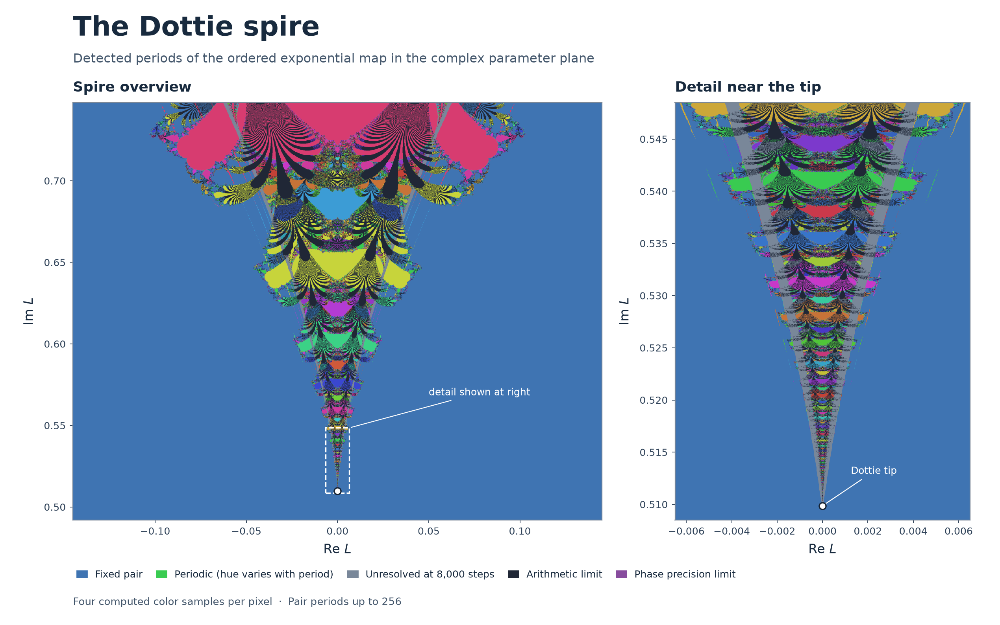

# The Super Zeta Function

NuckyDucky’s work began with six integers in his original math meme. Solving its quadratic gave a value for $\pi$ accurate to about $8.7\times10^{-20}$ and exposed a reciprocal expression that appears again in his exponential iteration. Studying the spire formed by periodic orbits led to the exact Dottie fold. The same equation that governs the fold gives the roots of the cosine determinant used to define the super zeta function.

[The original meme and the Dottie spire](#from-the-original-meme-to-the-dottie-spire) · [The local strengthening of the seven-eighths theorem](#a-local-strengthening-of-the-seven-eighths-theorem) · [Original papers and computations](archive/2026-11-18-lean-foundations-v001/README.md) · [Lean proofs and build instructions](lean/README.md)

At three height intervals selected from the spire, the zero counts give a local strengthening of OpenAI’s seven-eighths theorem for Riemann zeta. All eleven zeros in those intervals are simple and lie on the critical line.

## From the original meme to the Dottie spire

### NuckyDucky’s meme and the quadratic for π

NuckyDucky’s original meme and choice of coefficients give the approximation $T(\pi)\approx R(e)$, where

$$
T(x)=\frac{(1+x)(2+x)}{x^2+x-1},\qquad
R(e)=\frac{N}{D}=\frac{465e^2-183e-659}{155e^2+396e-936}.
$$

Solving $T(x)=R(e)$ by the quadratic formula gives $\widehat\pi=3.14159265358979323837582331055\ldots$. The plot measures both axes in units of $10^{-20}$. The horizontal gap is $\pi-\widehat\pi\approx8.682007272725\times10^{-20}$. [Lean proof of the error bound](lean/SuperZeta/MemePrecision.lean)

The substitution $p=2\widehat\pi+3$ puts the quadratic in the form

$$
p-p^{-1}=\frac{4N}{N-D}.
$$

The other root corresponds to $p\mapsto-p^{-1}$. This reciprocal expression reappears in the complex coordinate of the two exponential stages. [Quadratic and reciprocal substitution](lean/SuperZeta/Meme.lean)

### The spire and the Dottie number

Iterate $(P,Q)\mapsto(e^{LQ},e^{-LP})$ from $(1,1)$ for each complex parameter $L$. The figure shows the periods detected near the narrow region NuckyDucky calls the *Dottie spire*. The two-step return in the first coordinate is $g_L(z)=e^{L e^{-Lz}}$. Along the imaginary axis, Baker and Rippon’s fixed-point parametrization gives

$$
L=iY(u),\qquad Y(u)=u\sec u\,e^{-u\tan u},\qquad
\frac{Y'(u)}{Y(u)}=\frac{\cos^2u-u^2}{u\cos^2u}.
$$

The tip is the quadratic fold of this fixed-point curve. Its stationary point on $0<u<\pi/2$ is the Dottie number $d=\cos d$, giving $L_*=i e^{-\sin d}\approx0.509863605523013\,i$. The spire gives the Dottie value a geometric role: it locates where the two centerline fixed branches meet. [Baker and Rippon, eqs. (12)–(13)](https://doi.org/10.1080/17476938908814364) · [The Dottie Parabolic Fold and the Marked Spire, §2](archive/2026-11-18-lean-foundations-v001/papers/dottie-spire/main.pdf)

The 2540 × 1590 figure uses Layer 4 of the Reciprocal Tetration Lab for both the overview and the separately computed close-up. Each pixel uses four orbit samples. Colors record detected periods, while gray marks samples whose period remains unresolved at the iteration limit. [Full-resolution image](archive/2026-11-18-research-figures-v001/dottie-spire.png) · [Render settings and source](archive/2026-11-18-research-figures-v001/README.md) · [Certified period calculation](archive/2026-11-18-lean-foundations-v001/checks/dottie_slice.py)

### From the fold to the spectrum

For a fixed pair with multiplier one, the logarithmic phase $\alpha$ satisfies $\alpha^2e^{\alpha-\alpha^{-1}}=-1$. Use the reciprocal expression from the quadratic as the coordinate $2iu=\alpha-\alpha^{-1}$. Then $\alpha e^{iu}=\pm i$, which gives $u=\pm\cos u$. The cosine determinant in the derivative of $Y$ now describes the full set of such phases. Inversion and conjugation give four related phases, a *quartet*. The corresponding determinant roots are $u_n,-u_n,\bar u_n,-\bar u_n$, together with the real roots $\pm d$. [Cosine spectrum, equations (1)–(5)](archive/2026-11-16-super-zeta-v001/sources/foundation/cosine-spectrum.md)

In the squared variable $v=u^2$ the determinant is the entire power series

$$
E(v)=1-2v+\frac{v^2}{3}-\frac{2v^3}{45}+\cdots,\qquad E(u^2)=\cos^2u-u^2.
$$

Let $\lambda_j$ range over its zeros, with multiplicity. They define the Dirichlet series $\mathcal Z(s;1)=\sum_j\lambda_j^{-s}$. The bridge from the Taylor series to the spectral sum is the determinant’s product over its zeros. This is the step that connects the exponential iteration to the super zeta function. [Determinant, product and spectral sum](archive/2026-11-16-super-zeta-v001/sources/foundation/cosine-spectrum.md)

## A local strengthening of the seven-eighths theorem

Write $w=\beta+it$ for the Riemann variable. OpenAI’s *Quasi-Riemann Hypothesis*, Theorem 1.1, proves that the half-plane $\beta>7/8$ is zero-free. The Riemann zeta function has a pole at $w=1$. The functional equation and conjugation give the reflected bound, so every nontrivial zero satisfies $1/8\le\beta\le7/8$. **In the three intervals below, the certified counts reduce that entire range to $\beta=1/2$.** In particular they exclude zeros in $1/2<\beta\le7/8$ and in the reflected interval $1/8\le\beta<1/2$, including the endpoints $7/8$ and $1/8$. The strengthening concerns Riemann zeta at the listed heights. [OpenAI, Theorem 1.1](https://github.com/openai/math/blob/main/preprints/The-Quasi-Riemann-Hypothesis-September-30-2026/paper.pdf) · [Functional equation](https://dlmf.nist.gov/25.4)

| Interval in Riemann height $t$ | Simple zeros on $\beta=1/2$ | Off-critical-line zeros |
| --- | ---: | ---: |
| [$\lvert t-T_D\rvert<1/4$](archive/2026-11-17-dottie-local-strip-v001/README.md) | 2 | 0 |
| [$\lvert t-2T_D\rvert\le1/2$](archive/2026-11-18-superzeta-distance-v001/README.md) | 5 | 0 |
| [$\lvert t-3T_D\rvert\le1/2$](archive/2026-11-18-superzeta-distance-v001/README.md) | 4 | 0 |

The argument principle counts zeros with multiplicity from the change in argument around a rectangle. Interval arithmetic certifies the count and rules out zeros on the contour. Each disjoint interval where Hardy’s $Z$-function changes sign gives a distinct zero on the critical line. In each rectangle these sign changes account for the entire count, which proves that every zero is on the line and has multiplicity one.

- At $T_D$, the contour covers $1/16<\beta<15/16$. The entire interval $[1/8,7/8]$ allowed by the seven-eighths theorem and reflection lies inside this contour. [First-height proof and reproduction instructions](archive/2026-11-17-dottie-local-strip-v001/README.md)
- At $2T_D$ and $3T_D$, the computation covers the full closed rectangles $0\le\beta\le1$ and certifies their boundaries to be zero-free. A separate check compares counts from FLINT’s global zero-counting algorithm with the sign changes in the same intervals. [Full-width counts and independent check](archive/2026-11-18-superzeta-distance-v001/README.md)

## How the iteration gives the height

The experiment uses two reflected parameters $L_\pm=\pm x+iy$ with period $320$ under the two-step return, and their midpoint $L_0=iy$. It compares the products of the $320$ logarithmic derivatives at corresponding stages, where a stage $z\mapsto e^{\pm Lz}$ has logarithmic derivative $\pm L$. The modulus ratio is $(|L_\pm|/|L_0|)^{320}$. Taking its logarithm as the scale, the first positive phase change of $2\pi$ fixes the height

$$
T_D=\frac{2\pi}{160\log(1+(x/y)^2)}
=4{,}526{,}119{,}322{,}477.945393\ldots,
$$

with the exact decimal inputs $x=4.749479070945369\times10^{-8}$ and $y=0.509892982511772$. This rule fixed the height before the zeta calculation. In a comparison interval of the same width around the nearest multiple of $\pi$, the count was three, all on the critical line. [Height rule, comparison and certificates](archive/2026-11-17-dottie-grid-match-v001/README.md)

## The spectral zeta and the critical line

For $\Re s>1/2$ the spectral series converges absolutely. The reference determinant $\cos^2u$ has squared roots $\pi^2(n+1/2)^2$, each of multiplicity two. Its spectral series is therefore twice the sum over the positive odd integers, with the scale factor $(2/\pi)^{2s}$. This explains both the factor $2^{2s}-1$ and the argument $2s$ in the Riemann zeta term. The paper expresses the difference of the two spectral series as a Mellin integral $J$ that extends to an entire function. Subtracting it gives

$$
F(s)=\mathcal Z(s;1)-J(s;1)=2\pi^{-2s}(2^{2s}-1)\zeta(2s).
$$

For $w=2s$ in the open critical strip, the factor multiplying $\zeta(w)$ is nonzero, so the zeros and their multiplicities carry over under this change of variable. The critical line $\Re w=1/2$ becomes $\Re s=1/4$. The seven-eighths bound and reflection give $1/16\le\Re s\le7/16$ for the reconstructed nontrivial zeros, while the three certified intervals put those zeros on $\Re s=1/4$. Their height intervals in $s$ are half as large. [Spectral derivation, equations (21)–(22)](archive/2026-11-16-super-zeta-v001/sources/foundation/cosine-spectrum.md)

Lean proves the complete root list for the cosine determinant, including simplicity and the multiplicity after squaring. The Lean reconstruction uses genus-zero Hadamard factorization as an explicit hypothesis. The zero counts above are proved separately by interval arithmetic. [Quartet proof and factorization step](archive/2026-11-18-quartet-levels-v001/README.md)

## Further results

- **Distance to a zero.** In the rectangles at $2T_D$ and $3T_D$, subdivide the rectangle so that each subrectangle contains one simple zero $s_i$. The minimum-modulus principle gives $|F(s)|\ge\kappa |s-s_i|$, with uniform constants $\kappa=925/256$ and $2407/512$, respectively. A certified upper bound on $|F(s)|$ then gives an upper bound on the distance to that zero. [Bounds and finite Mellin sums](archive/2026-11-18-superzeta-distance-v001/README.md)
- **Motion under truncation.** In two tests, one Newton step predicted the direction in which a zero moved when a term was added to a truncated Mellin sum, with error below $0.001^\circ$. Both tests used known Riemann ordinates as initial guesses. [Newton calculation and interval enclosures](archive/2026-11-17-quartet-angle-v001/README.md)
- **Arithmetic.** The Lean library proves the number of factors of two in every positive-index rational coefficient of the logarithmic derivative and proves that four rational inputs suffice to give the original meme quartic a point over $\mathbb Q_p$ for every prime $p$. [Arithmetic proofs](archive/2026-11-18-binary-law-v001/README.md)

## The factorial correction

Let $R_n$ be the common modulus of the four parameters $L$ obtained from the $n$th quartet of characteristic phases, and set $B_n=4^{-n}\binom{2n}{n}$. The first Stirling correction gives the quarter power in

$$
\lim_{N\to\infty}N^{1/4}\prod_{n=1}^N\frac{R_n B_n^2}{2}
=\frac{e^{\sin(d)/2}}{G(3/2)^2}
=1.22500170731420\ldots,
$$

where $G$ is the Barnes $G$-function. [Derivation and bounds on the omitted terms](archive/2026-11-16-super-zeta-v001/research/binomial-normalization.md)

## Read and reproduce the work

- [Foundations](archive/2026-11-16-super-zeta-v001/README.md) collects the spectral zeta functions, the order of the exponential compositions, elliptic periods and Barnes normalization.
- [The ordered return](archive/2026-11-17-quartet-return-recursion-v001/README.md) derives the recursion from the two exponential stages and reconstructs a zero near height $32.935$.
- [Tests for off-critical-line zeros](archive/2026-11-17-offcenter-superzeta-v001/README.md) and [the computation at 32 selected heights](archive/2026-11-17-offcenter-screen32-v001/README.md) compare a reflected pair at the same height with two critical-line zeros at different heights.

The dated archives contain the proofs, exact inputs, numerical certificates and instructions for reproducing the calculations. From the repository root, check the archive inventory and SHA-256 hashes with Python 3.

~~~sh
python tools/verify_archive.py
~~~

Cite the relevant proof or certificate by its milestone tag or full commit hash. [Preservation and recovery instructions](PRESERVATION.md)
