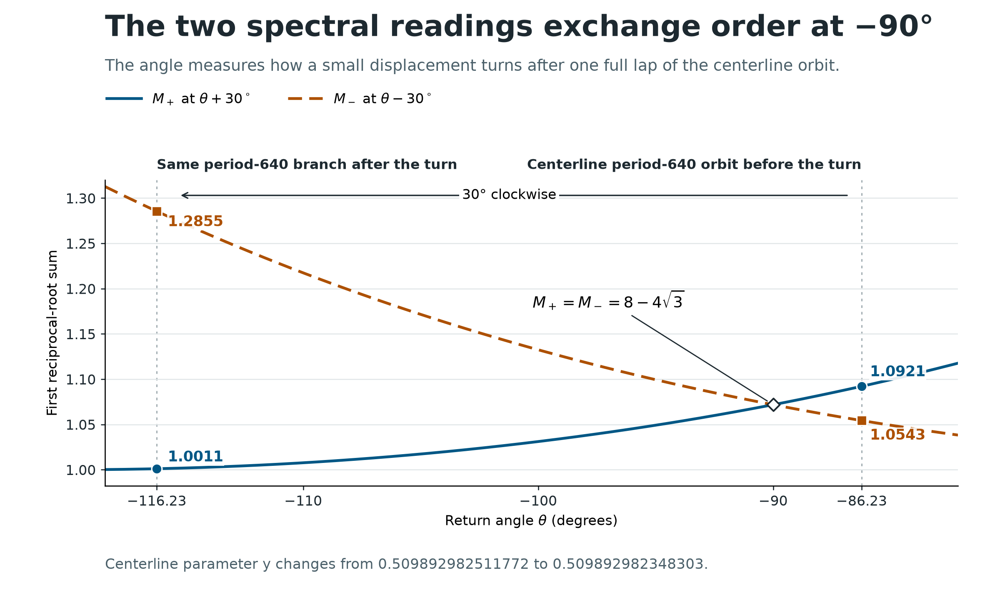
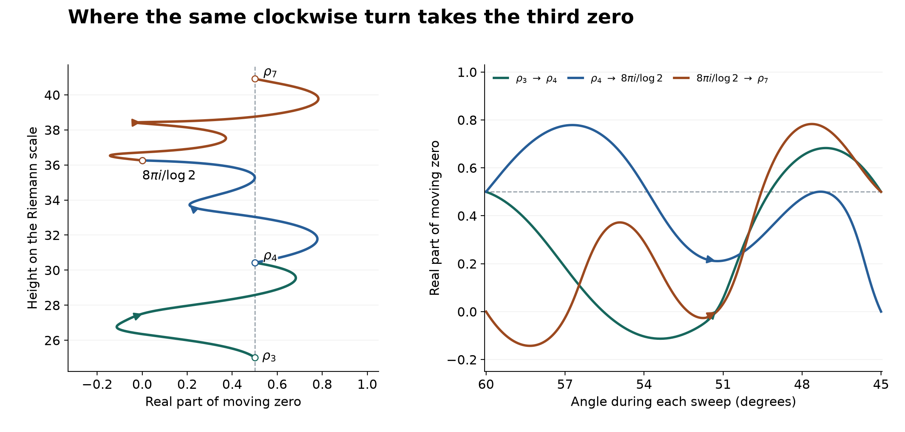
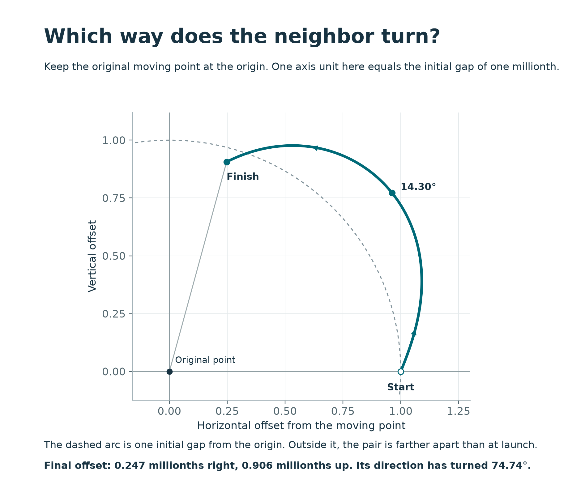
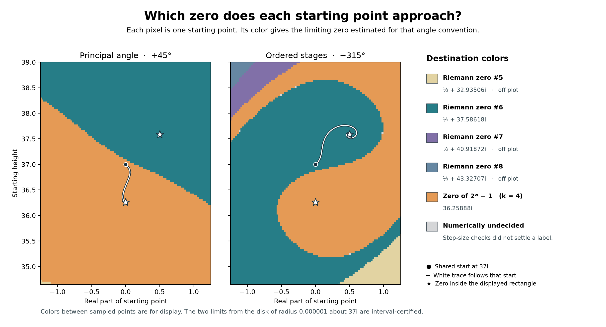

# The Super Zeta Function

<div><a name="abstract"></a><a name="introduction"></a></div>

I started with a quadratic approximation to π built from six integers and the number $e$. Its two roots led me to the reciprocal difference $z-1/z$. I met the same expression in the alternating tower with stages $P'=e^{LQ}$ and $Q'=e^{-LP}$. Keeping the order of those stages leads from the Dottie fold to a cosine equation. I call the sum of inverse powers of its squared roots the **super zeta function**. [Fixed pairs in my tetration preprint](archive/2026-11-18-lean-foundations-v001/papers/foundations/main.tex#L360-L402) · [The Dottie fold](archive/2026-11-18-lean-foundations-v001/papers/dottie-spire/main.tex#L145-L244)

**Principal results**

- In three intervals selected from a Dottie height, I strengthen the 7/8ths conclusion to the critical line. I account for all 2, 5 and 4 zeros there, respectively. [Intervals and counts](#user-content-read-zero-counts)
- I recover the exact Stirling remainder of each $n!$ from the factorial weight on my quartet radii. The actual radii give a Hurwitz sign change between levels 28 and 29. [Factorial correction](#user-content-read-factorial)
- I derive the determinant $`E(v)=\cos^2\!\sqrt v-v`$, realize its roots as a boundary spectrum, and recover $\zeta(2s)$ by comparison with the cosine spectrum. [Determinant and reconstruction](#user-content-read-super-zeta) · [Formal determinant](lean/SuperZeta/UnitSpectrum.lean)
- I isolate cap-selected cycles near the Dottie fold, including a paired orbit of period 205,440. For a period-640 centerline orbit, two ordered spectral measurements recover the parameter and its marked return. [Finite periods](#user-content-read-dottie-spire) · [Two-trace inverse](archive/2026-11-19-oriented-return-v001/README.md#the-two-trace-inverse)
- I prove that each finite sign order gives a distinct exponential map at every nonzero complex lift. Consecutive derivative measurements recover all 640 signed stages at the secondary centerline minimum. [Sign words and recovery](#user-content-read-sign-words)
- My quadratic gives a genus-one curve with two real ovals. Evaluating its upper branch at $x=e$ gives my approximation to $\pi$. [Quadratic and quartic](#user-content-read-quartic)

**Contents**

[1. Quadratic](#user-content-read-quartic) · [2. Reciprocal tetration](#user-content-read-tetration) · [3. Super zeta](#user-content-read-super-zeta) ([§3.6 Period-640 return](#user-content-read-period-640)) · [4. Local zero counts](#user-content-read-zero-counts) · [5. Factorial correction](#user-content-read-factorial)

[Consequences](#user-content-read-consequences) · [Preprints and reproduction](#user-content-read-preprints) · [Open questions](#user-content-read-questions) · [Credits](#user-content-read-credits)

<div><a name="from-the-original-meme-to-the-dottie-spire"></a><a name="the-quadratic-and-the-genus-one-curve"></a><a name="1-the-quadratic-and-the-genus-one-curve"></a></div>

<details open>
<summary><h2>1. The quadratic approximation to π and its genus-one quartic</h2></summary>

<div><a name="read-quartic" id="user-content-read-quartic"></a></div>

I began with a rational function of $e$ built from six integers. I put those integers in two quadratics and equated their ratio to $T(y)=(1+y)(2+y)/(y^2+y-1)$.

```math
\begin{aligned}
N(x)&=465x^2-183x-659,\\
D(x)&=155x^2+396x-936.
\end{aligned}
```

Clearing the denominators gave me a quadratic in $y$. Completing the square gave me a new ordinate $Y$ and the equation $Y^2=f(x)$. In these formulas $N$ and $D$ are evaluated at $x$. [Quartic derivation, §1](archive/2026-11-18-lean-foundations-v001/arithmetic/research/geometry.md#1-the-exact-quadratic-and-the-quartic) · [Completing the square in Lean](lean/SuperZeta/Meme.lean)

```math
\begin{aligned}
0&=(N-D)y^2+(N-3D)y-N-2D,\\
Y&=2(N-D)y+N-3D,\\
f(x)&=(N-D)^2+4N^2\\
    &=961000x^4-1039740x^3-1810543x^2+644010x+1813853.
\end{aligned}
```

<div><a name="what-the-right-panel-shows"></a><a name="real-ovals-and-projective-completion"></a></div>

<details>
<summary><h3>Real ovals and projective completion</h3></summary>

The coefficient difference is positive for real $x$ since $N-D=310(x-579/620)^2+8239/1240$. Consequently $f(x)>0$ and $Y=\pm\sqrt{f(x)}$ gives two disjoint graphs. In the left panel I plot $Y/[\sqrt{961000}(1+x^2)]$. On the right I use $2\arctan x$ as the angle, so the two ends of the real line meet at the same angle. [Plot coordinates and source](archive/2026-11-18-quartic-ovals-v001/README.md)


In the chart $t=1/x$, $V=Y/x^2$, the two points at $t=0$ satisfy $V^2=961000$. Both ends of the positive graph reach $V=310\sqrt{10}$, and both ends of the negative graph reach $V=-310\sqrt{10}$. The hollow dots mark those two points. Each graph closes into a circle through its own point at infinity. [Proof of the two real circles, §2](archive/2026-11-18-lean-foundations-v001/arithmetic/research/geometry.md#2-why-the-real-completion-is-exactly-two-circles) · [Radial drawing convention](archive/2026-11-18-quartic-ovals-v001/README.md)

Over $\mathbb C$ the degree-two projection to $x$ branches at the four simple roots of $f$. Riemann–Hurwitz gives $2g-2=2(-2)+4=0$, so the smooth completion has genus one and its complex points form a torus. I use the elliptic Jacobian to study rational points. [Complex genus, §3](archive/2026-11-18-lean-foundations-v001/arithmetic/research/geometry.md#3-why-the-complex-completion-is-a-torus) · [Explicit elliptic Jacobian, §5](archive/2026-11-18-lean-foundations-v001/arithmetic/research/geometry.md#5-an-explicit-elliptic-jacobian-and-its-complex-structure) · [Fisher, binary quartics, §2](https://people.maths.bris.ac.uk/~jb12407/ANTS-XV/papers/ANTS-XV_fisher.pdf)

The polynomial equation also gives the fibers where the quotient coordinates have poles. At $D=0$ the two roots satisfy $y^2+y-1=0$. At the complex points with $N-D=0$, the equation in homogeneous $y$ has the roots $y=-3/2$ and $y=\infty$. In the $t$-chart, the points with $x=\infty$ have $y=\pm\sqrt{5/2}$. [Quadratic coefficients and projective charts, §§1–2](archive/2026-11-18-lean-foundations-v001/arithmetic/research/geometry.md#1-the-exact-quadratic-and-the-quartic)

I call the input of the widest gap in the normalized plot Nucky’s constant, $x=0.057793510152240105777\ldots$. The stationary equation is $(1+x^2)f'(x)-4xf(x)=0$, and the narrowest gap is near $x=1.400168$. In the original $y$ coordinate the gap is $\sqrt{1+(2N/(N-D))^2}\ge 1$. Equality holds at both zeros of $N$, where the two roots are $-1$ and $-2$. [Stationary quartic and 384-bit enclosures](archive/2026-11-18-quartic-ovals-v001/README.md#where-the-branches-are-farthest-apart-and-closest-together) · [Exact gap in Lean](lean/SuperZeta/Meme.lean)

My quartic has points over $\mathbb R$ and every $\mathbb Q_p$, while its rational point set is empty. A rational point would give a Jacobian point whose first coordinate is a nonzero negative square. The computer-assisted 2-isogeny descent excludes the squareclass $[-1]$. This gives a counterexample to the Hasse principle. [Local points in Lean](lean/SuperZeta/HasseCover.lean) · [Map and descent, eqs. (4)–(6)](archive/2026-11-18-lean-foundations-v001/arithmetic/research/hasse-obstruction.md#proof)

</details>

<div><a name="the-point-giving-my-approximation-to-π"></a></div>

<details>
<summary><h3>The upper root giving my approximation to π</h3></summary>

I set $x=e$ and take the positive square root on the upper oval. The change of ordinate $Y=2(N-D)y+N-3D$ recovers the larger root of the original quadratic. [Inverse coordinate and the two branches, §2](archive/2026-11-18-lean-foundations-v001/arithmetic/research/geometry.md#2-why-the-real-completion-is-exactly-two-circles) · [Upper-root identity in Lean](lean/SuperZeta/Meme.lean)

```math
\widehat\pi=\frac{3D(e)-N(e)+\sqrt{f(e)}}{2\bigl(N(e)-D(e)\bigr)}
=3.14159265358979323837582331055\ldots
```

I centered the plot at $(\pi,T(\pi))$ and used units of $10^{-20}$ on both axes. The horizontal distance is $\pi-\widehat\pi\approx8.682007272725\times10^{-20}$. [Lean proof of the error bound](lean/SuperZeta/MemePrecision.lean)


I shift the ordinate to $p=2y+3$ to write the quadratic as $p-p^{-1}=4N/(N-D)$. The substitution $p\mapsto-1/p$ exchanges the two roots. On the exceptional fiber $N-D=0$, the same involution exchanges $p=0$ and $p=\infty$. [Reciprocal substitution in Lean](lean/SuperZeta/Meme.lean) · [Involutions of the quartic, §6](archive/2026-11-18-lean-foundations-v001/arithmetic/research/geometry.md#6-two-exact-involutions)

</details>

</details>

<div><a name="reciprocal-tetration"></a><a name="2-reciprocal-tetration"></a></div>

<details>
<summary><h2>2. Reciprocal tetration in the logarithmic lift</h2></summary>

<div><a name="read-tetration" id="user-content-read-tetration"></a></div>

I build the finite power tower from the top. Its cap is the starting value $T_0=1$, and $T_{n+1}=e^{LT_n}$. For $x=e^L$ this gives $T_1=x$ and $T_2=x^x$. I use $L=\log x$ on the positive real axis. In the complex family I choose $L$ itself and use $x^z=e^{Lz}$ at every stage. Lifts that differ by $2\pi i k$ have the same visible base and can give different towers. [*Reciprocal Tetration*, §2, “Finite Tet and the reciprocal pair”](archive/2026-11-18-lean-foundations-v001/papers/foundations/main.tex#L109-L146) · [PDF](archive/2026-11-18-lean-foundations-v001/papers/foundations/main.pdf)

The pair $x^{x-a},x^{x+a}$ gives two exponents centered at $x$. In the alternating tower each exponent comes from the opposite phase. I start both phases at the cap $(1,1)$ and apply

```math
F_L(P,Q)=\bigl(e^{LQ},e^{-LP}\bigr).
```

With $m=(Q-P)/2$ and $a=(Q+P)/2$ the next pair is $(x^{m+a},x^{m-a})$. I retain the ordered exponents $U=LQ$ and $V=-LP$. My preprints write $M$ for the second phase $Q$. [*Reciprocal Tetration*, §5, “Branch-sensitive complex fixed data”](archive/2026-11-18-lean-foundations-v001/papers/foundations/main.tex#L359-L402) · [Ordered return in Lean](lean/SuperZeta/Reciprocal.lean)

<div><a name="the-complex-two-base-family"></a></div>

<details>
<summary><h3>The complex two-base family</h3></summary>

One paired update applies an exponential stage in each coordinate. To follow a single value back to its original phase takes two successive updates, or two exponential stages along that value’s path. I call that composition the scalar return.

```math
F_L^2(P,Q)=\bigl(g_L(P),g_{-L}(Q)\bigr),
\qquad g_L(z)=\exp\!\bigl(L\exp(-Lz)\bigr).
```

If the second base is $x^c=e^{cL}$, the first scalar return is $g_{L,c}(z)=\exp(L\exp(cLz))$. The equal-base tower has $c=1$ and the reciprocal tower has $c=-1$. For $L,c\ne0$ choose logarithms $\kappa$ and $\ell$ with $e^\kappa=L$ and $e^\ell=c$. The affine coordinate $z\mapsto\kappa+cLz$ conjugates this return to $E_\kappa\circ E_{\kappa+\ell}$, with $E_b(z)=e^z+b$. At $L=0$ the scalar return is constant $1$, and at $c=0$ it is constant $e^L$. [*Reciprocal Tetration*, §4, “Two-step scalar reduction and marked values”](archive/2026-11-18-lean-foundations-v001/papers/foundations/main.tex#L242-L326) · [Baker and Rippon, Theorem 8.1](https://doi.org/10.1080/17476938908814364) · [Rempe and Schleicher, exponential parameter space](https://doi.org/10.1017/CBO9780511735233.014)

A primitive scalar period $r$ takes $2r$ exponential stages along one phase. An ordered periodic point solves $F_L^p(P,Q)=(P,Q)$, and its primitive paired period is the least positive $p$ for which both coordinates return. In the spire I follow the orbit approached from the cap. In each coordinate the even subsequence follows the corresponding scalar map from $1$. The odd updates in the first coordinate come from the other seed since $P_{2n}=g_L^n(1)$ and $P_{2n+1}=g_L^{n+1}(0)$. [*Reciprocal Tetration*, §4, marked values and symmetry](archive/2026-11-18-lean-foundations-v001/papers/foundations/main.tex#L298-L341)

</details>

<details>
<summary><h3>Chronological sign words and recovery of the signed stages</h3></summary>

<div><a name="read-sign-words" id="user-content-read-sign-words"></a></div>

I write signs in the order they act. With $E_+(z)=e^{Lz}$ and $E_-(z)=e^{-Lz}$, the word $-+$ means $E_+\circ E_-$. Following $P$ through two updates gives $-+$, while following $Q$ gives $+-$. At $L=\log 2$, those two words send the same starting value $1$ to $\sqrt2$ and $1/4$, respectively.

For **every fixed nonzero complex lift** $L$, two finite words give the same entire function exactly when every sign agrees in order. This also applies when one word is a cyclic rotation of the other. A rotation moves the marked starting phase on a periodic orbit. On the positive real axis the single value reached from $1$ determines the word: an endpoint above $1$ records a final plus, one below $1$ records a final minus, and $|\log x|/L$ recovers its predecessor. [My original definitions of rotation, reversal and complement](archive/2026-11-18-lean-foundations-v001/papers/foundations/main.tex#L404-L445) · [Proof and all six balanced four-stage outcomes at the spire](archive/2026-11-19-ordered-signs-v001/README.md#the-order-of-the-signed-exponentials)

The complex orbit has a second way to read its signs. Write $C_j$ for the derivative of the first $j$ stages at their common starting point and put $d_j=C_j/C_{j-1}$. On an alternating return the output of stage $j+1$ is $e^{-d_j}$ and its signed rate is $d_{j+1}e^{d_j}$. At the secondary period-640 minimum this calculation recovered every signed rate around the lap. [Derivation and measurements](archive/2026-11-19-ordered-signs-v001/README.md#recovering-one-alternating-stage-from-derivative-measurements) · [Lean proofs](lean/SuperZeta/SignWords.lean)

</details>

<details>
<summary><h3>Fixed pairs and their logarithms</h3></summary>

At a fixed pair $P=e^U$, $Q=e^V$, with $U=LQ$ and $V=-LP$. I keep these exponents as the logarithms of the phases, including their sheets and continuation sides. They satisfy $Ue^U+Ve^V=0$, and I can recover the lift by $L=Ue^{-V}=-Ve^{-U}$. At $L=0$ the fixed pair is $(1,1)$ and both exponents are zero. [*Reciprocal Tetration*, §5](archive/2026-11-18-lean-foundations-v001/papers/foundations/main.tex#L359-L402) · [Fixed-pair balance in Lean](lean/SuperZeta/Reciprocal.lean#L162-L197)

The difference $q=U-V$ gives one coordinate for the whole fixed-pair curve. The balance equation gives $V=-Ue^q$ and $q=U(1+e^q)$, so

```math
U=\frac{q}{1+e^q},\qquad
V=-\frac{qe^q}{1+e^q},\qquad
L=\frac{q}{e^U+e^V}.
```

If $1+e^q=0$, the equation $q=U(1+e^q)$ would give $q=0$ at an odd multiple of $\pi i$. Thus the chart covers all finite fixed pairs with $`q\in\mathbb C\setminus\{(2k+1)\pi i:k\in\mathbb Z\}`$. For real $q$ the lift is strictly increasing and ranges over $\mathbb R$. On that real slice the cap converges to the unique positive fixed pair for every $L$, by the Baker–Rippon criterion. [*Reciprocal Tetration*, §3, real chart and convergence](archive/2026-11-18-lean-foundations-v001/papers/foundations/main.tex#L147-L211) · [Global complex chart in q = 2iu](archive/2026-11-18-lean-foundations-v001/notes/monodromy.md#1-coordinates-and-constants)

</details>

<div><a name="the-dottie-spire"></a></div>

<details>
<summary><h3>The Dottie fold and the marked spire</h3></summary>

<div><a name="read-dottie-spire" id="user-content-read-dottie-spire"></a></div>

On the imaginary axis $L=iy$, the cap lies on the invariant set $Q=\bar P$. A paired step there is represented by the antiholomorphic map $H_y(z)=e^{iy\bar z}$, with $H_y^2=g_{iy}$. Baker and Rippon give the centerline boundary and the half-step. I write their centerline fixed curve in terms of $q=2iu$, $0<u<\pi/2$. [*Dottie Parabolic Fold*, §1, half-step and period conventions](archive/2026-11-18-lean-foundations-v001/papers/dottie-spire/main.tex#L100-L121) · [Baker and Rippon, eqs. (12)–(13)](https://doi.org/10.1080/17476938908814364)

```math
\begin{aligned}
L&=iY(u),&Y(u)&=u\sec u\,e^{-u\tan u},&Z(u)&=e^{u\tan u+iu},\\
g_{iY(u)}'(Z(u))&=(u\sec u)^2,\qquad&
\frac{Y'(u)}{Y(u)}&=\frac{\cos^2u-u^2}{u\cos^2u}.
\end{aligned}
```

At the maximum of $Y$ the derivative of the scalar return at its fixed point is one. The equation for that point is $d=\cos d$, where $d=0.7390851332\ldots$ is the Dottie number. The boundary is exactly $`L_{\ast}=ie^{-\sin d}\approx0.509863605523013\,i`$ and the fixed point is $Z_{\ast}=e^{\sin d+id}$. The quadratic term of $Y(d+h)-Y(d)$ is $-Y(d)(1+\sin d)h^2/d^2$, so the two fixed branches meet in a quadratic fold. I center and rescale the scalar return there to obtain the parabolic germ $f(z)=z+z^2+\cdots$. [*Dottie Parabolic Fold*, §2, exact fixed curve and fold](archive/2026-11-18-lean-foundations-v001/papers/dottie-spire/main.tex#L145-L243) · [§3, normalized germ and antiholomorphic square root](archive/2026-11-18-lean-foundations-v001/papers/dottie-spire/main.tex#L244-L304) · [Fold in Lean](lean/SuperZeta/Dottie.lean) · [Kaplan, *The Dottie Number*](https://doi.org/10.1080/0025570X.2007.11953455)

I call the narrow stack of period groups above the fold the **Dottie spire**. I drew it by starting from the same cap $(1,1)$ at each sampled lift. The Layer 4 survey checks paired periods up to 256. Gray marks samples that reached the numerical limit without an assigned period. [*Reciprocal Tetration*, §§6–8, “Periodic reciprocal sign words” through “Directed anchors”](archive/2026-11-18-lean-foundations-v001/papers/foundations/main.tex#L404-L547) · [Figure settings and orbit data](archive/2026-11-18-research-figures-v001/README.md)


I use the half-step in the normalized coordinates to obtain separate even and odd return equations. For an orbit of primitive paired period $p$ on the centerline, its period under $H_y^2$ is $p/\gcd(p,2)$. Thus paired periods 639, 640 and 641 have scalar periods 639, 320 and 641. In three finite parameter windows I certified that the cap enters a contracting disk and excluded every shorter period. [*Dottie Parabolic Fold*, §§5–6, cylinder and physical return equations](archive/2026-11-18-lean-foundations-v001/papers/dottie-spire/main.tex#L347-L489) · [§8, directed finite windows](archive/2026-11-18-lean-foundations-v001/papers/dottie-spire/main.tex#L554-L604) · [Window verifier](archive/2026-11-18-spectral-reproduction-v001/check_spire_windows.py) · [Rump, verified numerics](https://doi.org/10.1017/S096249291000005X)

At six lifts on the negative flank, the cap approaches a primitive scalar period-321 cycle in the first coordinate and a primitive period-320 cycle in the second. In the first coordinate the 320th scalar step makes a large excursion and the next lands near $1$. The return under $F_L^2$ takes $\operatorname{lcm}(321,320)=102720$ steps, so the orbit has primitive period **205,440** under $F_L$. Reflection $L\mapsto-\overline L$ gives the six corresponding lifts on the other flank and exchanges the coordinates after conjugation. [Proof, six inputs, and standalone verifier](archive/2026-11-18-dottie-mixed-cap-period-v001/README.md)

For the zeta experiment I use the two reflected lifts $L_\pm=\pm\eta+iy$ and their midpoint $L_0=iy$, with $\eta=4.749479070945369\times10^{-8}$ and $y=0.509892982511772$. At all three lifts I certify that under $F_L^2$ both coordinates approach scalar cycles of primitive period 320 from the cap, which gives primitive period 640 under $F_L$. These are the three marked orbits I use to select the height in §4. [Preprint §8, period-640 dynamics off the centerline](archive/2026-11-18-lean-foundations-v001/papers/dottie-spire/main.tex#L580-L604) · [Later three-point certificate, 384-bit arithmetic](archive/2026-11-18-lean-foundations-v001/checks/dottie_slice.py) · [Johansson, Arb ball arithmetic](https://arxiv.org/abs/1611.02831)

On the secondary centerline interval I can now follow the orbit from the cap through a second strict minimum of the return modulus, at $y\approx0.509893023733322309247$. Its 25 outside and 295 inside scalar phases retain the same gate order across the extension. The first minimum contracts by about $6.35\times10^{-17}$ per lap and the second by about $3.0154\times10^{-4}$. Both have primitive paired period 640. [Proof, detunings and independent interval check](archive/2026-11-19-ordered-signs-v001/README.md#two-minima-on-the-imaginary-centerline)

I can continue a marked period-640 cycle and its 25/295 itinerary across a finite centerline interval. The horn map passes between repelling and attracting Fatou coordinates at the fold. For the rail theorem I fix a nondegenerate local minimum of its multiplier. I assume that the relative Fatou normalization continues to that horn, that the cap itinerary and logarithmic branches persist, and that the minimum continues to a real detuning $\delta(E)=\delta_0+O(E)$ in the unfolding coordinate $E$. I also assume a solution $E_p=(2\pi/(p-\delta(E_p)))^2>0$ tending to zero for sufficiently large paired periods of the chosen parity. The heights $y_p$ on such a rail then obey

```math
y_p-y_{\ast}=\frac{C_{\ast}}{(p-\delta_0)^2}+\frac{A_4}{(p-\delta_0)^4}+O(p^{-5}),
\qquad y_{\ast}=e^{-\sin d},
```

where the coefficients $C_{\ast}$ and $A_4$ are explicit in $d$. My estimates of finite multiplier minima extend through paired period 4800. Carrying the entire cap approach and its logarithmic branches to a specific limiting horn in one common normalization is the remaining matching problem. [*Dottie Parabolic Fold*, §§9–10, rail law and finite data](archive/2026-11-18-lean-foundations-v001/papers/dottie-spire/main.tex#L605-L715) · [The finite orbit and the remaining horn matching](archive/2026-11-18-lean-foundations-v001/papers/dottie-spire/main.tex#L739-L750) · [Godin and Rousseau, antiholomorphic parabolic germs](https://doi.org/10.1017/etds.2021.98)

</details>

</details>

<div><a name="the-spectral-zeta-and-the-critical-line"></a><a name="building-the-super-zeta"></a><a name="3-building-the-super-zeta"></a></div>

<details>
<summary><h2>3. The super zeta and the marked return</h2></summary>

<div><a name="read-super-zeta" id="user-content-read-super-zeta"></a></div>

<details>
<summary><h3>3.1 The multiplier of the two-step return</h3></summary>

<div><a name="1-compose-the-two-marked-stages"></a><a name="31-compose-the-two-marked-stages"></a></div>

At a fixed pair I keep the actual exponents $U=LQ$ and $V=-LP$, so $P=e^U$ and $Q=e^V$. The stage from $P$ to $Q$ has derivative $-LQ$, and the stage from $Q$ to $P$ has derivative $LP$. The derivative of their composition is the **multiplier** of the return.

```math
g_L'(P)=(-LQ)(LP)=UV.
```

On the centerline curve this is $(u\sec u)^2$, and $Y'(u)/Y(u)=(1-UV)/u$. At the fold the multiplier is one, so a small displacement returns unchanged to first order. [*Reciprocal Tetration*, §5, fixed-pair identities](archive/2026-11-18-lean-foundations-v001/papers/foundations/main.pdf#page=7) · [*Dottie Parabolic Fold*, §2, eqs. (6)–(9)](archive/2026-11-18-lean-foundations-v001/papers/dottie-spire/main.pdf#page=3)

</details>

<details>
<summary><h3>3.2 Recovering the ordered fixed pair from a cosine root</h3></summary>

<div><a name="2-recover-the-marked-phases-from-the-cosine-roots"></a><a name="32-recover-the-marked-phases-from-the-cosine-roots"></a></div>

I eliminate $L$ from $U=Le^V$ and $V=-Le^U$ to get $Ue^U+Ve^V=0$. At multiplier one, set $U=\alpha$ and $V=\alpha^{-1}$. Then $\alpha^2e^{\alpha-\alpha^{-1}}=-1$. The reciprocal difference $2iu=\alpha-\alpha^{-1}$ gives $\alpha e^{iu}=\sigma i$ with $\sigma=\pm1$. Substitution gives $u=\sigma\cos u$.

The calculation also runs backward. From a signed root I recover the ordered exponents, the parameter, and the fixed pair $(e^U,e^V)$.

```math
U=\sigma\sin u+iu,\qquad V=\sigma\sin u-iu,\qquad L=\sigma i e^{-\sigma\sin u}.
```

[Cosine spectrum, §1, eqs. (1)–(5)](archive/2026-11-16-super-zeta-v001/sources/foundation/cosine-spectrum.md#1-exact-recovery-of-every-ordered-phase-and-parameter) · [Phase recovery in Lean](lean/SuperZeta/Quartet.lean)

</details>

<details>
<summary><h3>3.3 The squared cosine spectrum and its zeta function</h3></summary>

<div><a name="3-square-the-roots-and-sum-their-inverse-powers"></a><a name="33-square-the-roots-and-sum-their-inverse-powers"></a></div>

The real roots are $\pm d$. The other roots come in quartets $\lbrace u_n,-u_n,\bar u_n,-\bar u_n\rbrace$. Squaring merges each sign pair. In $v=u^2$ the determinant is entire, since the power series of $\cos^2\sqrt v$ uses only integer powers of $v$.

```math
E(v)=\cos^2\sqrt v-v=1-2v+\frac{v^2}{3}-\frac{2v^3}{45}+\cdots.
```

I define the super zeta by summing inverse powers of the squared roots. For each root $\lambda$ I use $\lambda^{-s}=\exp(-s\operatorname{Log}\lambda)$, with the principal logarithm cut along the negative real axis.

```math
\mathcal Z(s;1)=d^{-2s}+\sum_{n\ge1}\bigl[(u_n^2)^{-s}+(\bar u_n^2)^{-s}\bigr],
\qquad \Re s>\frac12.
```

The squared roots $\lambda_j$ grow quadratically with the quartet index, so $\sum_j|\lambda_j|^{-1}$ converges. The determinant has order $1/2$, which leaves only a constant in front of its genus-zero Hadamard product. The normalization $E(0)=1$ fixes the constant. Differentiating the product gives the integer inverse-power sums, or **traces**, in the series near zero.

```math
E(v)=\prod_j(1-v/\lambda_j),\qquad
-\frac{E'(v)}{E(v)}=\sum_{m\ge1}\mathcal Z(m;1)v^{m-1}.
```

The first two traces are $\mathcal Z(1;1)=2$ and $\mathcal Z(2;1)=10/3$. The first ties the Dottie root to every nonreal quartet in one exact sum. Lean proves the product over the complete squared-root family. [Product, traces and a tail bound, eqs. (16)–(19)](archive/2026-11-16-super-zeta-v001/sources/foundation/cosine-spectrum.md#4-canonical-product-and-exact-rational-trace-sums) · [Lean theorem](lean/SuperZeta/UnitSpectrum.lean)

</details>

<details>
<summary><h3>3.4 The midpoint boundary operator and its Fredholm determinant</h3></summary>

<div><a name="the-boundary-operator-behind-the-determinant"></a><a name="34-the-boundary-operator-behind-the-determinant"></a></div>

I realize the cosine spectrum on $L^2(-1,1)\oplus\mathbb C$. In the domain, $f$ and its weak derivative are square-integrable and the scalar coordinate is the midpoint value $c=f(0)$. For complex coupling $\varepsilon\ne0$ I define

```math
A_\varepsilon(f,c)=\left(-if',\frac{\varepsilon}{2}\bigl[f(-1)+f(1)\bigr]\right).
```

For eigenvalue $u$ the first coordinate gives $f(x)=c e^{iux}$, so the endpoint average in the second gives $u=\varepsilon\cos u$. The inverse $B_\varepsilon$ is Hilbert–Schmidt and its square is trace class. Its Fredholm determinant is the convergent determinant of $I-vB_\varepsilon^2$. At $\varepsilon=1$ it equals $E(v)$. [Operator, inverse and finite-matrix proof, eqs. (6)–(15)](archive/2026-11-16-super-zeta-v001/sources/foundation/cosine-spectrum.md#2-a-boundary-operator-with-compact-inverse-and-the-cosine-spectrum)

```math
\det(I-vB_\varepsilon^2)=\cos^2\sqrt v-v/\varepsilon^2.
```

The inverse sends scalar input $1$ to the constant function $1/\varepsilon$ in its first coordinate. Projecting onto normalized indicators of $N$ equal cells, with $N$ even, gives the scalar column

```math
(B_N)_{j,N+1}=\frac{\sqrt{2/N}}{\varepsilon}.
```

For $N=2$, $\varepsilon=2$ and $u=1$, the projected determinant $\det(I-uB_N)$ is $1/8$. [Projection and determinant, eqs. (8), (12) and (13)](archive/2026-11-16-super-zeta-v001/sources/foundation/cosine-spectrum.md#3-exact-fredholm-determinant-and-controlled-finite-matrices)

Hupkes’s midpoint condition gives the same characteristic equation in a continuous-history space. Put equal weights $i\varepsilon/2$ at the two endpoints and set $z=iu$ to get $i(u-\varepsilon\cos u)$. My starting point is the ordered reciprocal pair, which selects the unit-coupling spectrum and gives the Hilbert-space determinant used below. Varying $\varepsilon$ moves the roots. I can also add a shift $a$ to the squared roots, giving the series $\sum_j(\lambda_j+a)^{-s}$ with its own poles and residues. I welcome an earlier reference for this combination. [Hupkes, eqs. (2.10), (2.54) and Lemma 2.4.4](https://math.leidenuniv.nl/scripties/PhdHupkes.pdf) · [Shifted spectrum, domain and residues](archive/2026-11-16-super-zeta-v001/research/shifted-superzeta.md)

</details>

<details>
<summary><h3>3.5 The Mellin correction and the Riemann zeta factor</h3></summary>

<div><a name="4-compare-with-the-odd-integer-spectrum"></a><a name="35-compare-with-the-odd-integer-spectrum"></a></div>

I compare $E$ with the reference determinant $\cos^2\sqrt v$. Its zeros $[(n+\tfrac12)\pi]^2$, $n\ge0$, each count twice. Their inverse-power sum is the odd-integer part of $\zeta(2s)$ scaled by $2(2/\pi)^{2s}$. On the negative real ray, $E(-t)=\cosh^2\sqrt t+t>0$ for $t\ge0$, and its logarithm is real with $\log E(0)=0$. The root sum agrees with the determinant integral on $1/2<\Re s<1$.

Dividing by the reference leaves $1+t/\cosh^2\sqrt t$. Its logarithm gives the Mellin correction after an integration by parts.

```math
J(s;1)=\frac{s\sin(\pi s)}{\pi}
\int_0^\infty t^{-s-1}\log\left(1+\frac{t}{\cosh^2\sqrt t}\right)\,dt
\qquad (\Re s<1).
```

Subtracting Taylor terms at $t=0$ continues the integral. The factor $\sin(\pi s)$ cancels the poles from the subtracted terms, so $J$ is entire. This gives the meromorphic continuation of the super zeta and the corrected function

```math
F(s)=\mathcal Z(s;1)-J(s;1)=2\pi^{-2s}(2^{2s}-1)\zeta(2s).
```

With $w=2s$, the prefactor is nonzero in $0<\Re w<1$. There $\zeta(w)=\pi^w F(w/2)/[2(2^w-1)]$, with the same zero multiplicities. In particular $w=1/2+iT$ corresponds to $s=1/4+iT/2$. Lean identifies the root sum with the continuation on the Mellin strip and proves the multiplicity identity on the pulled-back critical strip. [Cosine spectrum, §5, eqs. (20)–(23)](archive/2026-11-16-super-zeta-v001/sources/foundation/cosine-spectrum.md#5-a-two-variable-zeta-for-the-inverse-cosine-coupling-family) · [Voros, zeta functions over zero sets](https://arxiv.org/abs/1403.4558) · [DLMF, Mellin transforms](https://dlmf.nist.gov/2.5) · [Lean determinant product and root sum](lean/SuperZeta/UnitSpectrum.lean)

</details>

<details>
<summary><h3>3.6 Recovering the period-640 return angle from two spectral traces</h3></summary>

<div><a name="read-period-640" id="user-content-read-period-640"></a></div>

<div><a name="oriented-period-640-return"></a><a name="36-inverting-two-spectral-traces-on-the-period-640-orbit"></a></div>

On the centerline $L=iy$, I iterate $G_y=g_{iy}^{320}$ from the cap $1$ to select the point $p_y$. The principal argument $\theta=\arg G_y'(p_y)$ gives the rotation of a tangent vector after all 640 alternating exponential stages. I use radians with counterclockwise positive. At $y_0=0.509892982511772$ the angle is about $-1.50505761241$. [Period convention and the cap-selected cycles](archive/2026-11-18-lean-foundations-v001/papers/dottie-spire/main.tex#L554-L604) · [Derivative of the full lap](lean/SuperZeta/Oriented/OrderedStages.lean)

I encode a probe angle $a$ by multiplying the two exponential outputs by $e^{ia}$ and $e^{-ia}$, respectively. The auxiliary multiplier-one equation for these marked stages is $u=\sigma\cos(u+a)$. With $q_{\sigma,a}(u)=u-\sigma\cos(u+a)$, the squared determinant at $\cos a\ne0$ is

```math
E_{\sigma,-a}(u^2)=\frac{q_{\sigma,a}(u)q_{\sigma,a}(-u)}{\cos^2 a}.
```

For the positive sign the sum of the reciprocal zeros converges absolutely and equals $M(a)=-E_{+,-a}'(0)=2/(1-\sin a)$. The unshifted determinants agree at angles reflected across $-\pi/2$ modulo $2\pi$, even with both signs retained. I measure the positive-sign spectrum at two labeled offsets to recover the unit direction $e^{i\theta}$.

```math
M_\pm=M(\theta\pm\pi/6),\qquad S_\pm=1-2/M_\pm,\qquad
\cos\theta=S_+-S_-,\qquad \sin\theta=\frac{S_++S_-}{\sqrt{3}}.
```

With both probes regular, $S_\pm=\sin(\theta\pm\pi/6)$. In $-2\pi/3<\theta<-\pi/3$, $M_+>M_-$ places $\theta$ above $-\pi/2$ and $M_+<M_-$ places it below. At $-\pi/2$ the two traces are both $8-4\sqrt3$. [Proof from the complete zero set](lean/SuperZeta/Oriented/SpectralInverse.lean) · [Reflection of the squared determinant](lean/SuperZeta/Oriented/PhaseSymmetry.lean)



I turned the measured angle clockwise by $\pi/6$, inverted the angle on the same centerline branch, and evaluated both traces afresh at the turned parameter. The table rounds the interval enclosures. [Interval record](archive/2026-11-19-oriented-return-v001/data/quarter_probe.json)

| Measurement | Return angle in radians | $M_+$ | $M_-$ |
| --- | ---: | ---: | ---: |
| Original orbit | −1.50505761241 | 1.092114930 | 1.054295998 |
| After the clockwise turn | −2.02865638801 | 1.001081173 | 1.285503688 |

Decoding the second pair and adding back $\pi/6$ recovered $y_0$ in an interval of width below $10^{-29}$. The cap marks the starting point, and the ordered map recovers $U=LQ$ and $V=-LP$ at every step. All 1,280 returned exponent enclosures overlap their original partners. In the interval $0.50989298230\le y\le0.50989298314$, 448-bit interval arithmetic proves cap attraction, primitive ordered period 640, and a positive angle derivative. Lean proves the spectral inverse and the round trip for regular readouts on a continuous branch with positive derivative and the target angle in range. It also checks the printed rational return bounds. [Full proof, arithmetic comparison with Liu, and replay](archive/2026-11-19-oriented-return-v001/README.md)

At the absolute angles $-\pi/6$ and $+\pi/6$, the reference spectra give the same function $\pi^{-w}(3^w-1)\zeta(w)$, where $w=2s$. The first dynamical trace minus the first reference trace is $0$ at $-\pi/6$ and $8/3$ at $+\pi/6$. Liu’s zero-free theorem applies to the common reference via its Riemann factor. The round trip above uses $\pi/6$ as a displacement from the measured centerline return angle. [Liu, Theorem 1.1](https://hexagonmath.org/pdf/2611.00421v1#page=2) · [Derivation and phase convention](archive/2026-11-19-oriented-return-v001/README.md#the-arithmetic-reference-at-the-two-absolute-angles)

</details>

<details>
<summary><h3>3.7 Continuing Hurwitz zeros from π/3 to π/4 and reusing their endpoints</h3></summary>

<div><a name="zero-transport"></a><a name="37-following-a-zero-from-one-turn-to-the-next"></a></div>

On the right flank I hold $\Re L=4.749479070945369\times10^{-8}$ fixed and vary $\Im L$ to continue the cap-marked period-640 orbit through return angles $\pi/3$ and $\pi/4$. The plus probe has singular determinant normalization at $\pi/3$. The inverse trace $1/M_+$ extends continuously with value zero there. I measure the clockwise angle traveled by $h=\pi/3-\theta$. From $h=0$ to $h=\pi/12$ the reference shift $b=1/6+h/\pi$ increases from $1/6$ to $1/4$. [Orbit calibration](archive/2026-11-19-zero-transport-v001/Dottie-Off-Axis-Return/NOTES.txt)

I follow zeros of $R(b,w)=\pi^{-w}H(w,b)$, where $w=2s$ and $H(w,b)=\zeta(w,b)+\zeta(w,1-b)$. The Hurwitz function $\zeta(w,b)$ continues the series $\sum_{n\ge0}(n+b)^{-w}$ from $\Re w>1$. [The arithmetic family and its antecedents](archive/2026-11-19-zero-transport-v001/README.md#relation-to-prior-work)

Grouping the reduced residue classes modulo four and six gives, for $w\ne1$,

```math
R(1/4,w)=\pi^{-w}2^w(2^w-1)\zeta(w),\qquad
R(1/6,w)=2^{-w}(3^w-1)R(1/4,w).
```

The first identity gives the possible endpoints, Riemann zeros and zeros of $2^w-1$. The second lets me reset to $b=1/6$ with the same exact zero as the next seed. I follow each simple zero through overlapping uniqueness disks and save the landing before identifying it by its elementary factor or a Riemann zero count. [Lean proof of the reset](archive/2026-11-19-zero-transport-v001/Dottie-Second-Zero/ReferenceReset.lean) · [Path and endpoint checks](archive/2026-11-19-zero-transport-v001/README.md#verification-and-replay)

Write $\rho_n$ for the positive-height Riemann zero of index $n$ in increasing height order. The first seed came from tracing $\rho_1$ backward. I called the second, third and fourth zeros before the respective forward tests. The first failed call was for $\rho_5$. Each arrow is one sweep.

```math
\rho_1 \longrightarrow \frac{4\pi i}{\log 2} \longrightarrow \rho_2
\longrightarrow \rho_3 \longrightarrow \rho_4
\longrightarrow \frac{8\pi i}{\log 2} \longrightarrow \rho_7.
```

The fourth-zero call hit directly. The next two sweeps skipped the fifth and sixth as endpoints and as interior points of the route. [Predictions, comparison seeds and stopping rule](archive/2026-11-19-zero-transport-v001/README.md#how-the-cases-were-selected)



<details>
<summary><h4>Three crossings of the critical line on the path from the fourth zero</h4></summary>

The blue arc leaving $\rho_4$ crosses the critical line three times after departure, twice in the narrow upper loop. The table gives clockwise distances $h$, so the signed angle change is $-h$. The interior angles are rounded.

| Clockwise angle $h$ | Event | Height | Ordinary zeta magnitude |
| --- | --- | ---: | ---: |
| $0$ | Start at the fourth zero | 30.424876 | 0 |
| $0.034097675\pi$ | Cross to the left | 33.035367 | 0.142187 |
| $0.070080843\pi$ | Cross to the right | 35.225270 | 2.920990 |
| $0.071086383\pi$ | Cross back to the left | 35.325132 | 2.938889 |
| $\pi/12$ | Reach the elementary zero | 36.258881 | 4.055336 |

[Native angles, turns and exact elementary addresses](archive/2026-11-19-zero-transport-v001/Dottie-Transport-Reversibility/rotations.md) · [Directed crossing enclosures](archive/2026-11-19-zero-transport-v001/Dottie-Transport-Reversibility/blue-crossings.json) · [Download the interactive route explorer](https://github.com/NuckyDucky/The-Super-Zeta-Function/raw/refs/heads/main/archive/2026-11-19-zero-transport-v001/order-of-the-turns.html)

</details>

McPhedran, Botten and Nicorovici plotted the same Hurwitz family in 2007. Their parameter is $a=1-b$, so my clockwise sweep reads their figures from $a=5/6$ to $a=3/4$. Figures 2b, 3a, 3b and 4 give the four individual arcs from $4\pi i/\log 3$ through the first Riemann zero, the base-two address, the second zero and the third. I matched the figures by following their labeled zeros from $a=1/2$ to both anchors. Reusing the endpoints joins arcs of distinct trajectories. [Original paper, §3 and Figures 2–4](https://doi.org/10.1098/rspa.2006.1763) · [Five figure identifications and their checks](archive/2026-11-19-zero-transport-v001/Dottie-Transport-Reversibility/PRIOR-WORK.md)

After the forward trial I traced $\rho_5$ and $\rho_6$ backward and replayed both paths forward. Their seeds are $10\pi i/\log 3$ and $12\pi i/\log 3$, respectively. Both come from $3^w-1$ at $b=1/6$. An imaginary-axis endpoint at $b=1/4$ satisfies $2^w=1$, and there is no shared nonzero address between these two lattices, since no positive powers of two and three agree. Each reverse path is simple and regular throughout the sweep, so it fixes the sole predecessor under regular continuation. A direct turn can reach either zero from its base-three seed. The chain of reused endpoints skips them because it cannot supply those seeds. [Inverse calculation, proof and replay](archive/2026-11-19-zero-transport-v001/Dottie-Transport-Reversibility/README.md) · [Question log](#user-content-read-questions)

</details>

<details>
<summary><h3>3.8 Three crossings of height 37.25 on the sixth Hurwitz path</h3></summary>

<div><a name="38-why-the-sixth-path-folds-back"></a></div>

On the path from $12\pi i/\log 3$ to the sixth Riemann zero I reach height $37.25$ three times. The zero first climbs through it to the left of the imaginary axis, descends through it farther left, then climbs through it to the right of the axis. At the crest the tangent points due left. At the trough it points due right. The tangent turns counterclockwise by exactly $\pi$ while my input advances clockwise by about $0.04283506$ radians.

On the simple branch $H(w,b)=0$, the velocity is $dw/dh=-H_b/(\pi H_w)$ when $h$ is in radians. The graph aligns all three crossings and gives velocities and accelerations per clockwise degree. For per-radian values, multiply them by $180/\pi$ and $(180/\pi)^2$, respectively.

[](https://nuckyducky.github.io/The-Super-Zeta-Function/)

The square marks a point near $-0.14560046+37.21759523i$ that the path visits at two distinct input angles. The acute angle between its tangent lines is about $0.713809$ radians. The shift distinguishes the two visits even though their complex positions agree. [Open the interactive graph](https://nuckyducky.github.io/The-Super-Zeta-Function/) · [Derivative formulas, interval proofs and replay](archive/2026-11-19-sixth-passes-v001/README.md)

</details>

<details>
<summary><h3>3.9 Distinguishing the two visits with one Hurwitz summand</h3></summary>

<div><a name="39-what-one-hurwitz-term-remembers-about-the-orbit"></a></div>

At the sixth path’s self-intersection I hid the angle, both traces and the zero position. I kept only the first complex Hurwitz summand $A=\zeta(w,b)$. One reading recovered the visit heading up and left at $2.482077$ radians counterclockwise from the positive real axis. The other recovered the visit heading almost due right at $0.054293$ radians. The recovered shifts located both marked period-640 orbits on the calibrated right flank. [Blind inputs, decoded directions and orbit enclosures](archive/2026-11-19-single-term-inverse-v001/README.md#the-experiment)

Elsewhere on the same sweep, the first summand takes the same value at two distinct positions. The corresponding orbit multiplier moduli are $0.19009231$ and $0.18425549$, giving different contraction rates. I checked the entire $\pi/12$ sweep and found exactly one such pair. Its two zero positions differ, so $(w,A)$ identifies every visit on this sweep. [Graph of the two crossings and proof](archive/2026-11-19-single-term-inverse-v001/README.md#where-the-single-reading-agrees-twice)

</details>

<details>
<summary><h3>3.10 Transport near the sixth landing and the two logarithms of a lap</h3></summary>

<div><a name="310-what-a-full-turn-changes-near-the-sixth-zero"></a></div>

I followed the sixth zero and 16 neighboring starting positions from its last height minimum to the landing at $\theta=\pi/4$. Each starting point retains its own value of $H(w,b)$ as $b$ changes. The arrows give the direction of travel and the axes use the same scale.


For a closer comparison I placed a point $10^{-6}$ to the right of the zero at the trough. In units of $10^{-6}$, the displacement vector starts at $(1,0)$ and ends at $(0.247209,0.905975)$, with direction $1.304416$ radians. Its length reaches a unique maximum of $1.233768546$ at $h\approx0.249559635032$, returns to $1$ at $h\approx0.259687877153$, and ends at $0.939096964$. [Proof for this pair](archive/2026-11-19-dottie-plane-atlas-v001/atlas/neighbor_proof.txt) · [Interval bounds](archive/2026-11-19-dottie-plane-atlas-v001/atlas/neighbor_proof.json) · [Distance plotted against the turn angle](archive/2026-11-19-dottie-plane-atlas-v001/atlas/two_paths.png)



<details>
<summary><h4>Length changes and folds in the plane map</h4></summary>

An infinitesimal line segment at the trough on the zero path shrinks to $0.93910$ times its length. A segment starting at $0.075+36.75i$ shrinks to $0.28613$ times its length, while one starting at $-0.525+37.3125i$ expands by a factor of $8.0752$. Those two nonzero-level paths have directed interval bounds. The colored grid gives estimates of the length change. Use **Download raw file** on the interactive map and open it in a browser to inspect any of the 10,961 starting points and its paired endpoint. [Plane map and derivative](archive/2026-11-19-dottie-plane-atlas-v001/atlas/plane_notes.md) · [Two certified paths](archive/2026-11-19-dottie-plane-atlas-v001/atlas/plane_anchors.json) · [Interactive complex-plane map](archive/2026-11-19-dottie-plane-atlas-v001/atlas/complex_explorer.html)

I extended the grid to $-2\le\Re w\le2$ and $34\le\Im w\le40$. Of these starting points, 38,649 passed the two-resolution comparison and 152 were flagged. Off-white means the length factor is near one. Crosses mark disagreement between resolutions or a level residual above tolerance. In the closeup, all 37 flagged centers reached regular endpoints under interval continuation. Two adjacent inputs at height $36.7875$ start $0.0125$ apart and end $1.72036$ apart, even though infinitesimal lengths shrink to less than half at both inputs. [The wider sample](archive/2026-11-19-dottie-plane-atlas-v001/atlas/plane_wide.json) · [All 37 verified centers and the two-point comparison](archive/2026-11-19-dottie-plane-atlas-v001/atlas/staircase.json)

Inside each of those 37 cells I found a point whose two solutions coalesce at a square-root fold. All 37 paths approach the same continued critical branch with the same sign of the local square root. [Moving critical branch and the 37 collisions](archive/2026-11-19-dottie-plane-atlas-v001/atlas/gray_collision.json)

[Wider field](archive/2026-11-19-dottie-plane-atlas-v001/atlas/plane_wide.png) · [Closeup](archive/2026-11-19-dottie-plane-atlas-v001/atlas/plane_strain.png) · [Complete starting and final grids](archive/2026-11-19-dottie-plane-atlas-v001/atlas/plane_grid.png)

</details>

<details>
<summary><h4>Two destinations at fixed Hurwitz shift</h4></summary>

I fix $b=1/4$ and work with $f(w)=H(w,1/4)=2^w(2^w-1)\zeta(w)$. On the continued right-flank orbit at this angle, $\mu$ is the multiplier of all 640 exponential stages and $|\mu|\approx0.18397133$. The principal logarithm of $\mu$ has imaginary part $+\pi/4$. For the ordered logarithm I keep the actual argument of every stage. Stage $j$ sends $z_j$ to $e^{a_j z_j}$, with $a_j=-L,L,-L,L,\ldots$. The logarithms of its derivatives sum to

```math
\ell_{\mathrm{ord}}=\sum_{j=0}^{639}\bigl(\operatorname{Log} a_j+a_jz_j\bigr),
\qquad e^{\ell_{\mathrm{ord}}}=\mu,\qquad
\Im\ell_{\mathrm{ord}}=-7\pi/4.
```

The imaginary parts differ by one revolution. I use either logarithm $\ell$ to prescribe a continuous path for the **value** of $f$, then follow the inverse of $f$ starting at $w_0$. At an integer lap $m$ both value paths give $\mu^m f(w_0)$. Between laps they wind differently. [448-bit stage sum and direct multiplier product](archive/2026-11-19-dottie-plane-atlas-v001/atlas/phase_lift.json)

```math
f(w(t))=e^{t\ell}f(w_0),\qquad w(0)=w_0,\qquad
\frac{dw}{dt}=\ell\,\frac{f(w)}{f'(w)}\quad(f'(w)\ne0).
```

For every $|w_0-37i|\le10^{-6}$, continuing with the principal logarithm converges to the elementary zero $8\pi i/\log 2$. The ordered logarithm leads to $\rho_6$. The two inverse branches meet at a simple critical point of $f$ near $0.235950387+36.945179676i$. The loop formed by the first lap of the two value paths at $w_0=37i$ winds once around its critical value. [Derivation and proof](archive/2026-11-19-dottie-plane-atlas-v001/atlas/THESIS.md) · [Whole-disk convergence](archive/2026-11-19-dottie-plane-atlas-v001/atlas/basin_certificate.json) · [The two branches](archive/2026-11-19-dottie-plane-atlas-v001/atlas/critical_branches.json)



</details>

<details>
<summary><h4>Predicting endpoints from position, velocity and acceleration</h4></summary>

On ten previously located branches I hid the endpoints and extrapolated from the position, velocity and acceleration. From the sixth path’s last trough, one quadratic step captured $`27.23\%`$ of the remaining rise. Updating 64 times reduced the complex distance error from $0.274054$ to $0.000076581$. I then publicly fixed the next two base-three seeds, the cutoff and the scoring rule before evaluating them. With $\pi/1440$ radians left, the quadratic forecast had complex error $0.00001901$ for seed 7, which reached the fifth base-two address, and $0.00030671$ for seed 8, which reached Riemann zero 11. Both met the preset $0.001$ threshold and endpoint-family rule. [Retrospective ten-branch trial](archive/2026-11-19-dottie-plane-atlas-v001/landing/README.md) · [Pre-evaluation protocol](https://github.com/NuckyDucky/The-Super-Zeta-Function/blob/a739bf30c0db09774d4fd3681596a1821f31d081/protocols/2026-11-19-dottie-plane-holdout.json) · [Two-seed results](archive/2026-11-19-dottie-plane-atlas-v001/holdout/README.md)

</details>

</details>

</details>

<div><a name="a-local-strengthening-of-the-seven-eighths-theorem"></a><a name="local-zeta-result"></a><a name="a-local-strengthening-of-the-78ths-theorem"></a><a name="4-a-local-strengthening-of-the-78ths-theorem"></a></div>

<details>
<summary><h2>4. A local strengthening of the 7/8ths theorem</h2></summary>

<div><a name="read-zero-counts" id="user-content-read-zero-counts"></a></div>

<div><a name="how-the-iteration-gives-the-height"></a><a name="selection-of-the-test-height"></a></div>

<details>
<summary><h3>How the marked period-640 lap sets the test height</h3></summary>

I used the marked return to choose a Riemann height where I could look for a sideways pair of zeros, with the same height and real parts reflected across the critical line. I took the two spire flanks $L_\pm=\pm\eta+iy$ and their midpoint $L_0=iy$, with $\eta=4.749479070945369\times10^{-8}$ and $y=0.509892982511772$ fixed as exact decimals. From the cap $(1,1)$ each parameter gives an attracting cycle of primitive period 320 under the two-step scalar return. One lap thus has 640 exponential stages, 320 of each sign. [Height rule and frozen inputs](archive/2026-11-17-dottie-grid-match-v001/README.md#nomination-before-forecasting)

For a stage $E(z)=e^{\pm Lz}$, the derivative in the logarithmic output coordinate is $E'(z)/E(z)=\pm L$. I multiply these coefficients for the 320 occurrences of one sign in the lap. Comparing a flank with the midpoint gives the modulus ratio $(|L_\pm|/|L_0|)^{320}$, whose logarithm is $\delta_{\mathrm{clock}}=160\log(1+(\eta/y)^2)$. A separate check of the ordinary full-return tangent gave winding of magnitude one at each flank. Before evaluating zeta I used $e^{it\delta_{\mathrm{clock}}}$ as the phase at Riemann height $t$ and took its first positive full turn, $T_D\delta_{\mathrm{clock}}=2\pi$.

```math
T_D=\frac{2\pi}{160\log(1+(\eta/y)^2)}
=4{,}526{,}119{,}322{,}477.945393\ldots .
```

I compared the first window with one of the same width centered at the nearest multiple of $\pi$. That control contained three zeros, all on the critical line. [Winding and matched comparison](archive/2026-11-17-dottie-grid-match-v001/README.md#forecast-and-directed-counts)

</details>

<div><a name="what-the-three-windows-tell-me"></a><a name="certified-counts-in-the-three-windows"></a></div>

<details>
<summary><h3>Eleven simple critical-line zeros in the three height windows</h3></summary>

Write $w=\beta+it$ for the Riemann argument. **In these three windows I strengthen the 7/8ths conclusion to $\beta=1/2$ for every zero.** OpenAI's Theorem 1.1 excludes zeros for $\beta>7/8$. Reflection across $\beta=1/2$ then puts all nontrivial zeros in the closed strip $1/8\le\beta\le7/8$. At $T_D$ I counted in $1/16<\beta<15/16$, which contains both boundary lines of that strip. At $2T_D$ and $3T_D$ I counted directly across $0\le\beta\le1$. [OpenAI, Theorem 1.1](https://github.com/openai/math/blob/main/preprints/The-Quasi-Riemann-Hypothesis-September-30-2026/paper.pdf) · [Riemann reflection](https://dlmf.nist.gov/25.4) · [First full-strip corollary](archive/2026-11-17-dottie-local-strip-v001/README.md#full-strip-corollary)

| Interval in Riemann height $t$ | Simple zeros on $\beta=\tfrac12$ | Off-critical-line zeros | Certificate |
| --- | ---: | ---: | --- |
| $\lvert t-T_D\rvert\lt\tfrac14$ | 2 | 0 | [First height](archive/2026-11-17-dottie-local-strip-v001/README.md) |
| $\lvert t-2T_D\rvert\le\tfrac12$ | 5 | 0 | [Second height](archive/2026-11-18-superzeta-distance-v001/README.md) |
| $\lvert t-3T_D\rvert\le\tfrac12$ | 4 | 0 | [Third height](archive/2026-11-18-superzeta-distance-v001/README.md) |

I enclose the image of each contour segment by interval arithmetic, so the winding counts every zero inside with its multiplicity. The first-height verifier counts boxes with height offsets in $[-1/4,1/4]$ using two charts that meet at $t=T_D$. The two contours give one zero each and certify that shared edge as zero-free. At $2T_D$ and $3T_D$ I use four separate quarter-height charts per window. Their counts from bottom to top are $(0,2,1,2)$ and $(2,0,2,0)$, with both outer height endpoints and every shared edge certified zero-free. In each window I also enclose opposite signs of the real Hardy function $Z(t)$ on disjoint intervals on the critical line. Each bracket gives a distinct zero. The number of brackets equals the complete contour count, which proves that each zero is simple and excludes an off-line pair anywhere in the three windows. A second check uses FLINT's global zero counter at guarded endpoints and direct Hardy signs at the higher two heights. [First interval certificate](archive/2026-11-17-dottie-local-strip-v001/README.md#full-strip-corollary) · [Higher interval counts and independent check](archive/2026-11-18-superzeta-distance-v001/README.md#how-the-computations-certify-the-statements) · [FLINT's zero-counting methods](https://flintlib.org/doc/algorithms/special-functions/zeta-zeros.html)

In the super zeta coordinate $w=2s$, I count the same zeros through $F(s)=\mathcal Z(s;1)-J(s;1)=2\pi^{-2s}(2^{2s}-1)\zeta(2s)$. The factor multiplying $\zeta(2s)$ is nonzero for $0<\Re(2s)<1$, so multiplicities agree there. My three windows put the zeros of $F$ on $\Re s=1/4$, with $|\Im s-T_D/2|\lt1/8$ for the first and $|\Im s-kT_D/2|\le1/4$ for $k=2,3$. The higher two certificates also check the elementary factor on the closed left edge $\Re s=0$. [Spectral reconstruction, eqs. (21)–(22)](archive/2026-11-16-super-zeta-v001/sources/foundation/cosine-spectrum.md#5-a-two-variable-zeta-for-the-inverse-cosine-coupling-family) · [Full result and evidence](archive/2026-11-18-superzeta-distance-v001/README.md)

</details>

<details>
<summary><h3>Zero proximity in the grid pilot and the 32-input test</h3></summary>

I also tested whether the marked return picks heights closer to a zero than nearby controls. An earlier two-height pilot split one win each against disjoint grid windows. For the preregistered test I fixed 32 transverse inputs and two controls at each, four local mean zero spacings below and above the orbit-selected height. The orbit-selected heights won 20 comparisons and the controls won 16. At 14 inputs the orbit check left both comparisons unresolved. That leaves 28 of the 64 votes open and the predicted overall majority undecided. [Earlier pilot](archive/2026-11-18-clock-proximity-results-v001/pilot/README.md) · [Frozen selection rule](archive/2026-11-18-clock-local-controls-protocol-v001/README.md) · [Every input, comparison and unresolved case](archive/2026-11-18-clock-proximity-results-v001/README.md)

</details>

</details>

<div><a name="the-factorial-correction"></a><a name="5-the-factorial-correction"></a></div>

<details>
<summary><h2>5. The factorial correction</h2></summary>

<div><a name="read-factorial" id="user-content-read-factorial"></a></div>

<div><a name="what-the-quarter-measures"></a></div>

<details>
<summary><h3>A quarter-step displacement in the normalized levels</h3></summary>

At nonunit multiplier-one quartet level $n$, the four recovered logarithmic parameters $L$ have a common modulus $R_n$. I number the quartets from $n=1$ in order of their positive characteristic levels. Their radii grow as $R_n\sim2\pi n$. I weight each radius by a count of balanced sign histories. Of the $4^n$ ordered words of length $2n$ in the signs $+$ and $-$, exactly $\binom{2n}{n}$ contain $n$ of each sign. Their fraction is $B_n=4^{-n}\binom{2n}{n}$. I take two independent words and require both to balance, giving the factor $B_n^2$. Since $B_n^2\sim1/(\pi n)$, the weighted radius tends to $2$. I divide by $2$ to get a factor that tends to $1$. [Quartet radii and balanced sign counts](archive/2026-11-16-super-zeta-v001/research/binomial-normalization.md)

```math
C_n=\frac{R_n B_n^2}{2}=\frac{R_n}{2\pi n}\,D_n,
\qquad D_n=\pi n B_n^2.
```

The count also occurs in the Dottie map. I select four inverse branches of the two-stage return at the Dottie fold and assign them the four unit directions on a square lattice. A pair of signs gives one direction at each step. A walk of $2n$ steps returns to the origin exactly when both sign histories balance. Thus among the marked points fixed by $2n$ scalar returns on those four branches, the fraction with zero total displacement is $B_n^2$. This word uses $4n$ individual exponential stages. I chose the four branches, their directions, their equal weights and the pairing of word length $2n$ with quartet level $n$. The tower from the cap follows its prescribed alternating stages. [Four branches and the exact count, eqs. (5) and (15)–(17)](archive/2026-11-16-super-zeta-v001/research/balanced-charge-operators.md)

The leading Stirling factors in $(2n)!/(n!)^2$ cancel against the leading radial growth in $C_n$. To retain the factorial error, I write $S_n=\sqrt{2\pi n}(n/e)^n$ for Stirling's leading approximation and $\rho_n=\log(n!/S_n)$ for its logarithmic remainder. Substitution in $D_n$ leaves an exact combination of these remainders.

```math
\begin{aligned}
I(x)&=\int_0^\infty e^{-xt}\frac{\tanh(t/4)}{t}\,dt,\qquad x>0,\\
\log D_n&=2\rho_{2n}-4\rho_n=-I(n),\\
\log C_n&=\log\frac{R_n}{2\pi n}-I(n).
\end{aligned}
```

For real $x>0$, $-I(x)$ is the logarithm of $x\Gamma(x+1/2)^2/\Gamma(x+1)^2$. The half-integer cosine spectrum used in the reconstruction of $\zeta(2s)$ also gives the partial fractions of $\tanh(t/4)/t$. A finite expansion of those fractions bounds the remainder by the first omitted term. Keeping the leading term gives

```math
0\le\log D_n+\frac{1}{4n}\le\frac{1}{96n^3},\qquad n\ge1.
```

At level 10 the estimate for $\log D_{10}$ is $-0.025$, with an error of at most $0.00001042$. I measure the displacement of the effective level $\Lambda_n=nC_n$ from its integer label by $\delta_n=n-\Lambda_n$. My quartet equations give $R_n-2\pi n\to0$, so the radial factor contributes at smaller order than $1/n$. The factorial term leaves a displacement of a quarter of the unit spacing in the limit. [Exact correction and all-order bound](archive/2026-11-18-stirling-correction-v001/README.md#the-exact-correction) · [Radial scale and quarter limit in Lean](lean/SuperZeta/QuartetRadius.lean) · [DLMF, Stirling's series](https://dlmf.nist.gov/5.11)

```math
\Lambda_n=n-\frac14+o(1),\qquad \delta_n\longrightarrow\frac14 .
```

</details>

<details>
<summary><h3>The Hurwitz value changes sign between levels 28 and 29</h3></summary>

What changes if I keep the balanced histories and replace the actual radii with the grid $2\pi n$? Both sequences give the same limiting quarter. I compare their finite displacements using the Hurwitz zeta at order $-1$. A unit-spaced list shifted by $\delta$ starts at $1-\delta$, so I evaluate its Hurwitz value at that argument.

```math
H(\delta)=\zeta(-1,1-\delta)=-\frac1{12}+\frac{\delta}{2}-\frac{\delta^2}{2},
\qquad
\delta_c=\frac{1-1/\sqrt3}{2}=0.2113248654\ldots .
```

On $0<\delta<1/4$ the function is increasing and its sign changes at $\delta_c$. The actual displacements are about $0.211094$ at level 28 and $0.211856$ at level 29. I checked the first 127 levels with directed arithmetic and proved the uniform lower bound $\delta_n>0.22591304428$ from level 128 onward. Thus $H(\delta_n)$ is negative through level 28 and positive at every later level. The four marked members of each quartet give the same value because they share $R_n$. [Quarter-shift proof and directed prefix](archive/2026-11-18-lean-foundations-v001/notes/quarter-shift.md#1-global-discrete-theorem) · [Hurwitz special value](https://dlmf.nist.gov/25.11.E14)

The grid displacement $\delta_n^{\mathrm{grid}}=n(1-D_n)$ starts at $1-\pi/4\approx0.214602$, above the threshold, and increases to $1/4$. The exact difference $\delta_n^{\mathrm{grid}}-\delta_n=D_n(R_n-2\pi n)/(2\pi)$ isolates the radius correction that makes the finite crossing possible. The corrected independent audit reproduced the crossing, and Lean verifies that the grid stays above the threshold at every positive integer level. [Comparison, proof and corrected notebook](archive/2026-11-18-quartet-grid-comparison-v001/README.md) · [Quartet-radius theorem](lean/SuperZeta/QuartetRadius.lean) · [Grid threshold in Lean](lean/SuperZeta/Barnes.lean#L196-L224)

</details>

<div><a name="recovering-the-error-on-one-factorial"></a></div>

<details>
<summary><h3>Recovering the error on one factorial</h3></summary>

The same kernel gives the Stirling remainder of a single factorial. I rearrange the identity as $\rho_n=I(n)/4+\rho_{2n}/2$ and repeat at $2n$, $4n$ and higher doublings. The last term vanishes in the limit because Stirling's ratio tends to one.

```math
\rho_n=\frac14\sum_{j=0}^{\infty}2^{-j}I(2^j n),
\qquad
n!=\sqrt{2\pi n}\left(\frac ne\right)^n e^{\rho_n}.
```

Since $0\le I(x)\le1/(4x)$, stopping after the first $k$ terms leaves at most $4^{-k}/(12n)$ in the logarithm of the factorial ratio. For $10!$ the leading expression gives about $3{,}598{,}695.62$. The exact remainder multiplies it by about $1.0083653591$, giving $3{,}628{,}800$. This is the Stirling remainder in Binet's formula, recovered here by doubling the kernel of the balanced histories. [Binet's formula, DLMF 5.9.10₂](https://dlmf.nist.gov/5.9.E10_2) · [Exact factorial identity and kernel in Lean](lean/SuperZeta/StirlingCorrection.lean)

</details>

<div><a name="where-the-correction-enters-the-level-zeta"></a></div>

<details>
<summary><h3>The level zeta has value −1/4 at zero</h3></summary>

I form the zeta function of the effective levels, $Z_\Lambda(s)=\sum_{n\ge1}\Lambda_n^{-s}$ for $\Re s>1$. For the weighted sum $\mathfrak Z(s,\nu)=\sum_{n\ge1}n^{-s}C_n^\nu$, the first term from $\log C_n$ gives $-(\nu/4)\zeta(s+1)$ alongside $\zeta(s)$. I take $\nu=-s$ to recover the effective levels. The radial error and higher powers are summed in a holomorphic remainder near zero. That remainder vanishes at $s=0$ on $\nu=-s$. The simple pole of $\zeta(s+1)$ has residue one, so $(s/4)\zeta(s+1)$ contributes $+1/4$, giving $Z_\Lambda(0)=\zeta(0)+1/4=-1/4$. [Derivation near zero](archive/2026-11-18-stirling-correction-v001/README.md#the-correction-in-the-zeta-series) · [Continuation and value in Lean](lean/SuperZeta/DeformedZeta.lean) · [DLMF, zeta at zero](https://dlmf.nist.gov/25.6)

</details>

<div><a name="what-the-barnesdottie-constant-measures"></a></div>

<details>
<summary><h3>The Barnes–Dottie limit of the normalized product</h3></summary>

In the log of the product over the first $N$ levels, the terms $-1/(4n)$ accumulate to $-\tfrac14\log N$ up to a finite offset. I multiply the product by $N^{1/4}$ to read that offset as a limiting coefficient.

```math
\lim_{N\to\infty} N^{1/4}\prod_{n=1}^N C_n
=\frac{e^{\sin(d)/2}}{G(3/2)^2}
=1.2250017073142016853\ldots .
```

The product of the radial factors $R_n/(2\pi n)$ is exactly $e^{\sin(d)/2}$, where $d=\cos d$ is the Dottie number from the fold. I combine the factorial factors $D_n$ with the Barnes recurrence $G(z+1)=\Gamma(z)G(z)$ and $G(1)=1$. The asymptotic formula for $G$ as $N$ grows then gives $N^{1/4}\prod_{n=1}^N D_n\to1/G(3/2)^2$. The figure follows the rescaled product through five finite cutoffs. [Exact radial product](archive/2026-11-16-super-zeta-v001/sources/foundation/radial-product-trace-theorem.md#2-the-same-trace-isolates-the-convergent-radial-product) · [Barnes product, eqs. (1)–(5)](archive/2026-11-16-super-zeta-v001/research/binomial-normalization.md#1-the-exact-global-normalization) · [DLMF, Barnes G-function](https://dlmf.nist.gov/5.17)


</details>

</details>

<div><a name="research-impact"></a><a name="conclusions"></a></div>

<details>
<summary><h2>Consequences for the ordered return, the factorial and the zero counts</h2></summary>

<div><a name="read-consequences" id="user-content-read-consequences"></a></div>

- **Each rooted sign word gives a distinct map at fixed $L\ne0$.** In the free associative ring on the two signs, multiplication joins words. The number of plus signs minus the number of minus signs adds under concatenation, so the balanced words span its degree-zero subring. Counting two balanced words independently gives the $B_n^2$ in §5. [Finite-word theorem and the six four-stage endpoints](#user-content-read-sign-words) · [Balanced words and their ring](archive/2026-11-16-super-zeta-v001/research/ordered-signed-histories.md#1-the-operators-retain-every-arrangement)
- **Two measurements recover the orientation of the period-640 return.** Their reciprocals determine the real and imaginary parts of the normalized multiplier. On the centerline interval where its angle increases strictly with the parameter, I can run the calculation backward to recover the parameter, then iterate from the cap to recover the marked orbit. [Two spectral measurements and the centerline inverse](#user-content-read-period-640)
- **The factorial error can be evaluated at each level.** The exact integral for $\log D_n$ isolates the factorial contribution, and the ratio $D_{n+1}/D_n=1+1/(4n(n+1))$ carries it from one level to the next. The same integral yields the remainder on a single $n!$. Lean checks that identity and the bounds after truncating the combined expansion at any order. [Adjacent-level phase calculation](archive/2026-11-18-stirling-correction-v001/README.md#effect-on-phase-at-the-dottie-height) · [Single-factorial identity](lean/SuperZeta/StirlingCorrection.lean) · [All-order bounds](lean/SuperZeta/StirlingExpansion.lean)
- **The orbit fixes a height at which the zero count can be decided.** Once the marked lap sets $T_D$, I count zeros around $T_D$, $2T_D$ and $3T_D$. In each rectangle the count with multiplicity equals the number of disjoint critical-line sign changes. That equality places every zero there on the line and gives each one multiplicity one. [Height rule and certified counts](#user-content-read-zero-counts)

</details>

<div><a name="preprints-and-reproduction"></a></div>

<details>
<summary><h2>Preprints and reproduction</h2></summary>

<div><a name="read-preprints" id="user-content-read-preprints"></a></div>

| My preprint | Where to start |
| --- | --- |
| [*Reciprocal Tetration in the Logarithmic Lift* (PDF)](archive/2026-11-18-lean-foundations-v001/papers/foundations/main.pdf) · [Editable TeX](archive/2026-11-18-lean-foundations-v001/papers/foundations/main.tex) | The two ordered stages, their fixed pairs, sign words, and the Dottie and Sirius orbit records. |
| [*The Dottie Parabolic Fold and the Marked Spire* (PDF)](archive/2026-11-18-lean-foundations-v001/papers/dottie-spire/main.pdf) · [Editable TeX](archive/2026-11-18-lean-foundations-v001/papers/dottie-spire/main.tex) | The local fold, its even and odd returns, finite periods, and the hypotheses connecting them to the limiting horn maps. |

The archive contains the derivations and computations in the order I developed them. [Foundations and rational traces](archive/2026-11-16-super-zeta-v001/README.md) · [Ordered return](archive/2026-11-17-quartet-return-recursion-v001/README.md) · [Off-line zero tests](archive/2026-11-17-offcenter-superzeta-v001/README.md) · [Distance bounds](archive/2026-11-18-superzeta-distance-v001/README.md) · [Newton steps](archive/2026-11-17-quartet-angle-v001/README.md) · [Binary valuation law](archive/2026-11-18-binary-law-v001/README.md)

**I invite independent reproduction** of the determinant product and Mellin integral on their specified logarithm branch, the contour winding and both endpoint signs in every Hardy bracket, and the passage from a finite cap orbit to a particular horn in a common phase coordinate. The first Dottie window contained two line zeros and its matched grid window contained three. The separate height-selection experiment asks how often an orbit-selected window improves on its controls. [Reproduction guide](archive/2026-11-18-spectral-reproduction-v001/README.md) · [Matched experiment](archive/2026-11-17-dottie-grid-match-v001/README.md)

From the repository root, the first command checks the archived inventory and file hashes. The second builds the pinned Lean project and runs its theorem audit. The individual interval certificates have replay commands in their own deposits. [Source inventory](archive/2026-11-18-lean-foundations-v001/README.md) · [Lean theorem index and setup](lean/README.md) · [Archive preservation](PRESERVATION.md)

~~~sh
python tools/verify_archive.py
python tools/check_lean.py --fetch-cache
~~~

</details>

<div><a name="zero-transport-questions"></a><a name="questions-in-the-order-i-asked-them"></a></div>

<details>
<summary><h2>Research questions in chronological order</h2></summary>

<div><a name="read-questions" id="user-content-read-questions"></a></div>

I keep the questions in the order I asked them. Crossed-out questions have an answer and a link to the calculation.

1. ~~Can I reuse the previous endpoint to reach the second Riemann zero?~~ Yes. The seed $4\pi i/\log 2$ reached $\rho_2$. [Prediction and certificate](archive/2026-11-19-zero-transport-v001/Dottie-Second-Zero/REPLAY.txt)
2. ~~Does the second zero itself lead directly to the third?~~ Yes, in one turn. [Path and ordinal count](archive/2026-11-19-zero-transport-v001/Dottie-Third-Zero/REPLAY.txt)
3. ~~Starting at the third zero, does repeating the turn keep finding consecutive zeros?~~ The first turn reached the fourth. The next two reached an elementary address and then the seventh, triggering the frozen stopping rule. [Prospective record](archive/2026-11-19-zero-transport-v001/Dottie-Forward-Iteration/results.json)
4. ~~If I turn back from the seventh zero, do I recover the same intermediate address?~~ Yes. Reversing the simple branch recovered $8\pi i/\log 2$. [Reverse certificate](archive/2026-11-19-zero-transport-v001/Dottie-Transport-Reversibility/reverse-identification.json)
5. ~~Could the two missed zeros be the critical-line crossings on the blue path leaving the fourth zero?~~ That path has three interior crossings. Ordinary zeta is nonzero at each. [Angles in multiples of π](archive/2026-11-19-zero-transport-v001/Dottie-Transport-Reversibility/rotations.md)
6. ~~Which starting addresses lead to the fifth and sixth zeros on this turn?~~ The base-three addresses with indices five and six. I identified them backward, then checked both from the exact seeds in the forward direction. [Retrospective inverse study](archive/2026-11-19-zero-transport-v001/Dottie-Transport-Reversibility/README.md)
7. **Open.** Given only a starting address, which features of the moving zero determine its endpoint's family and, when it lands on a Riemann zero, its ordinal?
8. **Open.** Which positive-height Riemann zeros have a unique regular predecessor on the extra base-three lattice, and can I characterize that set before computing their paths?
9. ~~Do earlier studies contain these same paths?~~ Yes. The five trajectories in Figures 2–4 of the 2007 paper include four successive links of my early route and one further elementary connection. [Figure-by-figure comparison](archive/2026-11-19-zero-transport-v001/Dottie-Transport-Reversibility/PRIOR-WORK.md)
10. ~~What makes the sixth path pass the same height three times?~~ Its velocity turns through the horizontal twice. The two folds enclose a whole band of repeatedly visited heights. [Three passes, two folds](archive/2026-11-19-sixth-passes-v001/README.md)
11. **Open.** Can I use the two Hurwitz shifts to bound the total turning of other branches before tracing their zeros?
12. ~~Can one labeled Hurwitz term recover which way I leave the sixth branch's crossing when the position, angle and both traces are hidden?~~ Each of the two readings isolates its own visit. The calibrated angle then recovers its Dottie orbit. [Blinded inverse](archive/2026-11-19-single-term-inverse-v001/README.md#the-experiment)
13. ~~Does a single term distinguish every visit on that sweep?~~ It has one transverse double point. Adding the position separates that last pair. [Full-sweep comparison](archive/2026-11-19-single-term-inverse-v001/chart.json)
14. **Open.** On which other positive-height Hurwitz branches does the pair of the zero position and one labeled summand distinguish every visit?
15. ~~Does one estimated acceleration near the last trough explain the full rise to the sixth zero?~~ It accounts for $`27.23\%`$. Updating the derivatives gives a much more accurate endpoint. [Masked forecast](archive/2026-11-19-dottie-plane-atlas-v001/landing/README.md)
16. ~~What happens to neighboring points as that zero moves?~~ At two certified starting points one neighborhood shrinks and the other expands, with length factors $0.28613$ and $8.0752$. [Level transport](archive/2026-11-19-dottie-plane-atlas-v001/atlas/plane_notes.md)
17. ~~Can two logarithms of the same Dottie multiplier send the same starting point to different zeros?~~ Yes. All seeds in a disk around $37i$ go to different named zeros under the principal and ordered logarithms of the multiplier. [Basin certificate](archive/2026-11-19-dottie-plane-atlas-v001/atlas/basin_certificate.json)
18. ~~Do the two publicly chosen next triadic seeds meet the forecast rule for the last $\pi/1440$ radians?~~ Both landed in their forecast boxes and in the forecast families. [Results and fixed protocol](archive/2026-11-19-dottie-plane-atlas-v001/holdout/README.md)
19. **Open.** Which other marked orbits and starting domains admit a comparable description of the branch values that separate their destinations?

</details>

<div><a name="credits"></a></div>

<details>
<summary><h2>Credits</h2></summary>

<div><a name="read-credits" id="user-content-read-credits"></a></div>

- **Ross C. McPhedran, Lindsay C. Botten and Nicolae-Alexandru P. Nicorovici** traced zeros of the same symmetrized Hurwitz function. Their paper gives the equation of motion and the rational specializations at both ends of my turn. **Hans Frisk and Serge de Gosson**, and later **Ramūnas Garunkštis and Jörn Steuding**, studied trajectories and endpoint classifications for the single Hurwitz function. I give formula and figure references beside the numerical comparisons. [McPhedran, Botten and Nicorovici (2007), §3](https://doi.org/10.1098/rspa.2006.1763) · [Frisk and de Gosson (2001), §2](https://arxiv.org/abs/math-ph/0102007) · [Garunkštis and Steuding (2011), §2](https://journals.vilniustech.lt/index.php/MMA/article/view/5510) · [Detailed comparison](archive/2026-11-19-zero-transport-v001/Dottie-Transport-Reversibility/PRIOR-WORK.md)

- **Michael Creutz and Robert M. Sternheimer** and **I. N. Baker and P. J. Rippon** provide the earlier work on alternating towers. Baker and Rippon give the centerline return, boundary, multiplier and antiholomorphic half-step I use. **Lasse Rempe and Dierk Schleicher** give the complex exponential parameter-space framework. **Robert Corless and coauthors** give the Lambert $W$ branches used in my fixed-pair atlas. [Creutz and Sternheimer](https://www.fq.math.ca/Scanned/19-4/creutz.pdf) · [Baker and Rippon, Theorem 8.1 and eqs. (12)–(13)](https://doi.org/10.1080/17476938908814364) · [Rempe and Schleicher](https://doi.org/10.1017/CBO9780511735233.014) · [Corless et al.](https://doi.org/10.1007/BF02124750)
- **Samuel R. Kaplan** documented the fixed point of cosine as the Dottie number. [*The Dottie Number*](https://doi.org/10.1080/0025570X.2007.11953455)
- **David R. Stoutemyer** supplied the inverse spherical Bessel framework, and **Riccardo Borghi** supplied the positive Stieltjes representation of the Bessel solution of Kepler’s equation. I used their 2024 results in the companion work on branches and approximation. [Stoutemyer’s paper](https://doi.org/10.5206/mt.v4i2.16787) · [Borghi’s paper](https://www.mdpi.com/2227-7390/12/1/154) · [Companion notes](archive/2026-11-18-lean-foundations-v001/README.md#results-and-their-evidence)
- **Jean Écalle and Sergei Voronin** provide the parabolic classification used for the return coordinates. I use **Dudko and Sauzin** for the analytic properties of Fatou coordinates, **Godin and Rousseau** for the antiholomorphic classification, and **Kuehn** for saddle-node scaling. [Écalle and Voronin in the preprint bibliography](archive/2026-11-18-lean-foundations-v001/papers/dottie-spire/references.bib#L36-L58) · [Dudko and Sauzin](https://doi.org/10.1016/j.crma.2013.12.005) · [Godin and Rousseau](https://doi.org/10.1017/etds.2021.98) · [Kuehn](https://doi.org/10.1088/1751-8113/42/4/045101)
- **Tom Fisher** supplied the binary-quartic framework used in the arithmetic notes. I use **Folkmar Bornemann’s** projection methods for the spectral determinant and **André Voros’s** framework for zeta functions over zero sets. [Fisher](https://people.maths.bris.ac.uk/~jb12407/ANTS-XV/papers/ANTS-XV_fisher.pdf) · [Bornemann](https://arxiv.org/abs/0804.2543) · [Voros](https://arxiv.org/abs/1403.4558)
- **H. J. Hupkes** gives the earlier derivative and midpoint formulation for mixed-type functional differential equations. The endpoint choice above identifies the shared characteristic equation. [Hupkes, chapter 2](https://math.leidenuniv.nl/scripties/PhdHupkes.pdf)
- **Baiying Liu** derives the strict zero-free half-plane $\Re w>B_{\ast}$, $B_{\ast}=0.8733458561\ldots$, for unitary Hecke $L$-functions using joint moment estimates. I apply the trivial-character case to the arithmetic reference at the absolute angles $-\pi/6$ and $+\pi/6$. [Liu, *Joint marked moments and optimized zero-free half-planes for unitary Hecke L-functions*, 13 November 2026, Theorem 1.1 and §1.2](https://hexagonmath.org/pdf/2611.00421v1#page=2) · [Reference identity and transfer](archive/2026-11-19-oriented-return-v001/README.md#the-arithmetic-reference-at-the-two-absolute-angles)
- **OpenAI** proved the 7/8ths zero-free theorem I use at the first Dottie height. The counts use the real $Z$ function of **G. H. Hardy**, and the cross-check uses the procedures credited in FLINT’s zero-counting documentation. [*The Quasi-Riemann Hypothesis*, Theorem 1.1](https://github.com/openai/math/blob/main/preprints/The-Quasi-Riemann-Hypothesis-September-30-2026/paper.pdf) · [DLMF, Hardy’s Z function](https://dlmf.nist.gov/25.10.E1) · [FLINT’s algorithms and sources](https://flintlib.org/doc/algorithms/special-functions/zeta-zeros.html)
- I used **Fredrik Johansson’s** ball arithmetic and **Siegfried Rump’s** verification methods for the numerical certificates. I use **Lean and mathlib** for the formal proofs, **FLINT** for directed interval arithmetic, and **PARI/GP** for the arithmetic descent. The **NIST Digital Library of Mathematical Functions** supplies the classical formulas cited at the Mellin, zeta and Barnes steps. [Johansson](https://doi.org/10.1109/TC.2017.2690633) · [Rump](https://doi.org/10.1017/S096249291000005X) · [mathlib](https://github.com/leanprover-community/mathlib4) · [FLINT](https://flintlib.org/) · [PARI/GP](https://pari.math.u-bordeaux.fr/)

The preprint bibliographies give the wider references for alternating towers, parabolic dynamics and validated numerics. I keep a separate source map for the formulas in the super zeta notes. [Reciprocal tetration bibliography](archive/2026-11-18-lean-foundations-v001/papers/foundations/references.bib) · [Dottie spire bibliography](archive/2026-11-18-lean-foundations-v001/papers/dottie-spire/references.bib) · [Super zeta source map](archive/2026-11-16-super-zeta-v001/source-map.md#published-inputs-and-their-actual-use)

</details>
