# The Super Zeta Function

I construct the super zeta function from the two ordered exponents in my reciprocal tower. At a fixed pair where the two-stage derivative equals one, the difference of the exponents divided by $2i$ satisfies a cosine equation. I square its roots and sum their inverse powers. Comparing this spectrum with the half-integer cosine spectrum gives an exact formula in terms of Riemann zeta. The ratio of the two exponents in the full fixed-pair family also defines a lattice. On the square lattice, one Gaussian quadratic factor of my genus-one quartic assigns opposite signs to two primes of norm 73. Choosing the conjugate factor reverses the assignment.

The Dottie fold gives me a periodic return from which I select three height windows. I count eleven Riemann zeros in those windows and account for every one on the critical line. From the same cosine equation I obtain quartets whose radii, combined with counts of balanced sign histories, give an exact Stirling correction. Two spectral readings recover the orientation of a return, and derivatives at the starting point recover the signed stages in order. For my quartic field, the factorization tells me how the multiplicities of Riemann, Dirichlet beta and Gaussian zeros add. I use the quartic’s prime signs to bound how many Gaussian zeros fit in two reflected disks near the Dottie height. Their exact count remains open.

**Results in this proof**

- From the product for $E$ I obtain exact sums over the tower spectrum. For example, $\mathcal Z(1;1)=2$ and $\mathcal Z(2;1)=10/3$. For every positive index $m$, the exponent of 2 in $\mathcal Z(m;1)$ equals the number of ones in the binary expansion of $m$. [All-index trace law](archive/2026-11-18-binary-law-v001/README.md#what-the-binary-digits-measure) · [Determinant product and first four sums](docs/proofs/quartet-spectrum.md#4-canonical-product-and-exact-rational-trace-sums)
- Near the Dottie fold I isolate paired periods 640 and 205,440. A period-640 return sets three height windows in which all eleven Riemann zeros lie on the critical line and have multiplicity one. Such zeros are called simple. This sharpens the 7/8ths and Liu bounds in those windows. [Orbit certificate](archive/2026-11-18-dottie-mixed-cap-period-v001/README.md) · [Count in each window](#4-transferring-zero-results-one-factor-at-a-time) · [Three window counts](archive/2026-11-20-liu-angular-velocity-v002/README.md)
- I express $n!$ exactly as Stirling’s leading factor times an explicit integral correction derived from the balanced sign counts. The actual quartet radii determine a finite Hurwitz sign change between levels 28 and 29. [Exact factorial formula](#the-exact-factorial-from-the-balanced-sign-count) · [Factorial proof](archive/2026-11-18-stirling-correction-v001/README.md) · [Comparison with equally spaced radii](archive/2026-11-18-quartet-grid-comparison-v001/README.md)
- I identify the arithmetic character of a branch of my quartic over the Gaussian integers. Its conductor gives three finite reductions that determine the sign at every nonzero marked Gaussian lattice point coprime to the conductor, and give zero at the excluded points. [Field and conductor proof](archive/2026-11-20-dedekind-phase-v001/README.md)
- I recover which branch supplied those signs from the completed zeros of an angular Hecke function. At norm 73 the two signs can then be read in order as exponential stages. Starting both words at 1 gives $\sqrt{2}$ and $1/4$. [Branch recovery and sign words](archive/2026-11-20-gaussian-branch-spectrum-v001/README.md)
- At any unknown nonzero integral lift $L=m\pi i$, two derivatives at the starting cap recover the magnitude of the lift and every signed exponential stage in order. One independently retained odd-stage prime reading also recovers which sign convention I used. [Theorem and blind experiment](archive/2026-11-20-hidden-lift-v001/README.md)
- On the symmetrized Hurwitz family I follow individual zeros as its two shifts move. The frozen rule takes the third Riemann zero to the fourth, then reaches an elementary zero and the seventh. The intervening fifth and sixth are skipped. [Recorded successes, counterexample and paths](docs/proofs/reciprocal-constructions.md#zero-transport)
- Two independent complex inputs to the super zeta separate the quartet radii from their angles. At one fixed real part the whole plane of readings determines the squared roots with multiplicity. [Two-input reconstruction](docs/proofs/reciprocal-constructions.md#user-content-read-two-inputs)
- On two reflected Gaussian circles I compare the finite sums at 193 cutoffs. The right circle misses the selected phase at every cutoff, while its mirror takes it twice. The omitted terms determine whether the full right boundary also misses it. [Finite circles and remainder](archive/2026-11-20-gaussian-circle-phases-v001/README.md)

[Full derivations and preprints](docs/proofs/reciprocal-constructions.md) · [Interactive Hurwitz paths](https://nuckyducky.github.io/The-Super-Zeta-Function/) · [Two-input spectral map](https://nuckyducky.github.io/The-Super-Zeta-Function/two-input/) · [Gaussian circle measurements](archive/2026-11-20-gaussian-circle-phases-v001/README.md)

### Definition from the reciprocal tower

I define the super zeta function from the fixed pairs of my reciprocal exponential tower. One update sends $(P,Q)$ to $(e^{LQ},e^{-LP})$. I keep the two exponents in order, $U=LQ$ and $V=-LP$. At a fixed pair, the derivative after two updates is $UV$ in either coordinate. I select the pairs with $UV=1$. Their difference $u=(U-V)/(2i)$ then satisfies $u=\cos u$ or $u=-\cos u$. Given $u$ and its sign in that equation, I can recover both exponents and the original parameter $L$. [Fixed pairs and their inverse, equations (1)–(3)](docs/proofs/quartet-spectrum.md#eq-1)

The two roots $u$ and $-u$ give one spectral value $v=u^2$. At unit coupling these values are exactly the zeros of the entire function $E$ below. I count them with multiplicity and use the principal logarithm for each inverse power. This is the defining sum, in the half-plane where it converges.

~~~math
E(v)=\cos^2\!\sqrt v-v,\qquad
\mathcal Z(s;1)=\sum_{E(v)=0}e^{-s\mathrm{Log}\,v},
\qquad \Re s>\tfrac12.
~~~

Ordinary zeta enters when I compare $E(v)$ with $\cos^2\!\sqrt v$. The reference has double zeros at the squares of the half-integer multiples $(n+\tfrac12)\pi$, for $n=0,1,\ldots$. Their inverse powers give the odd-integer part of the Riemann series. Integrating the logarithm of the determinant ratio on the negative real axis gives the correction $J$. After continuation their difference satisfies

~~~math
\mathcal Z(s;1)-J(s;1)=2\pi^{-2s}(2^{2s}-1)\zeta(2s).
~~~

Thus a Riemann zero at $w$ in the critical strip is a point where the continued super zeta and its correction agree at $s=w/2$, with the same order of vanishing for their difference. [Root sum, Mellin comparison and continuation](docs/proofs/quartet-spectrum.md#5-a-two-variable-zeta-for-the-inverse-cosine-coupling-family)

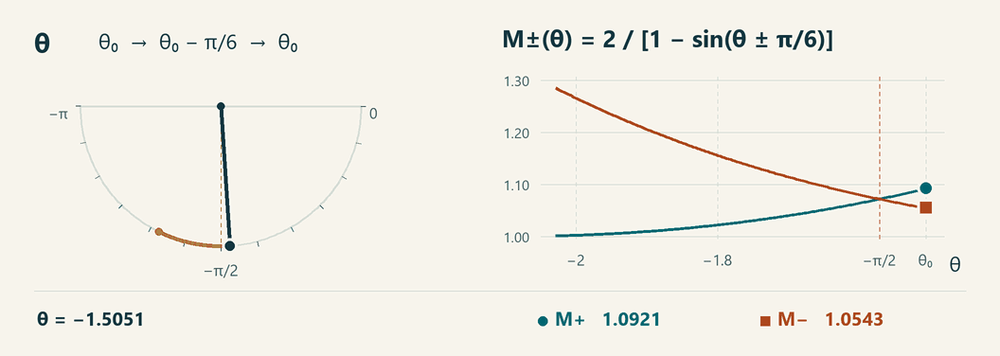

**Fig. 1. Reciprocal-root sums on the period-640 return.** The hand on the left shows the angle through which one complete lap of the orbit turns a tangent vector. I start at the measured angle $\theta_0$, turn clockwise by $\pi/6$ along the gold arc, then retrace it. On the right I sum the reciprocals of the spectral roots at two offsets from the hand, $\theta+\pi/6$ (teal circle) and $\theta-\pi/6$ (rust square). At the downward direction $-\pi/2$ the sums agree. On this arc, teal above rust puts the hand to the right of that direction, and rust above teal puts it to the left. [Still figure](docs/figures/ordered-turn.png) · [Angle, two traces and inverse](archive/2026-11-19-oriented-return-v001/README.md)

## The quadratic, the ordered exponential stages and the spectrum

My quadratic supplies the two conjugate factors of a genus-one quartic. The reciprocal tower supplies the ordered exponents $U,V$. At the Dottie fold the two-step derivative equals one. Requiring this same derivative at other complex fixed pairs gives the cosine spectrum in the definition above.

### The two real ovals and the Gaussian quadratic factor

My six coefficients define $N(x)=465x^2-183x-659$ and $D(x)=155x^2+396x-936$. Equating their ratio to $(1+y)(2+y)/(y^2+y-1)$ gives a quadratic in $y$. Set $A=N-D$ and $Y=2Ay+N-3D$. Completing the square gives

~~~math
Y^2=f(x)=A(x)^2+4N(x)^2
       =\bigl(A(x)+2iN(x)\bigr)\bigl(A(x)-2iN(x)\bigr).
~~~

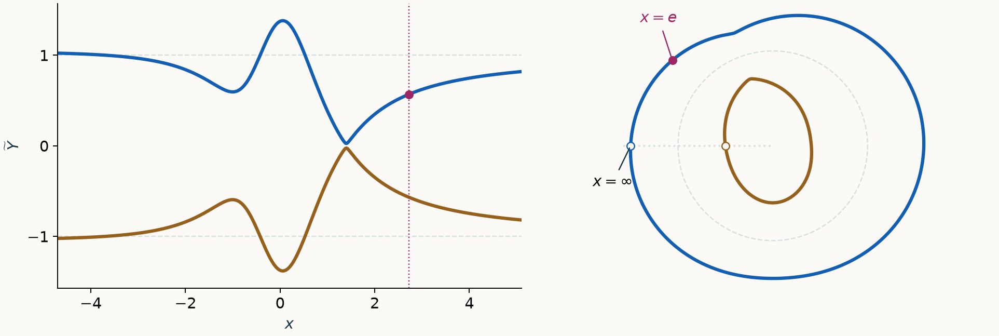

**Fig. 2. The two real ovals of the quartic.** The left panel shows both signs of $Y$, with each ordinate divided by $\sqrt{961000}(1+x^2)$. The blue and ochre branches come very close near $x=1.4$. To see where each goes, follow its color on the right. Its two ends meet at the same hollow point at infinity, closing that branch into an oval. The filled magenta point marks the same input $x=e$ in both views. [Quartic figure and coordinates](archive/2026-11-18-quartic-ovals-v001/README.md)

The two branches at infinity

The signs of $Y$ give two real branches. Adding their points at infinity closes each into an oval. For the arithmetic in §2 I use the factor $A+2iN$. Its discriminant determines which Gaussian prime splits in the quartic field, even when two primes have the same norm. [Diagram of the ovals and the quartic derivation](docs/proofs/reciprocal-constructions.md#user-content-read-quartic)

### The ordered stages and the Dottie fold

For the reciprocal bases $e^L,e^{-L}$ I start both phases at $1$ and iterate $F_L(P,Q)=(e^{LQ},e^{-LP})$. At a fixed pair, $P=e^U$ and $Q=e^V$ with $U=LQ$ and $V=-LP$. Two updates return to the same coordinate. Their derivative at the fixed pair is $UV$. It reaches one at the Dottie fold. The colors below record the period reached from the same cap as I vary $L$. Gray means that the survey reached its iteration limit with no period in its search range. [My tetration preprint](archive/2026-11-18-lean-foundations-v001/papers/foundations/main.pdf) · [My Dottie spire preprint](archive/2026-11-18-lean-foundations-v001/papers/dottie-spire/main.pdf) · [Figure and sampling limits](archive/2026-11-18-research-figures-v001/README.md)

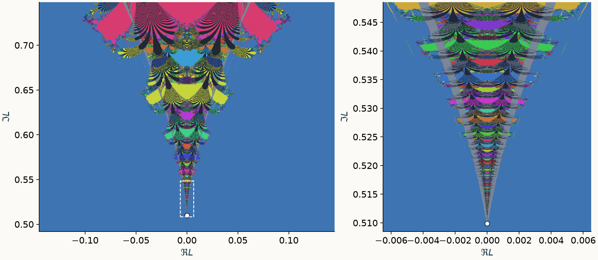

**Fig. 3. Paired periods near the Dottie fold.** I vary the complex logarithm $L$ and start each run at $(1,1)$. Blue marks fixed pairs. The other cycle colors encode the detected paired period from 2 through 256. Gray marks runs that reached 8,000 iterations without an assigned period. Dark navy marks an arithmetic range limit and purple marks insufficient precision in the phase. Four samples contribute to each pixel. The right panel enlarges the region around the Dottie fold. [Tetration preprint](archive/2026-11-18-lean-foundations-v001/papers/foundations/main.pdf) · [Dottie spire preprint](archive/2026-11-18-lean-foundations-v001/papers/dottie-spire/main.pdf) · [Sampling limits](archive/2026-11-18-research-figures-v001/README.md)

On the certified mixed orbit, two updates separate the coordinates into scalar cycles of primitive periods 321 and 320. Their joint period after two updates is $\mathrm{lcm}(321,320)=102720$. The ordered map therefore has primitive period $205440$. The height calculation uses a different orbit, of paired period 640. [Mixed-period certificate](archive/2026-11-18-dottie-mixed-cap-period-v001/README.md) · [Height from the period-640 orbit](archive/2026-11-17-dottie-grid-match-v001/README.md)

### From the ordered stages to the arithmetic reference

At $UV=1$, specifying a cosine root and the sign in its equation recovers the ordered exponents and $L$. The determinant product gives $\mathcal Z(1;1)=2$ and $\mathcal Z(2;1)=10/3$. In three off-center test rectangles I counted one zero of the cosine determinant in each. The reconstructed arithmetic response had no zeros in any of the three. Widening the rectangles to include the critical line gave counts of 2, 0 and 1 for the response. [Separate contours for the determinant and reconstructed response](archive/2026-11-17-offcenter-superzeta-v001/README.md#results)

Four constructions and the information each retains

**Which function am I studying?** Each row describes a different operation on the original return or its arithmetic reference.

| Input | Construction | Result |
| --- | --- | --- |
| Fixed pairs with $UV=1$ | Put $U=\alpha$, $V=\alpha^{-1}$ and $2iu=\alpha-\alpha^{-1}$. The fixed equations give $u=\pm\cos u$. | The zeros $\lambda=u^2$ of the entire function $E(v)=\cos^2\sqrt v-v$ are the spectrum. The reciprocal-power sum $\mathcal Z(s;1)=\sum_\lambda\lambda^{-s}$ uses principal logarithms and initially converges for $\Re s>1/2$. [Proof](docs/proofs/quartet-spectrum.md) |
| The determinant and the half-integer cosine spectrum | On the negative axis their ratio is $1+t/\cosh^2\sqrt t$. Its logarithm gives the Mellin correction $J$. | $\mathcal Z(s;1)-J(s;1)=2\pi^{-2s}(2^{2s}-1)\zeta(2s)$. In the open critical strip, a Riemann zero at $w$ has the same multiplicity at $s=w/2$ in the difference. [Mellin proof](docs/proofs/quartet-spectrum.md) |
| The symmetrized Hurwitz reference with an angle $a$ | The two shifts are $1/2-a/\pi$ and $1/2+a/\pi$. At $a=\pi/6$ the value adds the classes $1,2\bmod 3$. Its angular derivative subtracts them. | After removing the explicit prefactors and shifting the derivative input by one, these readings give $\zeta(w)$ and $L(w,\chi_{-3})$. Their product is a quadratic field zeta. [Angular formula and its domain](archive/2026-11-20-liu-angular-velocity-v002/README.md) |
| The two ordered logarithms at a fixed pair | Mark a vector by its two integers $m,n$ and measure the squared length of $m+nU/V$. | At $U/V=e^{2\pi i/3}$ this is the Eisenstein norm. At $U/V=i$ it is the Gaussian norm. The extra prime weight at the Gaussian ratio comes from $f$. [Lattice derivation](archive/2026-11-20-dedekind-phase-v001/README.md) |

The lattice ratios use fixed pairs of the full logarithmic lift. For example, the fixed pair at $u=\pi/4$ has multiplier $\pi^2/8$. The multiplier-one condition selects the smaller family in the first row. [Ordered phases and inverse logarithmic lift](lean/SuperZeta/DedekindLift.lean)

### The exact factorial from the balanced sign count

For every integer $n\ge1$, I recover $n!$ by multiplying Stirling’s leading approximation by the exponential of one definite integral. The right-hand side uses only $n$.

~~~math
n!=\sqrt{2\pi n}\left(\frac ne\right)^n
\exp\!\left[
  \int_0^\infty e^{-nt}
  \left(\frac12\coth\frac t2-\frac1t\right)\frac{dt}{t}
\right].
~~~

This is Binet’s integral for the Stirling remainder. In my construction it comes from counting two independent balanced sign histories of length $2n$. The count involves both $(2n)!$ and $n!$. Reading the same count at $n,2n,4n,\ldots$ isolates the correction for a single factorial. For $10!$, Stirling’s leading factor is about $3{,}598{,}695.62$. The integral supplies the multiplier $1.0083653591\ldots$, giving exactly $3{,}628{,}800$ when evaluated without rounding. [Derivation from the sign histories](docs/proofs/reciprocal-constructions.md#recovering-the-error-on-one-factorial) · [Exact factorial theorem in Lean](lean/SuperZeta/StirlingCorrection.lean#L355) · [Binet’s formula, DLMF](https://dlmf.nist.gov/5.9.E10_2)

How doubling the word length recovers the correction for one factorial

Write $B_n=4^{-n}\binom{2n}{n}$ for the fraction of balanced words. With two independent words the fraction is $B_n^2$. Removing the quartet radius from $C_n=R_nB_n^2/2$ leaves the factorial factor $D_n=\pi n B_n^2$. If $\rho_n$ denotes the logarithm of the ratio of $n!$ to its leading Stirling factor, the factorials in $D_n$ give

~~~math
\begin{aligned}
I(x)&=\int_0^\infty e^{-xt}\frac{\tanh(t/4)}{t}\,dt,\qquad x>0,\\
\log D_n&=2\rho_{2n}-4\rho_n=-I(n).
\end{aligned}
~~~

Solving for $\rho_n$ and iterating gives $\rho_n=\tfrac14\sum_{j\ge0}2^{-j}I(2^j n)$. The kernels at successive doubled indices telescope to the single integral above. After $k$ terms the omitted logarithmic correction is between zero and $4^{-k}/(12n)$. For $n=10$, twelve terms with that tail bound enclose the answer between $3{,}628{,}799.9981$ and $3{,}628{,}800.0001$. The only integer in that interval is $3{,}628{,}800$. [Kernel, recurrence and doubling proof](lean/SuperZeta/StirlingCorrection.lean#L306) · [Quartet normalization and all-order error bound](archive/2026-11-18-stirling-correction-v001/README.md#the-exact-correction)

## 1. Arithmetic weights from the two logarithms

At a fixed pair of my tower, the two exponents $U=LQ$ and $V=-LP$ determine the two lattice directions. I take the first direction to be $1$ and the second to be their ratio. The lattice consists of all integer combinations of those directions.

~~~math
\tau=\frac{U}{V},
\qquad
\Lambda_\tau=\bigl\{\,m+n\tau : m,n\in\mathbb{Z}\,\bigr\}.
~~~

To go back from the lattice to the tower, I keep one more value. For $\tau$ in the upper half-plane, the fixed-pair equations give $e^{V-U}=-\tau$. I choose a logarithm $d$ of $-\tau$ to specify the difference $V-U$. Then I recover the original exponents and the tower parameter in order.

~~~math
\begin{aligned}
V &= \frac{d}{1-\tau},\\[3pt]
U &= \tau V,\\
L &= U\,e^{-V}.
\end{aligned}
~~~

Changing $d$ by an integer multiple of $2\pi i$ preserves the lattice ratio while changing the lift. The square lattice in Fig. 4 comes from the fixed pair at $u=\pi/4$, whose return multiplier is $UV=\pi^2/8$. [Fixed-pair derivation](archive/2026-11-20-dedekind-phase-v001/README.md#1-the-ratio-of-the-two-actual-logarithms) · [Inverse in Lean](lean/SuperZeta/DedekindLift.lean)

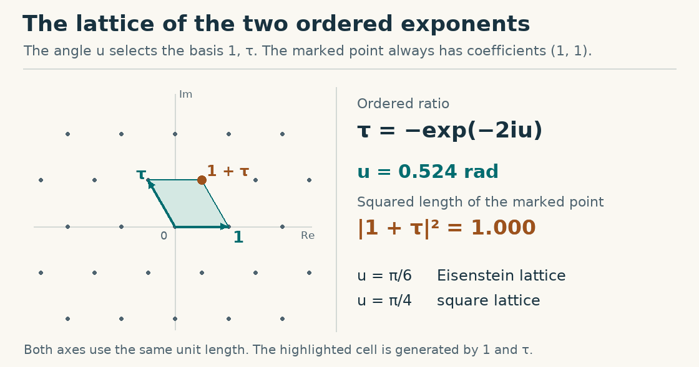

**Fig. 4. One lattice address from the Eisenstein lattice to the square lattice.** The arrows on the left are the basis vectors $1$ and $\tau$. The shaded cell has its opposite corner at the gold point $1+\tau$, one step along each vector. I keep that address fixed while changing $u$. The right panel follows the squared distance of that same point from the origin, $\lvert1+\tau\rvert^2=4\sin^2 u$. It rises from 1 at the Eisenstein lattice to 2 at the square lattice. The same integer address has a different norm. [Still figure](docs/figures/lattice-ordered-ratio.png) · [Lattice derivation](archive/2026-11-20-dedekind-phase-v001/README.md)

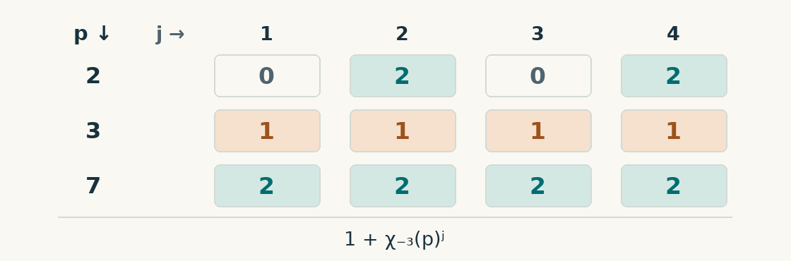

**Fig. 5. Prime-power weights in the Eisenstein field.** To read the table, choose a prime $p$ on the left and an exponent $j$ across the top. Multiply the entry by $\log p$ to get the weight of $p^j$ in the field’s prime sum. At 2 the weights alternate between 0 and 2 because the prime ideal above 2 has norm 4. At 3 there is one ramified prime, giving 1 in every column. At 7 the two split primes each contribute, giving 2 throughout. [Field weights](archive/2026-11-20-dedekind-phase-v001/README.md)

<strong>The Eisenstein norm and the prime-power weight</strong>

At the native parameter $u=\pi/6$, $\tau=-e^{-2iu}=\omega=e^{2\pi i/3}$. The squared length of $m+n\omega$ is $m^2-mn+n^2$. Every nonzero ideal in the Eisenstein integers is principal. Multiplying a generator by one of the six units gives the same ideal six times in the lattice sum. Consequently, for $\Re w>1$,

$`\displaystyle \frac16\sum_{(m,n)\ne(0,0)}(m^2-mn+n^2)^{-w} =\zeta_{\mathbb Q(\sqrt{-3})}(w)=\zeta(w)L(w,\chi_{-3}).`$

For this field the coefficient of $\log p$ at $p^j$ in its negative logarithmic derivative is $1+\chi_{-3}(p)^j$. The earlier weighted detector used $1+\chi_{-3}(p)^j/7$. At $p=2$ the field weights for $2,4,8$ are $0,2,0$. The prime is inert, so its first ideal has norm $4$. With the field weights and the corresponding main terms, 160-bit interval arithmetic gives the one-sided bound $G_K(x)<0.065597\sqrt{x}$ at every real cutoff $6501\le x\le4194304$. Here $x$ measures how far the prime-power sum runs. [Exact definition, four overlapping ranges and replay](archive/2026-11-20-dedekind-phase-v001/README.md) · [Quadratic factorization, Aycock and Kobin](https://arxiv.org/abs/2205.06298)

## 2. A phase hypothesis from my quartic

At $u=\pi/4$ the ordered ratio is $i$. A Gaussian generator $z=m+ni$ now marks a point in the lattice supplied by the lift. The branch polynomial $A+2iN$ from the first equation has discriminant $\delta=-5045155+1027708i$. Its roots generate $E=\mathbb Q(i,\sqrt{\delta})$ over $k=\mathbb Q(i)$. I use $E$ here for the number field and $E(v)$ above for the spectral determinant. The normal closure of the branch field over $\mathbb Q$ has dihedral group of order eight. [Derivation from the six coefficients](archive/2026-11-20-dedekind-phase-v001/README.md)

**Hypothesis to test.** For an unramified Gaussian prime of odd rational prime norm, can I recover the splitting of my branch from its marked direction in the lift? Splitting means two primes above it in $E$, with sign $+1$. A prime that stays prime has sign $-1$. To make the question reproducible I take the angle modulo $\pi/2$ (unit multiples give the same ideal), keep the quartic coefficients fixed, and test the sign against direct factorization in the residue field.

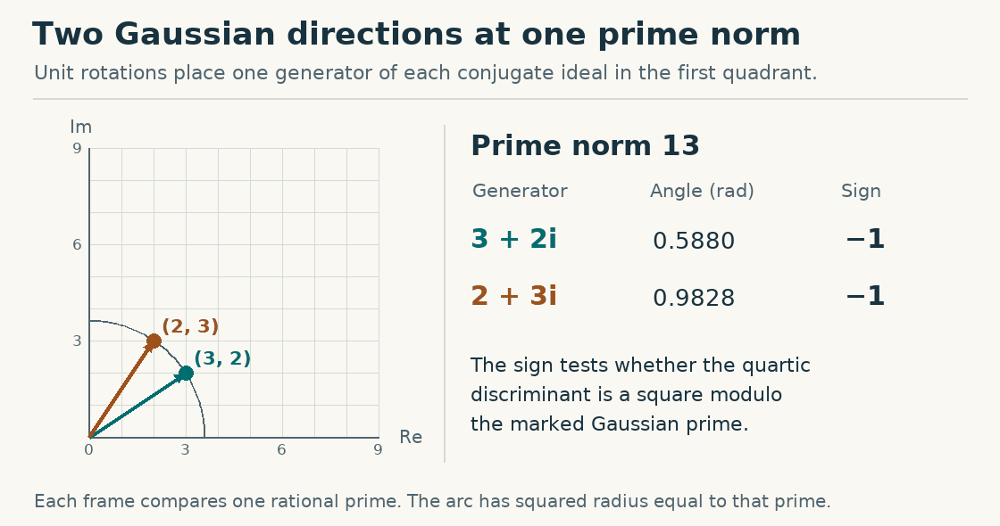

**Fig. 6. Directions of conjugate Gaussian primes.** In each frame I rotate the conjugate generators by units so that both representatives lie in the first quadrant. Their slopes record the two prime directions. At 13 both directions give minus. At 37 both give plus. At 73 one gives minus and the other plus. The angle identifies which Gaussian prime to reduce at. [Still figure](docs/figures/direction-marked-primes.png) · [Exact reductions](archive/2026-11-20-dedekind-phase-v001/README.md)

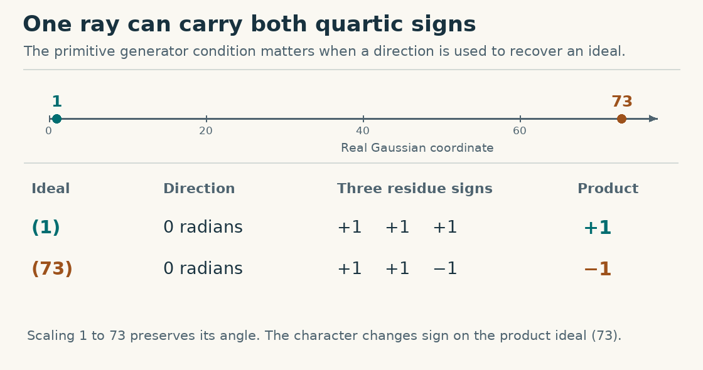

**Fig. 7. Two different signs on one ray.** Now I fix the direction and allow a general ideal. The generators $1$ and $73$ lie on the same ray, yet their character values have opposite signs. This is why I retain the full lattice coordinates when I leave the primitive prime case. [Direction test](docs/proofs/marked-gaussian-direction.md)

<strong>Recovering a prime from its direction and testing the sign</strong>

**Answer for exact angles.** A split rational prime has a primitive Gaussian generator. Its exact direction in the first quadrant gives the reduced slope $n/m$, hence the two integers and the prime norm. Reducing $m+ni=0$ at that prime gives the image of $i$ as $-m/n$. This specifies which reduction of my quadratic to factor. For ideals of arbitrary norm I retain both integer coordinates. If I also bound the tested prime norms by $X$, an angular error smaller than $\tfrac12\arcsin(1/X)$ suffices to identify the marked split prime. A direction shared by $z$ and $73z$ gives opposite signs whenever both ideals are coprime to the conductor. [Direction proof and angular precision](docs/proofs/marked-gaussian-direction.md) · [Residue calculation in Lean](lean/SuperZeta/FieldWeights.lean)

## 3. Phase tests at conjugate Gaussian primes

The two points $3+8i$ and $3-8i$ both have squared length $73$. At the first, $i$ reduces to $27\bmod 73$ and the Gaussian quadratic $A+2iN$ has no root. At the second, $i$ reduces to $46$ and the same quadratic has roots $30$ and $56$. The sign can therefore distinguish two primes that every function of the integer norm treats alike. At norms 13 and 37 the signs agree on the two sides.

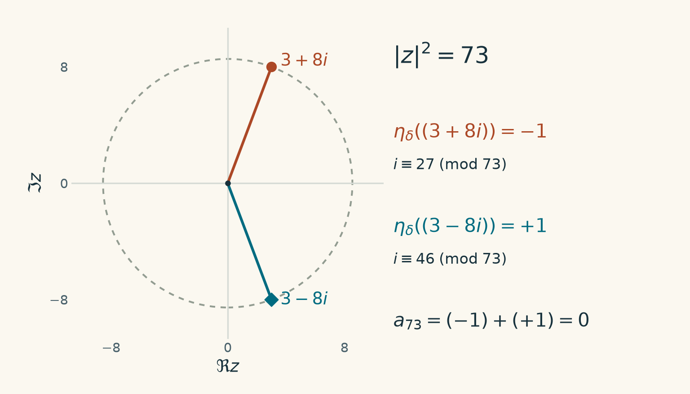

**Fig. 8. Opposite signs at norm 73.** The plotted points $3+8i$ and $3-8i$ are reflections across the real axis. Both have squared distance 73 from the origin. At the upper point the quadratic has no residue root and gives $-1$. At the lower point it has two and gives $+1$. Adding the signs loses their assignment. Marking the two points separately preserves it. [Prime directions and residues](docs/proofs/marked-gaussian-direction.md)

### Three residue symbols and the comparisons at 13, 37 and 73

For a nonzero generator $z=m+ni$, the three residue symbols at the primes dividing $(\delta)$ determine its character value.

The three residues and their sign table

For every nonzero $z=m+ni$ the quadratic Hecke character $\eta_\delta((z))$ is given by the following three Legendre symbols, with value zero on ideals that share a prime with the conductor. The conductor is the ideal $(\delta)$. Each pair $(p,t)$ below is a prime divisor of its norm and the image of $i$ at the corresponding prime ideal. For example, $t=32$ satisfies both $t^2=-1\bmod41$ and $\delta=0\bmod41$ after substituting $i=t$.

$`\displaystyle \eta_\delta((m+ni))= \prod_{(p,t)\in\{(41,32),(457,109),(1414835497,516876951)\}} \left(\frac{m+nt}{p}\right).`$

| Norm | Marked generators in the order tested | Signs |
| ---: | --- | --- |
| 13 | $2+3i$, $2-3i$ | $-1,\ -1$ |
| 37 | $1+6i$, $1-6i$ | $+1,\ +1$ |
| 73 | $3+8i$, $3-8i$ | $-1,\ +1$ |

Multiplying the formula for $z$ by the one for its conjugate replaces each numerator by $m^2+n^2$ inside its Legendre symbol. Away from the conductor this tells me from the norm alone **whether the two signs agree**. Keeping the marked coordinates tells me **which prime gets which sign**. I can now compare any candidate reading of the ordered exponential stages against these values. Whether a spectral observable of the stages alone produces the character is open. [Conductor proof and direct prime checks](archive/2026-11-20-dedekind-phase-v001/README.md)

### Reading the branch from the completed angular zeros

Conjugating my quartic interchanges the primes above 73 and preserves the field zeta. To recover the branch I keep the positive imaginary direction fixed by $U/V=i$ and weight each marked ideal by the fourth power of its unit direction. The ordinary coefficient gives the sum of the two prime signs. The imaginary part of the angular coefficient gives their difference times a known sine. This recovers which prime received each sign.

The zero sum and the two branch labels

For a marked split prime at angle $\theta$, let $e,f$ be the two residue signs. The ordinary coefficient is $S=e+f$ and the angular coefficient satisfies $\Im C=(e-f)\sin(4\theta)$. At norm 73 I get $S=0$ on both branches and $C=10560i/5329$ or its negative. This supplies both the sum and the difference needed to recover the ordered pair. [Two-coefficient inverse](archive/2026-11-20-gaussian-branch-spectrum-v001/README.md)

The same choice is visible in the zeros of the completed angular function. Counting every zero $\rho$ with its multiplicity, the quantity $-\Im\sum_\rho(2-\rho)^{-2}$ is positive for $A+2iN$ and negative for $A-2iN$. I bounded it by evaluating the corresponding differentiated Euler series, including its infinite tail. Reading $3+8i$ before $3-8i$ then gives the sign words $-+$ and $+-$. Under the original exponential stages with $L=\log 2$ their respective cap values are $\sqrt{2}$ and $1/4$. [Proof and numerical enclosures](archive/2026-11-20-gaussian-branch-spectrum-v001/README.md) · [Lean proof of ordered recovery](lean/SuperZeta/MarkedBranch.lean)

Lean proves that relabeling the zeros preserves this sum and that conjugating them reverses its sign. Since the value at 2 excludes zero, the two completed angular functions have different complex zero multisets. The individual zero where they first differ is still unknown. [Lean proof of the zero sum and conjugation](lean/SuperZeta/ZeroMoment.lean)

### Lemma. Chronological order of the signed stages

At base 2 the word $-+$ sends $1$ to $1/2$ and then to $\sqrt2$. Reversing the stages gives $1\mapsto2\mapsto1/4$.

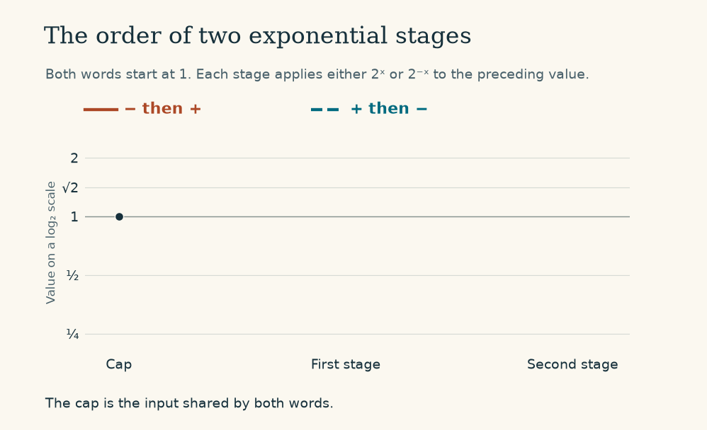

**Fig. 9. Reversing the two signs at base 2.** Both paths begin at 1. The solid path ($-+$) applies $x\mapsto2^{-x}$ first and $x\mapsto2^x$ second, reaching $\sqrt{2}$ through $1/2$. The dashed path ($+-$) reaches $1/4$ through 2. The horizontal coordinate counts the stages, and the vertical scale shows their outputs on a base-two logarithmic scale. The endpoints distinguish the orders even though both used each sign once. [Still figure](docs/figures/quartic-sign-orders.png) · [Exact stages](docs/proofs/chronological-order.md)

Recovering a sign word in reverse from its endpoint

At a fixed positive real lift, two finite sign histories give the same endpoint from the cap $1$ exactly when the signs agree at every stage. Parentheses can move because composition is associative. The last sign can be read from the endpoint itself. If it lies above $1$, the last stage was plus. If it lies below $1$, the last stage was minus. Taking the absolute logarithm and dividing by the lift recovers the preceding value.

My earlier balanced-history count assigns the same weight to `++--`, `--++`, and `-+-+`. The first two even describe the same cyclic order when the starting phase is hidden. Applied from the same cap at base 2, the three words give $0.957603\ldots$, $3.100555\ldots$, and $1.297032\ldots$, respectively. At the complex lift $L=\pi i$, every nonempty word sends that same cap to $-1$. [Proof, six exact endpoints and the complex example](docs/proofs/chronological-order.md) · [Lean formalization](lean/SuperZeta/SignWords.lean)

### Recovering the signed stages when the cap values coincide

I keep $L=\pi i$ fixed and vary the starting value $z$ in the same signed exponential stages. All six balanced four-stage words give $W(1)=-1$ and $W'(1)=\pi^4$. They leave that point with the same velocity for a real change in the cap. Their complex accelerations $W''(1)$ distinguish all six. For example, the words `++--` and `+-+-` bend upwards at the same rate there, but their horizontal accelerations differ.

The derivative polynomial and the selected powers of two

For any finite sign word, let $c_j$ be the product of its first $j$ signs. The chain rule gives

$`\displaystyle \frac{W''(1)}{W'(1)}=-\sum_{j=1}^n c_j(-\pi i)^j.`$

The highest power at which two histories differ outweighs every lower difference combined. This makes their derivative ratios distinct even when their lengths are hidden. To compare with the earlier prime detector, I use one exponent step for each minus and two for each plus. At powers of 2 the detector then records $1+c_j/7$, while the quadratic field records $1+c_j$. Both readings recover the same signs in order. [Derivation and blind test](archive/2026-11-20-cap-derivative-recovery-v001/README.md) · [Lean proof for all finite words](lean/SuperZeta/CapRecovery/Dominance.lean) · [General detector weights](lean/SuperZeta/CapRecovery/GeneralWeights.lean)

### An unknown integral lift and a hidden word

Within this family I can decide whether two compositions agree for every complex starting value by comparing just their first two derivatives at 1. This includes the empty word, which acts as the identity, and the nonempty words at zero lift, which are constant.

Recovering the magnitude, length, and sign convention

When I hide both the word and the integer in $L=m\pi i$, the stage rates still have a unique reconstruction. For a nonempty word and $m\ne0$, I measure $K=W''(1)/W'(1)$. If both Cartesian components are nonzero, dividing the larger absolute component by the smaller gives $|m|\pi$ to within one unit. Rounding after division by $\pi$ gives $|m|$. A single stage gives $|K|=|m|\pi$ exactly. With the positive lift as representative I can now recover the word, including its length.

The two labels $(2,\text{+--})$ and $(-2,\text{-++})$ give the same exponential at every stage. To recover the original labels, I retain the prime reading at the first selected power of two. With the earlier weight $1/7$ it reads $8/7$ for the first label and $6/7$ for the second. This is where the arithmetic supplies information the two derivatives cannot distinguish. [Proof, calculation and replay](archive/2026-11-20-hidden-lift-v001/README.md) · [Lean statement](lean/SuperZeta/CapRecovery/HiddenLift.lean)

At $m=0$ every nonempty word is the constant map $1$, with derivative pair $(0,0)$. The empty word acts as the identity at every lift, with derivative pair $(1,0)$. These cases complete the classification without dividing by a zero derivative. [Classification including the exceptional lifts](archive/2026-11-20-hidden-lift-v001/README.md)

## 4. Transferring zero results one factor at a time

The first field involves ordinary Dirichlet characters. The quartic adds a character of ideals over the Gaussian integers. Write $\beta_D(w)=L(w,\chi_{-4})$ for Dirichlet beta. The three factorizations specify which extra function has to be evaluated when I carry a zero count into a new field.

~~~math
\begin{aligned}
\zeta_{\mathbb Q(\sqrt{-3})}(w)&=\zeta(w)L(w,\chi_{-3}),\\
\zeta_k(w)&=\zeta(w)\beta_D(w),\\
\zeta_E(w)&=\zeta(w)\beta_D(w)L_k(w,\eta_\delta).
\end{aligned}
~~~

In the open critical strip all these factors are holomorphic. The order at any point is the sum of the orders of the factors. Thus each of the eleven certified Riemann zeros contributes at least one zero to each field product. To claim that a whole box has only those zeros, I need counts for every extra factor on the same contour. A *simple zero* means multiplicity one, equivalently that the first derivative there is nonzero. [Three Riemann counting intervals](archive/2026-11-20-liu-angular-velocity-v002/README.md) · [Field factors and the domain of Liu’s bound](archive/2026-11-20-dedekind-phase-v001/README.md)

The angular evaluations and the three field factors

Dirichlet beta can also be read from the same symmetrized Hurwitz function $R(a,v)=\pi^{-v}[\zeta(v,b)+\zeta(v,1-b)]$, with $b=1/2-a/\pi$. Differentiate in $a$ and evaluate at $v=w-1$. At $a=\pi/4$, subtracting the two Hurwitz sums weights the classes $1,3\bmod 4$ with opposite signs, giving $\partial_a R(\pi/4,w-1)=(w-1)(4/\pi)^w\beta_D(w)$. The angle $\pi/6$ gives $L(w,\chi_{-3})$ by the same calculation with modulus three. [The prime weights and both evaluations](archive/2026-11-20-dedekind-phase-v001/README.md) · [Check against Dirichlet values](archive/2026-11-20-dedekind-phase-v001/first-zero.md)

~~~mermaid
flowchart TB
    A["N, D"] --> B["A + 2iN"]
    B --> C["δ, ηδ"]
    U["U, V"] --> G["U/V = i, m + ni"]
    G --> H["Lk(w, ηδ)"]
    C --> H
    U --> D["UV = 1, E(v)"]
    D -->|"w = 2s"| Z["ζ(w)"]
    R["∂ₐR(π/4, w−1)"] --> J["βD(w)"]
    H --> F["ζE(w)"]
    Z --> F
    J --> F
~~~

**Fig. 10. The three factors of the quartic field zeta.** Read the diagram from top to bottom. The two polynomials $N,D$ give the quadratic character, and the ordered ratio $U/V=i$ supplies the Gaussian lattice on which I evaluate it. Together they give the Gaussian Hecke factor. The other paths give ordinary zeta from the cosine spectrum and Dirichlet beta from the Hurwitz derivative at $\pi/4$. The three arrows at the bottom mean multiplication. A zero of any factor in the critical strip contributes its multiplicity to the field zeta.

Liu’s stated unitary Hecke bound applies directly to the finite-order character over $k$. Sutherland’s November 20 report records independent verification of the Riemann and Dirichlet statements in Alpöge’s submission. The latter includes Dirichlet beta. Taking those critical-line conclusions, the off-line zeros of my quartic field inside the critical strip are exactly those of its Gaussian Hecke factor, with the same multiplicity. [Sutherland’s verification report](https://math.mit.edu/~drew/grh/) A critical-line bound for the extra Gaussian-ideal factor would extend that conclusion to this particular quartic field. [Liu, Theorem 1.1](https://hexagonmath.org/pdf/2611.00421v1#page=2) · [OpenAI, Theorem 1.1](https://github.com/openai/math/blob/main/preprints/The-Quasi-Riemann-Hypothesis-September-30-2026/paper.pdf)

Masullo’s November 20 draft treats Hecke characters over number fields and gives a trace formula with a separate calculation for each character. For my quartic the relevant character is $\eta_\delta$ over $\mathbb Q(i)$. At norm 73 its two prime contributions cancel. Keeping the fourth angular harmonic gives a nonzero imaginary coefficient whose sign identifies the branch. [Calculation at 73 and reading guide to Masullo’s draft](docs/number-fields/masullo-trace-formula.md)

**One reproduced transfer.** At the first positive Riemann zero I enclose the derivative of zeta and both additional Dirichlet values at the same complex point. All three enclosures exclude zero, so the zero has multiplicity exactly one in both quadratic field zetas. For the quartic field, its multiplicity is one plus the order of its Gaussian Hecke factor there. [160-bit calculation and replay](archive/2026-11-20-dedekind-phase-v001/first-zero.md)

### Eleven simple Riemann zeros in three Dottie height windows

A marked period-640 return first supplied a Riemann height $T_D\approx4.5261\times10^{12}$. I counted zeros in three windows centered at $T_D$, $2T_D$ and $3T_D$. The half-widths are $1/4$, $1/2$ and $1/2$, respectively. The counts with multiplicity were 2, 5 and 4, each exhausted by disjoint critical-line sign changes. [Height selection from the ordered stages](archive/2026-11-17-dottie-grid-match-v001/README.md) · [Three full-strip counts](archive/2026-11-20-liu-angular-velocity-v002/README.md)

Matching the full count to the critical-line sign changes

In each window I found that many disjoint intervals on the critical line where Hardy’s real-valued function changes sign. A sign change gives at least one zero in each interval. An additional zero anywhere in the strip or a repeated zero in a bracket would exceed the measured total. This is how the counts sharpen the 7/8ths and Liu bounds at these heights. [Height selection](archive/2026-11-17-dottie-grid-match-v001/README.md) · [Counts, signs and endpoint checks](archive/2026-11-20-liu-angular-velocity-v002/README.md) · [OpenAI, Theorem 1.1](https://github.com/openai/math/blob/main/preprints/The-Quasi-Riemann-Hypothesis-September-30-2026/paper.pdf)

### Two inverse branches of the Gaussian factor at the Dottie height

In my quartic, two solutions of $P(z)=v$ meet and separate in a perpendicular direction as the real target $v$ passes a critical value. To test for the same event in the quartic field, I use its completed Gaussian factor $f$ and count the solutions of $f(w)=v$ in a fixed rectangle. As the real target varies continuously, suppose $f(w)-v$ stays nonzero on the boundary and encloses exactly two solutions counted with multiplicity. Integrating around the boundary then gives their signed squared separation $(w_1-w_2)^2$. A change from positive to negative takes a same-height pair through a double solution on the critical line.

Nonzero targets and the endpoint parity test

At $T_D$, directed arithmetic gives exactly two simple solutions for every real target with $1.05238\times10^{-18}\leq |v|\leq 6\times10^{-16}$. One lies to the right of $1.018$ and its partner to the left of $-0.018$, at the same height. As I reduce the magnitude of either signed target, the two move horizontally toward each other. The Gaussian zero count concerns the remaining target $v=0$, where the contour is still unresolved. [Proof, positions and reproduction](archive/2026-11-20-gaussian-two-root-transition-v001/README.md)

I can also say exactly where an odd count can occur as I lower the target. I read the completed Gaussian factor at the two ends of the critical-line segment, at heights $T_D-1/16$ and $T_D+1/16$. Take a real target $v$ whose preimages avoid the rectangle’s boundary. The count inside, with multiplicity, is odd exactly when $v$ lies strictly between the two endpoint readings. Reflection gives every off-line preimage a partner in the rectangle. Using 404 split primes whose two signs cancel, I bound the magnitudes of the lower and upper readings by $3.584\times10^{-19}$ and $2.945\times10^{-19}$, respectively, in the same units as $v$. Both enclosures still contain zero. Independently, the ordinary Riemann count at the two heights agrees exactly, so ordinary zeta contributes no zeros in this window. [Parity proof, endpoint values and replay](archive/2026-11-20-gaussian-endpoint-parity-v001/README.md)

### Spiral phase on the Gaussian circle

I followed the finite Gaussian sum $L_N$ around the right circle at 193 norm cutoffs. Its spiral phase is $\arg L_N-\kappa\log\lvert L_N\rvert$ modulo $2\pi$, with $\kappa$ set by the period-640 return. At every tested cutoff its spiral phase stayed more than $0.91$ radians from $3.9$ on the entire circle. Applying the same phase test on the reflected circle gave two crossings at each cutoff. Both finite sums wound zero times around the origin. The bound on the omitted terms still allows the full Gaussian factor to pass through zero on the boundary, so its winding and the zero count inside remain open. [Circle measurements, radii and remainder bound](archive/2026-11-20-gaussian-circle-phases-v001/README.md)

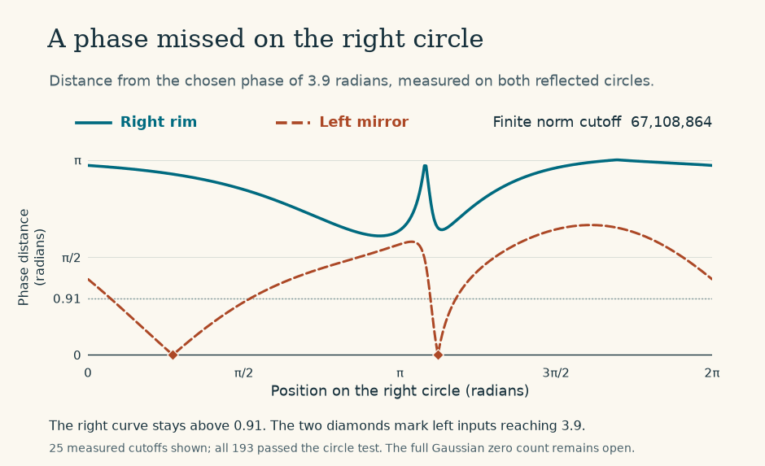

**Fig. 11. Distance from the target phase on the reflected circles.** The horizontal coordinate follows an input around the right circle in radians. At each position I measure the shortest angular distance from the finite sum’s phase to $3.9$ radians, both there (solid teal) and at its reflected input (dashed rust). The rust curve reaches zero twice, while the teal curve stays above zero. Here zero on the vertical scale means a match with the target angle at a nonzero function value. The distance stays continuous when the phase wraps from $3\pi/2$ to $-\pi/2$. Each frame uses the displayed norm cutoff $N$. Bounding the terms beyond $N$ is the remaining step in the winding test. [Still figure](docs/figures/gaussian-phase-cutoffs.png) · [Finite sums and omitted terms](archive/2026-11-20-gaussian-circle-phases-v001/README.md)

### The reflected disks and the weight available for an off-line pair

I centered two disks at $31/64+iT$ and $33/64+iT$, where $T=T_D-1/512$. With radius $15/1024$, each disk clears the critical line by $1/1024$. Reflection pairs their zeros at the same height, preserving multiplicity. The Gaussian prime sum bounds the total weight of all zeros by $87.057901$, and each zero in this height band contributes more than $5.481507$. Eight in either disk would require sixteen in the band and a weight above $87.704112$. This gives at most seven per closed disk without assuming that any zero lies on the critical line. The exact count in each disk is still open. [Derivation and two numerical checks](archive/2026-11-20-gaussian-reflected-disks-v001/README.md)

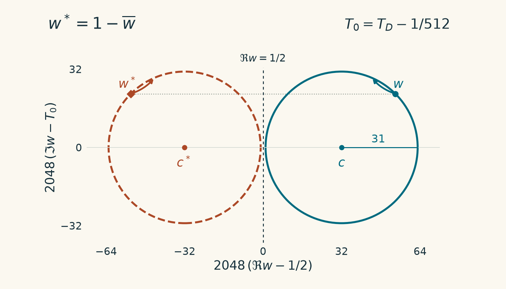

**Fig. 12. The two Gaussian measuring circles near the Dottie height.** Both axes give displacement in units of $1/2048$, horizontally from $\Re w=1/2$ and vertically from $T=T_D-1/512$. The disks in the count above have radius 30 in these units. The figure shows the outer measuring circles at radius 31 around the same centers. The arrows trace $w$ and its reflection $1-\overline w$ at the same height, in opposite directions around their respective circles. [Disk geometry](archive/2026-11-20-gaussian-reflected-disks-v001/README.md) · [Outer-circle radii](archive/2026-11-20-gaussian-circle-phases-v001/README.md)

The cutoff comparison and the scope of the Lean proof

The earlier $1/7$ is a coefficient in a different prime sum. For a cyclic subgroup of order $o$, the coefficient used there is $1/(3o+1)$ in the unmarked case. The Dirichlet character $\chi_{-3}$ has order two. Here seven comes from the measured upper bound. In the same two disks, increasing the Gaussian prime-power cutoff from $2^{20}$ to $2^{23}$ lowered the upper count from eight to seven. [Alpöge’s coefficient rule](https://github.com/Deicyde/riemann-hypothesis/blob/ba2a065656ec7c638baa601994de3e0245ff6665/src/Formalism/SharpRestriction/RamificationFrobenius/TotientGaloisClasses/ExplicitFormulaErrorOfHostConditions.lean#L37-L41) · [My prime weights](archive/2026-11-20-dedekind-phase-v001/README.md) · [Cutoff comparison](archive/2026-11-20-gaussian-reflected-disks-v001/README.md#how-the-arithmetic-rules-out-eight-per-disk)

Lean checks the per-zero lower integrand and its numerical integration rule, the count deduction from the trace inequalities, and a sufficient condition for both disks to be empty. The explicit formula and the numerical bounds fed into those deductions have their own derivation and interval replay. [Fourier weight proof in Lean](lean/SuperZeta/GaussianDiskKernel.lean) · [Disk and boundary proofs in Lean](lean/SuperZeta/GaussianDiskCount.lean) · [Open question on the omitted prime terms](archive/2026-11-20-gaussian-reflected-disks-v001/README.md#what-the-circle-calculation-resolves)

## Proofs, figures and open questions

The immediate question is whether cancellation in the omitted Gaussian terms preserves a gap in the phase around the entire right circle. If the full boundary stays nonzero and misses one spiral phase, its winding is zero. The argument principle would then clear the disk, and reflection would clear its partner. [Circle measurements](archive/2026-11-20-gaussian-circle-phases-v001/README.md) · [Earlier real-part test](docs/proofs/reciprocal-constructions.md#gaussian-disk-remainder)

[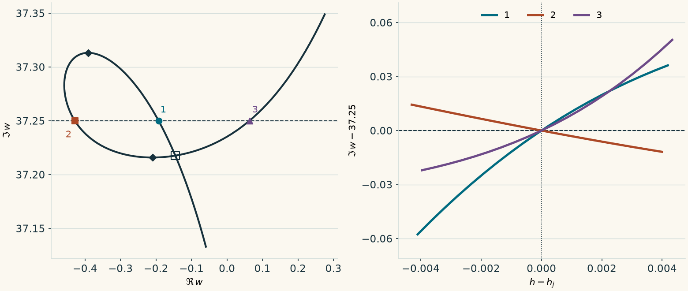](https://nuckyducky.github.io/The-Super-Zeta-Function/)

**Fig. 13. Three passes through height 37.25.** I follow the sixth Hurwitz path through height $37.25$ three times. In the left panel the path rises at 1, falls at 2 and rises again at 3. The two diamonds mark the crest and trough between those visits. The open square marks a separate event where the path visits the same complex point twice. In the right panel I set the clockwise angle to zero at each numbered visit. The slopes then show how quickly the height changes per radian on each pass. [Measured crossings and derivatives](archive/2026-11-19-sixth-passes-v001/README.md)

[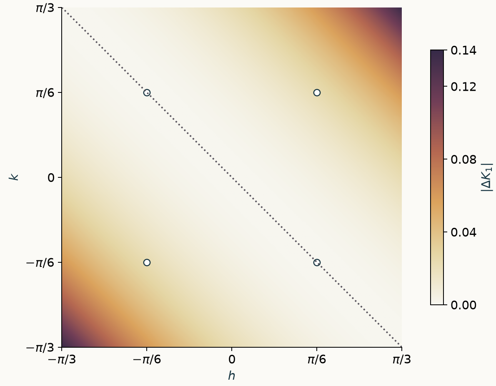](https://nuckyducky.github.io/The-Super-Zeta-Function/two-input/)

**Fig. 14. Angular contribution of two independent spectral inputs.** I change the imaginary parts $h$ and $k$ of the two spectral inputs $1+ih$ and $1+ik$ independently. The color measures how much the sum changes when I include the angles of the conjugate roots while keeping the radial phase fixed. Pale colors mean a small change and dark purple a large one. On the dotted diagonal $k=-h$, each conjugate pair contributes zero to that change. The four circles mark the choices $h,k=\pm\pi/6$. [Two-input derivation](docs/proofs/reciprocal-constructions.md#user-content-read-two-inputs) · [Color scale and sampled values](archive/2026-11-20-two-input-map-v001/README.md)

Prime-sum growth, branch prediction and the horn-map question

**Global hypothesis for my quartic field.** Let $G_E(x)$ be its smoothed prime-power sum after removing the two main terms specified in the proof. I ask whether for every $\epsilon>0$ some $C_\epsilon$ satisfies $\lvert G_E(x)\rvert\le C_\epsilon x^{1/2+\epsilon}$ for every real $x\ge2$. This two-sided bound would make its Mellin integral holomorphic for $\Re v>-1/2$. A field zero $\rho$ with $\Re\rho>1/2$ would give a pole at $v=\rho-1$ there. The field functional equation reflects the resulting exclusion across the critical line. The finite one-sided calculation in §1 uses the Eisenstein field. [Two main terms, pole residue and Mellin proof](archive/2026-11-20-dedekind-phase-v001/README.md#which-zero-counts-transfer)

The open field question is whether the native determinant, or another specified spectral reading of the ordered return, gives the three character residues independently of reducing the quartic. The test must specify the observable and its input before evaluating the comparison primes. The open spire question is how the certified finite cap orbits match to the limiting horn maps. [Chronological research questions](docs/proofs/reciprocal-constructions.md#user-content-read-questions)

For the two Gaussian disks, my next question is whether cancellation in the omitted terms keeps the real part of the completed factor negative around the entire right circle. That would settle both counts at zero. [Question 25 and its numerical threshold](docs/proofs/reciprocal-constructions.md#gaussian-disk-remainder)

<strong>Proofs, interactive figures, preprints and reproduction by topic</strong>

I keep the derivations, figures, and computational certificates together so each assertion can be traced back to the equation or experiment that produced it.

| Topic | Proof or data |
| --- | --- |
| Quadratic approximation, two ovals and the local/global obstruction | [Quartic derivation and descent](docs/proofs/reciprocal-constructions.md#user-content-read-quartic) |
| Distinct exponential sign words, consecutive stage products and primitive periods | [Sign recovery](docs/proofs/reciprocal-constructions.md#user-content-read-sign-words) · [Finite periods and the open horn correspondence](docs/proofs/reciprocal-constructions.md#user-content-read-dottie-spire) |
| Cosine spectrum, Fredholm determinant and relative Mellin correction | [Operator proof](docs/proofs/quartet-spectrum.md) · [Reproduction guide](archive/2026-11-18-spectral-reproduction-v001/README.md) |
| Orientation of the period-640 return from two spectral measurements | [The signed angle and its interval inverse](archive/2026-11-19-oriented-return-v001/README.md) |
| Paths of the symmetric Hurwitz zeros, intermediate crossings and the inverse from one summand | [Continuation between endpoints](archive/2026-11-19-zero-transport-v001/README.md) · [Three visits at the same height](archive/2026-11-19-sixth-passes-v001/README.md) · [One-term inverse](archive/2026-11-19-single-term-inverse-v001/README.md) |
| Angular velocity at the two signed angles and its mean square at Riemann zeros | [Velocity and Liu’s bound](archive/2026-11-20-liu-angular-velocity-v002/README.md) · [Mean squared speeds](docs/proofs/reciprocal-constructions.md#user-content-read-speed-moment) |
| Two independent spectral inputs and recovery of the first conjugate pair | [Two-input spectrum](docs/proofs/reciprocal-constructions.md#user-content-read-two-inputs) |
| Central-binomial sign weighting, finite Hurwitz transition and the Barnes–Dottie limit | [Factorial and quartet proofs](docs/proofs/reciprocal-constructions.md#user-content-read-factorial) |
| Three distinct ideal classes at discriminant $-23$ and the non-Galois cubic comparison | [Class weights, units and coefficient checks](archive/2026-11-20-dedekind-phase-v001/README.md) |

My two preprints give the definitions of the reciprocal tower and the local Dottie fold. Their TeX sources, PDFs and the commands to replay the archived and Lean checks are collected together. [My preprints and replay commands](docs/proofs/reciprocal-constructions.md#user-content-read-preprints)

## Credits

For the Gaussian prime angles I use the fourth angular harmonic in Rudnick and Waxman. The order-one completion used in the zero sum is the standard Hecke case of the analytic framework described by Lemke Oliver and Thorner. [Rudnick and Waxman, §4.1](https://arxiv.org/pdf/1705.07498#page=13) · [Lemke Oliver and Thorner, §2](https://arxiv.org/pdf/1505.03122#page=10)

I use Baker and Rippon’s iteration theory at the Dottie fold, McPhedran, Botten and Nicorovici’s symmetrized Hurwitz family for the motion of its zeros, and the bounds of OpenAI and Baiying Liu when locating nontrivial zeros. The field calculations use classical quadratic factorization, ideal norms, and quadratic Hecke characters. The formal and numerical checks use Lean, mathlib, FLINT and PARI/GP. Author and theorem references are listed beside the corresponding derivations. [Complete credits](docs/proofs/reciprocal-constructions.md#user-content-read-credits) · [Source map](archive/2026-11-16-super-zeta-v001/source-map.md) · [Archive and reproduction policy](PRESERVATION.md)
