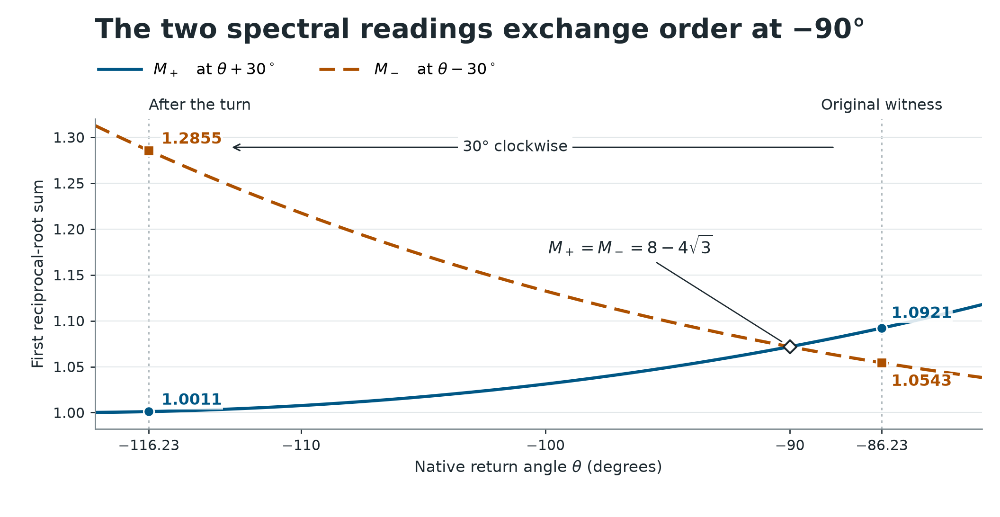
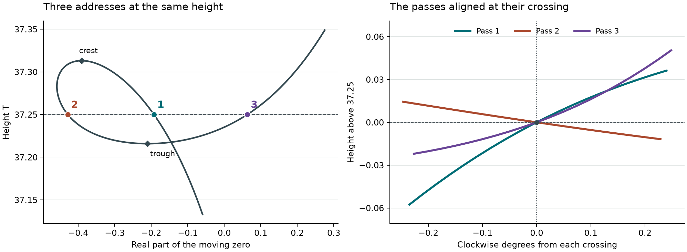
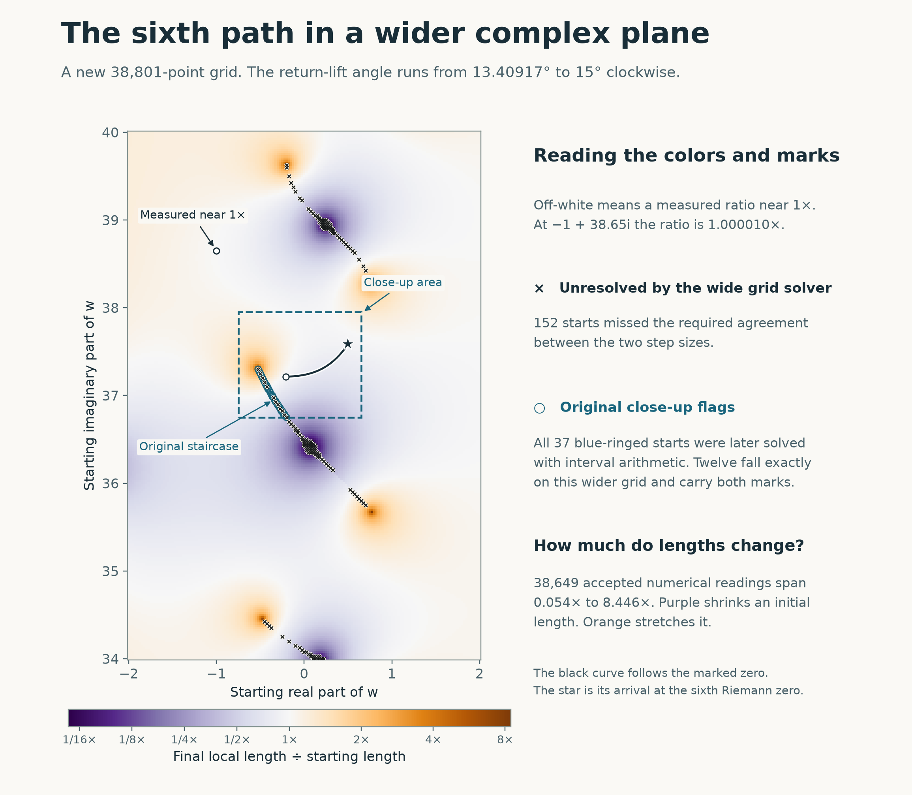
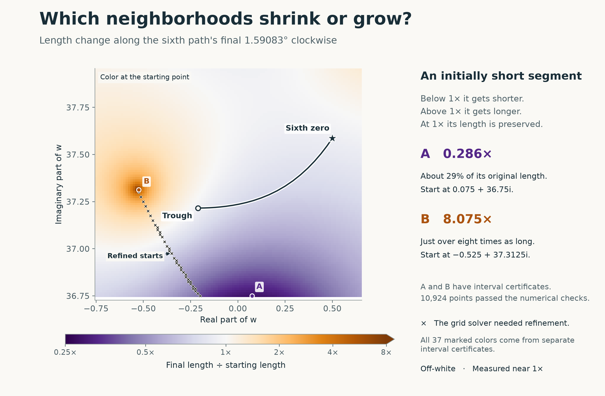
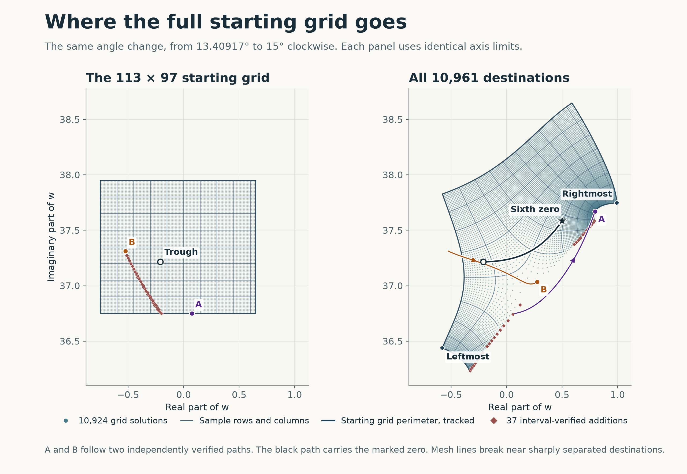

# The Super Zeta Function

**NuckyDucky**

## Abstract

I study the ordered return of the reciprocal exponentials $P'=e^{LQ}$ and $Q'=e^{-LP}$. Fixed pairs with multiplier one give a spectrum with entire determinant $E(v)=\cos^2\sqrt v-v$. Its zeros determine the reciprocal-power sums of my super zeta function. A cosine reference gives an exact comparison with Riemann zeta. I also use a marked family of determinants to measure the rotation of a finite attracting orbit. For a cap-selected orbit of period 640, two labeled spectral traces recover the side of the negative imaginary axis and, on a certified centerline interval, the original orbit parameter. [Unmarked determinant](lean/SuperZeta/UnitSpectrum.lean) · [Oriented inverse theorem](archive/2026-11-19-oriented-return-v001/README.md#the-two-trace-inverse)

**Principal results**

- I construct the quartet spectrum and a boundary operator with that spectrum.
- I recover $\zeta(2s)$ by comparing the quartet determinant with the cosine determinant.
- At a Dottie-selected height and its first two integer multiples above it, I strengthen the 7/8ths conclusion to the critical line within three explicit intervals.
- I recover the Stirling correction for each positive integer from the balanced-sign factor in my quartet normalization.
- I certify finite cycles in the Dottie spire and recover the period-640 witness from two labeled traces on a calibrated branch.
- I approximate $\pi$ from a genus-one quartic that fails the Hasse principle.

## Introduction

My starting problem was to approximate $\pi$ using $e$ and six integers. Solving the resulting quadratic exposed a curve with two real ovals and a reciprocal transformation exchanging its roots. The same reciprocal difference gives a coordinate for fixed pairs of the alternating tower. The Dottie fold identifies the multiplier-one condition. Extending that condition to the complex plane produces the determinant used below.

[1. Quadratic](#the-quadratic-and-the-genus-one-curve) · [2. Reciprocal tetration](#reciprocal-tetration) · [3. Super zeta](#building-the-super-zeta) · [Oriented period-640 return](#oriented-period-640-return) · [4. Local zero counts](#local-zeta-result) · [5. Factorial correction](#the-factorial-correction) · [Conclusions](#research-impact) · [Reproduction](#preprints-and-reproduction) · [Credits](#credits)

<a name="from-the-original-meme-to-the-dottie-spire"></a>

<a name="the-quadratic-and-the-genus-one-curve"></a>

## 1. The quadratic and the genus-one curve

My six integers are the coefficients of these two polynomials.

```math
\begin{aligned}
N(x)&=465x^2-183x-659,\\[0pt]
D(x)&=155x^2+396x-936.
\end{aligned}
```

I set $T(y)=(1+y)(2+y)/(y^2+y-1)$ and equated it to $N(x)/D(x)$. Clearing the denominators gave me a quadratic in $y$. Completing the square introduced the ordinate $Y$ and the quartic $f(x)=Y^2$. I suppress the argument $x$ on $N$ and $D$ when both are evaluated at the same input. [Quartic derivation, §1](archive/2026-11-18-lean-foundations-v001/arithmetic/research/geometry.md#1-the-exact-quadratic-and-the-quartic) · [Completing the square in Lean](lean/SuperZeta/Meme.lean)

```math
\begin{aligned}
0&=(N-D)y^2+(N-3D)y-N-2D,\\[0pt]
Y&=2(N-D)y+N-3D,\\[0pt]
Y^2&=(N-D)^2+4N^2\\[0pt]
   &=961000x^4-1039740x^3-1810543x^2+644010x+1813853.
\end{aligned}
```

<a name="what-the-right-panel-shows"></a>

### Real ovals and projective completion

On the left, the two values $Y=\pm\sqrt{f(x)}$ are separate graphs because $f(x)>0$ for real $x$. I divide $Y$ by $\sqrt{961000}(1+x^2)$ to draw both on a finite vertical scale. The right panel wraps the real line around a circle using the angle $2\arctan x$. The two directions $x\to+\infty$ and $x\to-\infty$ reach the same angle. [Plot coordinates and source](archive/2026-11-18-quartic-ovals-v001/README.md)


To see why the ends really join, I use the coordinates $t=1/x$ and $V=Y/x^2$ near infinity. At $t=0$ the equation becomes $V^2=961000$. Both ends of the upper graph reach the positive solution. Both ends of the lower graph reach the negative solution. The hollow dots are those two added points. The dashed circle is a guide for the radial drawing. In this projective completion, each open graph closes into a loop through its own point at infinity, so I can follow the same root choice all the way around the projective line. [Proof of the two real circles, §2](archive/2026-11-18-lean-foundations-v001/arithmetic/research/geometry.md#2-why-the-real-completion-is-exactly-two-circles) · [Radial drawing convention](archive/2026-11-18-quartic-ovals-v001/README.md)

Over $\mathbb C$ I can follow either square root as $x$ moves around the complex sphere. The two sheets meet at the four simple roots of $f$. Riemann–Hurwitz gives $2g-2=2(-2)+4=0$, so the completed complex curve has genus one. It is a torus with those two ovals as its real locus. Its elliptic Jacobian is the curve I use to study rational points. [Complex genus, §3](archive/2026-11-18-lean-foundations-v001/arithmetic/research/geometry.md#3-why-the-complex-completion-is-a-torus) · [Explicit elliptic Jacobian, §5](archive/2026-11-18-lean-foundations-v001/arithmetic/research/geometry.md#5-an-explicit-elliptic-jacobian-and-its-complex-structure) · [Fisher, binary quartics, §2](https://people.maths.bris.ac.uk/~jb12407/ANTS-XV/papers/ANTS-XV_fisher.pdf)

I call the input of the **widest gap in the normalized plot** Nucky’s constant, $x=0.057793510152240105777\ldots$. Its exact equation comes from differentiating $f(x)/(1+x^2)^2$. The narrowest plotted gap is near $x=1.400168$. Close by, at the positive zero of $N(x)$, the roots in the original coordinate $y$ are $-1$ and $-2$. Their gap of one is the exact minimum in that coordinate. [Stationary quartic and 384-bit enclosures](archive/2026-11-18-quartic-ovals-v001/README.md#where-the-branches-are-farthest-apart-and-closest-together) · [Exact gap in Lean](lean/SuperZeta/Meme.lean)

I checked solvability over the reals and over $\mathbb Q_p$ at every prime. The quartic passes all those local tests. The explicit map to the Jacobian would send a rational point of my quartic to one with a nonzero negative square as its first coordinate. The computer-assisted isogeny descent excludes that squareclass. That is what makes the quartic a **counterexample to the Hasse principle**. [Local points in Lean](lean/SuperZeta/HasseCover.lean) · [Map and descent, eqs. (4)–(6)](archive/2026-11-18-lean-foundations-v001/arithmetic/research/hasse-obstruction.md#proof)

### The point giving my approximation to π

To get my approximation, I fix $x=e$ and take the positive square root $Y(e)=\sqrt{f(e)}$ on the upper oval. The vertical coordinate in my starting equation was $y$. From $Y=2(N-D)y+N-3D$, I subtract $N-3D$ and divide by $2(N-D)$. The latter is positive for real $x$, so the upper oval gives the larger root of the quadratic. [Inverse coordinate and the two branches, §2](archive/2026-11-18-lean-foundations-v001/arithmetic/research/geometry.md#2-why-the-real-completion-is-exactly-two-circles) · [Upper-root identity in Lean](lean/SuperZeta/Meme.lean)

```math
\widehat\pi=\frac{3D(e)-N(e)+\sqrt{f(e)}}{2\bigl(N(e)-D(e)\bigr)}
=3.14159265358979323837582331055\ldots
```

The plot is centered at $(\pi,T(\pi))$, with both axes in units of $10^{-20}$. The horizontal error is $\pi-\widehat\pi\approx8.682007272725\times10^{-20}$. [Lean proof of the error bound](lean/SuperZeta/MemePrecision.lean)


The part I carried into the tower was $p=2y+3$. In that coordinate my quadratic is $p-p^{-1}=4N/(N-D)$, and $p\mapsto-1/p$ swaps its two roots. [Reciprocal substitution in Lean](lean/SuperZeta/Meme.lean)

<a name="reciprocal-tetration"></a>

## 2. Reciprocal tetration

In my preprint, the finite tower starts at height zero with $T_0=1$ and grows by $T_{n+1}=e^{LT_n}$. Thus $T_1=x$ and $T_2=x^x$ for $x=e^L$. I call $1$ the cap, the value at the top of the finite tower. For a positive real base I take $L=\log x$. Over the complex plane I work in the logarithmic lift. I choose $L$ first and use $x^z=e^{Lz}$ at every stage, which keeps the chosen logarithm attached to the base. [*Reciprocal Tetration*, §2, “Finite Tet and the reciprocal pair”](archive/2026-11-18-lean-foundations-v001/papers/foundations/main.tex#L109-L146) · [PDF](archive/2026-11-18-lean-foundations-v001/papers/foundations/main.pdf)

The pair $x^{x-a},x^{x+a}$ is a way to start thinking about two exponents at once. In my tower I alternate the bases $x$ and $x^{-1}$ and feed each output into the opposite stage. I start at $(1,1)$ and use the update

```math
F_L(P,Q)=\bigl(e^{LQ},e^{-LP}\bigr).
```

With center $m=(Q-P)/2$ and half-difference $a=(Q+P)/2$, the updated pair is $(x^{m+a},x^{m-a})$. I keep the branch witnesses $U=LQ$ and $V=-LP$, the actual exponents fed to the two maps. For $L\ne0$ they give back $Q=U/L$ and $P=-V/L$. My papers use $M$ for the second phase $Q$. [*Reciprocal Tetration*, §5, “Branch-sensitive complex fixed data”](archive/2026-11-18-lean-foundations-v001/papers/foundations/main.tex#L359-L402) · [Ordered return in Lean](lean/SuperZeta/Reciprocal.lean)

### The complex two-base family

I write the second base as $x^c=e^{cL}$. After two updates, the return on the first phase is $g_{L,c}(z)=e^{L e^{cLz}}$. The equal-base tower is the slice $c=1$. My reciprocal return is the slice $c=-1$, where $g_L(z)=e^{L e^{-Lz}}$ on the first phase and $g_{-L}$ on the second. For $L,c\ne0$, I choose $\kappa,\ell$ with $e^\kappa=L$ and $e^\ell=c$. The chart $z\mapsto\kappa+cLz$ turns the return into $E_\kappa\circ E_{\kappa+\ell}$, where $E_b(z)=e^z+b$. This puts both towers in one complex family while the original cap marks the two scalar orbits. [*Reciprocal Tetration*, §4, “Two-step scalar reduction and marked values”](archive/2026-11-18-lean-foundations-v001/papers/foundations/main.tex#L242-L326) · [Baker and Rippon, Theorem 8.1](https://doi.org/10.1080/17476938908814364) · [Rempe and Schleicher, exponential parameter space](https://doi.org/10.1017/CBO9780511735233.014)

### The Dottie spire

At six off-axis inputs the cap $(1,1)$ approaches a primitive period-321 cycle in one scalar coordinate and a primitive period-320 cycle in the other. The resulting attracting orbit has primitive period **205,440** under the ordered map. At the 320th scalar step one coordinate makes a large excursion whose direction sends the next iterate back near $1$. [Proof, six inputs, and standalone verifier](archive/2026-11-18-dottie-mixed-cap-period-v001/README.md)

I let the complex logarithm $L$ range over a grid. Each pixel records the period detected from the same cap, $(1,1)$. The narrow stack of period groups is what I call the **Dottie spire**. I keep track of the individual exponential stages in a lap, which lets me compare cycles that repeat after different numbers of paired updates. [*Reciprocal Tetration*, §§6–8, “Periodic reciprocal sign words” through “Directed anchors”](archive/2026-11-18-lean-foundations-v001/papers/foundations/main.tex#L404-L547) · [Figure settings and orbit data](archive/2026-11-18-research-figures-v001/README.md)

I specialize Baker and Rippon’s fixed-pair parametrization to the imaginary axis and write the phase angle as $u$. This gives $L=iY(u)$ with

```math
Y(u)=u\sec u\,e^{-u\tan u},
\qquad
\frac{Y'(u)}{Y(u)}=\frac{\cos^2u-u^2}{u\cos^2u}.
```

On $0<u<\pi/2$ the stationary point solves $d=\cos d$, with $d\approx0.7390851332$. I identify the boundary exactly as $L_*=i e^{-\sin d}\approx0.509863605523013\thinspace i$. The first change in $Y(u)$ away from its maximum is negative and quadratic, which is why two centerline fixed branches meet at a fold. I then center the return at the meeting point and rescale its quadratic term. In that coordinate it starts $f(z)=z+z^2+\cdots$. The linear term preserves a small displacement to first order. The quadratic term is the leading change that drives the local parabolic motion. [*Dottie Parabolic Fold*, §2, exact fixed curve](archive/2026-11-18-lean-foundations-v001/papers/dottie-spire/main.tex#L145-L243) · [§3, normalized germ and antiholomorphic square root](archive/2026-11-18-lean-foundations-v001/papers/dottie-spire/main.tex#L244-L304) · [Baker and Rippon, eqs. (12)–(13)](https://doi.org/10.1080/17476938908814364) · [Kaplan, *The Dottie Number*](https://doi.org/10.1080/0025570X.2007.11953455)


The Layer 4 survey searches paired periods up to 256. Gray marks unresolved pixels. To study higher periods on the imaginary axis I keep the half-step $H_y(z)=e^{iy\bar z}$, which squares to $g_{iy}$. At the fold its normalized square is $f$. This half-step gives separate physical return equations for even and odd periods. The paired periods 639, 640 and 641 give scalar periods 639, 320 and 641 under the squared map. I proved these periods in separate finite parameter windows by trapping the orbit and excluding shorter periods. [*Dottie Parabolic Fold*, §1, half-step and period conventions](archive/2026-11-18-lean-foundations-v001/papers/dottie-spire/main.tex#L100-L121) · [§§5–6, cylinder and physical return equations](archive/2026-11-18-lean-foundations-v001/papers/dottie-spire/main.tex#L347-L489) · [§8, directed finite windows](archive/2026-11-18-lean-foundations-v001/papers/dottie-spire/main.tex#L554-L604) · [Rump, verified numerics](https://doi.org/10.1017/S096249291000005X)

Baker and Rippon give the centerline return and convergence boundary. My spire analysis starts from that boundary and follows the cap into nearby cycles. The exact Dottie normalization gives separate return equations for the two parities, and the trapping certificates apply those periods to the original map. Under the cap and branch matching hypotheses in §9, the parameters of period $p$ on a rail approach the tip on the scale $p^{-2}$. I can follow the same marked period-640 cycle and its 25/295 itinerary across a finite interval. Matching its phase coordinates and logarithmic branches all the way to a specific limiting horn remains open. Section 10 estimates finite multiplier minima through paired period $4800$. [*Dottie Parabolic Fold*, §§9–10, rail law and finite data](archive/2026-11-18-lean-foundations-v001/papers/dottie-spire/main.tex#L605-L715) · [The finite orbit and the remaining horn matching](archive/2026-11-18-lean-foundations-v001/papers/dottie-spire/main.tex#L739-L750) · [Godin and Rousseau, antiholomorphic parabolic germs](https://doi.org/10.1017/etds.2021.98)

For the zeta experiment I checked two reflected points $L_\pm=\pm\eta+iy$ and their midpoint $L_0=iy$, using $\eta=4.749479070945369\times10^{-8}$ and $y=0.509892982511772$. The original cap is attracted to a cycle of primitive period 320 under the two-step return at each point. These finite orbits give me the marked laps and the parameter values used in the height rule below. [Preprint §8, off-axis witnesses](archive/2026-11-18-lean-foundations-v001/papers/dottie-spire/main.tex#L580-L604) · [Later three-point certificate, 384-bit arithmetic](archive/2026-11-18-lean-foundations-v001/checks/dottie_slice.py) · [Johansson, Arb ball arithmetic](https://arxiv.org/abs/1611.02831)

<a name="the-spectral-zeta-and-the-critical-line"></a>

<a name="building-the-super-zeta"></a>

## 3. Building the super zeta

<a name="1-compose-the-two-marked-stages"></a>

### 3.1 Compose the two marked stages

At a fixed pair, $P=e^U$ and $Q=e^V$, where $U=LQ$ and $V=-LP$ are the branch witnesses from my construction. A small change at $P$ passes first through $P\mapsto Q$ with derivative $-LQ$, then through $Q\mapsto P$ with derivative $LP$. By the chain rule the derivative of the whole return, called its **multiplier**, is

```math
g_L'(P)=(-LQ)(LP)=UV.
```

On the centerline chart, this product is $(u\sec u)^2$ and $Y'(u)/Y(u)=(1-UV)/u$. The condition $UV=1$ is therefore the one already built into the fold, where the two fixed branches meet. It says a small displacement returns unchanged to first order. [*Reciprocal Tetration*, §5, fixed-pair identities](archive/2026-11-18-lean-foundations-v001/papers/foundations/main.pdf#page=7) · [*Dottie Parabolic Fold*, §2, eqs. (6)–(9)](archive/2026-11-18-lean-foundations-v001/papers/dottie-spire/main.pdf#page=3)

<a name="2-recover-the-marked-phases-from-the-cosine-roots"></a>

### 3.2 Recover the marked phases from the cosine roots

From $U=Le^V$ and $V=-Le^U$ I eliminate $L$ to obtain $Ue^U+Ve^V=0$. On the multiplier-one locus I write $U=\alpha$ and $V=\alpha^{-1}$. The equation becomes $\alpha^2 e^{\alpha-\alpha^{-1}}=-1$. The same kind of reciprocal difference that solved my quadratic now gives the coordinate $2iu=\alpha-\alpha^{-1}$. Then $\alpha e^{iu}=\sigma i$, where $\sigma=\pm1$, and substitution yields $u=\sigma\cos u$. The steps also run back from a root to the ordered phases and the parameter.

```math
U=\sigma\sin u+iu,\qquad V=\sigma\sin u-iu,\qquad L=\sigma i e^{-\sigma\sin u}.
```

This recovery is why I can use cosine roots as a spectrum of the original return. Each root gives me both branch witnesses, the values $P=e^U$ and $Q=e^V$, and the complex $L$ that produced them. [Cosine spectrum, §1, eqs. (1)–(5)](archive/2026-11-16-super-zeta-v001/sources/foundation/cosine-spectrum.md#1-exact-recovery-of-every-ordered-phase-and-parameter) · [Phase recovery in Lean](lean/SuperZeta/Quartet.lean)

<a name="3-square-the-roots-and-sum-their-inverse-powers"></a>

### 3.3 Square the roots and sum their inverse powers

The real roots are $\pm d$, and the other roots come in quartets $\lbrace u_n,-u_n,\bar u_n,-\bar u_n\rbrace$. Squaring merges each sign pair. In the variable $v=u^2$ the determinant is the entire function

```math
E(v)=\cos^2\sqrt v-v=1-2v+\frac{v^2}{3}-\frac{2v^3}{45}+\cdots.
```

This is the step that gave me a zeta function. The zeros of $E$ are the squared values $d^2,u_n^2,\bar u_n^2$. I raise each to the power $-s$ using its principal logarithm and sum them.

```math
\mathcal Z(s;1)=d^{-2s}+\sum_{n\ge1}\bigl[(u_n^2)^{-s}+(\bar u_n^2)^{-s}\bigr],
\qquad \Re s>\frac12.
```

The complete root list gives more than individual frequencies. Write $\lambda_j$ for the squared roots just listed. Their moduli grow quadratically with the quartet index, so $\sum_j|\lambda_j|^{-1}$ converges. The entire determinant has order at most $1/2$. Hadamard factorization therefore leaves only a constant in front of its genus-zero product, and $E(0)=1$ fixes that constant. In particular,

```math
E(v)=\prod_j(1-v/\lambda_j),\qquad
-\frac{E'(v)}{E(v)}=\sum_{m\ge1}\mathcal Z(m;1)v^{m-1}
```

where the series holds near zero. For example, $E(v)=1-2v+v^2/3+\cdots$ gives $\mathcal Z(1;1)=2$ and $\mathcal Z(2;1)=10/3$. The first equality ties the Dottie root to every nonreal quartet in one exact sum. Lean proves the product for this concrete root family. [Product, traces and a tail bound, eqs. (16)–(19)](archive/2026-11-16-super-zeta-v001/sources/foundation/cosine-spectrum.md#4-canonical-product-and-exact-rational-trace-sums) · [Lean theorem](lean/SuperZeta/UnitSpectrum.lean)

<a name="the-boundary-operator-behind-the-determinant"></a>

### 3.4 The boundary operator behind the determinant

There is another way to obtain those same numbers. On $L^2(-1,1)\oplus\mathbb C$, take a function $f$ in $H^1(-1,1)$ and keep its midpoint value $c=f(0)$ as a second coordinate. For every complex $\varepsilon\ne0$ I define

```math
A_\varepsilon(f,c)=\left(-if',\frac{\varepsilon}{2}\bigl[f(-1)+f(1)\bigr]\right).
```

An eigenfunction must be $f(x)=c e^{iux}$. Its endpoint average is $c\cos u$, so the second coordinate gives $u=\varepsilon\cos u$. My manuscript constructs the inverse $B_\varepsilon$, proves its square is trace class, and computes its Fredholm determinant explicitly. [Operator, inverse and finite-matrix proof, eqs. (6)–(15)](archive/2026-11-16-super-zeta-v001/sources/foundation/cosine-spectrum.md#2-a-boundary-operator-with-compact-inverse-and-the-cosine-spectrum)

```math
\det(I-vB_\varepsilon^2)=\cos^2\sqrt v-v/\varepsilon^2.
```

The reciprocal equations determine the unit-coupling roots. I chose the midpoint and the two endpoint values to realize those roots as eigenvalues. One entry makes the coupling convention easy to check. In the inverse, scalar input $1$ contributes the constant function $1/\varepsilon$. Its coefficient on a normalized indicator of a cell of width $2/N$ is

```math
(B_N)_{j,N+1}=\frac{\sqrt{2/N}}{\varepsilon}.
```

For $N=2$, $\varepsilon=2$ and $u=1$, this gives $\det(I-uB_N)=1/8$. [Projection and determinant, eqs. (8), (12) and (13)](archive/2026-11-16-super-zeta-v001/sources/foundation/cosine-spectrum.md#3-exact-fredholm-determinant-and-controlled-finite-matrices)

**What was already known?** In Hupkes’s continuous-history space, the midpoint condition and a derivative already appear together. Choosing equal endpoint weights $i\varepsilon/2$ in his characteristic equation and putting $z=iu$ gives exactly $i(u-\varepsilon\cos u)$. What I trace here is the passage from my ordered reciprocal phases to the squared spectrum at $\varepsilon=1$, its explicit Hilbert-space determinant, and the resulting zeta comparison. Varying $\varepsilon$ moves the spectrum. Adding a shift $a$ gives the separate family $\sum_j(\lambda_j+a)^{-s}$, with its own poles and residues. I welcome an earlier reference for this precise combination. [Hupkes, eqs. (2.10), (2.54) and Lemma 2.4.4](https://math.leidenuniv.nl/scripties/PhdHupkes.pdf) · [Shifted spectrum, domain and residues](archive/2026-11-16-super-zeta-v001/research/shifted-superzeta.md)

<a name="4-compare-with-the-odd-integer-spectrum"></a>

### 3.5 Compare with the odd-integer spectrum

I compare $E$ with $\cos^2\sqrt v$, whose double zeros are $[(n+\tfrac12)\pi]^2$ for $n=0,1,2,\ldots$. Their reciprocal-power sum is the odd-integer part of $\zeta(2s)$, counted twice and scaled by $(2/\pi)^{2s}$. I use the principal logarithm for each squared root. On the negative real axis $E(-t)=\cosh^2\sqrt t+t>0$, so that axis is free of spectral zeros and the determinant logarithm there is real with $\log E(0)=0$. The full determinant integral and the root sum agree first on $1/2<\Re s<1$. Dividing out the reference determinant leaves $1+t/\cosh^2\sqrt t$. Integrating its logarithmic derivative by parts gives

```math
J(s;1)=\frac{s\sin(\pi s)}{\pi}
\int_0^\infty t^{-s-1}\log\left(1+\frac{t}{\cosh^2\sqrt t}\right)\,dt
\qquad (\Re s<1).
```

Subtracting Taylor terms at $t=0$ continues this correction. The factor $\sin(\pi s)$ cancels the poles introduced by those terms, so $J$ is entire. The reconstruction is

```math
F(s)=\mathcal Z(s;1)-J(s;1)=2\pi^{-2s}(2^{2s}-1)\zeta(2s).
```

With $w=2s$, the prefactor is nonzero in $0<\Re w<1$, so I can recover $\zeta(w)=\pi^w F(w/2)/[2(2^w-1)]$ there. Each Riemann zero corresponds to a zero of $F$ with the same multiplicity. The line $\Re w=1/2$ becomes $\Re s=1/4$, and its heights are halved as well. Lean proves the product over the Dottie square and the two squared roots from each nonreal quartet. Those roots determine the whole determinant, including its value between zeros. On the Mellin strip, their sum gives the same continuation used here. [Cosine spectrum, §5, eqs. (20)–(23)](archive/2026-11-16-super-zeta-v001/sources/foundation/cosine-spectrum.md#5-a-two-variable-zeta-for-the-inverse-cosine-coupling-family) · [Voros, zeta functions over zero sets](https://arxiv.org/abs/1403.4558) · [DLMF, Mellin transforms](https://dlmf.nist.gov/2.5) · [Lean determinant product and root sum](lean/SuperZeta/UnitSpectrum.lean)

<a name="oriented-period-640-return"></a>

### 3.6 Inverting two spectral traces on the period-640 orbit

Here I use the spectrum to read a rotation of the original attracting orbit. Put $L=iy$ and let $p_y$ be the point selected by iterating the scalar lap $G_y=g_{iy}^{320}$ from the cap $1$. The angle $\theta(y)=\arg G_y'(p_y)$ is the turn of a small displacement after one lap of 640 alternating exponential stages. At the centerline witness $y_0=0.509892982511772$ that turn is $-86.2334491153^\circ$. [Period convention and finite witnesses](archive/2026-11-18-lean-foundations-v001/papers/dottie-spire/main.tex#L554-L604) · [Derivative of the full lap](lean/SuperZeta/Oriented/OrderedStages.lean)

**Proposition (two-trace inverse).** I mark the two exponential stages by opposite phases. For a probe angle $a$, let $M(a)$ be the sum of the reciprocal zeros of its normalized positive-sign squared determinant. For $\cos a\ne0$, the sum converges absolutely and equals $2/(1-\sin a)$. The unshifted squared spectra agree at angles reflected across $-90^\circ$, even with both stage signs retained. I measure the same positive-sign spectrum at two labeled offsets and write

```math
M_+=M(\theta+\pi/6),\qquad M_-=M(\theta-\pi/6),\qquad
S_\pm=1-2/M_\pm .
```

Where both probes are regular, $S_\pm=\sin(\theta\pm\pi/6)$. Subtracting and adding the two sine addition formulas gives the inverse

```math
\cos\theta=S_+-S_-,\qquad
\sin\theta=\frac{S_++S_-}{\sqrt{3}}.
```

On the sector $-120^\circ<\theta<-60^\circ$, $M_+>M_-$ identifies the side above $-90^\circ$ and $M_+<M_-$ the side below. At the pivot the two readings equal $8-4\sqrt3$. The pair identifies the current side. Reading it before and after a specified turn records which side the orbit came from. [Proof from the complete zero set](lean/SuperZeta/Oriented/SpectralInverse.lean) · [Reflection of the squared determinant](lean/SuperZeta/Oriented/PhaseSymmetry.lean)



**Period-640 round trip.** I turned the measured phase clockwise by $30^\circ$, found the corresponding parameter on the same branch, and evaluated both determinants afresh there. The rounded entries below come from directed enclosures. [Interval record](archive/2026-11-19-oriented-return-v001/data/quarter_probe.json)

| Measurement | Native angle | $M_+$ | $M_-$ |
| --- | ---: | ---: | ---: |
| Original orbit | −86.2334491153° | 1.092114930 | 1.054295998 |
| After the clockwise turn | −116.2334491153° | 1.001081173 | 1.285503688 |

Decoding the second pair and adding back $30^\circ$ gives a parameter interval containing $y_0$ of width below $10^{-29}$. The cap selects the starting point at this parameter. Iterating the ordered map then recovers the same cycle with its actual exponents $U=LQ$ and $V=-LP$ at every step. Each of the 1,280 returned exponent enclosures overlaps its original partner.

Lean proves the determinant product, the inverse formula and the return theorem on a continuous, strictly increasing angle branch with the target in range. The 448-bit interval computation verifies cap capture, primitive period and positive angle derivative on the stated witness interval. Lean separately checks the printed rational return bounds. [Full proof, arithmetic comparison with Liu, and replay](archive/2026-11-19-oriented-return-v001/README.md)

**Arithmetic consequence.** At the *absolute* native angles $-30^\circ$ and $+30^\circ$, the reference spectra give the same function $\pi^{-w}(3^w-1)\zeta(w)$ with $w=2s$. The first dynamical correction is zero at $-30^\circ$ and $8/3$ at $+30^\circ$. Liu’s joint moment estimates give the external zero-free bound for this common reference. The measurements around the period-640 witness use relative offsets from its own angle. [Liu, Theorem 1.1](https://hexagonmath.org/pdf/2611.00421v1#page=2) · [Derivation and phase convention](archive/2026-11-19-oriented-return-v001/README.md#the-arithmetic-reference-at-the-two-absolute-angles)

<a name="zero-transport"></a>

### 3.7 Following a zero from one turn to the next

On the right-hand period-640 branch, my two spectral traces recover the signed angle of the marked return. Its measured clockwise turn passes through $60^\circ$ and $45^\circ$. I chose these two angles because both give an exact Riemann factor. With $w=2s$ and $b=1/2-\theta/\pi$, I followed one simple zero of $R(b,w)=\pi^{-w}[\zeta(w,b)+\zeta(w,1-b)]$ continuously from $b=1/6$ to $b=1/4$. [Orbit calibration](archive/2026-11-19-zero-transport-v001/Dottie-Off-Axis-Return/NOTES.txt) · [The arithmetic family and its antecedents](archive/2026-11-19-zero-transport-v001/README.md#relation-to-prior-work)

For $w\ne1$, grouping the two reduced residue classes modulo four and six gives

```math
R(1/4,w)=\pi^{-w}2^w(2^w-1)\zeta(w),\qquad
R(1/6,w)=2^{-w}(3^w-1)\,R(1/4,w).
```

The first identity tells me the possible destinations. The second lets me keep the exact ending coordinate and start the same turn again. To find which destination belongs to a particular seed, I followed overlapping disks containing a unique zero at every intervening angle. I saved each endpoint before identifying it from its elementary factor or an independent Riemann zero count. [Lean proof of the reset](archive/2026-11-19-zero-transport-v001/Dottie-Second-Zero/ReferenceReset.lean) · [Path and endpoint checks](archive/2026-11-19-zero-transport-v001/README.md#verification-and-replay)

**Does the turn find the next zero in height order?** I number the positive-height Riemann zeros $\rho_1,\rho_2,\ldots$ from the bottom up. The first seed came from tracing a known zero backward. I called the second, third and fourth zeros before their respective forward tests. The first failure came when I called for the fifth. Each arrow below is one complete turn.

```math
\rho_1 \longrightarrow \frac{4\pi i}{\log 2} \longrightarrow \rho_2
\longrightarrow \rho_3 \longrightarrow \rho_4
\longrightarrow \frac{8\pi i}{\log 2} \longrightarrow \rho_7.
```

The fourth-zero call hit directly. The next call skipped the fifth and sixth as destinations. They were also absent from the interiors of those paths. On the blue arc leaving $\rho_4$, I counted three crossings of the critical line after departure. Even the narrow upper loop crosses twice. [Predictions, comparison seeds and stopping rule](archive/2026-11-19-zero-transport-v001/README.md#how-the-cases-were-selected)

| Rotation clockwise from the seed | What happens | Height | Ordinary zeta magnitude |
| --- | --- | ---: | ---: |
| $0$ | Start at the fourth zero | 30.424876 | 0 |
| $0.034097675\pi$ | Cross to the left | 33.035367 | 0.142187 |
| $0.070080843\pi$ | Cross to the right | 35.225270 | 2.920990 |
| $0.071086383\pi$ | Cross back to the left | 35.325132 | 2.938889 |
| $\pi/12$ | Reach the elementary address | 36.258881 | 4.055336 |

I report turn sizes as positive distances clockwise. The signed angle change is their negative. The interior angles are rounded. [Native angles, turns and exact elementary addresses](archive/2026-11-19-zero-transport-v001/Dottie-Transport-Reversibility/rotations.md) · [Directed crossing enclosures](archive/2026-11-19-zero-transport-v001/Dottie-Transport-Reversibility/blue-crossings.json) · [Download the interactive route explorer](https://github.com/NuckyDucky/The-Super-Zeta-Function/raw/refs/heads/main/archive/2026-11-19-zero-transport-v001/order-of-the-turns.html)

**Which arcs were already in print?** McPhedran, Botten and Nicorovici plotted this same family in 2007. Reading their figures from $a=5/6$ to $a=3/4$ gives my clockwise turn because $a=1-b$. Figures 2b, 3a, 3b and 4 contain, in order, the four individual arcs from $4\pi i/\log 3$ through the first Riemann zero, the base-two address, the second zero and the third. Their labels count zeros at $a=1/2$. I followed those labeled zeros to both of my angles to identify the matches. Reusing each endpoint as the next seed joins pieces of different published trajectories. The later skip asks what order this repeated operation imposes. [Original paper, §3 and Figures 2–4](https://doi.org/10.1098/rspa.2006.1763) · [Five figure identifications and their checks](archive/2026-11-19-zero-transport-v001/Dottie-Transport-Reversibility/PRIOR-WORK.md)


**Where were the missing two?** After closing the forward trial, I traced the fifth and sixth zeros backward and replayed both paths forward. Their respective starting addresses were $10\pi i/\log 3$ and $12\pi i/\log 3$. Each is present at $60^\circ$ through the factor $3^w-1$. Neither can be inherited from a preceding $45^\circ$ endpoint. On the imaginary axis those endpoints satisfy $2^w=1$, and equality of a nonzero base-three and base-two address would require a positive power of two to equal a positive power of three. Uniqueness along a regular simple path makes the recovered starting address the only one for that destination on this turn. This explains how a direct turn can reach each missing zero while a chain that only reuses endpoints skips it. [Inverse calculation, proof and replay](archive/2026-11-19-zero-transport-v001/Dottie-Transport-Reversibility/README.md) · [Question log](#zero-transport-questions)

### 3.8 Why the sixth path folds back

On the path from $12\pi i/\log 3$ to the sixth Riemann zero, I reach height $37.25$ three times. The moving zero first climbs through it on the left, descends through it farther left, then climbs through it on the right of the imaginary axis. At the crest it travels due left. At the trough it travels due right. Its tangent turns **180° counterclockwise** between them while my input turns only **2.454268° clockwise**. Following the moving zero requires changing both its real part and its height as the two Hurwitz shifts vary. The graph aligns the three crossings so their slopes and accelerations can be compared directly.

[](https://nuckyducky.github.io/The-Super-Zeta-Function/)

The square on the graph marks a different kind of return. At two distinct input angles the path revisits the same complex point near $-0.14560046+37.21759523i$. The two tangents cross at about $40.8982^\circ$. Recording the shift distinguishes those visits even when both coordinates of the zero agree. [Open the interactive graph](https://nuckyducky.github.io/The-Super-Zeta-Function/) · [Derivative formulas, interval proofs and replay](archive/2026-11-19-sixth-passes-v001/README.md)

### 3.9 What one Hurwitz term remembers about the orbit

I hid the turn angle, both ordered traces and the position of the moving zero at the sixth path's crossing. I kept just the first complex summand $A=\zeta(w,b)$. One reading recovered the visit heading up and left at $142.21^\circ$. The other recovered the visit heading almost due right at $3.11^\circ$. On the calibrated right flank, each angle also located the original period-640 orbit and its two marked phases. [Blind inputs, decoded directions and orbit enclosures](archive/2026-11-19-single-term-inverse-v001/README.md#the-experiment)

That reading itself takes the same value twice elsewhere. The two Dottie orbits there have multiplier moduli $0.19009231$ and $0.18425549$, so nearby starting points contract at different rates even though the first Hurwitz value agrees. I checked all 15 degrees of this branch. This is the only repeated first-term reading, and its two visits have different zero positions. Recording the pair $(w,A)$ distinguishes every visit on the sweep. [Graph of the two crossings and proof](archive/2026-11-19-single-term-inverse-v001/README.md#where-the-single-reading-agrees-twice)

### 3.10 What a full turn changes near the sixth zero

The sixth path ends at the native $45^\circ$ angle of my marked Dottie orbit. I asked what happens to points on either side of that path. I followed each point from the final trough to the landing while holding its own complex value of $H(w,b)=\zeta(w,b)+\zeta(w,1-b)$ fixed. A tiny line segment at the trough on the zero path shrinks to $0.93910$ times its length. A segment starting at $0.075+36.75i$ shrinks to $0.28613$ times its length, while one starting at $-0.525+37.3125i$ expands by a factor of $8.0752$. Colored pixels give numerical estimates. I verified these last two factors by following their nonzero levels with directed arithmetic. [Plane map and derivative](archive/2026-11-19-dottie-plane-atlas-v001/atlas/plane_notes.md) · [Two certified paths](archive/2026-11-19-dottie-plane-atlas-v001/atlas/plane_anchors.json)

I also extended the sampled rectangle to $-2\leq\Re w\leq2$ and $34\leq\Im w\leq40$. On the wider grid, 38,649 points passed the two-step numerical comparison and 152 were flagged. The off-white region means a length factor near one. The crosses identify points where the two numerical resolutions disagreed or the level residual exceeded tolerance. On the original closeup, I revisited all 37 flagged centers with interval arithmetic and reached a regular endpoint at every one. Two adjacent inputs at height $36.7875$ illustrate why this region is hard to draw. They start $0.0125$ apart and finish $1.72036$ apart, even though infinitesimal lengths at both inputs shrink to less than half. [The wider sample](archive/2026-11-19-dottie-plane-atlas-v001/atlas/plane_wide.json) · [All 37 verified centers and the two-point comparison](archive/2026-11-19-dottie-plane-atlas-v001/atlas/staircase.json)

In each of those 37 squares, a nearby point has a different fate from the grid center. Its two solutions coalesce in a square-root fold. I followed all 37 examples to the same moving critical branch and identified the same incoming square-root sign in each. This locates the fold inside the squares traced by the crosses. [Moving critical branch and the 37 collisions](archive/2026-11-19-dottie-plane-atlas-v001/atlas/gray_collision.json)







I then held the Hurwitz shift fixed at $b=1/4$ and asked which zero attracts a starting point. Here $f(w)=2^w(2^w-1)\zeta(w)$. I let the marked multiplier act on its value through $f(w(t))=e^{\ell t}f(w(0))$. The 640 ordered exponential stages give a lifted angle of $-315^\circ$. Taking the principal logarithm of their product gives $+45^\circ$. Both clocks multiply $f$ by exactly the same complex number after one lap. Their paths around a branch value differ. **Every starting point within $10^{-6}$ of $37i$ converges to the elementary zero $8\pi i/\log 2$ with the principal clock and to the sixth Riemann zero with the ordered clock.** The two inverse branches meet at a simple critical point near $0.235950387+36.945179676i$. [Derivation and proof](archive/2026-11-19-dottie-plane-atlas-v001/atlas/THESIS.md) · [Whole-disk convergence](archive/2026-11-19-dottie-plane-atlas-v001/atlas/basin_certificate.json) · [The two branches](archive/2026-11-19-dottie-plane-atlas-v001/atlas/critical_branches.json)


**How early could I see the landing?** On ten previously located branches, I hid the endpoint and extrapolated from the position, velocity and acceleration. At the sixth path's last trough that single quadratic step captured $27.23\%$ of the remaining rise. Updating 64 times reduced its complex distance error from $0.274054$ to $0.000076581$. I then publicly fixed the next two triadic seeds, the cutoff and the scoring rule before evaluating them. With $1/8$ degree left, the quadratic forecast had complex error $0.00001901$ for seed 7, which reached the fifth dyadic address, and $0.00030671$ for seed 8, which reached Riemann zero 11. Both satisfied the preset $0.001$ threshold and the endpoint-family rule. [Retrospective ten-branch trial](archive/2026-11-19-dottie-plane-atlas-v001/landing/README.md) · [Pre-evaluation protocol](https://github.com/NuckyDucky/The-Super-Zeta-Function/blob/a739bf30c0db09774d4fd3681596a1821f31d081/protocols/2026-11-19-dottie-plane-holdout.json) · [Two-seed results](archive/2026-11-19-dottie-plane-atlas-v001/holdout/README.md)

<a name="a-local-strengthening-of-the-seven-eighths-theorem"></a>
<a name="local-zeta-result"></a>

<a name="a-local-strengthening-of-the-78ths-theorem"></a>

## 4. A local strengthening of the 7/8ths theorem

<a name="how-the-iteration-gives-the-height"></a>

### Selection of the test height

I used the certified period-320 lap at the spire to choose where to count. Each of the two marked exponential stages occurs 320 times per lap. The derivative divided by the output of $z\mapsto e^{\pm Lz}$ is $\pm L$, so comparing the product for one marked stage at a flank with its product at the midpoint gives the modulus ratio $(|L_\pm|/|L_0|)^{320}$.

I checked the full-return tangent winding separately and found magnitude one at the two flanks. In the height experiment I chose the logarithm $\delta$ of the marked product ratio as the phase scale. I fixed the one-winding rule $T_D\delta=2\pi$ before evaluating zeta. The Riemann height I get is

```math
T_D=\frac{2\pi}{160\log(1+(\eta/y)^2)}
=4{,}526{,}119{,}322{,}477.945393\ldots .
```

I also counted zeros in a window of the same width around the nearest multiple of $\pi$. That comparison interval contained three zeros, all on the critical line. [Height rule and frozen inputs](archive/2026-11-17-dottie-grid-match-v001/README.md#nomination-before-forecasting) · [Winding and matched comparison](archive/2026-11-17-dottie-grid-match-v001/README.md#forecast-and-directed-counts)

I then tested whether the Dottie clock picks heights **closer** to a zero than nearby controls. The earlier pilot split one win each. In a publicly preregistered test of 32 transverse inputs, the clock won 20 comparisons and the controls won 16. At 14 inputs the orbit check left both comparisons unresolved, so the predicted overall majority remains open. [Frozen selection rule](archive/2026-11-18-clock-local-controls-protocol-v001/README.md) · [Every input, comparison and unresolved case](archive/2026-11-18-clock-proximity-results-v001/README.md)

<a name="what-the-three-windows-tell-me"></a>

### Certified counts in the three windows

I wanted to know whether the spire had pointed me to a sideways pair of zeros, at the same height and on opposite sides of the line. That takes a count over the whole window. A pair could sit between the heights I happened to sample.

Write $w=\beta+it$. OpenAI’s 7/8ths theorem excludes zeros in $\beta>7/8$. Reflection therefore confines nontrivial zeros to $1/8\le\beta\le7/8$ at every height. At $T_D$ my contour covered $1/16<\beta<15/16$, so the theorem completes that first count across the critical strip. My contours at $2T_D$ and $3T_D$ covered the full width directly. [OpenAI, Theorem 1.1](https://github.com/openai/math/blob/main/preprints/The-Quasi-Riemann-Hypothesis-September-30-2026/paper.pdf) · [Functional equation](https://dlmf.nist.gov/25.4) · [First full-strip corollary](archive/2026-11-17-dottie-local-strip-v001/README.md#full-strip-corollary)

| Interval in Riemann height $t$ | Simple zeros on $\beta=\tfrac{1}{2}$ | Off-critical-line zeros | Certificate |
| --- | ---: | ---: | --- |
| $\lvert t-T_D\rvert\lt\tfrac{1}{4}$ | 2 | 0 | [First height](archive/2026-11-17-dottie-local-strip-v001/README.md) |
| $\lvert t-2T_D\rvert\le\tfrac{1}{2}$ | 5 | 0 | [Second height](archive/2026-11-18-superzeta-distance-v001/README.md) |
| $\lvert t-3T_D\rvert\le\tfrac{1}{2}$ | 4 | 0 | [Third height](archive/2026-11-18-superzeta-distance-v001/README.md) |

I used interval arithmetic around each rectangle to count every zero with multiplicity. Separate sign changes of Hardy’s function $Z$ gave me a lower bound for the number of distinct zeros on the line. The counts agreed in every window. That accounts for all eleven zeros, proves they are simple, and excludes a sideways pair anywhere within the checked heights. [First interval certificate](archive/2026-11-17-dottie-local-strip-v001/README.md#full-strip-corollary) · [Higher interval counts and independent check](archive/2026-11-18-superzeta-distance-v001/README.md#how-the-computations-certify-the-statements) · [FLINT’s zero-counting methods](https://flintlib.org/doc/algorithms/special-functions/zeta-zeros.html)

**I strengthen the 7/8ths conclusion in these three windows from the allowed strip to the single line $\beta=1/2$.** In particular I exclude the previously allowed points with $1/2<\beta\le7/8$ and their reflections. My addition is a rule for choosing the height from the cap-marked Dottie return, followed by the contour counts and the matching line brackets at those heights. The same result is $\Re s=1/4$ in my super zeta coordinate, over the corresponding halved height intervals. [Full result and evidence](archive/2026-11-18-superzeta-distance-v001/README.md)

<a name="the-factorial-correction"></a>

## 5. The factorial correction

### What the quarter measures

At quartet level $n$, the four recovered parameters have the same modulus $R_n$, which grows like $2\pi n$. Among all histories of $2n$ exponential signs, the fraction with equally many plus and minus signs is $B_n=4^{-n}\binom{2n}{n}$. I choose two histories independently and require both to balance, giving the factor $B_n^2$. It behaves like $1/(\pi n)$ and cancels the leading growth of the radii. I write the normalization as a radial factor times a factorial factor.

```math
C_n=\frac{R_n B_n^2}{2}=\frac{R_n}{2\pi n}\,D_n,
\qquad D_n=\pi n B_n^2.
```

**What changes if I replace the quartet radii with the grid $2\pi n$?** The binomial factor already gives a limiting displacement of $1/4$ on the grid. My quartet equations give $R_n-2\pi n\to0$, so the actual radii preserve that limit. The difference shows up at finite levels. The actual displacement rises from $0.211094$ at level 28 to $0.211856$ at level 29, crossing the Hurwitz threshold $0.211325$. The grid starts at $1-\pi/4\approx0.214602$ and increases at every level. The corrected independent audit reproduced the crossing. Lean verifies that the grid stays above the exact threshold at every positive integer level. [Comparison, proof and corrected notebook](archive/2026-11-18-quartet-grid-comparison-v001/README.md) · [Quartet-radius theorem](lean/SuperZeta/QuartetRadius.lean)

The two-history count also occurs inside the Dottie map. I select four inverse branches, assign them the four directions of a square lattice, and count their ordered words equally. Among the marked points fixed by $2n$ returns on this subsystem, the fraction with zero total displacement is exactly $B_n^2$. The cap follows its prescribed alternating stages. Counting all four-branch words and pairing their length $2n$ with quartet level $n$ are choices in my normalization. [Four branches and the exact count, eqs. (5) and (15)–(17)](archive/2026-11-16-super-zeta-v001/research/balanced-charge-operators.md)

The leading Stirling factors in $(2n)!/(n!)^2$ give the cancellation. The next term decides whether the normalization produces a real displacement. To measure it exactly, I write $S_n=\sqrt{2\pi n}(n/e)^n$ for the usual Stirling approximation and $\rho_n=\log(n!/S_n)$ for its logarithmic error. My normalization isolates the precise combination of errors that survives.

```math
\begin{aligned}
I(x)&=\int_0^\infty e^{-xt}\frac{\tanh(t/4)}{t}\,dt,\qquad x>0,\\[0pt]
\log D_n&=2\rho_{2n}-4\rho_n=-I(n),\\[0pt]
\log C_n&=\log\frac{R_n}{2\pi n}-I(n).
\end{aligned}
```

This turns the correction I care about into an exact analytic expression. To see how much of it comes from the quarter term, I use the same half-integer cosine spectrum that enters the reconstruction of $\zeta(2s)$. Its partial fractions expand the kernel $\tanh(t/4)/t$ and bound each truncation by its first omitted term. The first bound is

```math
0\le \log D_n+\frac{1}{4n}\le\frac{1}{96n^3},\qquad n\ge1.
```

At level 10 the estimate for $\log D_{10}$ is $-0.025$, with an error of at most $0.00001042$. The radial factor contributes at smaller order than $1/n$, so the quarter survives after the two factors are combined. In the effective levels this reads $nC_n=n-1/4+o(1)$. [Exact correction and all-order bound](archive/2026-11-18-stirling-correction-v001/README.md#the-exact-correction) · [Radial scale and quarter limit in Lean](lean/SuperZeta/QuartetRadius.lean) · [DLMF, Stirling’s series](https://dlmf.nist.gov/5.11)

### Recovering the error on one factorial

The identity for the balanced count also tells me about a single factorial. Rearranging it gives $\rho_n=I(n)/4+\rho_{2n}/2$. I repeat this at $2n$, $4n$, and higher doublings. The remaining term tends to zero by Stirling’s limit. This gives an exact formula for $n!$ from the same kernel I used for the quartets.

```math
\rho_n=\frac14\sum_{j=0}^{\infty}2^{-j}I(2^j n),
\qquad n!=\sqrt{2\pi n}\left(\frac ne\right)^n e^{\rho_n}.
```

Since $0\le I(x)\le1/(4x)$, keeping the first $k$ terms leaves at most $4^{-k}/(12n)$ in the logarithm of the factorial ratio. This gives me a precision target before I compute. For example, the leading expression for $10!$ gives about $3{,}598{,}695.62$. Its exact correction multiplies that by about $1.0083653591$, giving $3{,}628{,}800$. Binet’s classical formula already expresses the ordinary Stirling remainder as an integral. The doubling here recovers that remainder directly from the kernel of my balanced histories. [Binet’s formula, DLMF 5.9.10₂](https://dlmf.nist.gov/5.9.E10_2) · [Exact factorial identity and kernel in Lean](lean/SuperZeta/StirlingCorrection.lean)

### Where the correction enters the level zeta

In the continuation of $\sum_{n\ge1}n^{-s}C_n^\nu$, the first correction gives $-(\nu/4)\zeta(s+1)$. For the zeta of the levels $nC_n$, I take $\nu=-s$. The pole of $\zeta(s+1)$ then contributes $+1/4$ at zero. The base term gives $\zeta(0)=-1/2$, and the rest vanishes there. That is how the factorial correction changes the regularized value to $-1/4$. [Derivation near zero](archive/2026-11-18-stirling-correction-v001/README.md#the-correction-in-the-zeta-series) · [Continuation and value in Lean](lean/SuperZeta/DeformedZeta.lean) · [DLMF, zeta at zero](https://dlmf.nist.gov/25.6)

### What the Barnes–Dottie constant measures

In the product over the first $N$ levels the same $-1/(4n)$ term accumulates to $-\tfrac14\log N$ up to a finite offset. That explains the factor $N^{1/4}$ in the graph. It removes the predictable decay and leaves the accumulated correction from all the levels.

```math
\lim_{N\to\infty} N^{1/4}\prod_{n=1}^N C_n
=\frac{e^{\sin(d)/2}}{G(3/2)^2}
=1.2250017073142016853\ldots .
```

The numerator comes from the exact product of all the radial factors $R_n/(2\pi n)$ and contains the Dottie number $d$. The denominator comes from the factorial factors, collected using the Barnes recurrence $G(z+1)=\Gamma(z)G(z)$. The constant measures what all levels contribute together once the leading decay is removed. The graph shows the finite products approaching that value. [Exact radial product](archive/2026-11-16-super-zeta-v001/sources/foundation/radial-product-trace-theorem.md#2-the-same-trace-isolates-the-convergent-radial-product) · [Barnes product, eqs. (1)–(5)](archive/2026-11-16-super-zeta-v001/research/binomial-normalization.md#1-the-exact-global-normalization) · [DLMF, Barnes G-function](https://dlmf.nist.gov/5.17)


<a name="research-impact"></a>

## Conclusions

- **Two measurements determine the orientation of the cap-selected return.** The labeled root sums recover both coordinates of the normalized return multiplier. On the certified branch this determines the centerline parameter and the ordered period-640 orbit. [The inverse and the witness](#oriented-period-640-return)
- **I kept the order of the exponential stages in a ring.** A word records which sign I use at each step. Joining words is multiplication, and finite integer sums of words form the free associative ring on the two signs. The balance, given by the difference between the two sign counts, adds when I join words. The balanced words therefore span its degree-zero subring. The two orders +− and −+ already give different compositions at Dottie. In a scalar count, two of the four two-stage histories balance. With two independent streams, the fraction is $1/4$. At level $n$ that fraction is the factor $B_n^2$ in my normalization. [Periodic sign words in my preprint](archive/2026-11-18-lean-foundations-v001/papers/foundations/main.tex#L404-L445) · [Word ring acting by composition, eqs. (1)–(4)](archive/2026-11-16-super-zeta-v001/research/ordered-signed-histories.md#1-the-operators-retain-every-arrangement)
- **I made the factorial error an evaluable part of the formula.** The exact integral explains why the quarter survives and bounds what is left at each truncation. I also found the exact adjacent-level ratio $D_{n+1}/D_n=1+1/(4n(n+1))$, which lets me carry the factorial factor into the phase comparison at the Dottie height. Summing the correction across levels contributes a quarter at zero in the zeta function of those levels. Multiplying across levels gives the factorial factor in the Barnes–Dottie constant. [Adjacent-level phase calculation and certificate](archive/2026-11-18-stirling-correction-v001/README.md#effect-on-phase-at-the-dottie-height)
- **I verified the exact factorial identities in Lean.** The proofs check the combined Stirling error in the quartet formula and the truncation bound at every order. A separate theorem recovers the error on a single factorial from the same integral and proves the resulting equality for every positive integer $n$. [Combined and single-factorial identities](lean/SuperZeta/StirlingCorrection.lean) · [All-order bounds](lean/SuperZeta/StirlingExpansion.lean)
- **I used a finite Dottie orbit to choose where to count Riemann zeros.** The marked lap fixes the first test height, and the super zeta reconstruction gives the conversion between the two spectral coordinates. At the three tested heights the contour counts and the critical-line brackets agree, tightening the 7/8ths bound to the critical line in those windows. [Height rule and certified counts](#local-zeta-result)

## Preprints and reproduction

My two working preprints are available as PDFs and editable TeX. They give the alternating tower, the fixed-point branches and the spire’s marked return structure.

- [Reciprocal Tetration in the Logarithmic Lift (PDF)](archive/2026-11-18-lean-foundations-v001/papers/foundations/main.pdf) · [TeX](archive/2026-11-18-lean-foundations-v001/papers/foundations/main.tex)
- [The Dottie Parabolic Fold and the Marked Spire (PDF)](archive/2026-11-18-lean-foundations-v001/papers/dottie-spire/main.pdf) · [TeX](archive/2026-11-18-lean-foundations-v001/papers/dottie-spire/main.tex)

I keep the spectral derivations, further experiments and exact checks in the dated archives. [Foundations and rational traces](archive/2026-11-16-super-zeta-v001/README.md) · [Ordered return](archive/2026-11-17-quartet-return-recursion-v001/README.md) · [Off-line zero tests](archive/2026-11-17-offcenter-superzeta-v001/README.md) · [Distance bounds](archive/2026-11-18-superzeta-distance-v001/README.md) · [Newton steps](archive/2026-11-17-quartet-angle-v001/README.md) · [Binary valuation law](archive/2026-11-18-binary-law-v001/README.md)

**I invite independent reproduction.** Three checks matter most to me. Can a separate implementation recover the quartet product and the Mellin integral using the stated cut? Can it enclose every contour segment and recover the sign at both ends of every Hardy bracket? Can the finite cap orbit be carried to a particular horn in one consistent phase coordinate? I give the exact domains, both sets of period counts, per-slice windings, commands and open questions in the [reproduction guide](archive/2026-11-18-spectral-reproduction-v001/README.md). The Dottie window contained two line zeros and its matched grid window contained three. Whether the orbit selects unusually informative heights is still open. [Matched experiment](archive/2026-11-17-dottie-grid-match-v001/README.md)

To check the archive and build the proofs, run these commands from the repository root. [Source inventory](archive/2026-11-18-lean-foundations-v001/README.md) · [Lean theorem index and setup](lean/README.md) · [Archive preservation](PRESERVATION.md)

~~~sh
python tools/verify_archive.py
python tools/check_lean.py --fetch-cache
~~~

## Credits

- **Ross C. McPhedran, Lindsay C. Botten and Nicolae-Alexandru P. Nicorovici** traced zeros of the same symmetrized Hurwitz function. Their paper gives the equation of motion and the rational specializations at both ends of my turn. **Hans Frisk and Serge de Gosson**, and later **Ramūnas Garunkštis and Jörn Steuding**, studied trajectories and endpoint classifications for the single Hurwitz function. I give formula and figure references beside the numerical comparisons. [McPhedran, Botten and Nicorovici (2007), §3](https://doi.org/10.1098/rspa.2006.1763) · [Frisk and de Gosson (2001), §2](https://arxiv.org/abs/math-ph/0102007) · [Garunkštis and Steuding (2011), §2](https://journals.vilniustech.lt/index.php/MMA/article/view/5510) · [Detailed comparison](archive/2026-11-19-zero-transport-v001/Dottie-Transport-Reversibility/PRIOR-WORK.md)

- **Michael Creutz and Robert M. Sternheimer** and **I. N. Baker and P. J. Rippon** provide the earlier work on alternating towers. Baker and Rippon give the centerline return, boundary, multiplier and antiholomorphic half-step I use. **Lasse Rempe and Dierk Schleicher** give the complex exponential parameter-space framework. **Robert Corless and coauthors** give the Lambert $W$ branches used in my fixed-pair atlas. [Creutz and Sternheimer](https://www.fq.math.ca/Scanned/19-4/creutz.pdf) · [Baker and Rippon, Theorem 8.1 and eqs. (12)–(13)](https://doi.org/10.1080/17476938908814364) · [Rempe and Schleicher](https://doi.org/10.1017/CBO9780511735233.014) · [Corless et al.](https://doi.org/10.1007/BF02124750)
- **Samuel R. Kaplan** documented the fixed point of cosine as the Dottie number. [*The Dottie Number*](https://doi.org/10.1080/0025570X.2007.11953455)
- **David R. Stoutemyer** supplied the inverse spherical Bessel framework, and **Riccardo Borghi** supplied the positive Stieltjes representation of the Bessel solution of Kepler’s equation. I used their 2024 results in the companion work on branches and approximation. [Stoutemyer’s paper](https://doi.org/10.5206/mt.v4i2.16787) · [Borghi’s paper](https://www.mdpi.com/2227-7390/12/1/154) · [Companion notes](archive/2026-11-18-lean-foundations-v001/README.md#results-and-their-evidence)
- **Jean Écalle and Sergei Voronin** provide the parabolic classification used for the return coordinates. I use **Dudko and Sauzin** for the analytic properties of Fatou coordinates, **Godin and Rousseau** for the antiholomorphic classification, and **Kuehn** for saddle-node scaling. [Écalle and Voronin in the preprint bibliography](archive/2026-11-18-lean-foundations-v001/papers/dottie-spire/references.bib#L36-L58) · [Dudko and Sauzin](https://doi.org/10.1016/j.crma.2013.12.005) · [Godin and Rousseau](https://doi.org/10.1017/etds.2021.98) · [Kuehn](https://doi.org/10.1088/1751-8113/42/4/045101)
- **Tom Fisher** supplied the binary-quartic framework used in the arithmetic notes. I use **Folkmar Bornemann’s** projection methods for the spectral determinant and **André Voros’s** framework for zeta functions over zero sets. [Fisher](https://people.maths.bris.ac.uk/~jb12407/ANTS-XV/papers/ANTS-XV_fisher.pdf) · [Bornemann](https://arxiv.org/abs/0804.2543) · [Voros](https://arxiv.org/abs/1403.4558)
- **H. J. Hupkes** gives the earlier derivative and midpoint formulation for mixed-type functional differential equations. The endpoint choice above identifies the shared characteristic equation. [Hupkes, chapter 2](https://math.leidenuniv.nl/scripties/PhdHupkes.pdf)
- **Baiying Liu** derives the strict zero-free half-plane $\Re w>B_*$, $B_*=0.8733458561\ldots$, for unitary Hecke $L$-functions using joint moment estimates. I apply the trivial-character case to the arithmetic reference at the two absolute $30^\circ$ orientations. [Liu, *Joint marked moments and optimized zero-free half-planes for unitary Hecke L-functions*, 13 November 2026, Theorem 1.1 and §1.2](https://hexagonmath.org/pdf/2611.00421v1#page=2) · [Reference identity and transfer](archive/2026-11-19-oriented-return-v001/README.md#the-arithmetic-reference-at-the-two-absolute-angles)
- **OpenAI** proved the 7/8ths zero-free theorem I use at the first Dottie height. The counts use the real $Z$ function of **G. H. Hardy**, and the cross-check uses the procedures credited in FLINT’s zero-counting documentation. [*The Quasi-Riemann Hypothesis*, Theorem 1.1](https://github.com/openai/math/blob/main/preprints/The-Quasi-Riemann-Hypothesis-September-30-2026/paper.pdf) · [DLMF, Hardy’s Z function](https://dlmf.nist.gov/25.10.E1) · [FLINT’s algorithms and sources](https://flintlib.org/doc/algorithms/special-functions/zeta-zeros.html)
- I used **Fredrik Johansson’s** ball arithmetic and **Siegfried Rump’s** verification methods for the numerical certificates. I use **Lean and mathlib** for the formal proofs, **FLINT** for directed interval arithmetic, and **PARI/GP** for the arithmetic descent. The **NIST Digital Library of Mathematical Functions** supplies the classical formulas cited at the Mellin, zeta and Barnes steps. [Johansson](https://doi.org/10.1109/TC.2017.2690633) · [Rump](https://doi.org/10.1017/S096249291000005X) · [mathlib](https://github.com/leanprover-community/mathlib4) · [FLINT](https://flintlib.org/) · [PARI/GP](https://pari.math.u-bordeaux.fr/)

The preprint bibliographies give the wider references for alternating towers, parabolic dynamics and validated numerics. I keep a separate source map for the formulas in the super zeta notes. [Reciprocal tetration bibliography](archive/2026-11-18-lean-foundations-v001/papers/foundations/references.bib) · [Dottie spire bibliography](archive/2026-11-18-lean-foundations-v001/papers/dottie-spire/references.bib) · [Super zeta source map](archive/2026-11-16-super-zeta-v001/source-map.md#published-inputs-and-their-actual-use)

<a name="zero-transport-questions"></a>

## Questions in the order I asked them

I leave each answered question in place and put its result beside it. The numbers record the order of the investigation.

1. ~~Can I reuse the previous endpoint to reach the second Riemann zero?~~ Yes. The seed $4\pi i/\log 2$ reached $\rho_2$. [Prediction and certificate](archive/2026-11-19-zero-transport-v001/Dottie-Second-Zero/REPLAY.txt)
2. ~~Does the second zero itself lead directly to the third?~~ Yes, in one turn. [Path and ordinal count](archive/2026-11-19-zero-transport-v001/Dottie-Third-Zero/REPLAY.txt)
3. ~~Starting at the third zero, does repeating the turn keep finding consecutive zeros?~~ The first turn reached the fourth. The next two reached an elementary address and then the seventh, triggering the frozen stopping rule. [Prospective record](archive/2026-11-19-zero-transport-v001/Dottie-Forward-Iteration/results.json)
4. ~~If I turn back from the seventh zero, do I recover the same intermediate address?~~ Yes. Reversing the simple branch recovered $8\pi i/\log 2$. [Reverse certificate](archive/2026-11-19-zero-transport-v001/Dottie-Transport-Reversibility/reverse-identification.json)
5. ~~Could the two missed zeros be the critical-line crossings on the blue path leaving the fourth zero?~~ That path has three interior crossings. Ordinary zeta is nonzero at each. [Angles in multiples of π](archive/2026-11-19-zero-transport-v001/Dottie-Transport-Reversibility/rotations.md)
6. ~~Which starting addresses lead to the fifth and sixth zeros on this turn?~~ The base-three addresses with indices five and six. I identified them backward, then checked both from the exact seeds in the forward direction. [Retrospective inverse study](archive/2026-11-19-zero-transport-v001/Dottie-Transport-Reversibility/README.md)
7. **Open.** Given only a starting address, which features of the moving zero determine its endpoint's family and, when it lands on a Riemann zero, its ordinal?
8. **Open.** Which positive-height Riemann zeros have a unique regular predecessor on the extra base-three lattice, and can I characterize that set before computing their paths?
9. ~~Do earlier studies contain these same paths?~~ Yes. The five trajectories in Figures 2–4 of the 2007 paper include four successive links of my early route and one further elementary connection. [Figure-by-figure comparison](archive/2026-11-19-zero-transport-v001/Dottie-Transport-Reversibility/PRIOR-WORK.md)
10. ~~What makes the sixth path pass the same height three times?~~ Its velocity turns through the horizontal twice. The two folds enclose a whole band of repeatedly visited heights. [Three passes, two folds](archive/2026-11-19-sixth-passes-v001/README.md)
11. **Open.** Can I use the two Hurwitz shifts to bound the total turning of other branches before tracing their zeros?
12. ~~Can one labeled Hurwitz term recover which way I leave the sixth branch's crossing when the position, angle and both traces are hidden?~~ Each of the two readings isolates its own visit. The calibrated angle then recovers its Dottie orbit. [Blinded inverse](archive/2026-11-19-single-term-inverse-v001/README.md#the-experiment)
13. ~~Does a single term distinguish every visit on that sweep?~~ It has one transverse double point. Adding the position separates that last pair. [Full-sweep comparison](archive/2026-11-19-single-term-inverse-v001/chart.json)
14. **Open.** On which other positive-height Hurwitz branches does the pair of the zero position and one labeled summand distinguish every visit?
15. ~~Does one estimated acceleration near the last trough explain the full rise to the sixth zero?~~ It accounts for $27.23\%$. Updating the derivatives gives a much more accurate endpoint. [Masked forecast](archive/2026-11-19-dottie-plane-atlas-v001/landing/README.md)
16. ~~What happens to neighboring points as that zero moves?~~ At two certified starting points one neighborhood shrinks and the other expands, with length factors $0.28613$ and $8.0752$. [Level transport](archive/2026-11-19-dottie-plane-atlas-v001/atlas/plane_notes.md)
17. ~~Can two logarithms of the same Dottie multiplier send the same starting point to different zeros?~~ Yes. All seeds in a disk around $37i$ go to different named zeros under the two clocks. [Basin certificate](archive/2026-11-19-dottie-plane-atlas-v001/atlas/basin_certificate.json)
18. ~~Do the two publicly chosen next triadic seeds meet the final-eighth-degree forecast rule?~~ Both passed the coordinate and endpoint-family tests. [Results and fixed protocol](archive/2026-11-19-dottie-plane-atlas-v001/holdout/README.md)
19. **Open.** Which other marked orbits and starting domains admit a comparable description of the branch values that separate their destinations?
