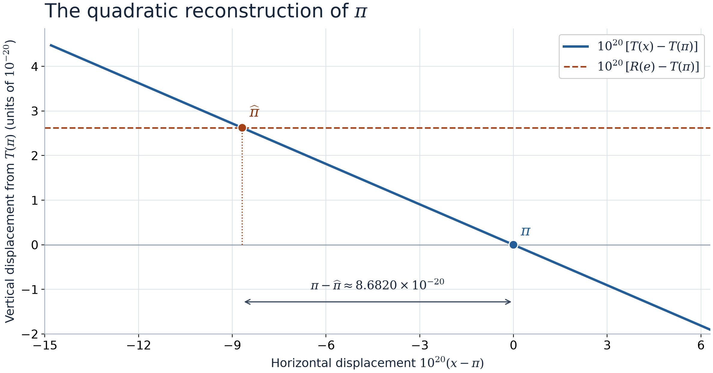
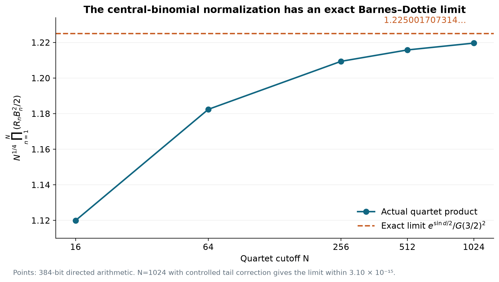

# The Super Zeta Function

I wanted to see how closely I could approximate $\pi$ using $e$ and six integers. When I solved the quadratic, I found a curve with two real ovals and a simple rule that swaps its two roots. The same reciprocal expression showed up in the tower I was studying. It let me find complex fixed pairs with the same first-order return as the Dottie fold. Summing inverse powers of the resulting spectrum led me to my super zeta function.

[Quadratic and real ovals](#the-quadratic-and-the-genus-one-curve) · [Reciprocal tetration and the Dottie spire](#reciprocal-tetration) · [The super zeta](#building-the-super-zeta) · [The 7/8ths strengthening](#local-zeta-result) · [Preprints and proofs](#preprints-and-reproduction) · [Credits](#credits)

## The quadratic and the genus-one curve

My six integers are the coefficients of these two polynomials.

$$
\begin{aligned}
N(x)&=465x^2-183x-659,\\
D(x)&=155x^2+396x-936.
\end{aligned}
$$

I set $T(y)=(1+y)(2+y)/(y^2+y-1)$ and equated it to $N(x)/D(x)$. Clearing the denominators gave me a quadratic in $y$. Completing the square introduced the ordinate $Y$ and the quartic $f(x)=Y^2$. I suppress the argument $x$ on $N$ and $D$ when both are evaluated at the same input. [Quartic derivation, §1](archive/2026-11-18-lean-foundations-v001/arithmetic/research/geometry.md#1-the-exact-quadratic-and-the-quartic) · [Completing the square in Lean](lean/SuperZeta/Meme.lean)

$$
\begin{aligned}
0&=(N-D)y^2+(N-3D)y-N-2D,\\
Y&=2(N-D)y+N-3D,\\
Y^2&=(N-D)^2+4N^2\\
   &=961000x^4-1039740x^3-1810543x^2+644010x+1813853.
\end{aligned}
$$

### What the right panel shows

On the left, the two values $Y=\pm\sqrt{f(x)}$ are separate graphs because $f(x)>0$ for real $x$. I divide $Y$ by $\sqrt{961000}(1+x^2)$ to draw both on a finite vertical scale. The right panel wraps the $x$-line around a circle using the angle $2\arctan x$. The two directions $x\to+\infty$ and $x\to-\infty$ reach the same angle. [Plot coordinates and source](archive/2026-11-18-quartic-ovals-v001/README.md)

To see why the ends really join, I use the coordinates $t=1/x$ and $V=Y/x^2$ near infinity. At $t=0$ the equation becomes $V^2=961000$. Both ends of the upper graph reach the positive solution. Both ends of the lower graph reach the negative solution. The hollow dots are those two added points. The dashed circle is a guide for the radial drawing. In this projective completion, each open graph closes into a loop through its own point at infinity, so I can follow the same root choice all the way around the projective $x$-line. [Proof of the two real circles, §2](archive/2026-11-18-lean-foundations-v001/arithmetic/research/geometry.md#2-why-the-real-completion-is-exactly-two-circles) · [Radial drawing convention](archive/2026-11-18-quartic-ovals-v001/README.md)

Over $\mathbb C$ I can follow either square root as $x$ moves around the complex sphere. The two sheets meet at the four simple roots of $f$. Riemann–Hurwitz gives $2g-2=2(-2)+4=0$, so the completed complex curve has genus one. It is a torus with those two ovals as its real locus. Its elliptic Jacobian is the curve I use to study rational points. [Complex genus, §3](archive/2026-11-18-lean-foundations-v001/arithmetic/research/geometry.md#3-why-the-complex-completion-is-a-torus) · [Explicit elliptic Jacobian, §5](archive/2026-11-18-lean-foundations-v001/arithmetic/research/geometry.md#5-an-explicit-elliptic-jacobian-and-its-complex-structure) · [Fisher, binary quartics, §2](https://people.maths.bris.ac.uk/~jb12407/ANTS-XV/papers/ANTS-XV_fisher.pdf)

I call the input of the **widest gap in the normalized plot** Nucky’s constant (lol not really but for now), $x=0.057793510152240105777\ldots$. Its exact equation comes from differentiating $f(x)/(1+x^2)^2$. The narrowest plotted gap is near $x=1.400168$. Close by, at the positive zero of $N(x)$, the roots in the original $y$-coordinate are $-1$ and $-2$. Their gap of one is the exact minimum in that coordinate. [Stationary quartic and 384-bit enclosures](archive/2026-11-18-quartic-ovals-v001/README.md#where-the-branches-are-farthest-apart-and-closest-together) · [Exact gap in Lean](lean/SuperZeta/Meme.lean)

I checked solvability over the reals and over $\mathbb Q_p$ at every prime. The quartic passes all those local tests. The explicit map to the Jacobian would send a rational point of my quartic to one with a nonzero negative square as its first coordinate. The computer-assisted isogeny descent excludes that squareclass. That is what makes the quartic a **counterexample to the Hasse principle**. [Local points in Lean](lean/SuperZeta/HasseCover.lean) · [Map and descent, eqs. (4)–(6)](archive/2026-11-18-lean-foundations-v001/arithmetic/research/hasse-obstruction.md#proof)

### The point giving my approximation to π

To get my approximation, I fix $x=e$ and take the positive square root $Y(e)=\sqrt{f(e)}$ on the upper oval. The vertical coordinate in my starting equation was $y$. From $Y=2(N-D)y+N-3D$, I subtract $N-3D$ and divide by $2(N-D)$. The latter is positive for real $x$, so the upper oval gives the larger root of the quadratic. [Inverse coordinate and the two branches, §2](archive/2026-11-18-lean-foundations-v001/arithmetic/research/geometry.md#2-why-the-real-completion-is-exactly-two-circles) · [Upper-root identity in Lean](lean/SuperZeta/Meme.lean)

$$
\widehat\pi=\frac{3D(e)-N(e)+\sqrt{f(e)}}{2\bigl(N(e)-D(e)\bigr)}
=3.14159265358979323837582331055\ldots
$$

The plot is centered at $(\pi,T(\pi))$, with both axes in units of $10^{-20}$. The horizontal error is $\pi-\widehat\pi\approx8.682007272725\times10^{-20}$. [Lean proof of the error bound](lean/SuperZeta/MemePrecision.lean)

The part I carried into the tower was $p=2y+3$. In that coordinate my quadratic is $p-p^{-1}=4N/(N-D)$, and $p\mapsto-1/p$ swaps its two roots. [Reciprocal substitution in Lean](lean/SuperZeta/Meme.lean)

## Reciprocal tetration

In my preprint, the finite tower starts at height zero with $T_0=1$ and grows by $T_{n+1}=e^{LT_n}$. Thus $T_1=x$ and $T_2=x^x$ for $x=e^L$. I call $1$ the cap, the value at the top of the finite tower. For a positive real base I take $L=\log x$. Over the complex plane I work in the logarithmic lift. I choose $L$ first and use $x^z=e^{Lz}$ at every stage, which keeps the chosen logarithm attached to the base. [*Reciprocal Tetration*, §2, “Finite Tet and the reciprocal pair”](archive/2026-11-18-lean-foundations-v001/papers/foundations/main.tex#L109-L146) · [PDF](archive/2026-11-18-lean-foundations-v001/papers/foundations/main.pdf)

The pair $x^{x-a},x^{x+a}$ is a way to start thinking about two exponents at once. In my tower I alternate the bases $x$ and $x^{-1}$ and feed each output into the opposite stage. I start at $(1,1)$ and use the update

$$
F_L(P,Q)=\bigl(e^{LQ},e^{-LP}\bigr).
$$

With center $m=(Q-P)/2$ and half-difference $a=(Q+P)/2$, the updated pair is $(x^{m+a},x^{m-a})$. I keep the branch witnesses $U=LQ$ and $V=-LP$, the actual exponents fed to the two maps. For $L\ne0$ they give back $Q=U/L$ and $P=-V/L$. My papers use $M$ for the second phase $Q$. [*Reciprocal Tetration*, §5, “Branch-sensitive complex fixed data”](archive/2026-11-18-lean-foundations-v001/papers/foundations/main.tex#L359-L402) · [Ordered return in Lean](lean/SuperZeta/Reciprocal.lean)

### The complex two-base family

I write the second base as $x^c=e^{cL}$. After two updates, the return on the first phase is $g_{L,c}(z)=e^{L e^{cLz}}$. The equal-base tower is the slice $c=1$. My reciprocal return is the slice $c=-1$, where $g_L(z)=e^{L e^{-Lz}}$ on the first phase and $g_{-L}$ on the second. For $L,c\ne0$, I choose $\kappa,\ell$ with $e^\kappa=L$ and $e^\ell=c$. The chart $z\mapsto\kappa+cLz$ turns the return into $E_\kappa\circ E_{\kappa+\ell}$, where $E_b(z)=e^z+b$. This puts both towers in one complex family while the original cap marks the two scalar orbits. [*Reciprocal Tetration*, §4, “Two-step scalar reduction and marked values”](archive/2026-11-18-lean-foundations-v001/papers/foundations/main.tex#L242-L326) · [Baker and Rippon, Theorem 8.1](https://doi.org/10.1080/17476938908814364) · [Rempe and Schleicher, exponential parameter space](https://doi.org/10.1017/CBO9780511735233.014)

### The Dottie spire

I let the complex logarithm $L$ range over a grid. Each pixel records the period detected from the same cap, $(1,1)$. The narrow stack of period groups is what I call the **Dottie spire**. I keep track of the individual exponential stages in a lap, which lets me compare cycles that repeat after different numbers of paired updates. [*Reciprocal Tetration*, §§6–8, “Periodic reciprocal sign words” through “Directed anchors”](archive/2026-11-18-lean-foundations-v001/papers/foundations/main.tex#L404-L547) · [Figure settings and orbit data](archive/2026-11-18-research-figures-v001/README.md)

I specialize Baker and Rippon’s fixed-pair parametrization to the imaginary axis and write the phase angle as $u$. This gives $L=iY(u)$ with

$$
Y(u)=u\sec u\,e^{-u\tan u},
\qquad
\frac{Y'(u)}{Y(u)}=\frac{\cos^2u-u^2}{u\cos^2u}.
$$

On $0<u<\pi/2$ the stationary point solves $d=\cos d$, with $d\approx0.7390851332$. I identify the boundary exactly as $L_*=i e^{-\sin d}\approx0.509863605523013\,i$. The first change in $Y(u)$ away from its maximum is negative and quadratic, which is why two centerline fixed branches meet at a fold. I then center the return at the meeting point and rescale its quadratic term. In that coordinate it starts $f(z)=z+z^2+\cdots$. The linear term preserves a small displacement to first order. The quadratic term is the leading change that drives the local parabolic motion. [*Dottie Parabolic Fold*, §2, exact fixed curve](archive/2026-11-18-lean-foundations-v001/papers/dottie-spire/main.tex#L145-L243) · [§3, normalized germ and antiholomorphic square root](archive/2026-11-18-lean-foundations-v001/papers/dottie-spire/main.tex#L244-L304) · [Baker and Rippon, eqs. (12)–(13)](https://doi.org/10.1080/17476938908814364) · [Kaplan, *The Dottie Number*](https://doi.org/10.1080/0025570X.2007.11953455)

The Layer 4 survey searches paired periods up to 256. Gray marks unresolved pixels. To study higher periods on the imaginary axis I keep the half-step $H_y(z)=e^{iy\bar z}$, which squares to $g_{iy}$. At the fold its normalized square is $f$. This half-step gives separate physical return equations for even and odd periods. The paired periods 639, 640 and 641 give scalar periods 639, 320 and 641 under the squared map. I proved these periods in separate finite parameter windows by trapping the orbit and excluding shorter periods. [*Dottie Parabolic Fold*, §1, half-step and period conventions](archive/2026-11-18-lean-foundations-v001/papers/dottie-spire/main.tex#L100-L121) · [§§5–6, cylinder and physical return equations](archive/2026-11-18-lean-foundations-v001/papers/dottie-spire/main.tex#L347-L489) · [§8, directed finite windows](archive/2026-11-18-lean-foundations-v001/papers/dottie-spire/main.tex#L554-L604) · [Rump, verified numerics](https://doi.org/10.1017/S096249291000005X)

Baker and Rippon give the centerline return and convergence boundary. My spire analysis starts from that boundary and follows the cap into nearby cycles. The exact Dottie normalization gives separate return equations for the two parities, and the trapping certificates apply those periods to the original map. Under the cap and branch matching hypotheses in §9, the period-$p$ parameters on a rail approach the tip on the scale $p^{-2}$. Section 10 estimates finite multiplier minima through paired period $4800$. [*Dottie Parabolic Fold*, §§9–10, rail law and finite data](archive/2026-11-18-lean-foundations-v001/papers/dottie-spire/main.tex#L605-L715) · [Godin and Rousseau, antiholomorphic parabolic germs](https://doi.org/10.1017/etds.2021.98)

For the zeta experiment I checked two reflected points $L_\pm=\pm\eta+iy$ and their midpoint $L_0=iy$, using $\eta=4.749479070945369\times10^{-8}$ and $y=0.509892982511772$. The original cap is attracted to a cycle of primitive period 320 under the two-step return at each point. These finite orbits give me the marked laps and the parameter values used in the height rule below. [Preprint §8, off-axis witnesses](archive/2026-11-18-lean-foundations-v001/papers/dottie-spire/main.tex#L580-L604) · [Later three-point certificate, 384-bit arithmetic](archive/2026-11-18-lean-foundations-v001/checks/dottie_slice.py) · [Johansson, Arb ball arithmetic](https://arxiv.org/abs/1611.02831)

## Building the super zeta

### 1. Compose the two marked stages

At a fixed pair, $P=e^U$ and $Q=e^V$, where $U=LQ$ and $V=-LP$ are the branch witnesses from my construction. A small change at $P$ passes first through $P\mapsto Q$ with derivative $-LQ$, then through $Q\mapsto P$ with derivative $LP$. By the chain rule the derivative of the whole return, called its **multiplier**, is

$$
g_L'(P)=(-LQ)(LP)=UV.
$$

On the centerline chart, this product is $(u\sec u)^2$ and $Y'(u)/Y(u)=(1-UV)/u$. The condition $UV=1$ is therefore the one already built into the fold, where the two fixed branches meet. It says a small displacement returns unchanged to first order. [*Reciprocal Tetration*, §5, fixed-pair identities](archive/2026-11-18-lean-foundations-v001/papers/foundations/main.pdf#page=7) · [*Dottie Parabolic Fold*, §2, eqs. (6)–(9)](archive/2026-11-18-lean-foundations-v001/papers/dottie-spire/main.pdf#page=3)

### 2. Recover the marked phases from the cosine roots

From $U=Le^V$ and $V=-Le^U$ I eliminate $L$ to obtain $Ue^U+Ve^V=0$. On the multiplier-one locus I write $U=\alpha$ and $V=\alpha^{-1}$. The equation becomes $\alpha^2 e^{\alpha-\alpha^{-1}}=-1$. The same kind of reciprocal difference that solved my quadratic now gives the coordinate $2iu=\alpha-\alpha^{-1}$. Then $\alpha e^{iu}=\sigma i$, where $\sigma=\pm1$, and substitution yields $u=\sigma\cos u$. The steps also run back from a root to the ordered phases and the parameter.

$$
U=\sigma\sin u+iu,\qquad V=\sigma\sin u-iu,\qquad L=\sigma i e^{-\sigma\sin u}.
$$

This recovery is why I can use cosine roots as a spectrum of the original return. Each root gives me both branch witnesses, the values $P=e^U$ and $Q=e^V$, and the complex $L$ that produced them. [Cosine spectrum, §1, eqs. (1)–(5)](archive/2026-11-16-super-zeta-v001/sources/foundation/cosine-spectrum.md#1-exact-recovery-of-every-ordered-phase-and-parameter) · [Phase recovery in Lean](lean/SuperZeta/Quartet.lean)

### 3. Square the roots and sum their inverse powers

The real roots are $\pm d$, and the other roots come in quartets $\{u_n,-u_n,\bar u_n,-\bar u_n\}$. Squaring merges each sign pair. In the variable $v=u^2$ the determinant is the entire function

$$
E(v)=\cos^2\sqrt v-v=1-2v+\frac{v^2}{3}-\frac{2v^3}{45}+\cdots.
$$

This is the step that gave me a zeta function. The zeros of $E$ are the squared values $d^2,u_n^2,\bar u_n^2$. I raise each to the power $-s$ using its principal logarithm and sum them.

$$
\mathcal Z(s;1)=d^{-2s}+\sum_{n\ge1}\bigl[(u_n^2)^{-s}+(\bar u_n^2)^{-s}\bigr],
\qquad \Re s>\frac12.
$$

Writing $E$ as a product over its roots ties this sum to the power series. For instance, the coefficient of $v$ is $-2$, which says the sum of the reciprocal roots is $\mathcal Z(1;1)=2$. The same spectrum comes from a boundary operator whose eigenfunction is $e^{iux}$ and whose boundary condition gives $u=\varepsilon\cos u$. Its inverse-square determinant is $\cos^2\sqrt v-v/\varepsilon^2$. I use $\varepsilon=1$ for the reciprocal return. [Boundary operator and determinant, §§2–3, eqs. (6)–(15)](archive/2026-11-16-super-zeta-v001/sources/foundation/cosine-spectrum.md#2-a-boundary-operator-with-compact-inverse-and-the-cosine-spectrum) · [Product and trace sums, §4, eqs. (16)–(18)](archive/2026-11-16-super-zeta-v001/sources/foundation/cosine-spectrum.md#4-canonical-product-and-exact-rational-trace-sums) · [Bornemann, determinant methods, §§2–5](https://arxiv.org/abs/0804.2543)

### 4. Compare with the odd-integer spectrum

I compare $E$ with $\cos^2\sqrt v$, whose double zeros are the squares of $(n+\tfrac12)\pi$ for $n=0,1,2,\ldots$. They give twice the reciprocal-power sum over odd positive integers with exponent $2s$, scaled by $(2/\pi)^{2s}$. On the negative axis $v=-t$, the ratio of the two determinants is $1+t/\cosh^2\sqrt t$. The root-product integral, integrated by parts, assigns that ratio the correction

$$
J(s;1)=\frac{s\sin(\pi s)}{\pi}
\int_0^\infty t^{-s-1}\log\left(1+\frac{t}{\cosh^2\sqrt t}\right)\,dt
\qquad (\Re s<1).
$$

Subtracting Taylor terms at $t=0$ continues this correction. The factor $\sin(\pi s)$ cancels the poles introduced by those terms, so $J$ is entire. The reconstruction is

$$
F(s)=\mathcal Z(s;1)-J(s;1)=2\pi^{-2s}(2^{2s}-1)\zeta(2s).
$$

With $w=2s$, the prefactor is nonzero in $0<\Re w<1$, so I can recover $\zeta(w)=\pi^w F(w/2)/[2(2^w-1)]$ there. Each Riemann zero corresponds to a zero of $F$ with the same multiplicity. The line $\Re w=1/2$ becomes $\Re s=1/4$, and its heights are halved as well. My written derivation gives the determinant product. The Lean reconstruction uses the genus-zero factorization as an explicit hypothesis. [Cosine spectrum, §5, eqs. (20)–(23)](archive/2026-11-16-super-zeta-v001/sources/foundation/cosine-spectrum.md#5-a-two-variable-zeta-for-the-inverse-cosine-coupling-family) · [Voros, zeta functions over zero sets](https://arxiv.org/abs/1403.4558) · [DLMF, Mellin transforms](https://dlmf.nist.gov/2.5) · [Lean root list and reconstruction](archive/2026-11-18-quartet-levels-v001/README.md#how-this-advances-reconstruction)

## A local strengthening of the 7/8ths theorem

### How the iteration gives the height

I used the certified period-320 lap at the spire to choose where to count. Each of the two marked exponential stages occurs 320 times per lap. The derivative divided by the output of $z\mapsto e^{\pm Lz}$ is $\pm L$, so comparing the product for one marked stage at a flank with its product at the midpoint gives the modulus ratio $(|L_\pm|/|L_0|)^{320}$.

I checked the full-return tangent winding separately and found magnitude one at the two flanks. In the height experiment I chose the logarithm $\delta$ of the marked product ratio as the phase scale. I fixed the one-winding rule $T_D\delta=2\pi$ before evaluating zeta. The Riemann height I get is

$$
T_D=\frac{2\pi}{160\log(1+(\eta/y)^2)}
=4{,}526{,}119{,}322{,}477.945393\ldots .
$$

I also counted zeros in a window of the same width around the nearest multiple of $\pi$. That comparison interval contained three zeros, all on the critical line. [Height rule and frozen inputs](archive/2026-11-17-dottie-grid-match-v001/README.md#nomination-before-forecasting) · [Winding and matched comparison](archive/2026-11-17-dottie-grid-match-v001/README.md#forecast-and-directed-counts)

### What the three windows tell me

I wanted to know whether the spire had pointed me to a sideways pair of zeros, at the same height and on opposite sides of the line. That takes a count over the whole window. A pair could sit between the heights I happened to sample.

Write $w=\beta+it$. OpenAI’s 7/8ths theorem excludes zeros in $\beta>7/8$. Reflection therefore confines nontrivial zeros to $1/8\le\beta\le7/8$ at every height. At $T_D$ my contour covered $1/16<\beta<15/16$, so the theorem completes that first count across the critical strip. My contours at $2T_D$ and $3T_D$ covered the full width directly. [OpenAI, Theorem 1.1](https://github.com/openai/math/blob/main/preprints/The-Quasi-Riemann-Hypothesis-September-30-2026/paper.pdf) · [Functional equation](https://dlmf.nist.gov/25.4) · [First full-strip corollary](archive/2026-11-17-dottie-local-strip-v001/README.md#full-strip-corollary)

| Interval in Riemann height $t$ | Simple zeros on $\beta=\tfrac{1}{2}$ | Off-critical-line zeros | Certificate |
| --- | ---: | ---: | --- |
| $\lvert t-T_D\rvert\lt\tfrac{1}{4}$ | 2 | 0 | [First height](archive/2026-11-17-dottie-local-strip-v001/README.md) |
| $\lvert t-2T_D\rvert\le\tfrac{1}{2}$ | 5 | 0 | [Second height](archive/2026-11-18-superzeta-distance-v001/README.md) |
| $\lvert t-3T_D\rvert\le\tfrac{1}{2}$ | 4 | 0 | [Third height](archive/2026-11-18-superzeta-distance-v001/README.md) |

I used interval arithmetic around each rectangle to count every zero with multiplicity. Separate sign changes of Hardy’s $Z$-function gave me a lower bound for the number of distinct zeros on the line. The counts agreed in every window. That accounts for all eleven zeros, proves they are simple, and excludes a sideways pair anywhere within the checked heights. [First interval certificate](archive/2026-11-17-dottie-local-strip-v001/README.md#full-strip-corollary) · [Higher interval counts and independent check](archive/2026-11-18-superzeta-distance-v001/README.md#how-the-computations-certify-the-statements) · [FLINT’s zero-counting methods](https://flintlib.org/doc/algorithms/special-functions/zeta-zeros.html)

**I strengthen the 7/8ths conclusion in these three windows from the allowed strip to the single line $\beta=1/2$.** In particular I exclude the previously allowed points with $1/2<\beta\le7/8$ and their reflections. My addition is a rule for choosing the height from the cap-marked Dottie return, followed by the contour counts and the matching line brackets at those heights. The same result is $\Re s=1/4$ in my super zeta coordinate, over the corresponding halved height intervals. [Full result and evidence](archive/2026-11-18-superzeta-distance-v001/README.md)

## The factorial correction

### What the quarter measures

For the $n$th nonunit quartet, $R_n$ is the common modulus of the four recovered parameters $L$. These radii grow like $2\pi n$. I used $B_n=4^{-n}\binom{2n}{n}$, the fraction of length-$2n$ sign words with equal numbers of plus and minus signs. The factor $B_n^2$ uses two balanced streams and behaves like $1/(\pi n)$. So in $C_n=R_nB_n^2/2$ the leading scales cancel and $C_n\to1$. The first surviving correction gives $nC_n=n-1/4+o(1)$. [Radial product and quartet scale](archive/2026-11-16-super-zeta-v001/sources/foundation/radial-product-trace-theorem.md#2-the-same-trace-isolates-the-convergent-radial-product) · [Balanced signs and quarter shift, eq. (6)](archive/2026-11-16-super-zeta-v001/research/binomial-normalization.md#1-the-exact-global-normalization)

The factorials cancel in a way that lets me write the Stirling error exactly.

$$
\log C_n=\log\frac{R_n}{2\pi n}-\int_0^\infty e^{-nt}\frac{\tanh(t/4)}{t}\,dt.
$$

The negative of the integral is $-1/(4n)$ plus a correction between $0$ and $1/(96n^3)$. The same half-integer cosine spectrum used to recover $\zeta(2s)$ gives the partial fractions of the kernel $\tanh(t/4)/t$, and with them the error bound at every truncation. In the continued series $\sum_{n\ge1}n^{-s}C_n^\nu$ the first term gives $-(\nu/4)\zeta(s+1)$. For the zeta function of the levels $nC_n$, I take $\nu=-s$. The shifted term gives $+1/4$ at zero from the unit residue of $\zeta$ at one. The base term gives $\zeta(0)=-1/2$ and the remaining series vanishes there. The regularized value is therefore $-1/4$. [Exact error and all-order bound](archive/2026-11-18-stirling-correction-v001/README.md#the-exact-correction) · [Correction in the zeta series](archive/2026-11-18-stirling-correction-v001/README.md#the-correction-in-the-zeta-series) · [DLMF, Stirling’s series](https://dlmf.nist.gov/5.11) · [DLMF, zeta at zero](https://dlmf.nist.gov/25.6)

### What the Barnes–Dottie constant measures

In the product over the first $N$ levels the same $-1/(4n)$ term accumulates to $-\tfrac14\log N$ up to a finite offset. That explains the factor $N^{1/4}$ in the graph. It removes the predictable decay and leaves the accumulated correction from all the levels.

$$
\lim_{N\to\infty} N^{1/4}\prod_{n=1}^N C_n
=\frac{e^{\sin(d)/2}}{G(3/2)^2}
=1.2250017073142016853\ldots .
$$

The numerator comes from the exact product of the quartet radii divided by $2\pi n$. The denominator comes from the factorials, collected using the Barnes recurrence $G(z+1)=\Gamma(z)G(z)$. This is where the Dottie number and the correction from the balanced sign counts enter the same constant. [Exact radial product](archive/2026-11-16-super-zeta-v001/sources/foundation/radial-product-trace-theorem.md#2-the-same-trace-isolates-the-convergent-radial-product) · [Barnes product, eqs. (1)–(5)](archive/2026-11-16-super-zeta-v001/research/binomial-normalization.md#1-the-exact-global-normalization) · [DLMF, Barnes $G$-function](https://dlmf.nist.gov/5.17)

## Preprints and reproduction

My two working preprints are available as PDFs and editable TeX. They give the alternating tower, the fixed-point branches and the spire’s marked return structure.

- [Reciprocal Tetration in the Logarithmic Lift (PDF)](archive/2026-11-18-lean-foundations-v001/papers/foundations/main.pdf) · [TeX](archive/2026-11-18-lean-foundations-v001/papers/foundations/main.tex)
- [The Dottie Parabolic Fold and the Marked Spire (PDF)](archive/2026-11-18-lean-foundations-v001/papers/dottie-spire/main.pdf) · [TeX](archive/2026-11-18-lean-foundations-v001/papers/dottie-spire/main.tex)

I keep the spectral derivations, further experiments and exact checks in the dated archives. [Foundations and rational traces](archive/2026-11-16-super-zeta-v001/README.md) · [Ordered return](archive/2026-11-17-quartet-return-recursion-v001/README.md) · [Off-line zero tests](archive/2026-11-17-offcenter-superzeta-v001/README.md) · [Distance bounds](archive/2026-11-18-superzeta-distance-v001/README.md) · [Newton steps](archive/2026-11-17-quartet-angle-v001/README.md) · [Binary valuation law](archive/2026-11-18-binary-law-v001/README.md)

To check the archive and build the proofs, run these commands from the repository root. [Source inventory](archive/2026-11-18-lean-foundations-v001/README.md) · [Lean theorem index and setup](lean/README.md) · [Archive preservation](PRESERVATION.md)

~~~sh
python tools/verify_archive.py
python tools/check_lean.py --fetch-cache
~~~

## Credits

- **Michael Creutz and Robert M. Sternheimer** and **I. N. Baker and P. J. Rippon** provide the earlier work on alternating towers. Baker and Rippon give the centerline return, boundary, multiplier and antiholomorphic half-step I use. **Lasse Rempe and Dierk Schleicher** give the complex exponential parameter-space framework. **Robert Corless and coauthors** give the Lambert $W$ branches used in my fixed-pair atlas. [Creutz and Sternheimer](https://www.fq.math.ca/Scanned/19-4/creutz.pdf) · [Baker and Rippon, Theorem 8.1 and eqs. (12)–(13)](https://doi.org/10.1080/17476938908814364) · [Rempe and Schleicher](https://doi.org/10.1017/CBO9780511735233.014) · [Corless et al.](https://doi.org/10.1007/BF02124750)
- **Samuel R. Kaplan** documented the fixed point of cosine as the Dottie number. [*The Dottie Number*](https://doi.org/10.1080/0025570X.2007.11953455)
- **David R. Stoutemyer** supplied the inverse spherical Bessel framework, and **Riccardo Borghi** supplied the positive Stieltjes representation of the Bessel solution of Kepler’s equation. I used their 2024 results in the companion work on branches and approximation. [Stoutemyer’s paper](https://doi.org/10.5206/mt.v4i2.16787) · [Borghi’s paper](https://www.mdpi.com/2227-7390/12/1/154) · [Companion notes](archive/2026-11-18-lean-foundations-v001/README.md#results-and-their-evidence)
- **Jean Écalle and Sergei Voronin** provide the parabolic classification used for the return coordinates. I use **Dudko and Sauzin** for the analytic properties of Fatou coordinates, **Godin and Rousseau** for the antiholomorphic classification, and **Kuehn** for saddle-node scaling. [Écalle and Voronin in the preprint bibliography](archive/2026-11-18-lean-foundations-v001/papers/dottie-spire/references.bib#L36-L58) · [Dudko and Sauzin](https://doi.org/10.1016/j.crma.2013.12.005) · [Godin and Rousseau](https://doi.org/10.1017/etds.2021.98) · [Kuehn](https://doi.org/10.1088/1751-8113/42/4/045101)
- **Tom Fisher** supplied the binary-quartic framework used in the arithmetic notes. I use **Folkmar Bornemann’s** projection methods for the spectral determinant and **André Voros’s** framework for zeta functions over zero sets. [Fisher](https://people.maths.bris.ac.uk/~jb12407/ANTS-XV/papers/ANTS-XV_fisher.pdf) · [Bornemann](https://arxiv.org/abs/0804.2543) · [Voros](https://arxiv.org/abs/1403.4558)
- **OpenAI** proved the 7/8ths zero-free theorem I use at the first Dottie height. The counts use **G. H. Hardy’s** real $Z$-function, and the cross-check uses the procedures credited in FLINT’s zero-counting documentation. [*The Quasi-Riemann Hypothesis*, Theorem 1.1](https://github.com/openai/math/blob/main/preprints/The-Quasi-Riemann-Hypothesis-September-30-2026/paper.pdf) · [DLMF, Hardy’s $Z$](https://dlmf.nist.gov/25.10.E1) · [FLINT’s algorithms and sources](https://flintlib.org/doc/algorithms/special-functions/zeta-zeros.html)
- I used **Fredrik Johansson’s** ball arithmetic and **Siegfried Rump’s** verification methods for the numerical certificates. I use **Lean and mathlib** for the formal proofs, **FLINT** for directed interval arithmetic, and **PARI/GP** for the arithmetic descent. The **NIST Digital Library of Mathematical Functions** supplies the classical formulas cited at the Mellin, zeta and Barnes steps. [Johansson](https://doi.org/10.1109/TC.2017.2690633) · [Rump](https://doi.org/10.1017/S096249291000005X) · [mathlib](https://github.com/leanprover-community/mathlib4) · [FLINT](https://flintlib.org/) · [PARI/GP](https://pari.math.u-bordeaux.fr/)

The preprint bibliographies give the wider references for alternating towers, parabolic dynamics and validated numerics. I keep a separate source map for the formulas in the super zeta notes. [Reciprocal tetration bibliography](archive/2026-11-18-lean-foundations-v001/papers/foundations/references.bib) · [Dottie spire bibliography](archive/2026-11-18-lean-foundations-v001/papers/dottie-spire/references.bib) · [Super zeta source map](archive/2026-11-16-super-zeta-v001/source-map.md#published-inputs-and-their-actual-use)
