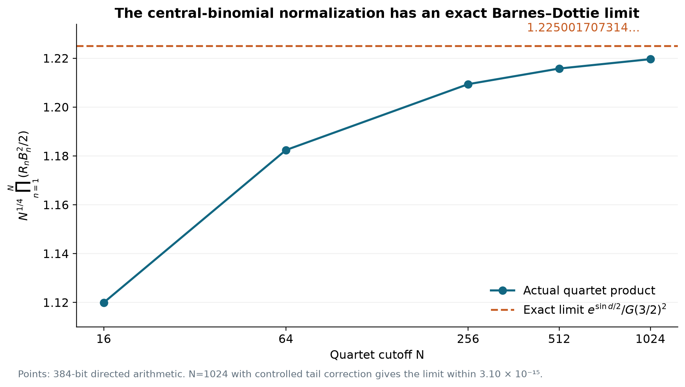
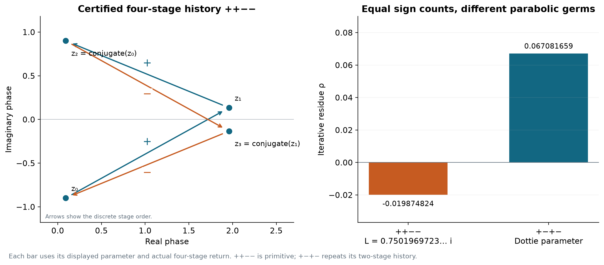

# Greater Works — Balanced Residues, Elliptic Periods, and Ordered Exponential Histories

**NuckyDucky's reciprocal construction × spectral superzeta theory, lattice traces, and Barnes normalization**  
16 November 2026

NuckyDucky's observation has developed into an exact chain of identities. The balanced-sign probability occurs as a pole residue of the reciprocal spectrum’s shifted superzeta. Squaring that residue produces an elliptic period and an actual charge-zero transfer trace. Multiplying the same probabilities against the quartet radii produces a Barnes–Dottie constant. Retaining the exponential operations in order supplies a computable parabolic invariant and a certified four-stage fold with negative iterative residue.

The central result is

\[
\boxed{
\left[\frac{\pi}{w^n}
\operatorname*{Res}_{s=1/2-n}\mathscr S(s,w;\varepsilon)\right]^2
=B_n^2
=\tau(A^{2n})
=\mathbb E[Z^n],
\qquad B_n=\frac{\binom{2n}{n}}{4^n}.
}
\tag{A}
\]

Here \(w>0\), \(\Re\varepsilon>0\), \(A\) is the normalized nearest-neighbor lattice operator, and \(Z\) is the product of the squared normalized lengths of two independently sampled circle chords. Every variable and transformation is specified below. The global normalization is

\[
\boxed{
\lim_{N\to\infty}N^{1/4}
\prod_{n=1}^{N}\frac{R_n B_n^2}{2}
=C_*:=\frac{e^{\sin d/2}}{G(3/2)^2}
=1.2250017073142016852999108811594267460\ldots.
}
\tag{B}
\]

The pole index, the walk half-length, and the quartet level are explicitly indexed in these formulas. Equation (B) is the specified matched-index observable joining the two exact sequences. The transfer construction below keeps the quartet label and the history length as independent grades.

## 1. The retained dynamical and spectral input

The reciprocal system is

\[
F_L(P,Q)=(e^{LQ},e^{-LP}),\qquad
g_L(z)=e^{Le^{-Lz}}.
\]

At a multiplier-one fixed pair, retain the actual lifted logarithms
\(U=LQ\), \(V=-LP\). They obey \(UV=1\). Writing \(U=\alpha\), \(V=\alpha^{-1}\) gives the classified equation

\[
\alpha^2e^{\alpha-\alpha^{-1}}=-1,
\qquad
u=\frac{\alpha-\alpha^{-1}}{2i},
\qquad \cos^2u-u^2=0.
\]

The nonunit phases form quartets
\(\alpha_{n,\sigma,\tau}=e^{\sigma t_n+i\tau\theta_n}\). Their common parameter radius is

\[
\theta(t)=\arccos\!\left(-\frac{t}{\sinh t}\right),\quad
\theta(t_n)+\cosh t_n\sin\theta(t_n)=(n+\tfrac12)\pi,
\quad R_n=e^{t_n\coth t_n}.
\]

The earlier exact input is

\[
R_n\sim2\pi n,
\qquad
\prod_{n\ge1}\frac{R_n}{2\pi n}=e^{\sin d/2},
\qquad d=\cos d.
\tag{1}
\]

The auxiliary inverse-cosine coupling \(u=\varepsilon\cos u\) has determinant

\[
E_\varepsilon(\lambda)
=\cos^2\sqrt\lambda-\lambda/\varepsilon^2
=\det(I-\lambda\mathcal B_\varepsilon^2).
\tag{2}
\]

The compact \(\mathcal B_\varepsilon\) is the inverse of the retained first-order boundary operator. Its square is trace class. The frozen proof and the radial product derivation are retained under [sources/foundation](sources/foundation/cosine-spectrum.md). The coupling \(\varepsilon=1\) is the original reciprocal section.

## 2. Exact balanced probabilities inside the superzeta

Let \(\lambda_j(\varepsilon)\) be the zeros of (2), with algebraic multiplicities. For \(w\ge0\), use principal powers and define

\[
\mathscr S(s,w;\varepsilon)
=\sum_j(\lambda_j(\varepsilon)+w)^{-s},
\qquad \Re s>\tfrac12,\quad \Re\varepsilon>0.
\tag{3}
\]

**Shifted residue theorem.** For \(w>0\), the complete pole list is
\(s=1/2-n\), \(n=0,1,2,\ldots\), each simple, and

\[
\boxed{
\operatorname*{Res}_{s=1/2-n}\mathscr S(s,w;\varepsilon)
=\frac{B_n w^n}{\pi}.
}
\tag{4}
\]

Also

\[
\mathscr S(-m,w;\varepsilon)=0\quad(m=0,1,\ldots),
\qquad
\boxed{e^{-\partial_s\mathscr S(0,w;\varepsilon)}
=4\left(\cosh^2\sqrt w+w/\varepsilon^2\right).}
\tag{5}
\]

**Proof.** The canonical product gives, initially for \(1/2<\Re s<1\),

\[
\mathscr S(s,w;\varepsilon)
=\frac{\sin\pi s}{\pi}
\int_0^\infty t^{-s}\frac d{dt}\log E_\varepsilon(-w-t)\,dt.
\tag{6}
\]

The logarithmic derivative has the full large-\(t\) power expansion

\[
(t+w)^{-1/2}
=\sum_{n\ge0}(-1)^nB_nw^nt^{-n-1/2};
\]

the remaining terms decay exponentially in \(\sqrt t\). Mellin subtraction continues (6) through successive half-planes. The \(n\)-th term contributes a denominator \(s+n-1/2\). At its pole, \(\sin\pi(1/2-n)=(-1)^n\), canceling the binomial sign and giving (4). The small endpoint’s integer poles cancel against the sine. At nonpositive integers the continued integral is regular and its sine factor vanishes, giving the first assertion in (5).

At infinity,
\(\log E_\varepsilon(-w-T)=2\sqrt{T+w}-\log4+o(1)\).
The finite part at zero in (6) is therefore
\(-\log4-\log E_\varepsilon(-w)\), yielding the determinant in (5). This also fixes its normalization. ∎

The first normalized residues are

\[
1,\quad\frac12,\quad\frac38,\quad\frac5{16},\quad\frac{35}{128},\ldots.
\]

They are exactly the probabilities that \(2n\) independent signs balance. The shift exposes the whole sequence; at \(w=0\), the higher residues vanish.

Every positive-integer shifted trace is elementary:

\[
\mathscr S(m,w;\varepsilon)
=\frac{(-1)^{m-1}}{(m-1)!}
\partial_w^m\log\left(\cosh^2\sqrt w+w/\varepsilon^2\right).
\tag{7}
\]

The full proof, a Poisson/Bessel continuation, and explicit exponential tails are in [shifted-superzeta.md](research/shifted-superzeta.md). The general zero-set superzeta viewpoint comes from [Voros, §1](https://arxiv.org/pdf/1403.4558); the residue and determinant formulas here are derived for (2).

## 3. Squared residues form an elliptic period, a chord measure, and a modular pullback

Use the elliptic **parameter** convention
\(\mathbf K(z)=\int_0^{\pi/2}(1-z\sin^2\theta)^{-1/2}d\theta\).
Then

\[
\boxed{
\mathcal M(z):=\sum_{n\ge0}B_n^2z^n
={}_2F_1(\tfrac12,\tfrac12;1;z)
=\frac2\pi\mathbf K(z).
}
\tag{8}
\]

The binomial recurrence proves its differential equation directly:

\[
z(1-z)\mathcal M''+(1-2z)\mathcal M'-\tfrac14\mathcal M=0.
\tag{9}
\]

It is the normalized period

\[
\mathcal M(z)=\frac1\pi\int_0^1
\frac{dx}{\sqrt{x(1-x)(1-zx)}}
\tag{10}
\]

of the Legendre elliptic family. The classical hypergeometric/elliptic identity is [DLMF 15.9.24](https://dlmf.nist.gov/15.9.E24), with its modulus converted to our parameter. Applying it to the exact residues supplies the present period interpretation.

NuckyDucky's circle picture has a precise positive-measure realization. Choose independent uniform endpoints on a unit circle. If \(\ell\) is the chord length, \(X=\ell^2/4\) has density
\(1/[\pi\sqrt{x(1-x)}]\). The beta integral gives \(\mathbb E[X^n]=B_n\). For two independent chords set \(Z=X_1X_2\). Consequently

\[
\mathbb E[Z^n]=B_n^2,\qquad
\mathcal M(z)=\mathbb E\frac1{1-zZ},
\qquad
f_Z(x)=\frac{2\mathbf K(1-x)}{\pi^2\sqrt x},\quad0<x<1.
\tag{11}
\]

For example, multiplicative convolution gives
\(f_Z(x)=(\pi^2\sqrt x)^{-1}\int_x^1[t(1-t)(t-x)]^{-1/2}dt\);
substitution \(t=x+(1-x)\sin^2\theta\) gives (11). Thus the residue transform is a Stieltjes moment function of explicit chord geometry.

To measure overlapping coverage, associate each sampled chord with its shorter boundary arc. Its normalized length is uniform on \([0,1/2]\), with mean \(1/4\). Rotational invariance and independence give

\[
\mathbb E[\text{covered fraction after }N]=1-(3/4)^N,
\qquad
\mathbb E[\text{new fraction at }N]=\tfrac14(3/4)^{N-1}.
\tag{12}
\]

This chooses the endpoint distribution, the measured set, and the meaning of overlap explicitly.

There are useful computational consequences. For \(0\le z<1\),

\[
\mathcal M(z)=\frac1{\operatorname{AGM}(1,\sqrt{1-z})},
\quad
\frac1{a_j}\le\mathcal M(z)\le\frac1{b_j},
\tag{13}
\]

where \(a_{j+1}=(a_j+b_j)/2\), \(b_{j+1}=\sqrt{a_jb_j}\). Directed arithmetic turns this quadratically convergent iteration into an enclosure even extremely close to \(z=1\). This applies [Gauss’s classical AGM identity](https://dlmf.nist.gov/19.8) to the residue transform.

Finally, with \(q=e^{\pi i\tau}\), \(\Im\tau>0\), and
\(\lambda(\tau)=\theta_2^4/\theta_3^4\),

\[
\boxed{\mathcal M(\lambda(\tau))=\theta_3(0\mid\tau)^2.}
\tag{14}
\]

The branch is continued from the positive imaginary \(\tau\)-axis. The theta identity is classical [DLMF 20.9](https://dlmf.nist.gov/20.9). It gives the squared-residue period a modular representation whose Fourier coefficients count representations by two squares. Complete measures, bounds, and branch conventions are in [residue-period-and-chords.md](research/residue-period-and-chords.md).

## 4. The finite-level cancellation has an exact Barnes normalization

Set \(C_n=R_nB_n^2/2\) and \(D_n=\pi nB_n^2\). Gamma duplication gives

\[
D_n=n\frac{\Gamma(n+1/2)^2}{\Gamma(n+1)^2},
\qquad
C_n=\frac{R_n}{2\pi n}D_n.
\]

Iterating \(G(x+1)=\Gamma(x)G(x)\) yields the exact finite identity

\[
\prod_{n=1}^{N}C_n
=\left(\prod_{n=1}^{N}\frac{R_n}{2\pi n}\right)
\Gamma(N+1)
\left[\frac{G(N+3/2)}{G(3/2)G(N+2)}\right]^2.
\tag{15}
\]

The Barnes/Stirling expansion is explicitly
\(\Gamma(N+1)[G(N+3/2)/G(N+2)]^2=N^{-1/4}(1+O(N^{-1}))\), with the factor \(G(3/2)^{-2}\) in (15) retained outside it. Combining with (1) proves (B), including its exact constant. This uses the standard [Barnes recurrence and asymptotic expansion](https://dlmf.nist.gov/5.17).

There is a strict all-order error mechanism. The exact identity

\[
\log D_n=-\int_0^\infty e^{-nt}\frac{\tanh(t/4)}t\,dt
\tag{16}
\]

and the positive partial-fraction expansion of \(\tanh(t/4)/t\) bound any finite Stirling truncation by its first omitted term. In particular

\[
\log D_n=-\frac1{4n}+\frac1{96n^3}-\frac1{320n^5}+\cdots.
\]

Together with the controlled radial expansion this gives, for \(L_n=\log(2\pi n)\),

\[
C_n=1-\frac1{4n}
+\frac{1/32+(2L_n^2-2L_n-1)/(4\pi^2)}{n^2}
+O((\log n)^2/n^3).
\tag{17}
\]

The accumulated first correction explains \(N^{1/4}\). For the complete product \(S_N=N^{1/4}\prod_{n\le N}C_n\), writing \(L=\log(2\pi N)\),

\[
\log S_N=\log C_*
-\frac{(2L^2+2L+1)/(4\pi^2)+1/8}{N}
+\frac{(2L^2-2L-1)/(8\pi^2)+1/64}{N^2}
+O(L^4/N^3).
\tag{18}
\]

The reproducible calculation uses 1,024 directed root brackets, exact central-binomial coefficients, and controlled radial and Stirling tails. The corrected product encloses
\(C_*\in[1.22500170731420\pm3.10\times10^{-15}]\).
The separate closed-form ball has radius below \(2.5\times10^{-81}\).

### The quarter correction becomes a zeta invariant

Retain the positive logarithm of \(C_n\). To distinguish this exponent from the spectral shift \(w\), denote it by \(\beta\):

\[
\mathfrak Z(s,\beta)=\sum_{n\ge1}n^{-s}C_n^\beta,
\qquad\Re s>1.
\tag{19}
\]

Its all-order asymptotic subtraction gives a meromorphic continuation in \(s\), with entire parameter \(\beta\) and poles confined to \(s=1-m\). A coefficient recurrence specifies every Laurent part. At zero,

\[
\operatorname*{Res}_{s=0}\mathfrak Z(s,\beta)=-\frac\beta4,
\qquad
\operatorname{FP}_{s=0}\partial_\beta\mathfrak Z(s,0)=\log C_*.
\tag{20}
\]

For the effective positive levels \(\Lambda_n=nC_n=n-1/4+o(1)\),

\[
Z_\Lambda(s)=\mathfrak Z(s,-s),
\qquad
\boxed{Z_\Lambda(0)=-\tfrac14,\quad
\det{}_\zeta\Lambda=\sqrt{2\pi}\,C_*
=3.07062391602502723888663830328\ldots.}
\tag{21}
\]

For completeness, put \(h_n=\log C_n+1/(4n)\). Absolute convergence gives
\(\sum h_n=\log C_*+\gamma/4\). Near zero,

\[
Z_\Lambda(s)=\zeta(s)+\tfrac s4\zeta(s+1)
-s\sum_{n\ge1}n^{-s}h_n+O(s^2).
\]

The Laurent expansion proves (20)–(21). The same \(1/4\) therefore appears in finite-level drift, product renormalization, and the continued spectral value. Detailed all-order proofs are in [binomial-normalization.md](research/binomial-normalization.md) and [binomial-deformed-zeta.md](research/binomial-deformed-zeta.md).

## 5. The quartet signs lift to integer charges and prime-clock traces

Let \(S_1,S_2\) be the bilateral coordinate shifts on \(\ell^2(\mathbb Z^2)\), and put

\[
X(a,b)=\tfrac a2(S_1+S_1^{-1})+\tfrac b2(S_2+S_2^{-1}),
\qquad A=X(1/2,1/2).
\tag{22}
\]

The canonical trace \(\tau(T)=\langle T\delta_0,\delta_0\rangle\) selects zero displacement. A pair of simultaneous signs maps to one of four steps by
\((\epsilon_1,\epsilon_2)\mapsto((\epsilon_1+\epsilon_2)/2,(\epsilon_1-\epsilon_2)/2)\).
Return after \(2n\) steps means that both streams balance. Thus
\(\tau(A^{2n})=B_n^2\), proving the lattice part of (A).

For the actual \(n\)-th quartet use \(a=t_n\), \(b=i\theta_n\). The continuous character symbol is

\[
X_n(\xi,\upsilon)=\tfrac{t_n}{2}(\xi+\xi^{-1})
+\tfrac{i\theta_n}{2}(\upsilon+\upsilon^{-1}).
\]

At \(\xi=\sigma\), \(\upsilon=\tau\) in \(\{\pm1\}\), it recovers the exact retained logarithm \(\sigma t_n+i\tau\theta_n\). Haar projection over the full torus gives

\[
\boxed{\operatorname{CT}e^{sX_n}=I_0(st_n)J_0(s\theta_n).}
\tag{23}
\]

This is an extension of the earlier four-character quartet product with its logarithmic data retained. Its zero-charge projection is a different, explicitly specified trace of the extended object.

### Actual inverse branches realize the trace

At \(L_*=ie^{-\sin d}\), four holomorphic inverses of \(g_{L_*}\) are certified on
\(D=\overline B(-37/2+32i,20)\):

\[
b_j(z)=-\frac1{L_*}
\left[\Log\left(\frac{\Log z+2\pi i\,10^6}{L_*}\right)+2\pi ij\right],
\quad j=0,1,2,3.
\tag{24}
\]

All logarithms in this disk are the displayed principal branches. Directed 768-bit bounds give derivative \(<1/50{,}000{,}000\), invariance margin \(>1.49998\), and pairwise separation \(>12.32326\). This produces an actual four-symbol inverse repeller.

For each ordered inverse word \(b\), its function composition trace is \(1/(1-b')\); its derivative-weighted trace is \(b'/(1-b')\), evaluated at its fixed point. Their difference is one. Give the four branches the normalized weights \(\xi/4,\xi^{-1}/4,\upsilon/4,\upsilon^{-1}/4\), equivalently \(a=b=1/2\) in the companion operators, and take the lattice trace. For \(n\ge1\), the resulting exact supertrace is

\[
\mathfrak T(\mathcal L_0^{2n})-\mathfrak T(\mathcal L_1^{2n})=B_n^2.
\tag{25}
\]

The individual operators retain each ordered fixed point and derivative. This is the classical holomorphic trace mechanism applied to the certified reciprocal inverses; full definitions and trace-class bounds are in [balanced-charge-operators.md](research/balanced-charge-operators.md).

Tensoring with a cyclic clock of length \(m\) multiplies its time-\(j\) trace by \(m\mathbf1_{m\mid j}\). Retaining the prime clocks \(m=p^k\) gives the exact coefficient

\[
B_h^2\sum_{k=0}^{v_p(2h)}p^k
=B_h^2\frac{p^{v_p(2h)+1}-1}{p-1}
\tag{26}
\]

at even scalar-return time \(2h\). One scalar inverse step represents two physical half-steps. The retained finite clock levels, their weighted product, and the completed \(p\)-adic clock have their specified traces; these conventions are part of the construction.

The existing joint quartet/clock product now has the zero-charge extension

\[
\boxed{
\log\mathcal Q_{p,0}(z;\rho,\eta;s)
=-\sum_{n\ge1,k\ge0,l\ge1}
\frac{(z\rho^n\eta^k)^{p^kl}}{l}
I_0(sp^klt_n)J_0(sp^kl\theta_n).
}
\tag{27}
\]

This is the logarithmic germ at \(z=0\); a sufficient domain is
\(|\eta|\le1\), \(|\rho|<1\),
\(|z|\sup_n|\rho|^ne^{|s|(t_n+\theta_n)}<1\).
It satisfies an exact prime refinement equation. A controlled computation gives

\[
\mathcal Q_{2,0}(10^{-3};1/4,1/4;1)
\approx0.9998702455821832515935638266904876236883,
\]

with relative omitted-product bound below \(1.198206\times10^{-33}\). This bound controls the infinite truncation; the retained Bessel sum is evaluated at 130 decimal digits.

## 6. Arrangements have primitive Euler factors and a parabolic invariant

Retain actual signed exponentials \(E_s(z)=e^{sLz}\). For a forward word \(w=(s_1,\ldots,s_m)\),

\[
z_{j+1}=E_{s_{j+1}}(z_j),\qquad
F_w=E_{s_m}\circ\cdots\circ E_{s_1}.
\]

The charge-zero coefficient of
\((xC_++x^{-1}C_-)^{2n}\), where \(C_sf=f\circ E_s\), retains every balanced order. Their primitive cyclic classes have the exact count

\[
P_n^{(r)}=\frac1{2n}\sum_{d\mid n}\mu(d)
\binom{2n/d}{n/d}^{r},\qquad r=1,2.
\tag{28}
\]

Indeed a primitive necklace of length \(2k\) contributes \(2k\) rooted words to every repeated balanced length \(2n\) with \(k\mid n\). Möbius inversion proves (28). Consequently

\[
\exp\left(\sum_{n\ge1}\frac{\binom{2n}{n}^{r}}{2n}q^n\right)
=\prod_{n\ge1}(1-q^n)^{-P_n^{(r)}}.
\tag{29}
\]

Here \(q\) counts half-length. For two streams normalize \(q=t/16\). Then

\[
t\partial_t\log\widehat{\mathcal Z}_2(t)
=\frac{\mathbf K(t)}\pi-\frac12,
\qquad
\widehat{\mathcal Z}_2(1)=4e^{-4G_{\rm Cat}/\pi}
=1.24613996435124212468678\ldots.
\tag{30}
\]

The elliptic derivative follows from (8); the endpoint follows by evaluating the integrable torus logarithm of \(1-\cos\theta\cos\phi\). The classical Catalan constant records square-lattice entropy here. The primitive word proof and the precise normalization appear in [ordered-signed-histories.md](research/ordered-signed-histories.md).

### A complete finite formula for each simple-parabolic history

For an actual periodic history \(z_m=z_0\), put

\[
D_0=1,\qquad D_j=\prod_{k=1}^{j}s_kLz_k,
\quad S_1=\sum_{j=0}^{m-1}s_{j+1}D_j,
\quad S_2=\sum_{j=0}^{m-1}D_j^2.
\]

If its return has multiplier one and \(S_1\ne0\), then

\[
\boxed{a_w=\frac L2S_1,\qquad
\rho_w=\frac{S_2}{3S_1^2}.}
\tag{31}
\]

Here \(F_w(z_0+\xi)=z_0+\xi+a_w\xi^2+b_w\xi^3+\cdots\), and
\(\rho_w=1-b_w/a_w^2\).

**Proof.** Each exponential has
\(E_s''/E_s'=sL\) and Schwarzian \(\operatorname{Sch}(E_s)=-L^2/2\).
The two chain rules give
\(F_w''/F_w'=LS_1\) and
\(\operatorname{Sch}(F_w)=-L^2S_2/2\).
At multiplier one, \(a_w=LS_1/2\) and
\(b_w=a_w^2-L^2S_2/12\), proving (31). Cyclic rotation scales \(S_1\) by \(D_j^{-1}\) and \(S_2\) by \(D_j^{-2}\), preserving the residue. ∎

This invariant sees the retained order and orbit. The actual lifted action also satisfies, for a balanced length-\(2n\) word at \(L=iy\),

\[
\mu_w=y^{2n}e^{\mathcal A_w},\qquad
\mathcal A_w=\sum_{j=0}^{2n-1}s_{j+1}Lz_j.
\]

At multiplier one,
\(\mathcal A_w=-2n\log y+2\pi ik\). The integer and the action survive cyclic rotation with the orbit.

### A certified primitive ++−− fold

The forward word \((+,+,-,-)\) has a simple-parabolic fixed point of its four-stage return at

\[
L=iy,\qquad y=0.75019697231646184963089152468402761224\ldots,
\]

\[
z_0=0.09081518944588625089726158747837491332\ldots
-0.89997673217325701299210518067923462630\ldots i.
\]

Its four phases are \(z_0,z_1,\bar z_0,\bar z_1\), with
\(z_1=1.95978980006906823\ldots+0.13372603326638104\ldots i\), and

\[
\boxed{\rho_{++--}
=-0.01987482392764093278654835457977383762\ldots<0.}
\tag{32}
\]

At imaginary \(L\), conjugation \(J\) exchanges the two signs, so
\(F_{++--}=(J\circ E_+^2)^2\). This antiholomorphic half-return forces its residue to be real. A 1024-bit contraction certificate in a real box of radius \(10^{-140}\) proves a unique solution there, four separated stage phases, multiplier one, and a nonzero quadratic term. It bounds the contraction norm by \(2.79\times10^{-138}\) and the center correction by \(4.15\times10^{-181}\).

The equal-count alternating word \((+,-,+,-)\), at the Dottie parameter, is the second iterate of its alternating two-stage return and has

\[
\rho_{+-+-}=\frac{\sin d}{6(1+\sin d)}
=0.06708165905411608916001607284054874151\ldots>0.
\tag{33}
\]

Each comparison uses the displayed parameter and actual return. The new word is primitive with four distinct stage phases; the alternating word repeats its two-stage primitive history. Equation (31) makes arrangement-sensitive local geometry calculable directly from finite phase data.

For a simple-parabolic germ, a formal Fatou coordinate begins
\(-1/(a_w\xi)+\rho_w\log\xi+\cdots\): substitution into the Abel equation gives precisely \(\rho_w=1-b_w/a_w^2\). Thus (32) supplies an explicit logarithmic input to a future sectorial Fatou/horn matching calculation for this four-stage family.

## 7. The Laplace fold governs a convergent multiple-zeta expansion

The same inverse-cosine framework has imaginary critical coordinate
\(\nu\tanh\nu=1\), with \(R_{\rm L}=\nu/\cosh\nu\).
For \(r(v)=v\operatorname{sech}^2\sqrt v\),
\(\max_{v\ge0}r(v)=R_{\rm L}^2\).
The relative spectral correction therefore has the convergent expansion

\[
J(s;\varepsilon)=\frac{s\sin\pi s}{\pi}
\sum_{m\ge1}\frac{(-1)^{m-1}I_m(s)}{m\varepsilon^{2m}},
\quad \Re s<1,\quad|\varepsilon|>R_{\rm L},
\tag{34}
\]

where

\[
I_m(s)=\int_0^\infty v^{m-s-1}\operatorname{sech}^{2m}\sqrt v\,dv
=2^{2s+1}\Gamma(2m-2s)\eta_{2m}(2m-2s,m).
\tag{35}
\]

Here \(\eta_N(p,a)=\sum_{k_1,\ldots,k_N\ge0}(-1)^{\sum k_j}(a+\sum k_j)^{-p}\) is the classical alternating Barnes–Euler multiple zeta, initially \(\Re p>N\), as defined by [Hu–Kim](https://arxiv.org/pdf/1703.05434). Expanding \(\operatorname{sech}^{2m}x\) and integrating after \(v=x^2\) proves (35). The degeneracy polynomial
\(X\prod_{j=1}^{m-1}(X^2-j^2)\) reduces every coefficient to a finite rational combination of ordinary eta values. The coefficient conventions are fully classical; the additional result is their exact occurrence in the reciprocal relative superzeta.

Put \(q=R_{\rm L}^2/|\varepsilon|^2<1\), \(\sigma=\Re s\). The tail after \(M\) terms is explicitly bounded by

\[
\boxed{\left|\frac{s\sin\pi s}{\pi}\right|
\frac{I_1(\sigma)}{|\varepsilon|^2}
\frac{q^M}{(M+1)(1-q)}.}
\tag{36}
\]

This follows from \(|I_m(s)|\le R_{\rm L}^{2m-2}I_1(\sigma)\). The original coupling \(\varepsilon=1\) lies inside the convergence domain.

There is an exact simplification at the saddle. For \(g(x)=\log(x^2\operatorname{sech}^2x)\),

\[
g''(\nu)=-2,\qquad
I_m(s)\sim2\sqrt\pi\,\nu^{-2s-1}R_{\rm L}^{2m}m^{-1/2}.
\tag{37}
\]

The Gaussian curvature is exactly \(-2\). It gives the precise convergence radius of the nonzero logarithmic coefficient hierarchy. At the fold, define

\[
\mathcal F_s(X)=\int_0^\infty v^{-s-1}
\log(1-Xr(v)/R_{\rm L}^2)\,dv.
\]

For real \(X\uparrow1\), \(\Re s<1\),

\[
\boxed{\mathcal F_s(X)=\mathcal F_s(1)
+4\pi\nu^{-2s-1}\sqrt{1-X}+O(1-X).}
\tag{38}
\]

An analytic Morse coordinate makes \(r/R_{\rm L}^2=1-u^2\); the measure has amplitude \(2\nu^{-2s-1}\) at zero. The elementary integral
\(\int_{\mathbb R}\log(1+\delta/u^2)du=2\pi\sqrt\delta\) proves (38). A chosen slit-neighborhood square root gives its complex continuation. The fold coordinate, the coupling threshold, and the multiple-zeta coefficient growth are now tied by explicit formulas. See [laplace-barnes-expansion.md](research/laplace-barnes-expansion.md).

## 8. Evidence, reproducibility, and the continuing program

This continuation has seven research notes with complete derivations, exact enumerations, independent proof reviews, directed branch/root certificates, and high-precision comparisons. The [verification record](verification-record.md) distinguishes exact algebra, outward-rounded enclosures, analytic truncation bounds, and point evaluations. The [source map](source-map.md) identifies the published input, the retained reciprocal input, and the added deduction formula by formula. Reproduction starts at [README.md](README.md).

The developments fit together through operations on retained data: spectral shifting exposes balance probabilities; the charge lift puts the quartet signs into a lattice; zero-charge traces recover balanced histories; primitive cyclic classes provide Euler factors; finite phase derivatives calculate local parabolic residues; and the radial product carries those probabilities into a Barnes-normalized spectrum. The Laplace fold supplies a convergent computational route and a controlled branch singularity for the same relative spectral family.

The strongest next geometric calculation is sectorial Fatou continuation for the certified ++−− germ and the complementary-half families \(v(-v)\). Its starting data now include the actual fixed phases, a strict local existence box, the antiholomorphic half-return, the quadratic coefficient, and the iterative residue. For the superzeta itself, the exact period and charge kernels provide a tractable basis for studying the continued zero-charge joint determinant near its first singular locus.
