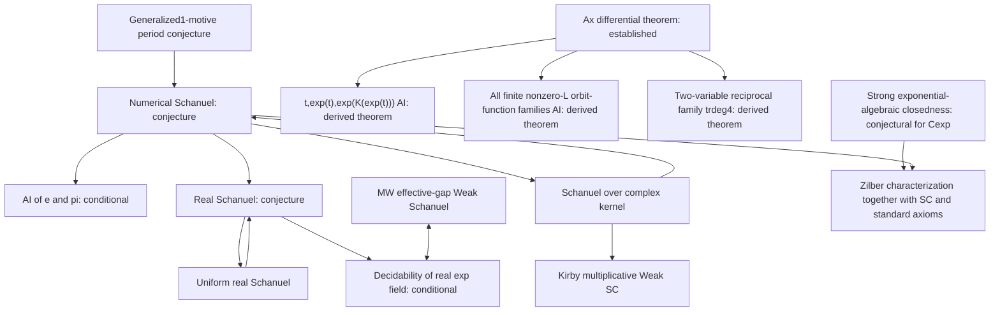

# Ax–Schanuel, functional deformations, and the exponential-field research map

Research cutoff: 15 November 2026. Status labels distinguish established theorems, conditional consequences, derived applications, and questions for further work. The new proofs below specialize established transcendence theorems to the functions in this project; their presentation records applications developed during this investigation.

## 1. The strongest concrete results obtained

The functional form of the project admits exact algebraic-independence results. Let

\[
K(X)=\frac{4(-659-183X+465X^2)}{277-579X+310X^2}.
\]

**Derived theorem A.** The three functions

\[
\boxed{t,\quad e^t,\quad \exp(K(e^t))}
\]

are algebraically independent over C on any regular analytic germ. Equivalently their generated function field has transcendence degree three.

**Derived theorem B.** Fix any nonzero complex L. With

\[
g_L(z)=\exp(Le^{-Lz}),
\]

every finite family

\[
\boxed{z,\quad g_L(z),\quad g_L^{\circ2}(z),\quad\ldots,\quad g_L^{\circ m}(z)}
\]

is algebraically independent over C.

**Derived theorem C.** As two-variable analytic functions, the four functions

\[
\boxed{L,\quad z,\quad e^{-Lz},\quad\exp(Le^{-Lz})}
\]

are algebraically independent over C. The Jacobian rank calculation supplying the extra degree of freedom is explicit below.

**Derived theorem D.** For fixed L, the same g_L satisfies the exact nonlinear differential equation

\[
\boxed{g_Lg_L''-(g_L')^2+L g_Lg_L'=0.}
\]

Thus algebraic independence of orbit functions coexists with a concrete differential equation. This supplies a direct connection among the reciprocal dynamics, differential algebra, and the Touchard–Bell germ in the preprints.

## 2. Definitions and the numerical Schanuel conjecture

Elements z_1,...,z_n are Q-linearly independent when a rational linear combination equal to zero has every coefficient zero. They are algebraically independent over a field k when evaluating a nonzero polynomial in k[X_1,...,X_n] always gives a nonzero value. The transcendence degree of an extension is the size of a transcendence basis: a maximal algebraically independent family over the base.

Schanuel's conjecture, proposed during Lang's Columbia course and printed in his 1966 book, states

\[
\operatorname{trdeg}_{\mathbb Q}
\mathbb Q(z_1,...,z_n,e^{z_1},...,e^{z_n})\ge n
\]

for Q-linearly independent complex z_i. It is a conjectural assertion about numerical values. [Waldschmidt, 2014, section 1](https://webusers.imj-prg.fr/~michel.waldschmidt/articles/pdf/ColloquiumDeGiorgiSchanuelConjecture2014.pdf).

For z_1=1,z_2=i*pi, rational independence follows by taking real and imaginary parts of a rational linear combination. Since e^(i*pi)=-1, Schanuel gives

\[
\operatorname{trdeg}_{\mathbb Q}\mathbb Q(i\pi,e)\ge2.
\]

Adjoining i changes an extension only algebraically, so

\[
\boxed{\text{Schanuel}\Longrightarrow
\operatorname{trdeg}_{\mathbb Q}\mathbb Q(e,\pi)=2.}
\]

Consequently every nonzero rational polynomial P(e,pi) would have a nonzero value. For fixed degree bounds and coefficient height, finiteness then gives a positive minimum. An explicit height-dependent lower bound is additional quantitative information to seek.

The exponential kernel is 2*pi*i*Z. Replacing i*pi with 2*pi*i uses exp(2*pi*i)=1 and gives the same transcendence-degree argument. Kernel bookkeeping identifies exactly which integer relations are compatible with exponentiation.

## 3. Ax's differential theorem and formal-power-series theorem

James Ax's paper is *On Schanuel's Conjectures*, Annals of Mathematics 93(2), March 1971, pp.252–268, DOI 10.2307/1970774. The [publisher record](https://annals.math.princeton.edu/1971/93-2/p03) confirms the differential-algebraic setting. A fully accessible statement is given in Kirby's section 5; an accessible proof using differentials appears in Dasgupta's section 3.

Let F be a characteristic-zero field with commuting derivations D_1,...,D_m, and let C be their common constant field. Suppose x_i,y_i in F, y_i nonzero, satisfy

\[
D_jy_i=y_iD_jx_i\qquad(1\le i\le n,\ 1\le j\le m).
\]

If the x_i are Q-linearly independent modulo C, meaning a rational combination belonging to C has every coefficient zero, then

\[
\boxed{
\operatorname{trdeg}_{C}C(x_1,...,x_n,y_1,...,y_n)
\ge n+\operatorname{rank}_{F}(D_jx_i).
}
\]

This is the multiderivation Ax–Schanuel inequality. [Kirby, theorem 5.1](https://pure.uea.ac.uk/ws/portalfiles/portal/129743769/1801.08765v1.pdf), [Ax's publisher record](https://annals.math.princeton.edu/1971/93-2/p03).

For formal series f_i in C[[t_1,...,t_m]], take partial derivatives and y_i=exp(f_i). Independence is imposed on f_i-f_i(0). The exponential is defined by

\[
\exp(f_i)=\exp(f_i(0))\sum_{r\ge0}\frac{(f_i-f_i(0))^r}{r!}.
\]

The same n+Jacobian-rank bound follows. Over a general characteristic-zero constant field, the zero-constant-term formulation uses the purely formal exponential. In one parameter, a nonconstant independent family has differential rank one, yielding n+1 over C. [Huang–Ng, theorem1.1](https://hkumath.hku.hk/~imr/IMRPreprintSeries/2019/IMR2019-10.pdf).

**Proof mechanism.** Kähler differentials turn transcendence degree into the dimension of a vector space of differentials. The exponential equations produce logarithmic forms dy_i/y_i-dx_i annihilated by the specified derivations. A minimal linear dependence among these forms can be made constant by applying derivations. Residue and logarithmic-differential arguments then give an integer dependence among the x_i modulo constants. Under the independence hypothesis the logarithmic forms supply n independent directions, and the Jacobian rank supplies the remaining differential directions in the inequality. Dasgupta develops this route through derivations, Kähler differentials, and the induced derivation on their exterior algebra. [Dasgupta, section 3](https://sites.math.duke.edu/~dasgupta/papers/Baker.pdf).

**Source-access record.** The original Annals bibliographic page and abstract were read. The attempted JSTOR full-PDF endpoint returned an application shell in this tool session. The theorem and proof were studied through the accessible mathematical sources linked above. This records the exact access achieved for the requested original-paper reading.

## 4. Proof of theorem A: the project function K(e^t)

Let E=e^t and H=exp(K(E)). The rational function K is nonconstant. Its exact derivative is

\[
K'(X)=\frac{-4(212505X^2-666190X+432252)}{(310X^2-579X+277)^2}.
\]

To check Ax's independence hypothesis, suppose q_1t+q_2K(e^t)=c for rational q_1,q_2 and a complex constant c. Analytic continuation makes this a meromorphic identity. Shift t by 2*pi*i. Periodicity of K(e^t) gives 2*pi*i*q_1=0, so q_1=0. Nonconstancy then gives q_2=0.

Apply Ax to f_1=t and f_2=K(e^t). Their derivative matrix has rank one. Thus

\[
\operatorname{trdeg}_{C}C(t,K(E),E,H)\ge3.
\]

Since K(E) belongs to C(E), this field is C(t,E,H), generated by three elements. Its transcendence degree is exactly three. This proves theorem A.

There is a useful generalization. Let h(E) be a nonconstant algebraic function of E on a selected regular branch, with E algebraic over C(h(E)). The established independence of t and e^t implies t and h(e^t) are algebraically independent. Apply Ax to t,h(e^t) and use the finite algebraic relation between e^t and h(e^t). It follows that t,h(e^t),exp(h(e^t)) are algebraically independent. This includes the reconstructed-root branch defined by s^2-K(e^t)s-1=0.

**Arithmetic of the Taylor germ.** At t=0,

\[
K(e^0)=-377/2.
\]

Both K(e^t) and H_bar(t)=exp(K(e^t)-K(1)) have rational Taylor coefficients. The experiment computes their exact jets through order18. The eight functions t^i E^j H_bar^k, i,j,k in {0,1}, have an exact nonzero 8-by-8 jet determinant, using coefficient orders0,...,7. The full functional theorem is the Ax argument above; the jet determinant certifies the displayed finite span independently.

## 5. Proof of theorem B: all finite reciprocal orbit-function families

Here is a slightly broader statement.

**Finite exponential-tower lemma.** Fix any nonzero complex constants c_0,...,c_(n-1). Set tau_0(z)=z and

\[
\tau_{j+1}(z)=\exp(c_j\tau_j(z)).
\]

Then tau_0,...,tau_n are algebraically independent over C.

**Proof.** Induct on n. The base tau_0=z is a nonconstant function. At the inductive step, tau_0,...,tau_(n-1) are algebraically independent, hence the n functions c_j*tau_j are Q-linearly independent modulo C. Their derivatives have rank one because the first derivative is c_0, a nonzero constant. Ax gives transcendence degree at least n+1 for the field generated by those exponents and their exponentials. That field is exactly C(tau_0,...,tau_n), with n+1 generators. Therefore the transcendence degree is n+1. This proves the induction.

Take c_0=-L,c_1=L,c_2=-L,c_3=L,... . Then

\[
\tau_2=g_L(z),\quad \tau_4=g_L^{\circ2}(z),\quad\ldots.
\]

The asserted family of iterates is a subset of an algebraically independent family, proving theorem B. The hypothesis is exactly L nonzero. At L=0, g_0 is identically1 and the rank changes.

The Dottie preprint's L*=i*exp(-sin(d)) is nonzero, so theorem B applies to that distinguished parameter as a fixed complex constant. An invertible affine change of the dynamical coordinate preserves the conclusion for the corresponding normalized local germ and its iterates.

**Dynamical interpretation.** A polynomial relation among finitely many orbit values at a fixed starting number is an arithmetic question. The theorem gives the functional conclusion for the corresponding orbit functions as the starting variable varies. It supplies an exact structural result for the reciprocal dynamical family.

## 6. Proof of theorem C: the parameter contributes another rank

Treat L and z as two independent analytic variables and put E=exp(-Lz),G=exp(LE). Choose exponents

\[
f_1=-Lz,\qquad f_2=LE.
\]

Their Jacobian with columns L,z is

\[
\begin{pmatrix}
-z&-L\\
E(1-Lz)&-L^2E
\end{pmatrix},
\qquad\det=LE.
\]

On a regular germ with L nonzero it has rank two. In particular f_1,f_2 are Q-linearly independent modulo constants. Ax gives transcendence degree at least4 for C(f_1,f_2,E,G). But

\[
L=f_2/E,\qquad z=-f_1/L,
\]

so this field equals C(L,z,E,G), with four generators. Its transcendence degree is exactly4.

This is the explicit Jacobian calculation for the logarithmic-parameter deformation requested in the directive. It explains how keeping L variable changes the count from three to four.

## 7. Differential equation and exact Touchard–Bell derivatives

For fixed L, E'=-LE and G'=-L^2EG. Eliminating E yields

\[
GG''-(G')^2+LGG'=0.
\]

Let T_n(W)=sum_(k=0)^n S(n,k)W^k be the Touchard polynomials, where S(n,k) are Stirling numbers of the second kind. Since d/dz=-LW*d/dW for W=Lexp(-Lz),

\[
\boxed{G^{(n)}(z)=(-L)^nT_n(W)G(z).}
\]

The recurrence T_(n+1)=W(T_n+T_n') supplies a symbolic proof and an efficient exact implementation. The script verifies it through n=8 against Stirling-number coefficients.

At a fixed point p=G(p), put alpha=Lexp(-Lp). Then

\[
\boxed{G(p+u)-p=p\left[\exp\{\alpha(\exp(-Lu)-1)\}-1\right].}
\]

The nth coefficient is p*(-L)^n*T_n(alpha)/n!. This reproduces the germ architecture in the Dottie preprint and situates its Bell-polynomial expansion inside a differential equation and a functional-transcendence theorem. When the fixed-point multiplier is1, -L*p*alpha=1, so the quadratic and cubic coefficients simplify to

\[
a_2=-L(\alpha+1)/2,\qquad
a_3=L^2(\alpha^2+3\alpha+1)/6.
\]

**Analytic classification of H(t).** The polynomial B(X)=310X^2-579X+277 has discriminant -8239 and nonzero roots. The numerator of K is coprime to B. Thus K(e^t) has finite poles, and exp(K(e^t)) has essential singularities there. Its natural setting here is regular meromorphic/analytic germs and differential algebra. This gives an explicit analytic property to compare against the entire-function hypotheses in E-function value-transfer results.

### The cubic coefficient is the reciprocal quotient; the quartic coefficient restores the phase

The normalized preprint coefficients satisfy

\[
h_3=\frac{2(\alpha^2+3\alpha+1)}{3(\alpha+1)^2},\qquad
h_4=\frac{\alpha^3+6\alpha^2+7\alpha+1}{3(\alpha+1)^3}.
\]

Put rho=1-h_3 and theta=alpha+alpha^(-1). Then

\[
\rho=\frac{\theta}{3(\theta+2)},\qquad
\theta=\frac{6\rho}{1-3\rho}.
\]

Thus Q(h_3)=Q(theta). For transcendental alpha, Q(alpha) is quadratic over this field, with involution alpha->alpha^(-1). The coefficient h_4 restores the full parameter, using

\[
w=\frac{24h_4-22+42\rho}{6\rho-2},\qquad
\alpha=\frac{1+w}{1-w}.
\]

Indeed 6rho-2=-4alpha/(alpha+1)^2, so recovery works throughout the normalized germ's domain alpha nonzero,-1. At the Dottie point alpha=sin(d)+id and |alpha|=1, giving

\[
\boxed{\mathbb Q(h_3)=\mathbb Q(\rho)=\mathbb Q(\sin d),
\qquad \mathbb Q(h_3,h_4)=\mathbb Q(\alpha).}
\]

This records exactly which coefficient retains the reciprocal quotient and which restores the complex phase. There is also a second field diamond: Q(alpha) and the real field Q(d,sin(d)) are distinct quadratic extensions of Q(sin(d)). The first contains the nonreal alpha and the second is real. Hence their intersection is Q(sin(d)); their compositum is Q(i,alpha), of degree4 with Galois groupC2xC2. These conclusions use the proved transcendence of sin(d) from the dynamics report and the equations d^2+sin(d)^2=1, alpha=sin(d)+id.

## 8. Functional specialization and arithmetic questions

The specialization of a function field can decrease transcendence degree. An explicit example is the algebraically independent pair t,e^t evaluated at0, giving0,1. The arithmetic problem has base field Q; the functional theorem has base field C and counts variable functions.

The deformation above supplies concrete checkpoints:

| Input t | e^t | K(e^t) | Status of the resulting arithmetic data |
|---|---|---|---|
| 0 | 1 | -377/2 | exp(-377/2) is transcendental by Lindemann–Weierstrass |
| 1 | e | K(e) | K(e) is transcendental by the rational-function lemma; Schanuel gives independence of e and exp(K(e)) |
| i*pi | -1 | -2/53 | exp(-2/53) is transcendental; its algebraic-independence relation to pi is equivalent to that of e and pi |
| e | exp(e) | K(exp(e)) | Schanuel gives algebraic independence of e, exp(e), and exp(K(exp(e))) |

For the last row, first apply Schanuel to1,e to obtain independence of e and exp(e). Since K is nonconstant, K(exp(e)) is transcendental over Q(e). Hence1,e,K(exp(e)) are Q-linearly independent. A second application yields transcendence degree3 for the displayed triple.

For the original reconstructed pi_hat, its finite algebraic relationship to e places both Q(e) and Q(pi_hat) inside the same one-dimensional algebraic function-field extension. Consequently the algebraic independence of e,pi is equivalent to that of pi_hat,pi. Under Schanuel, the tiny difference pi_hat-pi is itself transcendental. These are conditional arithmetic consequences, with Schanuel named as the hypothesis.

## 9. Variants, model theory, and the exact logical map

### Real and uniform real Schanuel

Real Schanuel restricts z_i to R. Uniform real Schanuel asserts that for each rational algebraic subvariety V of R^(2n) of dimension below n, there is a bound M(V) on coefficients of an integer linear dependence among every real exponential-graph point lying in V. Kirby and Zilber proved in2006 that real Schanuel and its uniform real version are equivalent. The proof uses o-minimality and analytic cell decomposition to obtain finiteness/uniformity. [Original paper](https://londmathsoc.onlinelibrary.wiley.com/doi/pdf/10.1112/S0024609306018510).

### Schanuel over the kernel and a multiplicative weak form

Write delta(a/A)=trdeg(a,exp(a)/A,exp(A))-ldim_Q(a/A). Schanuel over the kernel requires delta(a/ker(exp))>=0. For the actual complex exponential, the cyclic kernel and transcendence of2*pi*i connect this formulation back to numerical Schanuel. Kirby also labels a weaker statement “Weak SC”: trdeg_Q(a,exp(a))<n implies an integer multiplicative relation among the exp(a_i). Its conclusion allows a linear relation landing in the exponential kernel. These named forms and implication arrows are recorded in Kirby's section1. [Kirby, variants](https://pure.uea.ac.uk/ws/portalfiles/portal/129743769/1801.08765v1.pdf).

### The computational weak Schanuel principle of Macintyre–Wilkie

A different usage of “Weak Schanuel” concerns effective separation at nonsingular solutions of exponential-polynomial systems. Given such a square system H and an exponential polynomial g over Q, it asserts a computable positive rational q(H,g) such that every real solution P of H has either g(P)=0 or |g(P)|>q. This principle is equivalent to decidability of the real exponential field. Real Schanuel implies that decidability. [Wilkie's first-person exposition](https://doi.org/10.1007/978-94-015-8923-9_11), [Berarducci–Gallinaro2026, conjecture13.4 and introduction](https://arxiv.org/pdf/2603.08365).

The effective positive gap is a particularly relevant target for the project's bounded searches. The arithmetic hypotheses and the scope of the exponential systems determine where such a gap principle applies.

### Converse/embedding Schanuel

The converse formulation in Williams's problem list considers a countable characteristic-zero exponential field (F,E) with cyclic exponential kernel and Schanuel's transcendence-degree property. It predicts an embedding h:F->C respecting exponentiation, h(E(x))=exp(h(x)). This is an embedding/existence problem for exponential fields. Williams attributes the two conjectures to Schanuel in the early1960s. [Williams, section3, article based on a2000 version](https://www.math.buffalo.edu/~sww/0papers/million.buck.problems.mi.pdf).

### Tarski, Wilkie, exponential rings, and Zilber

Tarski's question asks for an algorithm deciding every first-order sentence in the real ordered field with exp. Wilkie's1996 model-completeness theorem is established. Macintyre–Wilkie1996 prove the conditional implication real Schanuel -> decidability. Model completeness reduces formulas to existential ones; o-minimality controls the geometry of definable sets. [Wilkie's exposition](https://doi.org/10.1007/978-94-015-8923-9_11).

An exponential ring has a homomorphism from its additive group to the multiplicative units. Iterated exponential expressions live in such rings. Macintyre's1991 free-exponential-ring work and Terzo's2008 results give conditional freeness statements under Schanuel, including the exponential subring of R generated by pi. This supplies a framework for tracking identities in repeated exponentiation. [Terzo, original-paper record](https://www.tandfonline.com/doi/abs/10.1080/00927870701410694).

Zilber constructs abstract algebraically closed characteristic-zero exponential fields using a transcendence predimension, a standard cyclic kernel, strong exponential-algebraic closedness, and countable closure. In the strong closedness condition, suitable rotund, additively and multiplicatively free varieties meet the exponential graph in generic points. The construction gives categoricity in uncountable cardinalities. Identifying the continuum-sized structure with C_exp is a conjectural characterization. [Zilber's original author manuscript](https://people.maths.ox.ac.uk/~zilber/expf.pdf), [Bays–Kirby2018](https://arxiv.org/abs/1512.04262).

Exponential-algebraic closedness concerns existence of solutions of appropriate exponential-polynomial systems; the strong version asks for genericity over specified parameters. These are useful distinct properties when organizing proof dependencies.

## 10. Periods, motives, and recent developments

The period-conjecture approach encodes integration data in comparison matrices between algebraic de Rham and topological Betti realizations. Motivic or Mumford–Tate groups predict the allowed algebraic relations. In the generalized1-motive setting over a suitable complex definition field K, the desired inequality takes the form

\[
\operatorname{trdeg}_{\mathbb Q}K(\mathrm{periods}(M))
\ge\dim\mathcal G_{\rm mot}(M).
\]

Bertolin's2002 paper proves equivalences between generalized period conjectures for particular1-motives and elliptico-toric transcendence statements; the toric case captures Schanuel. Exponentials define points on powers of G_m, logarithms appear in the period matrix, and2*pi*i records its kernel. This uses the generalized period formulation with its field-of-definition data. [Bertolin2002, original paper](https://iris.unito.it/bitstream/2318/103562/1/JournalOfNumberTheory1.pdf).

The following relevant recent sources were checked against the cutoff:

| Source | Date/version | Result and status |
|---|---|---|
| Berarducci–Gallinaro, *On the elementary theory of the real exponential field* | arXiv2603.08365v3,25September2026 | Conditional axiomatization of R_exp by definably complete exponential fields satisfying exp'=exp; an unconditional model-completeness theorem for related restricted-exp axioms |
| Bertolin, *A conjecture in Schanuel style for1-motives* | arXiv2509.08700v3,29June2026 | Proven equivalence of a semi-elliptic conjecture and a specified generalized period conjecture; exact motivic-group computations |
| Bertolin, *Dimension of the motivic Galois group of a1-motive* | arXiv2604.24128v3,3July2026 | Explicit dimension formula in terms of linear/multiplicative ranks for the family of1-motives studied |
| Bays, *SEAC from EAC modulo Schanuel* | arXiv2610.27963,20October2026 | A conditional reduction of the strong closedness problem to a non-density statement for selected exponential-graph subgroups |
| Papas, *Weak Ax–Schanuel for GL_n* | online30July2025; Israel J.Math.271(2026) | A proved functional-transcendence theorem for matrix exponential maps |

Primary links: [Berarducci–Gallinaro](https://arxiv.org/pdf/2603.08365), [Bertolin1-motives](https://arxiv.org/html/2509.08700v3), [Bertolin dimensions](https://arxiv.org/html/2604.24128v3), [Bays reduction](https://arxiv.org/abs/2610.27963), [Papas](https://link.springer.com/article/10.1007/s11856-025-2802-6).

Modern functional-transcendence theory also includes Ax–Schanuel for Shimura varieties and variations of Hodge structure. These replace ordinary exponentiation by other uniformizing or period maps and use differential algebra, complex geometry, and o-minimal methods. [Mok–Pila–Tsimerman2019](https://ora.ox.ac.uk/objects/uuid%3A629e5fc4-bb28-4cac-aad8-de9994523094), [mixed-Hodge theorem](https://link.springer.com/article/10.1007/s00208-023-02614-w).

The project's finite matrix Q(K) is rational in its parameter. Matrix-exponential results concern the analytic map A->exp(A); this identifies the extra function required for that possible extension of the project.

## 11. Dependency map for this slice

All arrows are logical implications or proved equivalences under the node's indicated hypothesis. The differential Ax theorem has its own established proof. Its arrows here lead to functional conclusions.

## 12. Reproducible experiments and concrete follow-up directions

The subdirectory `ax-functional/` contains `reproduce.py` and `results.json`. It requires Python3.12 and SymPy1.14.0. The script performs exact symbolic Jacobian and ODE checks; Touchard–Bell identities through degree8; exact rational jets through order18; and an exact rank8 determinant certificate for the eight listed monomials. These are new experiments for the functional program.

The most accessible next steps are:

1. Use the finite-tower lemma as the functional-independence statement accompanying the reciprocal-tetration preprints. Present the elementary induction and Ax hypothesis verification explicitly.
2. Attach the differential equation and Touchard derivative identity to the exact parabolic germ. They provide a uniform coefficient-generation mechanism and a differential-algebraic description.
3. Study arithmetic specialization at algebraic parameters through E-function or other value-transfer theorems, choosing function families that meet their arithmetic and analytic hypotheses.
4. For polynomial residuals P(e,pi), seek a quantitative nonvanishing estimate whose hypotheses include the chosen constants, polynomial degree, and coefficient height. The existing finite certificates give exact benchmark cases for such a theorem.
5. Treat exponential closedness as a source of existence questions for dynamical fixed-point systems, with the relevant rotundity, freeness, and branch conditions specified in each application.
