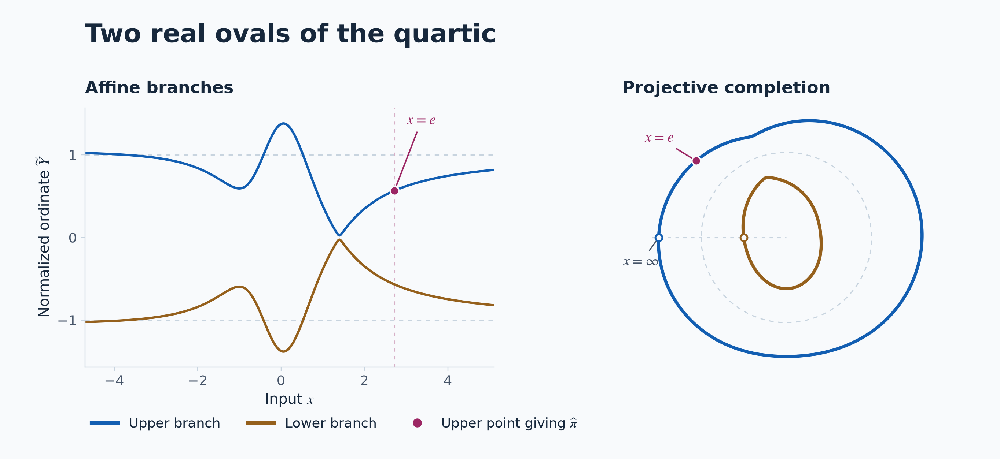

# The real ovals of my quartic

18 November 2026. I plotted the two real components of the quartic from my original six coefficients. The point marked at $x=e$ on the upper branch gives $\widehat\pi$ after converting back to the original quadratic’s ordinate. [Starting coefficients and proof of the two ovals](../2026-11-18-lean-foundations-v001/arithmetic/research/geometry.md)

The left panel uses the ordinate $\widetilde Y=Y/[\sqrt{961000}(1+x^2)]$. For the right panel I use $\theta=2\arctan x$ and draw each branch at radius $r_\pm=2\pm(1+|\widetilde Y|)/2$. The radial spacing keeps both loops visible when the affine branches come close. The dashed circle has radius 2. Both ends of each affine branch reach the same angle as $x\to\pm\infty$ and close at their hollow point.

## Where the branches are farthest apart and closest together

If $f(x)=Y^2$, the plotted gap is

$$
\frac{2\sqrt{f(x)}}{\sqrt{961000}(1+x^2)}.
$$

Its stationary points are exactly the real roots of $(1+x^2)f'(x)-4xf(x)$. Dividing this polynomial by two gives

$$
519870x^4+3732543x^3-2525625x^2-5438249x+322005.
$$

Four sign changes across disjoint rational brackets isolate all four stationary points. Comparing the gaps there and at infinity gives the following extrema.

| Extremum of the plotted gap | $x$, rounded | Gap, rounded |
| --- | ---: | ---: |
| Global maximum | 0.0577935102 | 2.7618426310 |
| Global minimum | 1.4001675626 | 0.0512721009 |

The maximum is enclosed by $x=0.057793510152240105777280250693154883192029607377208871002508747568\pm3.72\times10^{-67}$. At $x=0.057739531$ the upper branch is about $6.19\times10^{-9}$ below its maximum.

The closest complex branch points to the real axis are $1.3996032796\pm0.0328751629\,i$. Their real factor in the quartic is $(x-1.3996032796\ldots)^2+(0.0328751629\ldots)^2$, which becomes especially small where the plot narrows. [Directed enclosures](extrema-results.txt)

In the original $y$-coordinate the gap has a simple exact minimum. The coefficient difference $N-D$ is positive and

$$
y_+-y_-=\frac{\sqrt{f(x)}}{N-D}
=\sqrt{1+\left(\frac{2N}{N-D}\right)^2}\ge1.
$$

Equality holds exactly at $N(x)=0$. The positive solution, $x=(183+\sqrt{1259229})/930\approx1.4033911105$, is about $0.003224$ to the right of the plotted minimum. There the original quadratic factors as $-D(x)(y+1)(y+2)$, giving $y=-1,-2$. These two values become $p=+1,-1$ in my shifted reciprocal coordinate $p=2y+3$. The negative root of $N$ gives the same exact unit gap. [Exact gap and roots in Lean](../../lean/SuperZeta/Meme.lean)

## Reproduce the figure and checks

The figure is a 2728 × 1254 PNG generated with Python 3.12.11, Matplotlib 3.11.2 and NumPy 2.5.5. The extrema script isolates each root by 192 rational bisections and bounds the gaps with 384-bit interval arithmetic using python-flint 0.9.0. The calculation starts from the quartic in the archived geometry note, SHA-256 EB3C1A97C511ACE572FCEABEBA1DFF29D305A5B86A2C12C0B36EF69F93AD1F14.

Run these commands from this directory.

~~~sh
python -m pip install matplotlib==3.11.2 numpy==2.5.5 python-flint==0.9.0
python -B plot_quartic_ovals.py quartic-ovals-reproduced.png
python -B check_extrema.py
~~~

The output of the last command is saved in the [extrema record](extrema-results.txt).
