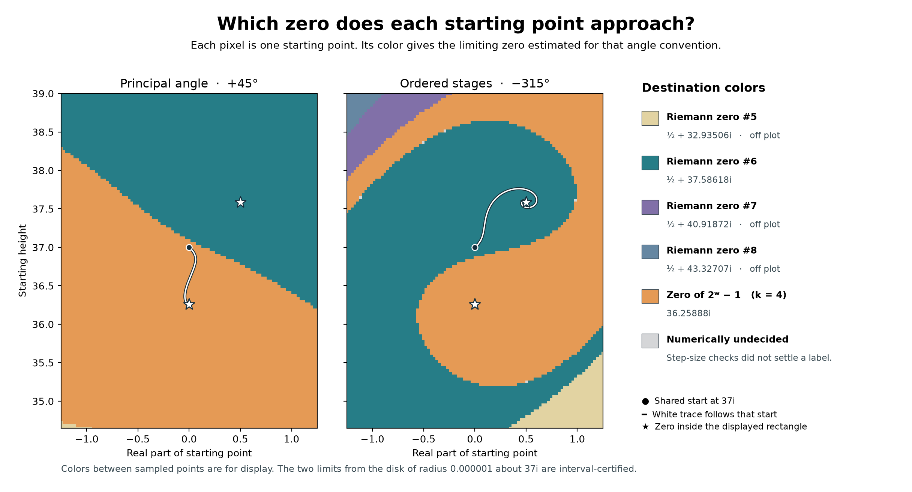
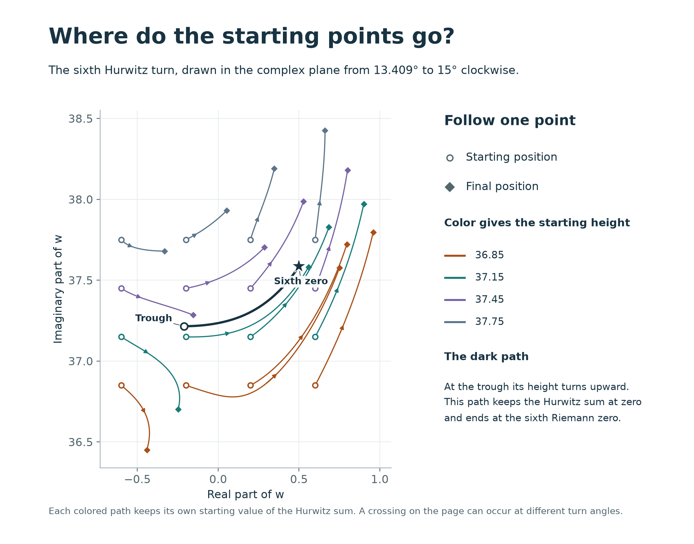
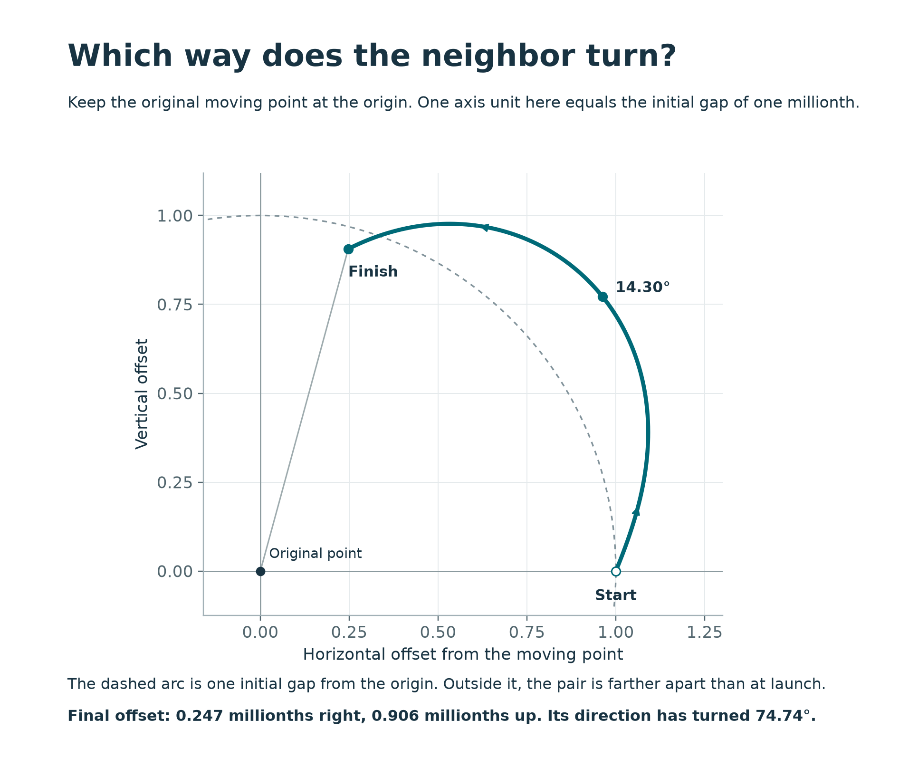

# What the ordered Dottie return contributes to a map of zero basins

I asked whether keeping the two exponential stages could change where a starting point goes on a complex map. For the endpoint of my Hurwitz turn there is a disk on which the answer is yes. Give both calculations the same starting point, the same meromorphic function and the same one-lap multiplier. Reading the final multiplier at its principal angle leads to the elementary zero at height 36.25888. Reading the logarithms of the original 640 stages leads to the sixth Riemann zero at height 37.58618. The directed calculation covers every point within $10^{-6}$ of $37i$. The basin colors below show numerical destinations on a larger rectangle. [Two-destination certificate](basin_certificate.json)

## Which complex function moves the original paths?

I use $w=\sigma+iT$ and the **unnormalized** symmetric Hurwitz sum

$$
H(w,b)=\zeta(w,b)+\zeta(w,1-b),\qquad b=\tfrac16+h/180 .
$$

Here $h$ counts clockwise degrees from the original 60° calibration. Each complex input $w_0$ supplies its own value $c=H(w_0,b_0)$. Continuing $H(w,b)=c$ gives the equation for *every* regular starting point. Differentiating first with respect to $h$, then differentiating the conserved value with respect to the starting position, gives

$$
\frac{dw}{dh}=-\frac{H_b}{180H_w},\qquad
\frac{\partial w_1}{\partial w_0}=\frac{H_w(w_0,b_0)}{H_w(w_1,b_1)} .
$$

These formulas hold on each continued branch wherever $H$ is regular and $H_w\ne0$. The modulus of the second formula measures the change in an infinitesimal length. Its square measures the change in area. The rectangular grid covers a finite part of this plane. The choice of normalization matters away from a zero. For example, keeping $\pi^{-w}H$ constant produces the same zero paths, while at a zero the derivative of its transport gains the factor $\pi^{w_1-w_0}$. [Hurwitz parameter derivative, DLMF 25.11.17](https://dlmf.nist.gov/25.11.E17) · [McPhedran, Botten and Nicorovici, null trajectories](https://doi.org/10.1098/rspa.2006.1763)

The Dottie parameter can also be complex. On a neighborhood of the calibrated right flank let $m(L)$ be the logarithm of the continued orbit multiplier with argument between 45° and 60° on the segment. Write $\eta=\Re L$ on that segment and $L^*=2\eta-\bar L$. My earlier chart gives the holomorphic shift

$$
b(L)=\frac12-\frac{m(L)-\overline{m(L^*)}}{2\pi i}.
$$

Substitution gives $dw/dL=-b'(L)H_b/H_w$. This extends the measured turn to complex $L$ on its calibrated neighborhood and lets initial $w$ vary independently. [Flank chart, proof and choice of logarithm](../../2026-11-19-single-term-inverse-v001/conformal_flank.txt)

I followed the sixth moving zero and 16 neighboring starting positions through the last part of the turn. Each arrow shows the direction of travel in the complex plane. The horizontal and vertical axes use the same scale.

For a closer comparison I placed a second point exactly one millionth to the right of the zero at its last height minimum. The offset panel draws the vector from the moving zero to this neighbor. It starts at $(1,0)$ in millionths of a unit. At the landing it points $74.73753^\circ$ counterclockwise from the positive real axis, with coordinates $(0.247209,0.905975)$. The distance between the points reaches its unique maximum of $1.233768546$ millionths near $14.29871382415^\circ$, returns to its starting length near $14.87901935156^\circ$, and ends at $0.939096964$ millionths. [Proof for this pair](neighbor_proof.txt) · [Interval bounds](neighbor_proof.json) · [Distance plotted against the turn angle](two_paths.png)

To explore the map, download the HTML file from GitHub using **Download raw file** and open it in a browser. Choose any of the 10,961 starting points to see its paired endpoint on the same complex axes. It also works offline. [Interactive complex-plane map](complex_explorer.html)

[Wider field](plane_wide.png) · [Closeup](plane_strain.png) · [Complete starting and final grids](plane_grid.png)

From the last trough to the sixth landing, the length factor is $0.93909767282928$. At $0.075+36.75i$ it is $0.286128734$. At $-0.525+37.3125i$ it is $8.075195$. The three values have interval enclosures. Thus neighboring points can approach one another or spread apart on the same angular interval. At a regular finite endpoint the transport derivative is nonzero. In particular those finite arrows keep their complex level $c$, including the nonzero levels marked A and B. [Two nonzero-level interval proofs](plane_anchors.json) · [Zero-path length and area](phase_lift.json)

**Why did the original heatmap show a gray staircase?** Off-white means a measured length factor near one. The original gray squares identified 37 starting points at which two angular step sizes disagreed. I continued all 37 exact stored centers with 192-bit interval arithmetic and recovered all 37 endpoints. Two neighboring centers at height $36.7875$, about $0.0125$ apart horizontally, finished $1.7203611739$ apart. Tiny separations confined to either individual neighborhood *shrink*, by factors $0.4972247$ and $0.416243774$ respectively. These measure two different things: the first distance compares the two continued centers; the local factors describe what happens to points infinitesimally close to each center. [All 37 centers, both endpoints and separation bounds](staircase.json)

At an intermediate shift $b$, a simple critical point has $H_w(w_c,b)=0$ and $H_{ww}(w_c,b)\ne0$. Its value can also occur at the initial shift. I solved $H(w_0,b_0)=H(w_c,b)$ and found such a point strictly inside each of the 37 squares. Following each of those 37 points forward gives a collision of two local solutions on the same continued branch of critical points. The 37 collision angles range from $13.70715^\circ$ to $14.95822^\circ$. Near each collision, writing $b_*$ for its shift, the two displacements from the critical point are proportional to $\pm\sqrt{b_*-b}$. All 37 marked interior trajectories approach on the same sheet under the sign convention in the certificate. Meanwhile all 37 sampled **centers** continue through the entire turn. The wide survey extends the starting rectangle to $-2\le\Re w\le2$, $34\le\Im w\le40$ and follows 38,801 starting positions through the same angle. [Locations inside the marked squares](gray_locus.json) · [Directed proof of all 37 collisions on one branch](gray_collision.json)

## How the signs survive the move into a spectral coordinate

At the 45° end of the right-flank segment defined above, I use the cap-selected orbit of ordered period 640. Write $E_j(z)=\exp(a_jz)$ for the ordered scalar stages, beginning with $a_0=-L$ and then $a_1=L$, alternating through all 640. Set $z_{j+1}=E_j(z_j)$ and $c_j=a_jz_{j+1}$. The negative stage has exponent $-LP$ and the positive stage has exponent $LQ$, with $Q$ the intermediate scalar phase. The derivative of the full return is $\mu=\prod_j c_j$. Keeping the exponent *before* applying the exponential gives the following lift. I use the principal logarithms of the two fixed coefficients $+L,-L$.

$$
\ell_*=\sum_{j=0}^{639}\big(\log a_j+a_jz_j\big),\qquad
e^{\ell_*}=\mu.
$$

At the calibrated parameter a direct interval product and a separate logarithmic sum give $\mu\approx0.13008737389166(1+i)$. Its modulus is $0.18397132845108$. Its principal logarithm $\ell_0$ has imaginary part $+\pi/4$, while the stage lift has imaginary part $-7\pi/4$. Their real part is $-1.69297535715033$. The directed enclosure singles out the integer in $\ell_*-\ell_0=2\pi i k$ as $k=-1$. This result specifies a log convention and a marked orbit. [448-bit stage sum and product](phase_lift.json) · [Original alternating exponential maps, Baker and Rippon](https://doi.org/10.1080/17476938908814364)

There is an exact local transfer of the stages. Let $G_j$ be the full return beginning at $z_j$. Since $0<|\mu|<1$, Koenigs' theorem supplies the unique local coordinate $\kappa_j$ taking $z_j$ to zero, with derivative one there, such that $\kappa_jG_j=\mu\kappa_j$. The return identity $G_{j+1}E_j=E_jG_j$ and uniqueness imply

$$
\kappa_{j+1}E_j=c_j\kappa_j .
$$

Indeed $c_j^{-1}\kappa_{j+1}E_j$ has the same derivative and satisfies the same equation as $\kappa_j$. For **any** simple zero $\rho$ of $f(w)=H(w,1/4)$, let $f^{-1}_\rho$ be its local inverse taking 0 to $\rho$. The coordinates $f^{-1}_\rho\kappa_j$ therefore carry each individual Dottie stage into $w\mapsto f^{-1}_\rho(c_j f(w))$. Composing recovers the local one-lap map $w\mapsto f^{-1}_\rho(\mu f(w))$. The choice of which inverse branch to follow away from a zero is where the basin question enters. [Milnor, Koenigs linearization, Theorem 6.1](https://legacy-www.math.harvard.edu/archive/118r_spring_05/docs/milnor.pdf)

## Two destinations and the critical point that joins their inverse branches

At $b=1/4$, summing over the two odd residue classes modulo four gives

$$
f(w)=2^w(2^w-1)\zeta(w).
$$

I chose a continuous interpolation of one Dottie lap by requiring its **spectral value** to follow a logarithmic spiral. For a selected logarithm $\ell$, in lap time $t$,

$$
f(w(t))=e^{t\ell}f(w_0),\qquad
\dot w=\ell\,\frac{f(w)}{f'(w)} .
$$

The second identity follows by differentiation. Near a simple zero both lifts have the same time-one map, by local invertibility and $e^{\ell_0}=e^{\ell_*}$. Across a larger region the path taken through the values of $f$ determines which inverse branch returns the position. This is a rotated continuous Newton flow. Applying the stage logarithm to that flow is my choice of interpolation. Newton flows for ordinary zeta and their relation to $f'=0$ have an established literature. [Neuberger and collaborators, equations (1)–(3)](https://doi.org/10.1088/1367-2630/16/10/103023)

**Two-destination result.** For every $|w_0-37i|\le10^{-6}$, the principal lift tends to $8\pi i/\log 2$. The stage lift tends to $\rho_6=1/2+37.58617815882567\ldots i$. Up to lap time 4 the interval proof continues the two inverses in 137 and 199 overlapping disks. Each then enters a disk of radius $1/64$ containing its specified zero. The uniform inverse estimate gives $|w(t)-\rho|\le K\exp(t\Re\ell)$ for all $t\ge4$, with $K=0.541$ or $0.579$, respectively. [Directed proof](basin_certificate.py) · [Enclosures](basin_certificate.json)

**Which two branches meet?** A simple critical point lies at

$$
w_c=0.235950387044401\ldots+36.945179675756715\ldots i.
$$

The normalized critical value $f(w_c)/f(37i)=0.8940136932\ldots-0.0226480972\ldots i$ lies inside the first-lap loop formed by going forward on the principal spiral and backward on the ordered spiral. To verify this, use the strictly decreasing radius to locate the two boundaries at the critical radius. Its angle $-0.02533$ lies strictly between their angles $-0.36278$ and $+0.05183$ radians. The loop winds once about this value. [Critical point and winding proof](critical_loop.json)

I followed both roots from $q=0$ along $f(w)=qf(w_c)$. They meet at this same $w_c$ when $q=1$. With $C=0.23160362304627\ldots+0.65085396517774\ldots i$, the two inverse branches have the local form

$$
w_{\rm elem}=w_c-C\sqrt{1-q}+O(1-q),\qquad
w_{\rm Riemann}=w_c+C\sqrt{1-q}+O(1-q).
$$

Taylor expansion gives $C^2=-2f(w_c)/f''(w_c)$. Interval continuation identifies which root carries which sign. A boundary comparison by Rouché's theorem counts exactly two roots in the final disk and isolates the only critical point there. Thus a sufficiently small loop about this critical value exchanges these particular branches when carried back along the radial path. The winding calculation for the full spirals and the two-destination proof above are separate checks. [Branch identification, boundary estimates and both signs](critical_branches.json)

**Reading the two pictures.** The lattice figure varies the Hurwitz parameter and follows constant complex values. The destination figure freezes the Hurwitz parameter and moves each complex value down a spiral. The former measures how neighboring points deform during the actual sixth turn. The latter shows how much difference a retained Dottie winding makes in the specified continuous interpolation. The destination plot samples 11,115 starting positions. Both endpoint classifications survived the step-size comparison at 11,110 positions, and 6,632 of those gave different limits. The percentages depend on the rectangle and sampling. [Full grid, raw classifications and both step sizes](basins.npz) · [Grid summary](basin-summary.json)

As for the apparent exponential in the sixth path, its height $T$ has a horizontal tangent at its last trough and starts by rising proportionally to the **square** of the horizontal displacement, with coefficient $0.435268662475601\ldots$. In the basin calculation the quantity that changes exactly exponentially is $f(w(t))$. The plotted positions come from inverting that quantity. [Sixth-path fold coefficients](../landing/Dottie-Fold-Arrival/fold-shapes.json)

**Open question.** Can critical values and their two labeled inverse branches predict destination changes for other windings and starting disks before tracing the full paths? The calculation above identifies one such pair and supplies a disk on which to test a proposed rule.
