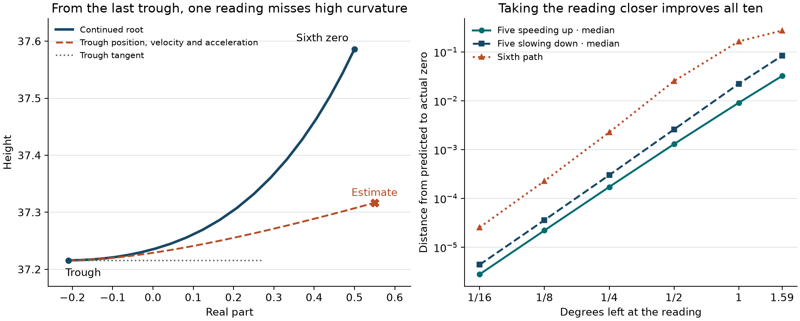

# Forecasting the end of a Hurwitz zero path

I followed ten marked zeros of the symmetric Hurwitz sum through the same clockwise turn. I asked how much of the remaining motion I could predict from a single point, its velocity, and its acceleration. The sixth path gives a visible test. At its last trough the height derivative is zero. Its upward acceleration predicts a rise of **0.100854** before the end of the turn. The actual rise is **0.370348**. Updating the derivatives through 64 equal steps brings the final complex error down from **0.274054** to **0.000076581**. [Sixth-path forecast and comparison](Dottie-Blind-Landing/masked-test.txt) · [Fixed-step errors and endpoint identifications](Dottie-Forward-From-Trough/scored.json)



The angular coordinate is measured in clockwise degrees from 60°. I write it as $h$, so the symmetric shift is $b=1/6+h/180$ and the endpoint is $h=15$. The path satisfies

$$
H(w,b)=\zeta(w,b)+\zeta(w,1-b)=0.
$$

For a position $w$, velocity $v$ and acceleration $a$ taken $D$ degrees before the endpoint, the quadratic forecast is $w+Dv+D^2a/2$. It predicts both coordinates. At the trough it gives $0.549784+37.316684i$ for the sixth landing. The actual endpoint is $0.5+37.586178i$. Among the ten paths the quadratic forecast improved on the tangent in all 60 matched comparisons. At every point in the **last eighth of a degree** on each of these ten paths, the cubic remainder bound puts the quadratic error below **0.001**. [All coordinate forecasts](Dottie-Blind-Landing/predictions.json) · [All scores](Dottie-Blind-Landing/scores.json) · [Continuous error bounds](Dottie-Forward-From-Trough/uniform_eighth.json)

At the quarter shift $H(w,1/4)=2^w(2^w-1)\zeta(w)$. Differentiating the moving-zero equation gives a way to recover ordinary zeta derivatives from the arrival. On the sixth path the velocity recovers $\zeta'(\rho_6)\approx1.853466250-0.561004420i$. The acceleration recovers $\zeta''(\rho_6)\approx-3.203353764+1.373503603i$. The proof includes an all-order expansion for ordinary zeta along the zero path. [Arrival formulas, local expansion and its remainder](Dottie-Fold-Arrival/arrival-proof.txt) · [Directed comparisons](Dottie-Fold-Arrival/arrival.json)

## How the ten tracks were chosen

All ten destinations were already known when I designed this local test. I froze three extrapolations and six leads and used separate processes for forecasting and scoring. The individual forecaster receives the latest eligible past checkpoint, the cutoff parameter, and the track label. With the forecast file sealed, the scorer identifies the endpoints using FLINT enclosures of ordinary Riemann zeros. At the shared trough time, simply assigning each stationary point to the nearest known zero also gives ten correct ordinals. The useful comparison is the size of the coordinate error. [Frozen protocol](Dottie-Blind-Landing/protocol.json) · [Forecast code](Dottie-Blind-Landing/observe.py) · [Score code](Dottie-Blind-Landing/score.py)

| Landing | Starting point at 60° | How the checkpoint sequence was obtained |
| --- | --- | --- |
| 1 | $4\pi i/\log 3$ | Forward continuation from an elementary address. |
| 2 | $4\pi i/\log 2$ | Forward continuation from the dyadic address. |
| 3 | $\rho_2$ | Forward from the previous identified endpoint after resetting the angle. |
| 4 | $\rho_3$ | Forward from the third zero after resetting the angle. |
| 5 | $10\pi i/\log 3$ | Backward tracing from the known fifth zero identified the elementary seed. The forecast uses the forward replay. |
| 6 | $12\pi i/\log 3$ | Backward tracing from the known sixth zero identified the elementary seed. The forecast uses the forward replay. |
| 7 | $8\pi i/\log 2$ | Forward from the elementary address reached by the fourth zero's path. |
| 8 | $\rho_6$ | Traced backward from the known eighth zero. |
| 9 | $\rho_7$ | Traced backward from the known ninth zero. |
| 10 | $\rho_8$ | Traced backward from the known tenth zero. |

The original inputs for cases 1–7 and the independent identification of the elementary seeds for 5 and 6 are in the zero-transport archive. This directory supplies the original backward traces for cases 8–10 and the script that generates them. The direction describes how the historical checkpoints were produced. At every cutoff the forecast advances in increasing $h$. [Zero transport at its pinned revision](https://github.com/NuckyDucky/The-Super-Zeta-Function/tree/5c5f3a160b2412a49b0b1e86fa24f7605a938823/archive/2026-11-19-zero-transport-v001) · [Fifth- and sixth-zero round trips](https://github.com/NuckyDucky/The-Super-Zeta-Function/tree/5c5f3a160b2412a49b0b1e86fa24f7605a938823/archive/2026-11-19-zero-transport-v001/Dottie-Transport-Reversibility) · [Tracks 8–10](Dottie-Turn-Geometry/ten)

## Reproduce the calculation

From this directory in a full repository checkout, use Python 3.12 with python-flint 0.9.0.

```sh
python -m pip install python-flint==0.9.0
python -B replay.py
```

The replay works offline after installation. It verifies SHA-256 for its inputs, stages the original unmodified scripts in a temporary directory, regenerates the sealed predictions, computes the endpoint derivatives, rescores all 60 forecasts, runs the multistep and interval continuations from the common trough cutoff, and checks the continuous last-eighth bound. The published inputs and results remain available throughout. The protocol and forecast SHA-256 digests are respectively `c1377dd7d9eac80e691c40b7c024aad63247e945f2260174372f7cfcbaa080a2` and `15d777274758a8fb97b549418139ef9d15373e23b67d5c15cc59353f9a150bb7`. These are local content seals. [Pinned dependency files and commits](dependencies.json) · [Preserved payload hashes](payload-sha256.json)

For the full geometric replay, including the four sixth-path folds and the three backward continuations, run

```sh
python -B replay.py --geometry --backward
```

The geometry calculation also checks the last speed maximum, the convexity estimate for the squared zeta residual and the sixth path’s final contiguous forecast intervals. The physical attraction numbers quoted in the arrival proof use the earlier 448-bit right-flank certificate. [Sixth-path derivative certificates](https://github.com/NuckyDucky/The-Super-Zeta-Function/tree/eac68c0a3068060d7458fdd3b189194e8c955d8d/archive/2026-11-19-sixth-passes-v001) · [Right-flank contraction calculation](https://github.com/NuckyDucky/The-Super-Zeta-Function/blob/703381cb3e6df97aabcf3f3784e9aba6c66c927b/archive/2026-11-19-single-term-inverse-v001/contraction-sweep.json) · [Sixth-path forecast horizons](Dottie-Forward-From-Trough/horizon.json)
