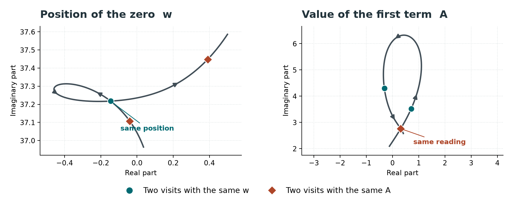

# Which visit does one Hurwitz value remember?

On the path to the sixth Riemann zero, I return to the same complex position at two different angles. If I hide the angle, the position and both ordered traces, **one labeled Hurwitz summand distinguishes those two visits**. It recovers the outgoing direction and, on the calibrated right flank, the original marked Dottie cycle. I also found exactly one pair of other angles where the single reading agrees. The positions there differ. On this whole sweep, the pair of measurements $(w,A)$ identifies the visit.

## The experiment

Write $A(w,b)=\zeta(w,b)$ and $B(w,b)=\zeta(w,1-b)$. I follow the simple zero of $H=A+B$ starting at $12\pi i/\log 3$. The clockwise turn $h$ runs from $0$ to $15$ degrees, with $b=1/6+h/180$. At the endpoint the moving zero reaches $\rho_6$. The earlier reconstruction fixes this arithmetic family and its branch. The two terms have opposite complex values all along a zero of $H$.

At $w\approx-0.14560046151+37.21759523205i$, I formed two input packets containing only real and imaginary bounds for $A$. For each, I started at the elementary seed and covered the full sweep with 1,533 directed cells at 224 bits. I used the crossing position and visit labels to score the recovered shifts only after decoding. Angles in the last column are measured counterclockwise from the positive real axis as $h$ increases. [Two packets](packets.json) · [Recovered shifts and tangents](decoded.json) · [Original position certificate](../2026-11-19-sixth-passes-v001/compute/revisit.json)

| Single complex reading, rounded | Clockwise turn | Outgoing heading | Dottie multiplier modulus |
| --- | ---: | ---: | ---: |
| $-0.310046+4.294884i$ | 13.60742319° | 3.110769° | 0.18547269948 |
| $0.714660+3.522701i$ | 10.01602454° | 142.212546° | 0.18967792902 |

I converted the recovered shift to the native angle $90^\circ-180^\circ b$ and inverted the certified angle of the continued right-flank multiplier, holding $\Re L=4.749479070945369\times10^{-8}$ fixed. The first packet gives $\Im L\approx0.5098929774449005867$ and the second gives $\Im L\approx0.50989297809009499909$. The record encloses the rooted $P,Q$ and complex multiplier at each input, with scalar period 320 and ordered period 640. This inverse uses the known branch, clockwise direction, right flank and phase marking. [Recovered ordered orbits](recovered-orbits.json) · [Reference computation for scoring](scoring/orbit_packets.py) · [Flank calibration](../2026-11-19-zero-transport-v001/Dottie-Off-Axis-Return/flank_path.py)

## Where the single reading agrees twice

For the reading along the branch, $C(b)=A(w(b),b)$, implicit differentiation gives

$$
\frac{dw}{db}=-\frac{H_b}{H_w},\qquad
\frac{dC}{db}=\frac{A_b B_w-A_w B_b}{A_w+B_w}.
$$

I enclosed these derivatives on a partition of 4,209 cells at 192 bits. On the full sweep $0.10438<\lvert dC/dh\rvert<3.84948$. The holomorphic inverse function theorem therefore gives a local coordinate near every one of these real inputs on the complexified branch. [Full derivative and injectivity certificate](chart.json) · [Proof and exact negative-even examples](conformal-note.txt)

The global question needs a second check. Intervals sharing a strictly monotone real or imaginary projection cannot repeat a value there. I compared enclosures for the remaining pairs of intervals. Three possible cell pairs survived, all in one rectangle in the two-angle plane. A two-variable interval contraction proves a transverse double point there. The derivative bound below 0.524 gives uniqueness throughout that rectangle. The corresponding position boxes are disjoint. This exhausts the distinct pairs on the closed real sweep. [Computational proof](chart.py) · [Double-point bounds](chart-crossing.json)

| Clockwise turn | Moving zero $w$, rounded | First term $A$, rounded | Dottie multiplier modulus |
| --- | --- | --- | ---: |
| 9.68377070248° | $-0.03954342+37.10681804i$ | $0.31372042+2.76007972i$ | 0.19009230804 |
| 14.73140805789° | $0.39050372+37.44801936i$ | $0.31372042+2.76007972i$ | 0.18425548998 |

The modulus measures local attraction of the marked Dottie orbit per scalar return lap. Even with the same complex reading, the two orbits contract at different rates. On this specific flank $\lvert\mu\rvert$ decreases from $0.20429677285$ to $0.18397132845$. Propagating the derivative around the original lap bounds $d\log\lvert\mu\rvert/dh$ strictly between $-0.008614$ and $-0.005387$ per clockwise degree across 120 cells at 448 bits. The graph of $w$ measures how a spectral zero moves as I vary the angle. Attraction measures how nearby states move under repeated iteration with the parameter fixed. [Two orbits at the double reading](collision-orbits.json) · [Contraction on the entire flank](contraction-sweep.json) · [Conformal multiplier proof](conformal_flank.txt)

The branch matters. At $w=-2$ there is an exact counterexample to carrying the joint inverse over to all branches. Both $b=1/5$ and $b=(13-\sqrt{73})/20$ give exactly $A=-2/125$. Here $A=-B_3(b)/3$ by the Hurwitz special-value formula, and factoring the cubic gives the equal readings. The derivative vanishes between them at $(1-1/\sqrt3)/2$, the quarter-shift coordinate from the rooted-history calculation. [Rational polynomial check and 448-bit orbit comparison](quarter_example.json) · [Earlier order-contrast identity](../2026-11-18-lean-foundations-v001/notes/hurwitz-order.md) · [DLMF 25.11.14](https://dlmf.nist.gov/25.11.E14)

## Reproduce the result

From a clean checkout with Python 3.12, run the commands below. The verifier regenerates and scores the blinded readings, exhausts the double-point search, differentiates the periodic orbit and checks the exact Bernoulli example. Each calculation uses a fresh output folder. Add `--output <empty-directory>` to keep its results. The same entry point runs in GitHub Actions. These results combine written derivations with directed ball arithmetic and exact polynomial arithmetic. The related Lean development covers the earlier two-trace algebra. [Replay](replay.py) · [Two-trace Lean proof](../2026-11-19-oriented-return-v001/README.md) · [Source inventory](provenance.json)

~~~sh
python -m pip install python-flint==0.9.0
python -B archive/2026-11-19-single-term-inverse-v001/replay.py
~~~

The figure uses midpoint samples for display. Regenerate it with `plot_projection.py` and matplotlib 3.11.2. For credits, McPhedran, Botten and Nicorovici derived the moving-zero equation for this symmetrized Hurwitz family. Baker and Rippon give the alternating-exponential return behind the Dottie cap. I used the published parameter derivative of Hurwitz zeta and FLINT's implementation of directed complex arithmetic for the enclosures. [McPhedran, Botten and Nicorovici, §3](https://doi.org/10.1098/rspa.2006.1763) · [Baker and Rippon, Theorem 8.1](https://doi.org/10.1080/17476938908814364) · [DLMF 25.11.17](https://dlmf.nist.gov/25.11.E17) · [FLINT, Hurwitz zeta](https://flintlib.org/doc/acb_dirichlet.html)
