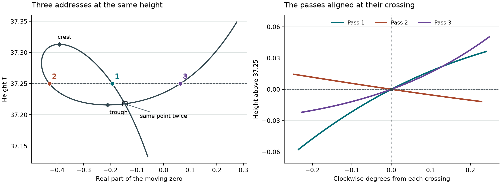

# Three passes through the same height on the branch ending at the sixth Riemann zero

I followed the zero that starts at $12\pi i/\log 3$ through the clockwise turn from $60^\circ$ to $45^\circ$. It finishes at the sixth positive-height Riemann zero. Before reaching it, the same moving zero meets $T=37.25$ three times. Here I locate the three addresses, measure their velocities, and account for both intervening reversals. [Explore the graph](https://nuckyducky.github.io/The-Super-Zeta-Function/) · [Earlier branch identification](../2026-11-19-zero-transport-v001/Dottie-Transport-Reversibility/README.md)

[](https://nuckyducky.github.io/The-Super-Zeta-Function/)

## What I turn

I use $h$ for clockwise degrees traveled from the starting angle. The native angle is $60^\circ-h$, and $b=1/6+h/180$. The zero $w=\sigma+iT$ satisfies

```math
H(w,b)=\zeta(w,b)+\zeta(w,1-b)=0.
```

The two shifts move oppositely. As I change them, I follow the same simple zero so the two complex Hurwitz values still sum to zero. The factor $\pi^{-w}$ in the arithmetic reference is everywhere nonzero. The ordered period-640 phases determine the signed orientation of the original return. I chose the two special angles on its sweep for their arithmetic factorizations. The moving zero belongs to the resulting reference family. Its endpoint at $b=1/4$ recovers the Riemann factor. [Calibration and endpoint identities](../../README.md#37-following-a-zero-from-one-turn-to-the-next) · [Related zero trajectories in earlier work](../2026-11-19-zero-transport-v001/Dottie-Transport-Reversibility/PRIOR-WORK.md)

## What makes the folds

A prime below means a derivative with respect to **one clockwise degree**. Implicit differentiation gives

```math
w'=-\frac{H_b}{180H_w},\qquad
w''=-\frac{H_{ww}(w')^2+2H_{wb}w'/180+H_{bb}/180^2}{H_w}.
```

I evaluated these derivatives on the enclosed zero, using the Hurwitz derivative in its shift. At each simple height fold here, $w'$ is real and nonzero and $T''$ has a definite nonzero sign. On the rotated plot $X=T,\ Y=1/2-\sigma$, this same point has a vertical tangent. [NIST, Hurwitz parameter derivative](https://dlmf.nist.gov/25.11.E17)

| Event | Clockwise degrees | Real part | Height | Real velocity | Height velocity | Real acceleration | Height acceleration |
|---|---:|---:|---:|---:|---:|---:|---:|
| Pass 1 | 10.160089 | −0.192696 | 37.250000 | −0.320800 | +0.194648 | +0.112201 | −0.400825 |
| Crest | 10.954905 | −0.390926 | 37.313108 | −0.167683 | 0 | +0.210498 | −0.132547 |
| Pass 2 | 12.321335 | −0.428799 | 37.250000 | +0.105663 | −0.055446 | +0.179764 | +0.029372 |
| Trough | 13.409174 | −0.210153 | 37.215830 | +0.302583 | 0 | +0.220157 | +0.079703 |
| Pass 3 | 14.101705 | +0.063261 | 37.250000 | +0.499715 | +0.138330 | +0.294567 | +0.437757 |

At the first crossing the point is climbing and losing upward speed. At the second it is descending and recovering upward speed. At the third it is climbing and gaining upward speed.

**Every height strictly between the trough and the crest is visited exactly three times.** The descending arc from crest to trough supplies one downward crossing of each of those heights. On the rest of the 15-degree path, every passage through those heights is upward. I checked this last assertion by enclosing the height or its derivative on every parameter interval outside the central arc. Inside that arc the two certified horizontal tangencies separate the three directions of travel. The branch starts below the band and ends above it, so the number of upward crossings exceeds the number of downward crossings by one. That gives two up and one down. At either bounding height two of the visits merge into a single tangency, leaving two distinct visits there.

## How far the direction turns

At the crest the tangent points due left. At the trough it points due right. Height decreases throughout the intervening arc, so the continuous tangent angle goes from $\pi$ to $2\pi$ through the lower half-plane. **The tangent turns counterclockwise by exactly half a turn while the input advances only about 2.454268 degrees clockwise.**

I also checked the direction of turning throughout the larger interval from $645/64$ to $905/64$ degrees, which contains the three passes. For a regular complex curve the angular velocity is $\mathrm{Im}(w''/w')$. The interval calculation bounds it strictly between $1/20$ and $6$ radians per clockwise input degree. Thus every piece of this arc bends counterclockwise in the ordinary complex plane. Its two height folds occur as the velocity passes through the horizontal in opposite directions. [Angular certificate](compute/turning.json) · [Continuous check](compute/turning.py)

## Where the path crosses itself

Just above the trough there is a second, different coincidence. At clockwise input angles $10.01602453524\ldots$ and $13.60742318697\ldots$ the branch passes through **the same complex number**, approximately $-0.14560046150734+37.217595232052i$. Its first visit heads up and left, and its second heads up and right. The angle between the two tangent lines is $40.898223^\circ$.

I solved the two real equations obtained by setting $w(h_1)-w(h_2)=0$. On two disjoint angle intervals a preconditioned two-dimensional interval calculation gives a strict contraction, hence an exact shared point. The determinant of the two velocities lies near $-0.09605119$, excluding parallel tangents. One complex address really can occur twice with different directions of travel. To recover the motion at this point I must retain which shift I am following. [Two-angle certificate](compute/revisit.json) · [Contraction proof](compute/revisit.py)

## Evidence and replay

I used Python 3.12 and python-flint 0.9.0 with 192-bit ball arithmetic and no random inputs. The input is the sixth forward replay in the immutable [zero-transport snapshot](../2026-11-19-zero-transport-v001/Dottie-Transport-Reversibility/rho6-replay.json), previously published at commit `5c5f3a160b2412a49b0b1e86fa24f7605a938823`. Its original SHA-256 is recorded in both result files. I carried overlapping uniqueness disks along the full 15-degree branch. An adaptive census certified exactly three intersections with $T=149/4$. Separate isolations give the positions and derivatives in the table. The angular check covers entire parameter intervals to bound the tangent's angular speed and count the path's horizontal tangencies. These are analytic derivative formulas with computer-assisted interval proofs. The display lines interpolate midpoint samples for viewing. [Directed intervals and display samples](compute/jets.json) · [Full-sweep verifier](compute/verify.py)

From the repository root, install the pinned numerical dependency and run the same job used by Pages.

```sh
python -m pip install python-flint==0.9.0
python -B tools/build_sixth_passes.py --output sixth-site
```

Open the generated `index.html` to explore the graph offline. The build rechecks all three certificates before rendering the page. GitHub performs that calculation on relevant changes or manual dispatch, then serves the saved graph to readers. Only the controls and interpolation run in the reader's browser. The preview figure can be regenerated separately with matplotlib 3.11.2 and `preview.py`.
