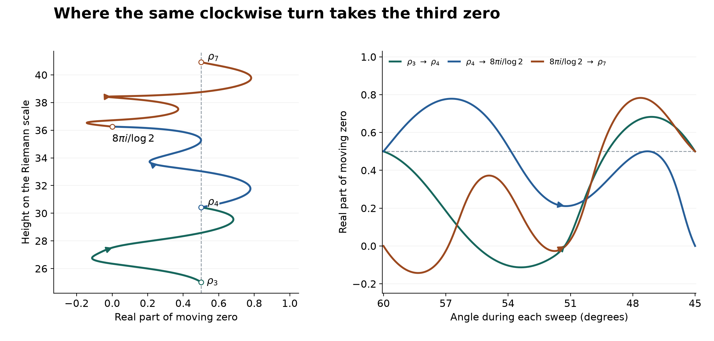

# Following zeros on the clockwise Dottie return

I followed an individual zero through the same interval of the symmetrized Hurwitz zeta function, then used its endpoint as the seed for the next turn. The third Riemann zero led directly to the fourth. From the fourth, the first turn reached an elementary zero and the second reached the **seventh** Riemann zero. I had called for the fifth. This deposit preserves the prediction, the stopping rule and all three trajectories. [Protocol](Dottie-Forward-Iteration/protocol.txt) · [Results in execution order](Dottie-Forward-Iteration/results.json)

## The turn and the reset

I use the marked period-640 orbit of the ordered map $F_L(P,Q)=(e^{LQ},e^{-LP})$. On the calibrated right-hand branch of the Dottie spire, the two spectral measurements $M_+$ and $M_-$ recover the signed argument $\theta$ of the scalar return multiplier. A measured clockwise turn of $30^\circ$ contains the subarc from $60^\circ$ to $45^\circ$. I chose this subarc because the corrected arithmetic reference has explicit factors at both ends. [Oriented spectral return](../2026-11-19-oriented-return-v001/README.md) · [Off-axis witness and calibration](Dottie-Off-Axis-Return/NOTES.txt)

With Riemann variable $w=2s$ and $b=1/2-\theta/\pi$, the function being followed is

$$
R(b,w)=\pi^{-w}\bigl(\zeta(w,b)+\zeta(w,1-b)\bigr),
\qquad \frac16\le b\le\frac14 .
$$

At $b=1/q$ the two Hurwitz terms select the residue classes $1$ and $-1$ modulo $q$. For $q=4,6$ these are exactly the reduced residue classes. Grouping the Dirichlet series first in its half-plane of absolute convergence and then continuing gives, for $w\ne1$,

$$
R(1/4,w)=\pi^{-w}2^w(2^w-1)\zeta(w),\qquad
R(1/6,w)=2^{-w}(3^w-1)R(1/4,w).
$$

The first identity describes the destinations. They consist of the Riemann zeros together with the elementary addresses $2\pi i k/\log 2$, $k\in\mathbb Z$. The two sets are disjoint. The second identity explains how I can reset the angle from $45^\circ$ to $60^\circ$ while keeping the endpoint's exact complex coordinate as a starting zero. Following the same simple branch continuously over the subarc determines which destination goes with which seed. [Exact endpoint classification](Dottie-Forward-Iteration/ForwardCertificate.lean) · [Reset identity](Dottie-Second-Zero/ReferenceReset.lean)

## How the cases were selected

Write $\rho_n$ for the $n$th positive-height nontrivial Riemann zero, ordered by imaginary part and counted with multiplicity. Each arrow below denotes one complete clockwise subarc and each new arrow starts at the preceding endpoint.

| Stage | Seed and observed endpoint | How I chose the test |
| --- | --- | --- |
| First connection | $4\pi i/\log 3\to\rho_1$ | I identified this seed by tracing back from the known first zero, then verified the path forward. [Exploratory trace](Dottie-Off-Axis-Return/arithmetic_method.txt) |
| First reset | $\rho_1\to4\pi i/\log 2$ | I followed the first zero to its next elementary address. [Saved path](Dottie-Off-Axis-Return/arithmetic_braid_riemann.json) |
| Second zero | $4\pi i/\log 2\to\rho_2$ | I called this endpoint in advance. My comparison seed $8\pi i/\log 3$ reached $6\pi i/\log 2$. [Protocol](Dottie-Second-Zero/protocol.txt) · [Riemann endpoint](Dottie-Second-Zero/dyadic_identification.json) · [Comparison](Dottie-Second-Zero/triadic_classification.json) |
| Third zero | $\rho_2\to\rho_3$ | I called the third zero as the first new Riemann endpoint and scored a direct landing separately. It took one turn. [Protocol](Dottie-Third-Zero/protocol.txt) · [Count and winding](Dottie-Third-Zero/audit_1.json) |
| Fourth zero | $\rho_3\to\rho_4$ | The next protocol fixed successive calls before the run. This one hit directly. [Protocol](Dottie-Forward-Iteration/protocol.txt) · [Count and winding](Dottie-Forward-Iteration/audit_1.json) |
| First failed successor call | $\rho_4\to8\pi i/\log 2\to\rho_7$ | I called for $\rho_5$. The intermediate address carried forward exactly. The out-of-order Riemann endpoint ended the trial. [Elementary endpoint](Dottie-Forward-Iteration/audit_2.json) · [Seventh-zero count](Dottie-Forward-Iteration/audit_3.json) |

An earlier comparison started at $6\pi i/\log 3$. The registered computation exhausted its 30,000-step budget. A subsequent continuation with tighter derivative bounds attached that same branch to a Fourier expansion. Its real part tends to $-\infty$ and its height tends to $4\pi/\log 2$. This is an example where even a finite next seed fails to exist. The protocol files in this deposit are the local records from the experiments. This publication archives them together with the outcomes. [Original budget and subsequent proof](Dottie-Off-Axis-Return/arithmetic_method.txt) · [Fourier estimate](Dottie-Off-Axis-Return/FOURIER-LIMIT.txt)

## What the skip means

The final three sweeps furnished these endpoint readings, with each endpoint sealed before its ordinal or elementary factor was tested.

| Starting address | Endpoint height, rounded | Ordinary Riemann zeros in the endpoint square | Independent identification |
| --- | ---: | ---: | --- |
| $\rho_3$ | 30.4248761258595132 | 1 | The full-strip count rises from 3 to 4. |
| $\rho_4$ | 36.2588811346175505 | 0 | $2^w=1$ with $k=4$. The ordinary zeta magnitude exceeds 4.05533 throughout the square. |
| $8\pi i/\log 2$ | 40.9187190121474952 | 1 | The full-strip count rises from 6 to 7. |

The ordinary zero count at the height of the intermediate address is five. Thus the fifth zero lies below that address and the sixth above it. A separate check enclosed ordinary zeta along all three **open** arcs and certified nonvanishing there. The fifth and sixth zeros were missed both as stops and as points along the route. Geometric height order and the order of arrival answer different questions. [Height counts](Dottie-Forward-Iteration/height_counts.json) · [First interior](Dottie-Forward-Iteration/interior_1.json) · [Second interior](Dottie-Forward-Iteration/interior_2.json) · [Third interior](Dottie-Forward-Iteration/interior_3.json)

## The crossings and the two skipped zeros

I checked the smaller turns individually. The first blue crossing comes 0.100306 above the fifth zero. The upper loop has two more crossings separated by about 0.181 degrees of rotation. At the three crossings the ordinary zeta magnitudes are about 0.142187, 2.920990 and 2.938889. [Table of angles in multiples of π](Dottie-Transport-Reversibility/rotations.md) · [All crossing enclosures](Dottie-Transport-Reversibility/blue-crossings.json) · [Download the interactive explorer](https://github.com/NuckyDucky/The-Super-Zeta-Function/raw/refs/heads/main/archive/2026-11-19-zero-transport-v001/order-of-the-turns.html)

In a retrospective test I isolated the fifth and sixth zeros, turned backward from each, then checked the forward paths from the recovered exact seeds. They start at the fifth and sixth nonzero positive members of the base-three lattice. Lean checks that **every nonzero base-three address is available only at the starting angle** of this pair of anchors. Uniqueness of continuation along finite simple branches then explains why those endpoints are inaccessible to a regular reset chain launched elsewhere. [Proof, reverse traces and forward replays](Dottie-Transport-Reversibility/README.md) · [Lean proof for the two lattices](Dottie-Transport-Reversibility/TriadicStart.lean) · [Open questions](../../README.md#zero-transport-questions)

## Verification and replay

The forward calculation used the scaled Hurwitz pair and 2,075 contracting Newton disks across the three paths. A second calculation used the unscaled Hurwitz pair and 1,267 Rouché bounds. These compare functions on whole disks over whole parameter intervals. They establish that an apparently nearby zero at one angle continues the particular zero followed at the preceding angle. Both implementations use FLINT directed ball arithmetic. At the two Riemann endpoints, the winding on a reflection-invariant square is one. Uniqueness forces the real part to equal $1/2$ exactly. Counts on either side of the square identify the ordinal, and Hardy sign changes give an additional local check. [Forward algorithm](Dottie-Forward-Iteration/follow.py) · [Second implementation](Dottie-Forward-Iteration/audit_forward.py) · [Endpoint classification](Dottie-Second-Zero/classify.py)

Lean checks the reset and disjoint endpoint classification for the actual Hurwitz reference. It also checks the conditions under which residual and derivative bounds construct a unique simple zero, join adjacent disks to the same branch, and control the zero's motion. For the numerical audit it checks that all 1,267 exported rational intervals cover their three sweeps and that every rounded comparison bound is strictly below one. FLINT evaluates the transcendental functions and supplies the bounds, winding numbers and full-strip counts. [Analytic Lean checks](Dottie-Forward-Iteration/LEAN-ENDPOINTS.txt) · [Disk and branch theorems](Dottie-Forward-Iteration/CertificateLogic.lean) · [Rational mesh](Dottie-Forward-Iteration/ForwardMesh.lean)

The four sibling directories preserve the original verifier paths. Before publication I copied the archive into a fresh working directory and replayed the three sweeps at 256 bits, the independent audits at 320 bits and the Riemann classifications at 384 bits. All 15 regenerated records, including the interior checks, count at the elementary height and exported Lean mesh, matched the archived bytes. The fourth package starts from the previously sealed third zero. Each earlier package can be replayed in turn to trace that input to the exploratory starting data. [Off-axis returns](Dottie-Off-Axis-Return/REPLAY.txt) · [Second zero](Dottie-Second-Zero/REPLAY.txt) · [Third zero](Dottie-Third-Zero/REPLAY.txt) · [Fourth-zero call and skip](Dottie-Forward-Iteration/REPLAY.txt) · [Source inventory and original hashes](provenance.json)

## Relation to prior work

Figures 2–4 of the 2007 paper contain five paths through both of my angles. Four are the individual arcs I connected successively from the base-three seed to the third Riemann zero. I traced all five from the authors' own starting convention at $a=1/2$. The separate comparison records both anchor values for each published figure. [Figure identifications, primary sources and reproduction](Dottie-Transport-Reversibility/PRIOR-WORK.md)

McPhedran, Botten and Nicorovici studied trajectories of zeros of the symmetrized Hurwitz functions and their passage through arithmetic zeros at distinguished parameters. Nakamura treats the rational factorizations and the escape of a real branch at a quarter shift. My calculation identifies the connections above on the measured Dottie subarc, reuses each selected finite endpoint as a seed, and tests the resulting order against predictions recorded in advance. Liu's zero-free half-plane applies to the Riemann factor at the special angles. The ordinal of the selected endpoint comes from the continuation and subsequent count. [McPhedran, Botten and Nicorovici (2007)](https://doi.org/10.1098/rspa.2006.1763) · [Nakamura, Propositions 1.7 and 4.7](https://arxiv.org/abs/1910.10430) · [Liu, Theorem 1.1](https://hexagonmath.org/pdf/2611.00421v1#page=2)
