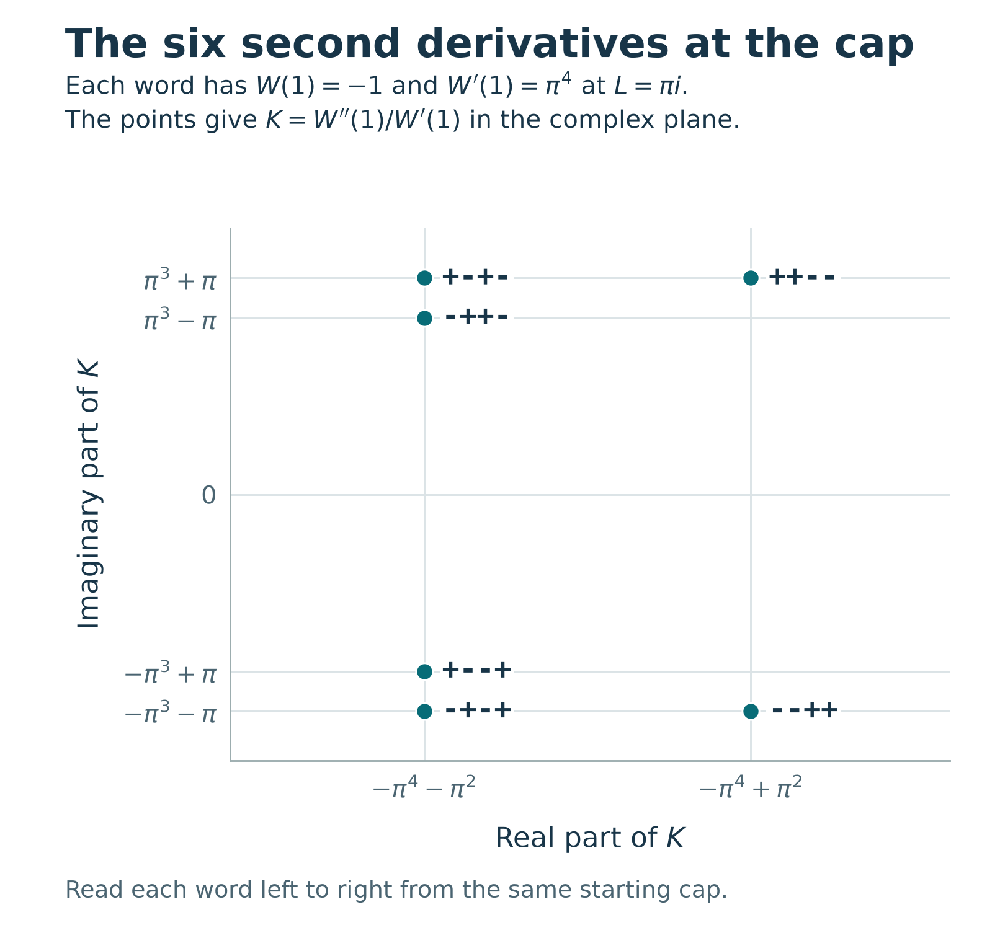

# Recovering the sign order from two cap derivatives at πi

I fix the logarithmic lift at $`L=\pi i`$ and ask how much of an ordered sequence of exponentials I can recover by moving its starting point. Every nonempty sequence sends the cap $`1`$ to $`-1`$. Even the first derivative agrees for all six orderings of two plus signs and two minus signs. The complex second derivative distinguishes all six. For a word of any finite length, the ratio of its second derivative to its first determines both its length and the signs in their original order. I use the same ordered exponential stages as in my [sign-word construction](../2026-11-19-ordered-signs-v001/README.md).

## The cap derivatives retain all the prefix signs

Write $`E_\sigma(z)=\exp(\sigma Lz)`$ for $`\sigma\in\{+1,-1\}`$. I read each word from left to right, starting with $`W_0(z)=z`$ and composing $`W_j=E_{\sigma_j}\circ W_{j-1}`$. A derivative here varies the starting cap $`z`$ with $`L`$ and the word held fixed.

**Proposition.** For $`t=-\pi i`$, set $`c_0=1`$ and $`c_j=\sigma_1\cdots\sigma_j`$. Then

$$
D_j=W_j'(1)=c_jt^j,\qquad
K_m=\frac{W_m''(1)}{W_m'(1)}=-\sum_{j=1}^{m} c_jt^j.
$$

The map from finite sign words to $`K_m`$ is injective, including the empty word.

**Proof.** Both possible stages send $`1`$ and $`-1`$ to $`-1`$. At the cap, the chain rule therefore gives $`D_j=-\sigma_jL D_{j-1}`$, with $`D_0=1`$. For any preceding composition $`f`$, direct differentiation gives

$$
\frac{(E_\sigma\circ f)''}{(E_\sigma\circ f)'}
=\frac{f''}{f'}+\sigma L f'.
$$

At stage $`j`$ the increment is $`\sigma_j L D_{j-1}=-D_j`$. Summing gives the formula for $`K_m`$.

To prove uniqueness when the lengths may differ, pad the shorter list of prefix signs with zeros. If two lists differ, let $`k`$ be the largest index where they differ. In the difference of their polynomials the degree-$`k`$ term has magnitude at least $`\pi^k`$. All preceding differences together have magnitude at most

$$
2\sum_{j=1}^{k-1}\pi^j < \frac{2}{\pi-1}\,\pi^k < \pi^k.
$$

The degree-$`k`$ term survives. The prefix list recovers the original letters by $`\sigma_j=c_{j-1}c_j`$. This also distinguishes a nonempty word from the empty word, for which $`K_0=0`$. [Formal injectivity proof](../../lean/SuperZeta/CapRecovery/Dominance.lean)

There is a practical inverse when both derivatives are available. First read the length from $`|D_m|=\pi^m`$. Starting with $`S=-K_m`$, divide by $`t^m`$. All terms of lower degree together contribute less than $`1/(\pi-1)<1/2`$ to that quotient, so the nearer of $`+1,-1`$ is $`c_m`$. Subtract $`c_mt^m`$ from $`S`$ and repeat at degree $`m-1`$. Uniqueness holds for every finite length. The precision needed to carry out a long sequence of subtractions depends on that length.

## Six balanced words and one real nudge

For four stages with two of each sign, every first derivative is $`\pi^4`$. The normalized complex acceleration has components

$$
\Re K_4=-\pi^4+c_2\pi^2,\qquad
\Im K_4=c_1\pi-c_3\pi^3.
$$

The horizontal coordinate therefore gives $`c_2`$. The four possible vertical levels distinguish the pair $`(c_1,c_3)`$. For example, `++--` and `+-+-` share the same imaginary part $`\pi^3+\pi`$, so their transverse accelerations agree for a real cap displacement. Their real parts differ by $`2\pi^2`$. A measurement of the full second derivative separates them. Outside the balanced family, flipping the first letter exchanges $`W(1+h)`$ and $`W(1-h)`$, so the even derivatives by themselves can agree for distinct words.

I tested the six using 192-bit complex ball arithmetic. Each anonymous packet contained four separately decoded measurements. The generator evaluated the actual compositions by truncated Taylor series at the cap and direct exponentiation at the nudge. The decoder evaluated the prefix polynomials and never received the label assignment. I then checked the saved calls against the salted assignment committed in the packets. [Protocol](protocol.md) · [Packets](packets.json) · [Calls](calls.json) · [Reveal](reveal.json)

| Measurement supplied alone | Compatible words for each packet | Outcome |
| --- | ---: | --- |
| Cap value | 6 | Common value $`-1`$ |
| First derivative | 6 | Common value $`\pi^4`$ |
| Second derivative | 1 | All 6 recovered |
| Value at $`1+2^{-24}`$ | 1 | All 6 recovered |

For $`h=2^{-24}`$ I compared each nudged endpoint to six disks centered at $`-1+\pi^4h+\tfrac12 W_4''(1)h^2`$. The smallest center spacing is $`\pi^5h^2`$, since the closest two normalized accelerations are exactly $`2\pi`$ apart. Here is the common radius bound. For a complex input perturbation of size $`d\le1/16`$, each stage amplifies the error by at most four, because $`e^{\pi d}-1\le\pi d/(1-\pi d)\le4d`$ using $`\pi<16/5`$. On a cap circle of radius $`R=2^{-10}`$ the four input errors are bounded by $`R,4R,16R,64R`$ and hence $`|W_4+1|\le1/4`$ there. Cauchy's coefficient estimate bounds the omitted Taylor terms by

$$
\frac14\,\frac{(|h|/R)^3}{1-|h|/R}<5.69\times10^{-14}.
$$

After allowing for both disk radii, even the closest two nudged endpoints are more than $`9.7\times10^{-13}`$ apart. This bound applies to these six compositions and the specified real nudge. [Directed-arithmetic results](results.json)

## Reading the same prefix signs from prime-power coefficients

The project's earlier normalized prime sum uses $`D_7(w)=\zeta(w)^7L(w,\chi_{-3})`$. For $`\Re w>1`$ the coefficient at $`p^k`$ in $`-D_7'/(7D_7)`$, divided by $`\log p`$, is $`1+\chi_{-3}(p)^k/7`$. This coefficient comes from the Euler product. I use it in the following sign coding without any hypothesis on the real parts of zeros. [Origin of the detector and field weights](../2026-11-20-dedekind-phase-v001/README.md#prime-weights-and-a-bound-over-real-cutoffs) · [Field weights in Lean](../../lean/SuperZeta/FieldWeights.lean)

More generally, for a quadratic character $`\chi`$ and a real weight $`a`$, put $`b_{a,p}(k)=1+a\chi(p)^k`$. These are the normalized coefficients of $`-\zeta'/\zeta-aL'/L`$ for positive $`k`$. I choose increasing exponents $`m_0=0`$, advancing by two for each plus and one for each minus. At every prime with $`\chi(p)=-1`$ this gives $`(-1)^{m_j}=c_j`$, and hence for $`a\ne0`$

$$
b_{a,p}(m_j)=1+a c_j,\qquad
K_n=-\frac{1}{a}\sum_{j=1}^{n}\bigl(b_{a,p}(m_j)-1\bigr)(-\pi i)^j.
$$

For example, `+-+-` selects exponents $`2,3,5,6`$ at $`p=2`$. The detector with $`a=1/7`$ returns $`8/7,6/7,6/7,8/7`$. Subtracting one and multiplying by seven gives the four prefix signs $`+,-,-,+`$. The field weight $`a=1`$ gives $`2,0,0,2`$ at the same exponents. The word determines which powers to sample. Every nonzero known weight recovers the same prefix signs and cap derivative from those ordered samples. A reading with absolute error below $`|a|`$ stays on the correct side of the midpoint $`1`$.

At primes with $`\chi(p)=+1`$ the readings all equal $`1+a`$. At ramified primes with $`\chi(p)=0`$ they all equal $`1`$, as they do for $`a=0`$. In particular $`\chi_{-3}(73)=+1`$, while $`\chi_{-3}(2)=\chi_{-3}(5)=-1`$. If $`a`$ is unknown, an independently measured final coefficient at an inert prime fixes it through $`a=c_n(b_{a,p}(m_n)-1)`$, using $`c_n=D_n/t^n`$. For the balanced words $`c_4=1`$, so a final reading of $`8/7`$ gives $`a=1/7`$. [General weights in Lean](../../lean/SuperZeta/CapRecovery/GeneralWeights.lean)

### A Gaussian comparison at 73

The [earlier Gaussian spectrum](../2026-11-20-gaussian-branch-spectrum-v001/README.md) marks the two prime ideals above 73 using the quartic extension's quadratic ideal character $`\eta`$. Its angular character is $`\omega((z))=(z/|z|)^4`$. I choose the comparison product $`H^7W_\eta`$, where $`H=L_{\mathbb Q(i)}(\cdot,\omega)`$ and $`W_\eta=L_{\mathbb Q(i)}(\cdot,\omega\eta)`$. At an unramified prime ideal power $`\mathfrak p^k`$, the negative logarithmic derivative divided by $`7\log N\mathfrak p`$ has the local coefficient $`\omega(\mathfrak p)^k\bigl(1+\eta(\mathfrak p)^k/7\bigr)`$. This normalization applies to the contribution of that prime ideal.

The two unmarked readings at norm 73 are conjugate and have real sum. The imaginary part of the marked sum is thus exactly one seventh of the earlier signed angular coefficient, giving the two values $`\pm10560/(7\cdot5329)`$. At a real input $`x>1`$ the paired Euler factors likewise give $`H(x)`$ real and nonzero. Differentiating twice gives

$$
\frac17\Im\bigl(\log (H^7W_\eta)\bigr)''(x)
=\frac17\Im(\log W_\eta)''(x).
$$

The conductor and gamma factors have real logarithmic second derivatives there, so the same equality holds for the completions. The previously enclosed signed statistic at $`x=2`$ retains its sign under this normalization. This uses the Gaussian spectrum's Euler product and signed-zero identity. The cap calculation supplies a separate way to recover the order of signs, and contributes no new zero-free region. [Gaussian proof and interval enclosure](../2026-11-20-gaussian-branch-spectrum-v001/README.md) · [Rational check at 73](test_cap_jets.py)

## Formal scope and reproduction

The mathematical construction uses the [ordered signs](../2026-11-19-ordered-signs-v001/README.md), the [prime-weight comparison](../2026-11-20-dedekind-phase-v001/README.md), and the [two marked Gaussian branches](../2026-11-20-gaussian-branch-spectrum-v001/README.md). I archived the original cap trial's protocol, inputs, calls, reveal, results, plotting program and figure together. The [manifest](manifest.json) records the file hashes.

| Lean module | Statement checked |
| --- | --- |
| [CapJets](../../lean/SuperZeta/CapRecovery/CapJets.lean) | Actual complex derivatives of the stage composition at $`1`$, common first derivative, distinct second derivatives for the six words |
| [Dominance](../../lean/SuperZeta/CapRecovery/Dominance.lean) | Injectivity of $`W''(1)/W'(1)`$ on finite words of arbitrary lengths |
| [DyadicWeights](../../lean/SuperZeta/CapRecovery/DyadicWeights.lean) | $`\chi_{-3}(2)=-1`$ and the normalized coefficient at each selected power of two |
| [DyadicCap](../../lean/SuperZeta/CapRecovery/DyadicCap.lean) | Equality of the weighted prefix sum and the actual cap derivative ratio |
| [GeneralWeights](../../lean/SuperZeta/CapRecovery/GeneralWeights.lean) | Recovery for any nonzero real weight at character value $`-1`$, loss at character values $`0,+1`$, and terminal calibration |

From the repository root run `python tools/check_lean.py` with the pinned Lean toolchain. For the numerical replay use Python 3.12 with `python-flint==0.9.0`. From this snapshot directory, copy the saved trial to a fresh scratch directory, run the decoder there, and compare its output with the archived calls and results. The following commands work in Python from the same directory.

~~~python
from pathlib import Path
from tempfile import TemporaryDirectory
import json
import shutil
import subprocess
import sys

source = Path.cwd()
test = source / "test_cap_jets.py"
with TemporaryDirectory() as trial:
    for name in ("packets.json", "reveal.json"):
        shutil.copyfile(source / name, Path(trial) / name)
    for action in ("decode", "verify"):
        subprocess.run([sys.executable, str(test), action, "--folder", trial], check=True)
    for name in ("calls.json", "results.json"):
        archived = json.loads((source / name).read_text())
        replayed = json.loads((Path(trial) / name).read_text())
        assert archived == replayed
~~~

For a fresh random trial, run `python test_cap_jets.py prepare --folder new-trial`, followed by `decode` and `verify` with the same folder. To recreate the figure with Matplotlib, copy [the plot source](plot_derivative_words.py) into a scratch directory and run it there. It writes `derivative-words.png` beside itself.
