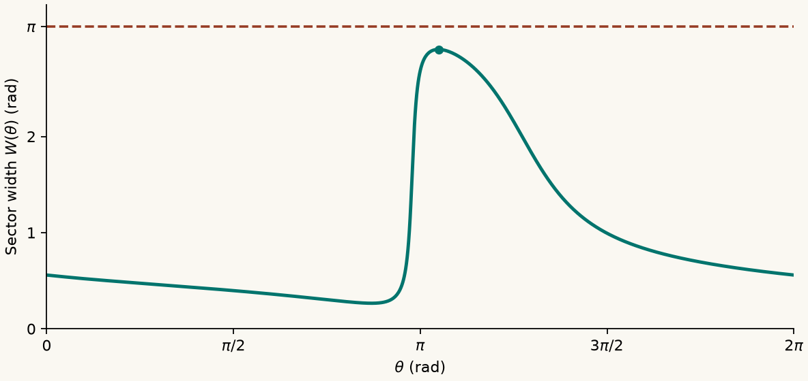

# A common sector for 193 signed Gaussian sums

At each input on the right Dottie circle I compared all 193 recorded Gaussian readings. I wanted to know whether adding a block could turn a reading far enough to cancel it exactly. Two nonzero complex numbers can cancel partway along the straight segment joining them only if they point in opposite directions. This gives a test for every pair at once. I measured the narrowest sector, with vertex at zero, containing all the readings at the same input.

**Directed interval result.** For the completed finite sums $F_N$, the maximum sector width over the entire input circle is strictly between $2.90$ and $2.92$ radians. The direction of the sector is allowed to change as the input moves. All $18{,}528$ pairs among the 193 cutoffs therefore stay strictly short of opposition at every input angle. In particular, this resolves the 26 adjacent blocks for which the real-part test in the [preceding calculation](../2026-11-20-gaussian-relative-remainder-v001/README.md) failed.

**Fig. 1. Angular width of the measured readings.** At one horizontal position I hold the input angle $\theta$ fixed, take the arguments of all 193 completed readings relative to the first, and measure the angular distance between the two extremes. The teal curve repeats that measurement around the circle. The dashed line at $\pi$ is the width needed for two opposite directions. The marked sample at $\theta=537\pi/512$ contains two readings separated by $2.904872079576\ldots$ radians. The continuous bound on the maximum comes from interval arithmetic over arcs. [Figure source](plot_sector.py) · [Interval verification](verify_sector.py)

## Why this preserves the count for a whole family

Fix a boundary input $w$. Rotate the output plane until the middle of its enclosing sector points to the right. If the rotation angle is $-\phi$, every reading satisfies

~~~math
\Re(e^{-i\phi}F_N(w))\ \ge\ \cos(1.46)\,|F_N(w)|\ >\ 0.11\,|F_N(w)|.
~~~

Adding these inequalities with nonnegative coefficients $\lambda_N$ whose sum is one gives

~~~math
\left|\sum_N\lambda_NF_N(w)\right|
 \ \ge\ \cos(1.46)\sum_N\lambda_N|F_N(w)|.
~~~

The right side is positive. In particular, turning any measured reading into any other by adding a fraction of their difference avoids zero on the whole input boundary for the whole deformation. The same holds for interpolation to any fixed convex combination of the 193 sums. Winding is constant during such a deformation. The completed finite sums are holomorphic on the disk and the first has winding zero, so the argument principle gives zero zeros, with multiplicity, for every one of these combinations. Reflection gives the same conclusion on the mirror disk. [Finite winding, completion and reflection](../2026-11-20-gaussian-circle-phases-v001/README.md#why-the-two-crossings-preserve-the-zero-count)

### The same angular bound inside the disk

The boundary measurement controls the angles at interior inputs as well. Fix the first cutoff as reference. Every quotient $F_j/F_{\rm ref}$ is holomorphic and nonzero on the closed disk by the finite winding calculation. Here $j$ labels a recorded cutoff. Choose its analytic logarithm on the disk to match the principal argument at one boundary point. It then matches continuously all the way around, because the measured boundary arguments avoid the cut. For every pair $j,k$ the difference of those two arguments is the imaginary part of an analytic function and is therefore harmonic. Its boundary values lie strictly between $-2.92$ and $2.92$. The maximum and minimum principles give the same inequalities at every interior input. Taking the largest and smallest arguments among the 193 readings gives the common sector there too. This extends the sector bound and the convex-combination inequality to both closed disks for the measured finite family. [Maximum principle for harmonic functions, DLMF §1.10(v)](https://dlmf.nist.gov/1.10.v)

## What an extra Gaussian zero would require

Write $F$ for the full completed Gaussian factor and $F_N$ for one of the finite sums. If $F$ is nonzero on the right circumference, the argument principle gives

~~~math
\#\{\text{zeros of }F\text{ in }D_R\}
  =\operatorname{wind}_{\partial D_R}(F/F_N,0).
~~~

Here zeros are counted with multiplicity, the input circle is traversed counterclockwise, and $F_N$ has zero zeros in the disk. One extra zero requires one extra net circuit about the origin in the plot of the quotient. A continuous nonzero loop with positive winding must meet every ray, including the negative real axis. Thus at some common input the full reading and the finite reference would have to point exactly opposite. One occurrence of opposition alone does not give the winding. A full reading equal to zero on the boundary is a separate possibility for which this quotient loop has no winding number. [Argument principle, DLMF Eq. 1.10.9](https://dlmf.nist.gov/1.10.E9)

The recorded cutoffs end at $2^{28}$. To transfer the count to $F$ it suffices to enclose $F/F_N$ away from the closed negative real axis on the whole circle. A bound placing the full reading in the nonzero part of the measured sector would be stronger. The available absolute estimate for the remaining residues and contour integrals establishes neither. [Cutoffs, circle coordinates and full remainder](../2026-11-20-gaussian-circle-phases-v001/README.md)

## Reproduction

Use Python 3.12 and python-flint 0.9.0 with the [archived Taylor moments](../2026-11-20-gaussian-circle-phases-v001/moments.json.gz). From this directory run the command below.

~~~text
python -B verify_sector.py
~~~

The verifier uses the same 192-bit evaluator and the same 193 cutoffs $2^{26}+j2^{20}$ as the preceding deposit. On each arc it checks that the first reading is nonzero and encloses all other quotients by that first reading. It includes the first reading’s relative argument $0$ when bounding the spread. Starting with 256 arcs, adaptive bisection certified a covering by 865 arcs. At one input, the pair of cutoffs $111{,}149{,}056$ and $203{,}423{,}744$ gives the lower bound on the maximum. The optional figure uses Matplotlib 3.11.2 and the command `python -B plot_sector.py`. The study and programs were prepared November 20, 2026, from the recorded Gaussian sums.
