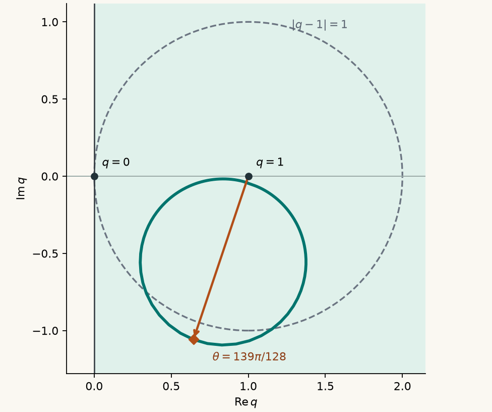

# The direction of a signed Gaussian remainder on the Dottie circle

I compared consecutive cutoffs of my quartic’s Gaussian sum on the right measuring circle. At a fixed input the old sum can be very small, so a block of signed terms can exceed it in magnitude. I wanted to know whether that block actually points far enough back toward zero to jeopardize the winding argument. The two tests give different answers on 29 of the 192 blocks.

## The comparison at one boundary point

I use the completed finite sum $F_N$ and its enclosing Taylor series from the [circle calculation](../2026-11-20-gaussian-circle-phases-v001/README.md). Each $a_n$ sums the quartic character signs of Gaussian ideals of norm $n$. The two cutoffs $N<M$ use the same completion, reflected term, and Dottie height. At every angle I compare them at the same input

~~~math
w=\frac{33}{64}+i\!\left(T_D-\frac1{512}\right)+\frac{31}{2048}e^{i\theta},
\qquad q(w)=\frac{F_M(w)}{F_N(w)}.
~~~

Dividing by $F_N(w)$ places the old reading at $1$, the new one at $q$, and zero at the origin. The size test asks for $|q-1|<1$. The direction test asks for $\Re q>0$. The disk around $1$ lies inside that half-plane. A sideways increment can therefore fail the first test while satisfying the second.

**Fig. 1. One block from $N=69{,}206{,}016$ to $M=70{,}254{,}592$.** The black dot at $1$ is the old reading after division by itself. The black dot at $0$ is where the new reading would land if the added terms canceled it exactly. At the input angle $\theta=139\pi/128$, the arrow travels $0.356$ units left and $1.058$ units down. It reaches the diamond outside the dashed circle of radius one and misses zero. As the input makes one circuit, the diamond traces the teal curve. For every input angle, the straight segment from $1$ to its corresponding teal point stays in the green half-plane. Interval arithmetic gives $\Re q>0.29$ for the whole circumference. [Figure source](plot.py) · [Interval verification](verify.py)

## Why the winding survives

Assume $F_N$ is nonzero along the circle. To compare the two closed curves in the output plane, join their values at each boundary point by

~~~math
H_t(w)=(1-t)F_N(w)+tF_M(w)
       =F_N(w)\bigl(1-t+tq(w)\bigr),\qquad 0\le t\le1.
~~~

If $\Re q(w)>0$ everywhere on the boundary, the factor in parentheses has positive real part throughout the deformation. Hence $H_t$ avoids zero, and the winding number about zero is constant in $t$. The finite sums are holomorphic on these disks, so the argument principle gives the same interior zero count, with multiplicity. Their zero winding at each recorded cutoff was established separately using the spiral phase of the uncompleted sum $L_N=F_N/A$. The completion factor $A$ is holomorphic and nonzero on both disks. [Finite winding, reflection and completion](../2026-11-20-gaussian-circle-phases-v001/README.md#why-the-two-crossings-preserve-the-zero-count)

## Results on all 192 consecutive norm blocks

I used every adjacent pair of recorded cutoffs $N=2^{26}+j2^{20}$ and $M=N+2^{20}$, for $0\le j<192$. A pass requires strict positivity of the relevant margin on a cover of the entire circle by arcs. A failure in the table means a strictly negative margin was enclosed at a particular angle.

| Size test | Direction test | Blocks | First ending cutoff $M$ |
|---|---|---:|---:|
| Passes everywhere | Passes everywhere | 137 | 68,157,440 |
| Fails somewhere | Passes everywhere | 29 | 70,254,592 |
| Fails somewhere | Fails somewhere | 26 | 77,594,624 |

The total is 166 blocks for which the direction test certifies equal winding. On each of the other 26, the two readings turn more than a right angle apart somewhere. Their finite winding numbers are independently known to be zero. A negative projection at one angle alone does not imply that the segment crosses the origin.

## The missing bound on the full Gaussian factor

Put $F$ for the completed Gaussian factor and $R_N=F-F_N$ for its entire remaining correction. The same deformation proves that it suffices to establish, at one fixed cutoff, the pointwise inequality

~~~math
\Re\!\left(R_N(w)\overline{F_N(w)}\right)>-|F_N(w)|^2
\qquad(w\text{ on the right circle}).
~~~

The available finite zero count would then transfer to the whole closed right disk. Reflection $w\mapsto1-\overline w$ would clear the left disk, including the thin ring on each side. At $N=2^{28}$ the minimum of $|F_N|$ on the right circle is strictly between $6.3\times10^{-30}$ and $6.5\times10^{-30}$ in completed units. The available uniform upper bound on $|R_N|$ is $7.558\times10^{-19}$ in the same units. It includes the omitted residues and both contour integrals. It leaves the signed projection unresolved. The 192 comparisons concern measured finite blocks, all at or below $N$. [Full remainder and its three bounds](../2026-11-20-gaussian-circle-phases-v001/tail-bound.json)

## Reproduce the calculations

From this directory use Python 3.12 with python-flint 0.9.0 and run the command below. The verification reads the archived [interval moments](../2026-11-20-gaussian-circle-phases-v001/moments.json.gz) at 192-bit precision. For a direction test it encloses $\Re(F_M\overline{F_N})$. For a size test it encloses $|F_N|-|F_M-F_N|$. The replay starts with 256 equal arcs and bisects wherever the bound needs refinement. Enclosing the modulus on every final-cutoff arc gives the lower bound on its minimum, and enclosing one point below the upper bound completes the bracket. The plotted coordinates are midpoint samples for illustration.

~~~text
python -B verify.py
~~~

The optional figure command is `python -B plot.py` with Matplotlib 3.11.2. This November 20, 2026 calculation uses the signed moments already deposited for the two reflected circles. [Coefficient and completion definitions](../2026-11-20-gaussian-circle-phases-v001/README.md#the-sum-and-the-two-circles)
