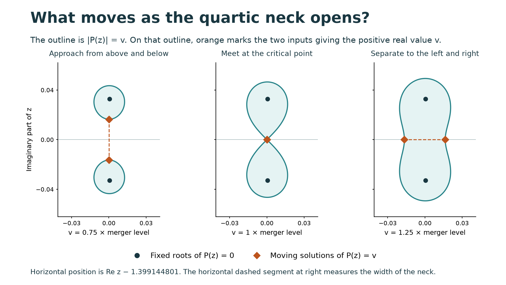
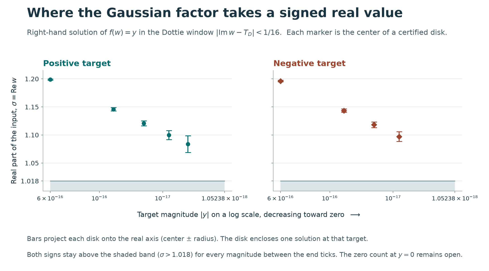

# Where two inputs of the Gaussian factor go as the target approaches zero

At the height selected by my period-640 Dottie orbit I studied the equation $f(w)=v$, varying the **real output** $v$ and keeping the **input rectangle** fixed. For either sign, throughout $1.05238\times10^{-18}\leq |v|\leq6\times10^{-16}$, the rectangle contains exactly two simple solutions. They have equal height. Their horizontal distance decreases strictly as the target approaches zero. At the smallest certified target the distance still exceeds $1.036$. The count at the target zero is open. [Interval proof](gaussian-target-corridor.md) · [Directed results](gaussian-target-corridor.json)

Here $f(w)=B^w\Gamma(w)L_k(w,\eta_\delta)/S$ is the completed quadratic Hecke factor over $k=\mathbb Q(i)$, with $B=\sqrt{106039090829156}/(2\pi)$ and the fixed positive scale $S=B^2|\Gamma(2+iT_D)|$. The quadratic extension of $k$ from my quartic supplies the character and the completion has sign $+1$, so $f(1-\bar w)=\overline{f(w)}$. The open rectangle is $-1<\Re w<2$ and $|\Im w-T_D|<1/16$, where $T_D\approx4526119322477.945393$. [Character and field](../2026-11-20-dedekind-phase-v001/README.md) · [Construction of the height](../2026-11-17-dottie-grid-match-v001/README.md)

**Which factor remains after the Dirichlet verification?** Sutherland's November 20 report (19:45 UTC) records a complete module-by-module kernel replay of Alpöge's submission and independent acceptance of the exported proof by nanoda. The stated theorems cover Riemann zeta and Dirichlet $L$-functions. In our factorization $\zeta_E=\zeta\,L(\,\cdot\,,\chi_{-4})L_k(\,\cdot\,,\eta_\delta)$ this covers the first two factors. Taking the reported Dirichlet conclusions, at every off-line input inside the open critical strip the first two factors are nonzero. The field zeta and its Gaussian factor therefore have exactly the same zero multiplicity there. The split at norm 73 illustrates the distinction: two Gaussian primes above that same integer carry opposite signs. The contour calculation below uses the Gaussian signs directly and does not assume a critical-line theorem. [Sutherland's verification report and status](https://math.mit.edu/~drew/grh/) · [Quartic field factorization and signs](../2026-11-20-dedekind-phase-v001/README.md)

## The measurement from the original quartic

For my polynomial $P(z)=961000z^4-1039740z^3-1810543z^2+644010z+1813853$, the two points near $1.399$ solving $P(z)=v$ meet at $c=1.399144800966\ldots$, where $P'(c)=0$ and $v_*=P(c)=5530.017980110724\ldots$. Just below this level they are a conjugate pair. Just above it they are distinct real points. The dark dots are the original roots of $P(z)=0$. The orange points move when I change the target. [Quartic calculation and error bound](quartic-neck-readings.md)

A contour surrounding exactly two solutions, counted with multiplicity, gives the signed squared separation without first locating either solution. Around a positively oriented boundary free of solutions, measure the first two power sums by

~~~math
S_k(v)=\frac{1}{2\pi i}\oint_{\partial D}(w-b)^k\frac{f'(w)}{f(w)-v}\,dw,\qquad
G(v)=2S_2(v)-S_1(v)^2=(w_1-w_2)^2 .
~~~

The residue theorem gives these sums for any fixed center $b$. For the Gaussian reflection, $G>0$ means two different real parts at the same height. $G<0$ means two different heights on the critical line. $G=0$ means a double solution on the line, hence $f'(w)=0$. In the earlier half-separation convention $\Delta=G/4$. While the boundary stays clear, the number of solutions stays constant and the integrals vary continuously. Opposite signs of $G$ at two targets with count two therefore force a collision at an intermediate target. A crossing of the boundary is a separate event and need not change the net count. [Argument principle](https://dlmf.nist.gov/1.10.iv) · [Lean classification and continuity theorem](../../lean/SuperZeta/TwoRootMoments.lean)

**Formal scope.** Lean verifies the contour identity on circles for an entire function with either two distinct simple zeros or one order-two zero inside and no other zeros in the closed disk. It constructs the nonvanishing cofactor. The separate sign-change theorem takes continuous power sums of a reflection-invariant two-entry multiset as explicit hypotheses. Lean also proves that a continuous solution path going from the strict interior to the strict exterior of a rectangle meets an edge at an intermediate target. The rectangular Gaussian counts come from the argument principle, the stated Hecke functional equation and the directed enclosures below. [Lean integral proof](../../lean/SuperZeta/TwoRootCircleIntegral.lean) · [Outer contour and initial counts](gaussian-strip-image.md)

## Inward motion of the two Gaussian inputs

The exterior roots follow continuously from the count at each signed target $v=\pm6\times10^{-16}$, because the boundary avoids both target intervals and the roots are simple. The whole central rectangle $-0.018\leq\Re w\leq1.018$ has $|f(w)|<1.052376322\times10^{-18}$. Thus one solution has $\Re w>1.018$, its reflection has $\Re w<-0.018$, and $G>1.036^2=1.073296$ on both intervals. This bound uses the signed finite Euler product as well as a positive upper bound for the omitted prime ideals. [Uniform bound and continuation](gaussian-target-corridor.md)

To see the direction of travel, write $v=\pm e^u$ and let $w=\sigma+it$ be the right-hand solution. Local analytic inversion gives

~~~math
\frac{dw}{du}=\frac{1}{(f'/f)(w)}.
~~~

For $\sigma>1$, put $w'=1-\bar w$. The functional equation gives $(f'/f)(w')=-\overline{(f'/f)(w)}$. Subtract the logarithmic derivatives of the order-one Hadamard product at these two inputs. The constant and regularizing terms cancel. For zeros $\rho=\beta+i\gamma$ of the completion, repeated according to multiplicity, this gives

~~~math
2\Re\frac{f'}{f}(w)=\sum_\rho\left[
\frac{\sigma-\beta}{(\sigma-\beta)^2+(t-\gamma)^2}
+\frac{\sigma-1+\beta}{(\sigma-1+\beta)^2+(t-\gamma)^2}\right]>0.
~~~

The difference converges absolutely, since its terms before taking real parts are $O(|\rho|^{-2})$ for fixed $w,w'$. The zeros are in the closed critical strip, making both real numerators positive. The real part of the reciprocal is then positive as well. Therefore $d\sigma/du>0$ and $dG/du=4(2\sigma-1)d\sigma/du>0$. Decreasing $|v|$ decreases $u$, $\sigma$ and $G$. This analytic statement concerns horizontal motion. The imaginary part can vary along the branch. [Thorner and Zaman, §2A, equations (2-6)–(2-8)](https://msp.org/ant/2017/11-5/ant-v11-n5-p04-s.pdf#page=8)

### Where the branches were localized

The table gives disks in the input plane for the right-hand solution. Centers shown here are rounded for reading. Exact binary centers and certified radii are in the record. Reflection supplies the other solution for each row. [Disk enclosures including unresolved trials](branch-positions.json)

| Target $v$ | Center $\Re w$ | Center $\Im w-T_D$ | Disk radius |
| --- | ---: | ---: | ---: |
| $+6\times10^{-16}$ | 1.198729 | +0.022461 | 0.0010 |
| $+4\times10^{-18}$ | 1.083835 | +0.026518 | 0.0150 |
| $-6\times10^{-16}$ | 1.196182 | −0.049542 | 0.0015 |
| $-8\times10^{-18}$ | 1.097226 | −0.046081 | 0.0085 |

**Disk proof.** On a trial disk centered at $c$, radius $R$, with $\sigma_0=\Re c-R>1$, choose an analytic logarithm $F=\log(f/v)$ by matching the truncated product at $c$. The [Euler tail bound](gaussian-strip-image.md) supplies $|F(c)|\leq|\log(f_X(c)/v)|+E_X(\Re c)$, with the principal logarithm of the computed ratio. Throughout the disk the digamma estimate and the Euler series yield

~~~math
\Re F'(w)\geq m=\log[B(T_D-1)]+2\frac{\zeta'(\sigma_0)}{\zeta(\sigma_0)}
  -\frac{1/2+\pi/4}{T_D-1}.
~~~

Here the absolute logarithmic derivative of the Euler product is at most $-2\zeta'(\sigma_0)/\zeta(\sigma_0)$, since at most two Gaussian prime ideals lie above a rational prime with total residue degrees at most two. If $m>0$, integration along straight segments makes $F$ injective on the disk and gives $|F(w)-F(c)|\geq mR$ on its boundary. When $mR>|F(c)|$, Rouché gives a zero of $F$ and hence a solution of $f(w)=v$. The enclosing rectangle count identifies it with the unique right-hand solution. All trial targets, including those for which the disk test fails, are retained. [Disk verifier](check_branch_positions.py)

## The remaining target and two ways to test it

At target zero there is a third possible outcome. The two solutions can stay distinct and reach zero inside the rectangle. If the zero-target boundary is clear, its count is two, and $G(0)>0$, then the Gaussian factor has an off-line reflected pair there. Under the same count, $G(0)<0$ gives two distinct zeros on the line, and $G(0)=0$ gives a double zero on it. None of these alternatives requires extrapolating the exterior derivative formula into the critical strip.

Both $f(1/2+i(T_D-1/16))$ and $f(1/2+i(T_D+1/16))$ are real by reflection. Both have magnitude below $1.052376322\times10^{-18}$. At least one real boundary value therefore lies between the two certified intervals. The values could be equal. Their signs control whether zero lies between the two endpoint readings.

1. **First measure the two endpoint signs.** If they are nonzero and opposite, the critical line contains an odd number of zeros counted with multiplicity between them. Equal nonzero signs give even parity. Off-line pairs contribute an even number to the symmetric rectangle. This test answers parity with two values. A total count still requires control of the full contour.
2. **Separate a collision from a boundary passage.** On each horizontal edge, isolate inputs with $\Im f=0$ and enclose the corresponding real output. On the critical line inside the window, isolate a common solution of $f(w)=v_c$ and $f'(w)=0$. For an isolated order-two solution, the inverse expansion gives $G(v)=8(v-v_c)/f''(w_c)+O((v-v_c)^2)$. The former calculation identifies boundary targets; the latter gives the orientation and rate at which the pair opens. The present data resolve neither event at $v=0$.

## Reproduce the calculations

This November 20 deposit preserves the quartic contour and the initial Gaussian contour as prerequisites for the new interval sweep and branch enclosures. The original working sources came from the project's ERH-target-check calculations. Their height and prime enumeration are included in [gaussian_inputs.py](gaussian_inputs.py). The directed calculations use Python 3.12.14 and python-flint 0.9.0, with 192 bits for the quartic and the initial strip image and 160 bits for the remaining Gaussian calculations. All use deterministic inputs. The signed Euler products use prime ideals of norm at most 100,000 with separate bounds for their tails. To reproduce the results without modifying the deposit, copy the scripts to an empty directory, install python-flint 0.9.0, and run in this order:

~~~sh
python -B check_quartic_tube.py
python -B check_quartic_neck.py
python -B check_gaussian_loop_arcs.py
python -B check_gaussian_strip_image.py
python -B check_gaussian_preimage_counts.py
python -B check_gaussian_target_corridor.py
python -B check_branch_positions.py
~~~

Each script writes its corresponding JSON record next to itself. A clean local run reproduced all seven archived records byte for byte. The plotting scripts [for the quartic](plot_quartic_neck.py) and [for the Gaussian inputs](plot_gaussian_branch_positions.py) read those records and use Matplotlib to draw the figures. The two proof modules build through the standard library entry point. From the repository root, run `python tools/check_lean.py` with Lean 4.19.0 and the pinned mathlib. The repository’s audit checks every imported project theorem for assumptions outside its allowed foundations.
