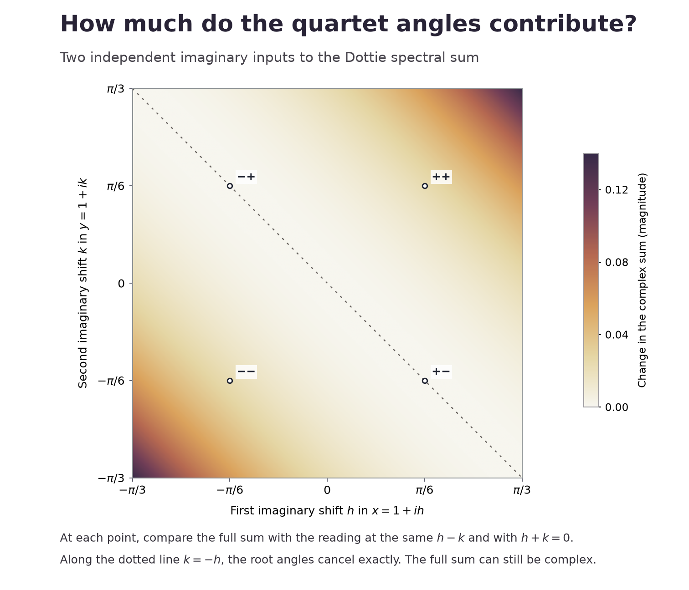

# The angular contribution across two imaginary inputs

NuckyDucky · November 20, 2026

I fix the real parts of both exponents at one, set $x=1+ih$ and $y=1+ik$, and vary $h$ horizontally and $k$ vertically. The axes are dimensionless imaginary displacements of the exponents, each from $-\pi/3$ to $\pi/3$. The four open circles mark the sign choices at $h,k=\pm\pi/6$. [Two-input spectrum and principal-power convention](../2026-11-20-hurwitz-speed-mean-square-v001/two-input-spectrum.md#a-plane-indexed-by-two-imaginary-displacements)

For $\delta=h-k$ and $\eta=h+k$, write $K_1(\delta,\eta)$ for the full complex sum on this plane. The linear color scale gives $|K_1(h-k,h+k)-K_1(h-k,0)|$. Pale colors indicate a smaller change and dark purple a larger one. The four marked choices show that equal shifts can change the sum while opposite shifts of the same size cancel the angular contribution. I keep $\delta$ fixed in the subtraction so the radial phase stays the same. Each conjugate pair of squared roots of modulus $r_n$ and principal arguments $\pm\psi_n$ contributes

$$
2r_n^{-2} e^{-i\delta\log r_n}\left[\cosh(\eta\psi_n)-1\right]
$$

to this difference. The real Dottie root cancels throughout the map. The dotted diagonal $k=-h$ sets $\eta=0$, so the difference vanishes there. The complex sum itself can still vary along that diagonal. The angles $\psi_n$ are in radians, positive counterclockwise.

I evaluate the first 1,024 nonreal conjugate pairs on a 301 × 301 grid. The root verifier uses 320-bit Arb arithmetic before conversion to binary64 for the sampled sum. The PNG is 1512 × 1296 pixels and interpolates colors between samples. The omitted terms in the plotted change have a uniform absolute bound below $10^{-8}$ on this square, using $r_n>[\pi(n-1/2)]^2$, $|\psi_n|<\pi$ and an integral comparison. The color values are finite point evaluations. The five-reading inverse uses real parts 16 and 17 and directed intervals to recover the first nonreal squared pair. [Inputs, tail bound and recovered intervals](../2026-11-20-hurwitz-speed-mean-square-v001/two-input-spectrum.md#recovering-the-first-nonreal-pair-from-five-full-readings)

## Replay

I preserved the original local PNG from November 20, 2026, byte for byte. Its original filename was `two-input-dottie-map.png` and its SHA-256 is `defd4e0797dd28d5bd34cd1c99d9db0dd823ab7a6ed7c6500a77cc86424ceefc`. The original generator was `make_map.py`, SHA-256 `5870f1df9e57013fdb7ea7ca0470a6290c3c5ad2e3346773fcb020fa9c21766e`. I adapted its path handling for replay from a checkout and saved the editable interactive interface in [map-template.html](map-template.html). It reads the [archived root verifier](../2026-11-20-hurwitz-speed-mean-square-v001/verify_two_inputs.py) and its helper modules. It uses Matplotlib's Agg backend and its bundled default fonts. The computation uses no randomness.

With CPython 3.12.11, install the pinned dependencies and run from the repository root. Choose a scratch output location outside the preserved archive.

~~~sh
python -m pip install -r archive/2026-11-20-two-input-map-v001/requirements.txt
python -B archive/2026-11-20-two-input-map-v001/make_map.py --output ../two-input-map-replay
~~~

The replay writes the PNG and a self-contained interactive HTML companion into the selected directory.

A replay on Windows with these versions reproduced the original PNG byte for byte. The largest sampled magnitude was 0.13679094. The interactive companion has revised explanations, native keyboard and touch controls, and labeled readouts over the same sampled image and root data.
