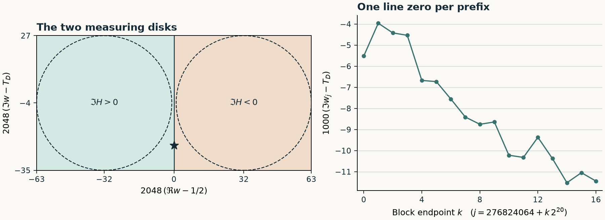

# One simple zero of the retained Gaussian terms

I use the same height $T_D$ and the same two measuring circles as in the finite-sum test. This time I follow the imaginary part horizontally across the critical line. A strictly negative horizontal derivative forces the imaginary part to have opposite signs on the two sides. This tests the entire area between the two height endpoints.

Write $s=1/2+x+i(T_D+y)$. The rectangle has $|x|\le63/2048$ and $-35/2048\le y\le27/2048$. Each disk has radius $31/2048$. Its center has $x=\pm1/64$ and $y=-1/512$. Let $F_j$ be the completed sharp prefix at $j=293{,}601{,}280$ and normalize by the positive number $S_0=|F_{276824064}(1/2+i(T_D-1/512))|$.

For the second calculation, $H$ retains the same prefix, six signed bands near $BT_D/4$, $BT_D/2$ and $BT_D$, and every smoothed term of norm greater than $\lceil e^{17}BT_D\rceil$. Here $B=\sqrt Q/(2\pi)$ for the field conductor parameter $Q$, and both halves use smoothing parameter $\lambda=1$. The table gives a bound valid throughout the rectangle and the height of its unique zero.

| Function | Lower bound for $-\operatorname{Im} f'(s)/S_0$ | Height of the simple zero relative to $T_D$ |
| --- | ---: | --- |
| Sharp prefix $F_j$ | $194.01$ | $[-0.011443476382340,-0.011443476381899]$ |
| Prefix, six signed bands and all terms above the tail cutoff, $H$ | $194.00274$ | $[-0.011443479006616,-0.011443479006175]$ |

**Fig. 1.** The star is the zero of $H$. On its left $\operatorname{Im} H>0$, and on its right $\operatorname{Im} H<0$. Both open disks and their circumferences lie within these two regions. Each dot on the right is the midpoint of an interval containing the zero of a sharp prefix. Connecting consecutive dots shows the order of cutoffs. [Figure source](plot.py) · [Recorded intervals](certificate.json)

### How a slope determines a count

For either function, reflection gives $f(1-\bar s)=\overline{f(s)}$. On $x=0$ its imaginary part is zero. On every horizontal segment its derivative is $\partial_x\operatorname{Im} f=\operatorname{Im} f'$. Integrating the strict negative bound from $x=0$ shows that every off-line point has a nonzero imaginary part. On the line the Cauchy–Riemann equations give $\partial_y\operatorname{Re} f=-\operatorname{Im} f'>0$. The real part has opposite signs at the two ends of the height bracket. It therefore vanishes once and has a nonzero derivative there.

I enclose the sharp derivative on the four edges of the right half-rectangle and use harmonicity of $\operatorname{Im} f'$ to carry its bound to the interior. The retained additions obey $|(H-F_j)'|/S_0<0.007893$ across the whole rectangle by Cauchy’s estimate on circles of radius $1/8192$. These additions move the zero down by between $2.6238\times10^{-9}$ and $2.6248\times10^{-9}$ in height. [Signed bands and tail estimates](bounds.md)

If the full factor $F$ has an off-line zero here, its imaginary part vanishes twice at one height, at the zero and on the line. The real mean value theorem forces $\operatorname{Im} F'=0$ somewhere between them. At that point $\operatorname{Im}(F-H)'/S_0>194.00274$. Testing that inequality requires the signed terms still missing from $H$.

### Reproduce the count

Run these commands from the repository root with Python 3.12 and python-flint 0.9.0.

~~~sh
python -B archive/2026-11-21-gaussian-rectangle-v001/replay_rectangle.py
python -B archive/2026-11-21-gaussian-rectangle-v001/retained.py
~~~

The first command evaluates the archived sharp moments, encloses the six retained bands and computes the infinite-tail bound. It checks the derivative and sign brackets again. The second regenerates the six band sums from the signed prime-ideal coefficients, checks their hashes and compares the complex enclosures. [Sharp moment inputs](signed-blocks.json) · [Six band sums](carriers.json) · [Earlier moment regeneration](../../docs/proofs/gaussian-moment-regeneration.md)

