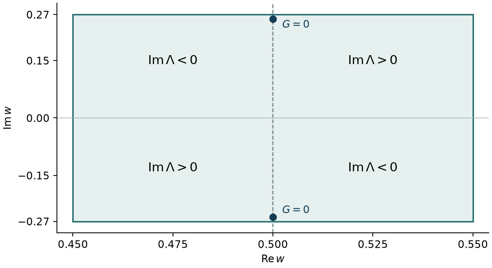

# Reading the side of the critical line from the Gaussian value

I keep the quartic and the height fixed. The two possible inputs are $w_R=1/2+a+it$ and $w_L=1/2-a+it$, with $a>0$. For $a\le 1/20$ and $0<t\le 0.27$, the imaginary part of the completed Gaussian value is positive at $w_R$ and negative at $w_L$. At the height of the first positive Gaussian zero, the readings at real parts $0.51$ and $0.49$ differ by more than $93$ in this coordinate. I use the completion $\Lambda(w)=B^w\Gamma(w)G(w)$ in the normalization of the [original two-detour calculation](../2026-11-21-gaussian-pinch-v001/README.md).



**Fig. 1.** Each quadrant gives the sign of $\Im\Lambda$ throughout the indicated part of the input plane. At positive height this tells me whether the input was left or right. At negative height the signs reverse. The two dots sit at the midpoints of the certified height brackets at this resolution. On the critical line, a zero also requires the real part to vanish.

## What a reflected pair would force at one height

Write $K(x)=e^{x/2}\Theta(e^x/B)$ for the kernel formed from the quartic's signed ideal coefficients. Its [Mellin representation](../2026-11-21-gaussian-pinch-v001/README.md#the-actual-arithmetic-kernel-is-positive-on-the-half-integral) gives two real integrals:

$$
\begin{aligned}
C(a,t)&=2\int_0^\infty K(x)\cosh(ax)\cos(tx)\,dx,\\
Q(a,t)&=2\int_0^\infty K(x)x^2
\frac{\sinh(ax)}{ax}\frac{\sin(tx)}{tx}\,dx .
\end{aligned}
$$

Both quotients have removable value $1$ at zero. With this choice of coordinates, the reflected readings are

$$
\Lambda(w_R)=C(a,t)+iatQ(a,t),\qquad
\Lambda(w_L)=C(a,t)-iatQ(a,t).
$$

A proposed pair with $at\ne0$ would require $C(a,t)=Q(a,t)=0$ at the **same** $(a,t)$. Subtracting the two readings cancels their shared real part. The distance between their complex outputs is exactly $2|at|\,|Q(a,t)|$. Throughout the rectangle the integral estimate below gives $Q(a,t)>18000$, so that distance exceeds $36000|at|$. At $a=0.01$ and $0.25835<t<0.25838$, the right reading has imaginary part above $46.5$ and the left below $-46.5$. [Same-height reflection and separation in Lean](../../lean/SuperZeta/GaussianSidePair.lean)

At $t=0$, the real integral is strictly positive. On $a=0$, the [critical-line calculation](../2026-11-21-gaussian-pinch-v001/README.md#continuing-both-arms-to-target-zero) isolates the two simple zeros $1/2\pm it_*$ with $0.25835<t_*<0.25838$. Together, these facts account for every zero of $G$ in the closed rectangle: the completion factor is nonzero there.

## How the quartic supplies the margin

The [central replay](../2026-11-21-gaussian-pinch-v001/central_detours.py) regenerates the norm coefficients through $2^{25}$, checks positivity of $K$, and gives $Q(0,t)>519994$ for $|t|\le0.27$ and $2\int K(x)x^2\,dx<3565602$. On $0\le x\le18$, the absolute change from $Q(0,t)$ is at most

$$
3565602\left(\frac{\sinh(0.9)}{0.9}-1\right).
$$

For $x=18+y$ the pointwise bound $|\Theta(e^x/B)|\le 3e^{-40e^y}$ supplies the infinite tail. Using $e^y\ge1+y$ and $(18+y)^2\le18^2e^{2y/18}$ bounds that part of the change by

$$
\frac{6\cdot18^2 e^{0.55\cdot18-40}}{40-0.55-2/18}<4.185\times10^{-12}.
$$

The [192-bit interval replay](gaussian_side_sign.py) gives $Q>18762.56$. The [Lean theorem](../../lean/SuperZeta/GaussianSideSign.lean) derives the rounded bound $Q>18000$, the sign test, positivity on the real axis, and the resulting zero-location implication. Its certificate explicitly assumes the representation of the field function by the integral, integrability, positivity of $K$, its pointwise tail estimate, and the central slope and curvature bounds. The [integral comparison](../../lean/SuperZeta/GaussianSideError.lean) derives the change across the rectangle from those inputs. The field-specific coefficient enumeration and numerical enclosures run outside Lean.

## Where the original super zeta enters

Let $\Phi(w)=\mathcal Z(w/2;1)$. Splitting the ideal series between the positive and negative character values gives $G=E_+-E_-$, initially for $\Re w>1$. The sum $E_++E_-$ counts ideals coprime to the conductor. Continuing their sum and difference continues the two readings. Define $\Psi_\pm=\Phi\,B^w\Gamma(w)E_\pm$. Then at each input

$$
\Psi_+(w)-\Psi_-(w)=\Phi(w)\Lambda(w).
$$

Throughout $0.45\le\Re w\le0.55$ and $0.25835\le\Im w\le0.25838$, the [spectral enclosure](side-sign.json) gives $\Im\Phi<-0.2001$. In this band, equality of the two signed readings at one input is equivalent to $G(w)=0$. At real parts $0.49$ and $0.51$ their separation exceeds $0.2\cdot46.5=9.3$. At a hypothetical Gaussian pair the identity would give one equality at the left input and another at the right. Comparing the original super-zeta addresses across the inputs is a separate measurement. The [original zero-fiber experiment](../2026-11-21-gaussian-zero-fiber-v001/README.md) used conjugate inputs at two different heights.

## What the verified Dirichlet theorem transfers

The quartic has $\zeta_E(w)=\zeta(w)\beta(w)G(w)$. At any off-line input in $0<\Re w<1$, the verified Dirichlet theorem gives $\zeta(w)\beta(w)\ne0$. Consequently $\zeta_E(w)=0$ there **if and only if** $G(w)=0$. At the same input the [original spectrum's Mellin identity](../../lean/SuperZeta/UnitSpectrum.lean) makes $\Phi(w)-J(w/2;1)$ a nonzero multiple of $\zeta(w)$. A nonzero corrected spectral reading is therefore precisely what ordinary RH predicts at that input, including under the hypothesis of a Gaussian zero. [Field factorization and transfer hypotheses](../../docs/proofs/gaussian-field-target.md) · [Sutherland's verification of Alpöge's theorem](https://math.mit.edu/~drew/grh/#what-was-verified)

The distinction can be checked at $73$. The two Gaussian primes above it have opposite character values. With $X=73^{-w}$ the scalar Euler factor is $(1-X)^{-1}(1+X)^{-1}=(1-X^2)^{-1}$. Its Dirichlet-series coefficients at $73$ and $73^2$ are $0$ and $1$. A single rational Dirichlet character with $\chi(73)=0$ has $\chi(73^2)=0$. On the prime-window route, the [external pole exclusion theorem](https://github.com/Deicyde/riemann-hypothesis/blob/ba2a065656ec7c638baa601994de3e0245ff6665/src/Development/AutomorphicArithmetic/DedekindLFunctions/LandauTheorems/landauWindow.lean#L83) accepts an estimate on arbitrarily late windows as a hypothesis. Establishing that estimate for the actual signed Gaussian coefficients would extend the arithmetic argument. The local integral bound above reaches every input in the displayed rectangle. [Prime signs at 73](../../docs/proofs/gaussian-ideals-and-super-zeta.md) · [Gaussian window calculations](../2026-11-21-quartic-projections-v001/windows/README.md)

## Reproduction

From the repository root, use the project's Lean 4.19.0 environment and the numerical dependencies in the [arithmetic workflow](../../.github/workflows/number-field-replay.yml).

```sh
python tools/check_lean.py --fetch-cache
python -B archive/2026-11-21-gaussian-pinch-v001/central_detours.py
python -B archive/2026-11-21-gaussian-side-sign-v001/gaussian_side_sign.py
```

The arithmetic run compares the results with [the recorded bounds](side-sign.json). To render the figure separately, append `--plot gaussian-side-sign.png` to the last command with Matplotlib installed. The root bracket and completion come from the earlier Gaussian pinch deposit. The present deposit adds the full rectangle, the signed left/right measurement, and its application to the two spectral readings.
