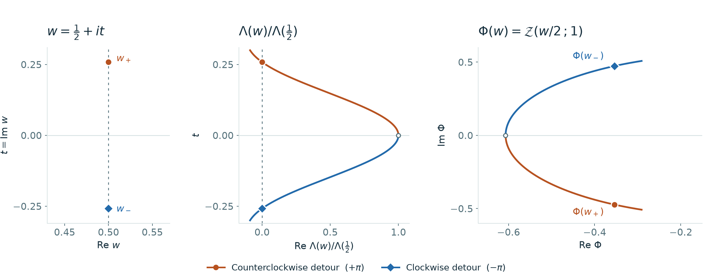

# One Gaussian value and two super-zeta images

I start both inverse paths at $w=0.51$. I turn the output of the completed Gaussian factor $\Lambda$ through $+\pi$ or $-\pi$ radians around $\Lambda(1/2)$, then take the same real segment to zero. I use the endpoints $w_\pm=1/2\pm it_0$ from the signed-coefficient calculation, where $0.25835<t_0<0.25838$. Keeping the input to each path lets me ask what the original super zeta reads at the two zeros. [Gaussian detours, endpoint signs and simplicity](../2026-11-21-gaussian-pinch-v001/README.md)

**Fig. 1.** The orange circle keeps the counterclockwise endpoint and the blue diamond keeps the clockwise endpoint across all three panels. The middle panel plots normalized Gaussian value horizontally against input height vertically, so both markers sit at horizontal coordinate zero. On the right both axes are output coordinates of $\Phi(w)=\mathcal Z(w/2;1)$. The upper input gives the lower image. The curves are sampled for display. I enclose the images over the full root bracket in the calculation below.

## The contradiction at the two endpoints

| Input | Completed Gaussian value | Real part of $\Phi$ | Imaginary part of $\Phi$ |
|---|---:|---:|---:|
| $w_+$, counterclockwise | $0$ | $(-0.35481,-0.35339)$ | $(-0.47364,-0.47217)$ |
| $w_-$, clockwise | $0$ | $(-0.35481,-0.35339)$ | $(0.47217,0.47364)$ |

The continued super zeta respects complex conjugation. In its convergent spectral sum, conjugation fixes the real squared root and exchanges the members of each conjugate pair. The identity theorem extends the symmetry away from the pole. Thus $\Phi(w_-)=\overline{\Phi(w_+)}$, and their distance is exactly $2|\Im\Phi(w_+)|>0.94434$.

Suppose a single-valued function $H$ recovered $\Phi$ from the Gaussian value at both endpoints. Substitution gives $\Phi(w_+)=H(0)=\Phi(w_-)$, contradicting their measured separation. Lean proves this for the actual continued spectrum. Its two arithmetic inputs are a positive Gaussian zero in the bracket for the specified half-Mellin kernel and the strict upper bound on the spectral imaginary part throughout the bracket. Gaussian evenness supplies the second zero. The independent interval evaluation below also encloses the lower image directly. [Lean proof](../../lean/SuperZeta/GaussianZeroFiber.lean)

## Why the two traces bend in different directions

Write $c=\Lambda(1/2)>0$ and $a=\Lambda''(1/2)/2>0$. The centered Gaussian is even. On the vertical line the displacement is $it$, so its square contributes $-t^2$. Its normalized horizontal coordinate is

$$
\frac{\Lambda(1/2+it)}{c}=1-\frac{a}{c}\,t^2+O(t^4).
$$

At $t=0$ the middle curve opens to the left. The two signs of the height give exactly the same horizontal reading throughout that trace. The signs and bounds on $a,c$ come from the [Gaussian coefficient replay](../2026-11-21-gaussian-pinch-v001/central-detours.json).

For the right panel write $X+iY=\mathcal Z(1/4+it/2;1)$. Suppressing the fixed coupling in derivatives, set

$$
X_0=\mathcal Z(1/4),\qquad
B=\frac{\mathcal Z'(1/4)}{2},\qquad
C=-\frac{\mathcal Z''(1/4)}{8}.
$$

Conjugation makes these three numbers real. Near $t=0$, $X=X_0+Ct^2+O(t^4)$ and $Y=Bt+O(t^3)$. The derivatives enclose $X_0$ between $-0.60670972$ and $-0.60670971$, $B$ between $-2.3681900$ and $-2.3681899$, and $C$ between $4.8587740$ and $4.8587741$. Eliminating the shared height gives

$$
\lim_{t\to0,\ t\ne0}\frac{X(t)-X_0}{Y(t)^2}
=\frac{C}{B^2}\in(0.8663505,0.8663506).
$$

The positive coefficient opens this trace to the right. The negative $B$ sends a small positive input height below the real axis. These are local quadratic approximations at the vertex. The contradiction at the zeros uses the separately enclosed endpoint values. [Taylor expansions and the limit in Lean](../../lean/SuperZeta/GaussianBends.lean)

## Comparing the field's ideal-counting series

For the quartic field $E$, the field theorem uses the Formal Conjectures definition of an admissible Dedekind continuation $Z$. Once $\zeta\,\beta_D\,G$ is identified with the continuation of the ideal-counting series, a zero of the completed Gaussian factor gives $Z(w)=0$ at either marked input. Its gamma and scale factors are nonzero there. Every such $Z$ therefore has the same obstruction to recovering $\Phi$ from its scalar value. The theorem lists holomorphy, multiplicativity, agreement at every rational prime power and summation on $\Re w>1$ among its hypotheses. The conclusion concerns this pair of critical-line zeros. [Quartic theorem](../../lean-ideal73/GaussianZeroFiber.lean) · [Definition and field-identification hypotheses](../../docs/proofs/gaussian-field-target.md)

## Replaying the measurements

From the repository root, with Python, NumPy and python-flint 0.9.0, run

~~~sh
python -B archive/2026-11-21-gaussian-pinch-v001/central_detours.py
python -B archive/2026-11-21-gaussian-zero-fiber-v001/check_images.py
~~~

The first command rebuilds the Gaussian sign bracket. The second evaluates the original super zeta by its Mellin formula at 160 bits. In the variable $y=\log u$ it integrates 96 panels on $[-144,144]$. The integrand's logarithmic factor is bounded by $e^y$ on the negative half-line and by $4$ on the positive half-line. Multiplying by $|y|^k$ bounds the omitted tails for each derivative of order $k=0,1,2$. For the endpoint intervals the code also bounds the first derivative of the Mellin integral on the full height bracket before adding the zeta reference term. [Interval verifier](check_images.py) · [Mellin formula](../2026-11-18-spectral-reproduction-v001/README.md)

The [spectral Lean package](../../lean/README.md) checks the symmetry, separation and local expansions. The [quartic-field package](../../lean-ideal73/README.md) checks the Dedekind transfer with its own pinned mathlib release. To redraw Fig. 1 with Matplotlib and mpmath installed, run `python -B archive/2026-11-21-gaussian-zero-fiber-v001/plot.py figure.png`.
