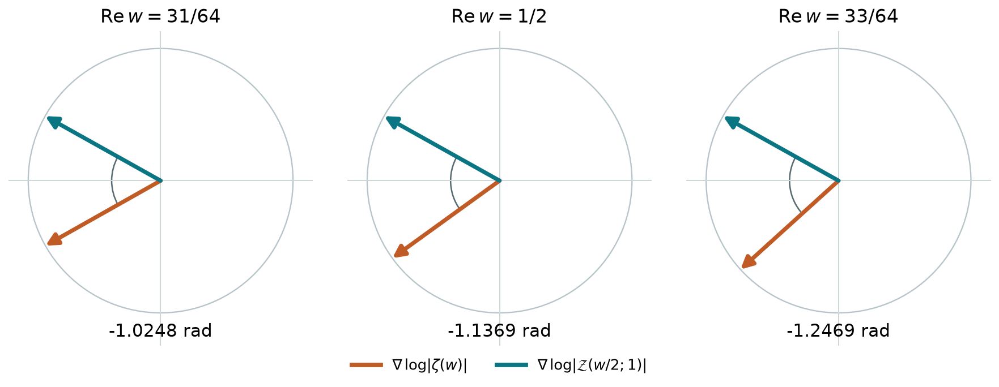

# Local rotation of the two modulus gradients

**Fig. 3.** The arrows have unit length so that their directions can be compared. Orange points toward increasing $\log|\zeta(w)|$, and teal points toward increasing $\log|\mathcal Z(w/2;1)|$. The horizontal axis points toward larger $\Re w$ and the vertical axis toward larger $\Im w$. All three inputs have height $T_D-1/512$. The signed angle under each pair runs from orange to teal, with a negative value for a clockwise turn. The ratios of the actual gradient lengths, teal divided by orange, are 0.06664, 0.07640, and 0.09098 from left to right.

For a holomorphic function $f$ at a point where $f\ne 0$, the two real components of the gradient of $\log|f|$ are $(\Re(f'/f),-\Im(f'/f))$. On this input plane the first spectral contribution is $u_1^{-w}$ because $-2s=-w$. Its logarithmic derivative in $w$ is $-\log u_1$. To check this direction for the full continuation, write $\mathcal Z(w/2;1)=u_1^{-w}(1+E(w))$. The additional logarithmic derivative is $E'(w)/(1+E(w))$. The proved band estimate and a Cauchy circle of radius $1/64$ about each measured point bound its magnitude by $10^{-54}$.

For ordinary zeta, differentiate the 64-term Cauchy interpolant. The same radius bounds the derivative error by 64 times the uniform interpolation error. Direct FLINT values of $\zeta(w)$ provide the denominators. The signed angular difference grows by about 0.22213 radians in magnitude from left to right. These are local directions at matched inputs: the three angles do not determine a motion carrying one full function onto the other.

[Calculation](rotation-audit.py) · [Enclosures](rotation-audit.json) · [Common input-plane maps](side-by-side.md)

