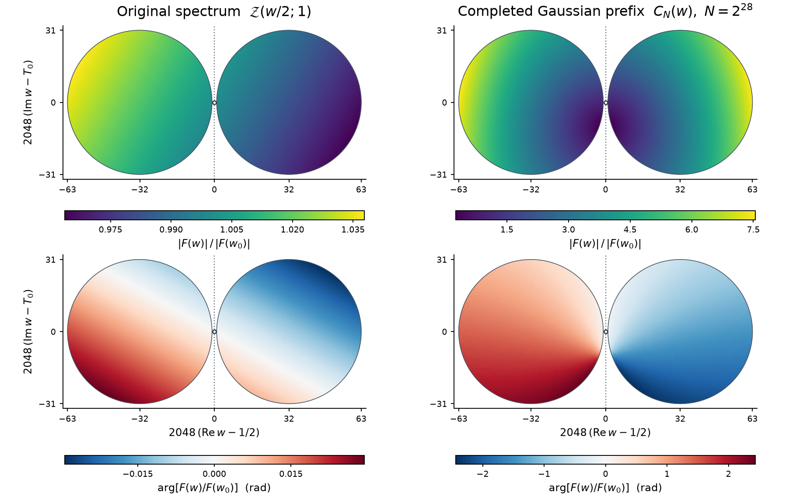

# The original spectrum and the quartic’s Gaussian reading on the same two disks



**Fig. 2.** The disks have radius $31/2048$ and centers $31/64+iT_0$ and $33/64+iT_0$, where $T_0=T_D-1/512$. Every point is an input $w$. The small open circle marks the reference input $w_0=1/2+iT_0$. The top panels divide each magnitude by the magnitude of the same function at $w_0$. A reading of $1$ means equal magnitude. The lower panels give the change of argument from the reference in radians. Red means a positive angle and blue a negative angle. Each panel has its own scale.

At the left and right centers, the original spectrum has relative magnitudes $1.01770890$ and $0.98259925$. The finite Gaussian magnitudes are both $3.30686719$, while their angles are $+1.26750563$ and $-1.26750563$ radians. For the finite completed Gaussian reading, reflection $w\mapsto1-\overline w$ conjugates the output. That identity accounts for the equal colors across the upper-right panel and the opposite colors across the lower-right panel at reflected positions.

For the spectral panels I evaluated the first upper-root contribution at $w/2$ and used the proved bound for every remaining term. For the Gaussian panels I used the quartic’s signed ideal coefficients through norm $N=2^{28}$ in the paired completed sum $C_N(w)$. I evaluated both members of 3,253 reflected pairs, including 256 positions along each circumference, and checked the conjugation identity against their interval readings. Colors between those points interpolate the measured values. [Measurements](side-by-side-gaussian.csv.gz) · [Error bounds and input fingerprint](side-by-side-gaussian.json)

The uniform error allowance for replacing the full Gaussian completion by $C_N$ is $7.55764\times10^{-19}$ in the archived completion scale. At the displayed points this allowance exceeds even the largest finite magnitude by a factor of $3.98\times10^9$. The Gaussian colors therefore show the measured finite contribution. Which phases the full function reaches inside these disks remains open.

To regenerate the figure and measurements, run the following from this directory with Python, python-flint 0.9.0, NumPy and Matplotlib. The argument is the archive directory of the research repository. The script reads the saved moment table, checks its cutoff against the recorded full remainder, and records the SHA-256 digest of the table.

```sh
python side-by-side-gaussian.py /path/to/The-Super-Zeta-Function/archive
```
