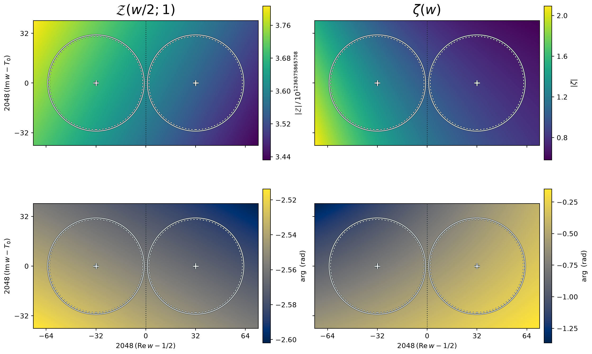

# The original super zeta and ordinary Riemann zeta on the Dottie disks

**Fig. 1.** Each column uses the same input $w$. The left evaluates the original continued super zeta at $s=w/2$, the input used in the spectral identity. The right evaluates ordinary Riemann zeta at $w$. In the upper left panel the colorbar gives the modulus in units of $10^{1236375865708}$. The upper right panel gives the ordinary modulus directly. The lower panels give principal arguments in radians. Each colorbar has its own numerical scale.

The crosses mark $31/64+iT_0$ and $33/64+iT_0$, with $T_0=T_D-1/512$. The solid circles have radius $31/2048$. The dashed circles immediately inside them have radius $30/2048$. The dotted vertical line is $\Re w=1/2$. Each tick interval of 32 represents $1/64$ in the input plane.

## How the colors were calculated

On the left, divide the explicit bound from the vertical-strip theorem by the modulus of the first spectral term $u_1^{-w}$. Its relative error is below $10^{-155258110290}$ throughout this rectangle. The shaded values use that term with the same scale at every input. The directed calculation also encloses the full continuation on each of 2,880 closed rectangles covering the figure.

On the right, evaluate ordinary zeta with Arb at 64 equally spaced points of radius $r=1/10$ about $w_0=1/2+iT_0$. Use their discrete Fourier coefficients to evaluate the Taylor polynomial in $(w-w_0)/r$. The floor-integral identity gives $|\zeta|\le M<3\times10^{13}$ on the larger circle $R=3/10$, since $\Re w\ge1/5$ there and $|w/(w-1)|<2$. Cauchy's coefficient bound gives the following absolute error on $|w-w_0|\le d=1/20$, including truncation and all aliased Fourier coefficients:

$$
\left|\zeta(w)-p_{63}(w)\right|\le
\frac{M}{1-d/R}\left[(d/R)^{64}+\frac{(r/R)^{64}}{1-(r/R)^{64}}\right]<10^{-16}.
$$

The interval polynomial includes the rounding error in its coefficients. Direct evaluations of $\zeta$ at nine marked or extremal inputs provide an independent check on the interpolation. The enclosed values throughout the rectangle have $\Re\zeta(w)>0$ and $|\zeta(w)|>1/4$. Both coordinates of the original super zeta are negative there. The two images give an independent calibration for comparing reflected Gaussian readings. The Gaussian Hecke factor itself is a separate numerator.

[Replay and figure](side-by-side.py) · [Numerical enclosures](side-by-side.json) · [First-root enclosure](reflected-modulus-contrast.py)

On each of the same cells I also bounded the modulus of $2\pi^{-w}(2^w-1)$. Multiplying by the enclosed ordinary zeta modulus gives $|\mathcal Z(w/2;1)-J(w/2;1)|>1.171$ throughout the rectangle.

