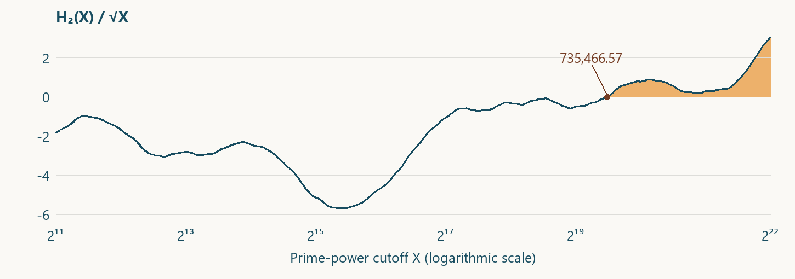

# The signed prime sum of the quartic, viewed in two fields

The quartic gives a quadratic ideal character over the Gaussian integers. The same function can be computed by subtracting two sums over ideal classes in a different imaginary quadratic field. This identifies which lattices from the ordered tower carry the missing arithmetic signs. It also gives a signed prime sum to which the Landau criterion in Alpöge's Lean source can be applied once its window inequality is established.

## From the original quartic to the ideal classes

Put $k=\mathbb Q(i)$, $\delta=-5045155+1027708i$ and $D=\delta\bar\delta=26509772707289=41\cdot457\cdot1414835497$. The original quadratic factor defines $E=k(\sqrt\delta)$. Its relative discriminant ideal is $(\delta)$. At the odd primes this follows from squarefreeness. At the dyadic place $\delta-1$ is divisible by $(1+i)^5$, so Hensel's lemma makes $\delta$ a local square. The primitive quadratic character $\eta$ of $E/k$ therefore has conductor of norm $D$. The field zeta factors as $\zeta_E=\zeta L(\chi_{-4})L_k(\eta)$. [Quartic and Gaussian signs](../2026-11-20-dedekind-phase-v001/README.md)

Choose $u=\sqrt\delta$, $v=\bar u$, so $uv=\sqrt D$. The square classes of $\delta$ and $\bar\delta$ are independent in $k$: their product is the positive nonsquare $D$, and each has odd valuation at a prime that does not divide the other. Thus the normal closure $M=k(u,v)$ has order eight over $\mathbb Q$. The independent sign changes and complex conjugation form the dihedral group. The automorphism $r:(u,v,i)\mapsto(v,-u,-i)$ generates a cyclic group of order four fixing $iuv$. Its fixed field is $K=\mathbb Q(\sqrt{-D})$.

The representation on the two conjugate square-root directions is irreducible: the sign changes distinguish the coordinate axes and conjugation exchanges them. It is induced by $\eta$ over $k$. Restricted to the rotation subgroup it has eigencharacters $\psi,\bar\psi$, with $\psi(r)=i$. Either induces the same representation over $\mathbb Q$. Artin induction for Euler factors and the conductor induction formula give

$$
L_k(s,\eta)=L_K(s,\psi),\qquad
4D=\lvert d_K\rvert N\mathfrak f_\psi .
$$

Since $D\equiv1\bmod8$ is squarefree, $d_K=-4D$. Thus $\psi$ has conductor one and is an ideal class character. This identification includes the ramified rational primes. [Class field theory](https://www.jmilne.org/math/CourseNotes/CFT.pdf) · [Stevenhagen, cyclic quartic extensions in dihedral fields, §5](https://arxiv.org/pdf/1806.06250#page=9)

Let $Z_j(s)$ sum $N\mathfrak a^{-s}$ over the nonzero integral ideals of $K$ with $\psi([\mathfrak a])=i^j$. Conjugation preserves ideal norms and inverts ideal classes, hence $Z_1=Z_3$ coefficient by coefficient. For $\Re s>1$ this gives

$$L_k(s,\eta)=Z_0(s)-Z_2(s).$$

Continuation extends the identity. Write $A=\chi_{-4}$ and $B=\chi_D$. The sum of the same two groups of ideals is

$$Z_0+Z_2=\tfrac12\bigl(\zeta L(AB)+L(A)L(B)\bigr).$$

Indeed, $(1+\psi^2)/2$ selects the even classes. Its two terms induce $1\oplus AB$ and $A\oplus B$ on the rational side. At norm nine the four ideal counts are $(1,0,2,0)$, giving signed coefficient $-1$ and total $3$. At norm 73 the prime is inert in $K$ and there are zero ideals of norm 73. This recovers the cancellation of the two opposite readings in $k$.

The [PARI calculation](class_check.gp) unconditionally certified the class group and reproduced both identities through norm 4096. The class character was selected at 5 and 29 before checking the remaining good split primes through 997. A separate [binary-form check](form_predictions.py) selected sixteen prime values of two forms before evaluating either Gaussian residue. For example, $162^2+D=26509772733533$ gives two plus signs. The form $13x^2+10xy+((D+25)/13)y^2$ at $(31,1)$ gives $2039213297981$ and two minus signs. Its sign is fixed by the ideal class of the prime above 13. This predicts the common sign at these primes from a represented class. [Class group and arithmetic results](class_check_results.txt)

## Which tower lifts realize these signs?

The tower parameter $t$ gives the ratio $\tau=U/V=-e^{-2it}$. A normalized ideal with basis $(1,\tau)$ and norm scale $a$ gives the form $a|m+n\tau|^2$. Every positive definite primitive form class of discriminant $-4D$ has such a representative. Changing the logarithm sheet at fixed $\tau$ preserves the ideal lattice and its coefficient. Varying the complex parameter to reach a different ideal class can change the coefficient. The character weights here come from the quartic. [Earlier lattice identity and the discriminant $-23$ example](../2026-11-20-dedekind-phase-v001/README.md) · [Zagier, ideal-class partial zetas](https://people.mpim-bonn.mpg.de/zagier/files/doi/10.1007/BFb0065299/ModFormsZetaValues.pdf#page=3)

For real $t$, $|\tau|=1$. On that circle the modular basis change $\tau\mapsto-1/\tau$ sends $\tau$ to $-\bar\tau$, the point for its inverse ideal class. Thus any class that can occur at a real $t$, even after an oriented integral change of basis, is self-inverse. This restriction can be checked directly on the opposite signs at 13 and 37. For a split prime $p$ with $p^2<D$, a principal square $\mathfrak p^2=(x+y\sqrt{-D})$ would force $x^2+Dy^2=p^2$. Then $y=0$ and $(x)=(p)=\mathfrak p\bar{\mathfrak p}$, contradicting distinctness of the split primes. Both prime classes therefore require a complex $t$. Explicit ratios for them are $(5+i\sqrt D)/13$ and $(18+i\sqrt D)/37$. In these bases $\Im t=\tfrac12\log|\tau|$ is approximately 6.44466 and 5.92167, respectively.

All four character values have $4447552/4=1111888$ classes per value. Only eight classes in the certified group $C_{1111888}\times C_2\times C_2$ square to the identity. Of the $2223776$ classes with weights $+1$ or $-1$, at least $2223768$ require complex $t$. The local proof at 13 and 37 is independent of the class group computation. The arithmetic distinction survives passage to these lattices. The two signs assigned to individual conjugate Gaussian ideals at norm 73 remain additional marked information.

## A one-sided prime test with every scale defined explicitly

Let $b(n)$ be the real coefficients of $-L'_k/L_k(s,\eta)$. For $a>1$ put

$$
R(X)=\sum_{n\le X} b(n)(X/n-1),\qquad
H_a(X)=aR(X/a)-R(X).
$$

The linear contribution $cX$ cancels exactly at **every** scale. The identity $H_{ab}(X)=aH_b(X/a)+H_a(X)$ holds for every positive $X,a,b$ when $H_1=0$ and the same formula is used for all scales. In particular $H_{2^k}(X)=\sum_{j=0}^{k-1}2^jH_2(X/2^j)$. If $H_2$ is strictly negative throughout $[A,B]$, then $H_{2^k}$ is strictly negative throughout $[2^{k-1}A,B]$ whenever that interval is nonempty. The arithmetic needed above $B$ enters through the newest summand.

Integrating a single weight first on $\Re s>1$ gives $\int_n^\infty(X/n-1)X^{-s-1}\,dX=n^{-s}/[s(s-1)]$. Absolute convergence justifies summation there. The transform of $H_a$ on $[1,\infty)$ is therefore

$$
\Phi_a(s)=\frac{a^{1-s}-1}{s(s-1)}
               \left(-\frac{L'_k}{L_k}(s,\eta)\right).
$$

At $s=1$ the filter removes the kernel singularity since $L_k(1,\eta)\ne0$. For $\Re s<1$, $|a^{1-s}|=a^{1-\Re s}>1$. Every zero in the open critical strip therefore remains a pole. A real zero $\beta$ of multiplicity $m$ contributes positive residue $m(a^{1-\beta}-1)/[\beta(1-\beta)]$. Nonreal zeros require a nonzero complex residue. The full analytic inputs also include discreteness of zeros, continuation, an analytic choice of the removable value at 1, and the elementary growth and measurability of $g(u)=H_a(e^u)$. The [external Hecke theorem at $\Re s\ge1$](https://github.com/Deicyde/riemann-hypothesis/blob/ba2a065656ec7c638baa601994de3e0245ff6665/src/GroundTheory/GlobalFields/TateThesis/Nonvanishing.lean#L193) takes a non-norm-power character and its entire continuation. The two equal norms with opposite signs at 73 exclude all pure norm powers once the concrete ideal and idele descriptions are identified.

The upstream theorem [Deduction.landau_window](https://github.com/Deicyde/riemann-hypothesis/blob/ba2a065656ec7c638baa601994de3e0245ff6665/src/Development/AutomorphicArithmetic/DedekindLFunctions/LandauTheorems/landauWindow.lean#L83) takes pole data and a one-sided inequality. At $\theta=1/2$, a sufficient inequality, for some fixed $\delta_0>0$, is that for every $\epsilon>0$ and every lower cutoff there is a larger $Y$ satisfying

$$\int_Y^{Y^{1+\delta_0}}\max(H_a(X),0)X^{-3/2}\,dX\le Y^\epsilon.$$

This follows by substituting $X=e^u$ in its window hypothesis and choosing the positive part for its majorant. With the pole data this would exclude every zero to the right of $1/2$. Reflection supplies the other half. The character family for which the submission supplies this bound is rational Dirichlet. The unbounded sequence of windows for this quartic is open.

## Finite interval certificate

At $a=2$ and $\delta_0=1$, the [192-bit checker](check_windows.py) constructs every signed prime-power coefficient through 65536 in two ways. It uses Gaussian prime ideals and their three residue symbols, and independently reduces the original discriminant at each rational prime. The checker encloses $H_2(n)$ at all integers. Each weight is affine between consecutive integers, so the maximum over the continuous interval is its maximum over endpoints. The unique maximum on $[64,65536]$ is at 64:

$$-4.790706069317958 < H_2(64)< -4.790706069317956.$$

The positive-part integral on that entire interval is exactly zero, and the scale identity gives simultaneous bounds for $H_{2^k}$ on the subintervals above. For a control that includes earlier cutoffs the same verifier finds $0.06359<\int_{32}^{1024}[H_2(X)]_+X^{-3/2}\,dX<0.06634$. These are windows in prime-power cutoff $X$. Neither end is a zero height. The full Gaussian factor's winding on the Dottie circle remains open.

Continuing the calculation through $2^{22}$ finds the first subsequent change to positive at $X=735466.5734173917834\ldots$. On $[1024,1024^2]$ the weighted positive area is $0.1855496250753\ldots$. On $[2048,2048^2]$ it is $1.3775398138598\ldots$. The latter is below $2048^{1/8}$ and above $2048^{1/32}$. The criterion asks for arbitrarily late passing windows for each exponent. At the next doubling the integral exceeds both thresholds. The [projection from retained positive area](windows/README.md) extends this failure to a continuous range of later window starts. [Certified crossing and integrals](windows/prime_windows.txt) · [Arithmetic and integration](windows/prime_windows.py)

**Figure 1.** The horizontal coordinate is $\log X$. The area of the orange region in these coordinates equals $\int[H_2(X)]_+X^{-3/2}\,dX$ over the illustrated window. The labeled point marks a sign reversal of the real prime sum. The intervals and crossing above use directed arithmetic independently of pixels.

The [local Lean replay](README.md#lean-and-the-external-window-theorem) checked the bodies from the 16 modules needed for the upstream exclusion theorem. [ScaleAndShape.lean](ScaleAndShape.lean) checks scale composition, cancellation of the linear term, nonvanishing for every integer scale at least two, and the unit-circle basis identity. The PARI class certificate, interval sign calculations and analytic specialization have separate evidence. The upstream [class_sum theorem](https://github.com/Deicyde/riemann-hypothesis/blob/ba2a065656ec7c638baa601994de3e0245ff6665/src/GroundTheory/HeightsAndTheta/Theta/EisensteinZeta/MirabolicInduction/DedekindZetaEqSumRealEisenstein.lean#L322) identifies the sum over an ideal class with the normalized lattice sum for real $s>1$ given a scaled ideal lattice. Combining it with the known fixed-pair formula explains why the same shapes occur. On the original Gaussian lattice the [finite Fourier calculation](quartic-dual-theta.md) gives an exact cancellation law for the signed ideal weights. An argument estimating the signed prime sums on infinitely many windows is still required. [Alpöge's research chronology, items 14–19](https://alpo.ge/remark.pdf#page=4) · [Sutherland's verified statements](https://math.mit.edu/~drew/grh/) · [Liu's Hecke half-plane](https://hexagonmath.org/pdf/2611.00421v1#page=2)
