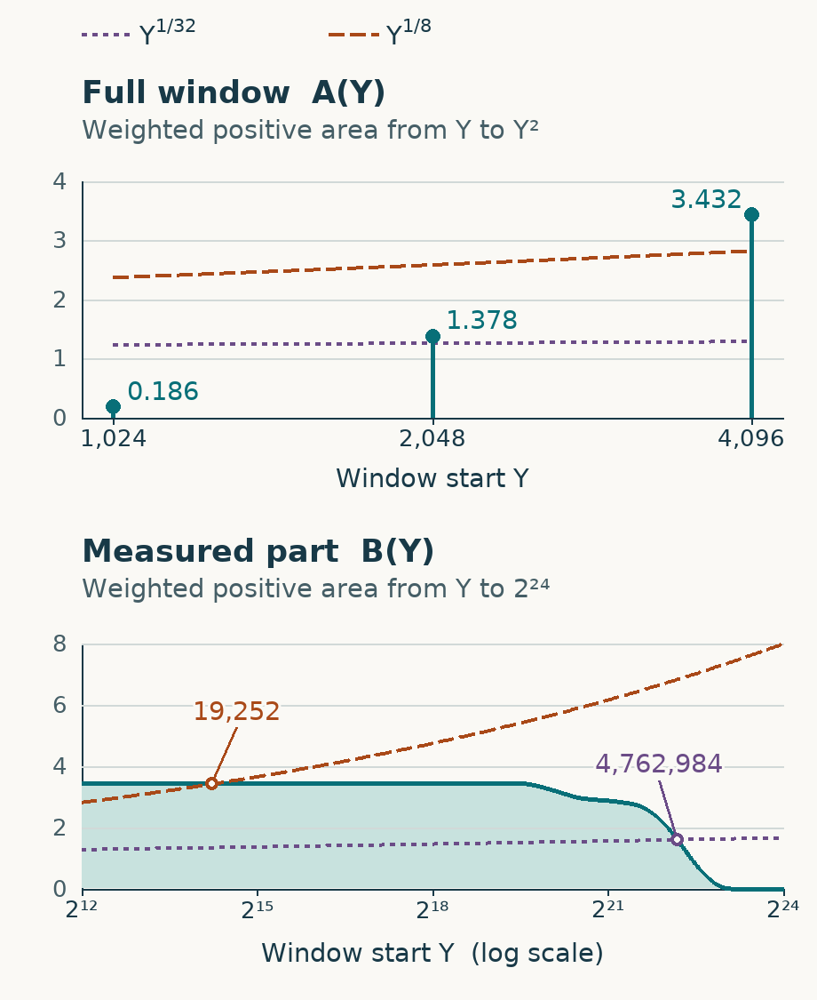

# Positive area in the quartic's dyadic prime windows

For a prime ideal of Gaussian norm $q$ and quartic sign $e$, add $e^j\log q$ to $b(q^j)$ for every $j\geq1$. A sign of zero denotes a ramified prime for this character. This determines the signed prime sum used below.

$$
R(X)=\sum_{n\le X} b(n)(X/n-1),\qquad
H_2(X)=2R(X/2)-R(X),\qquad
A(Y)=\int_Y^{Y^2}\max(H_2(X),0)\,X^{-3/2}\,dX .
$$

The one-sided window condition with exponent $\epsilon$ asks for $A(Y)\le Y^\epsilon$ at arbitrarily large starts $Y$. Here the proposed window ends at $Y^2$ and the weight uses $\theta=1/2$.

### A prediction from the previous window

At $Y=2048$, the earlier integral enclosed $A(2048)=1.377539813859769\ldots$. After $X=64$ the sum first changes from negative to positive at $X=735466.57341739178\ldots$. Moving the start from $2048$ to $4096$ therefore removes exactly zero positive area. Extending the other end can only increase it. This predicts $A(4096)>4096^{1/32}=1.29683955465\ldots$ before any of the additional coefficients are evaluated.

| Start $Y$ | Upper cutoff $Y^2$ | Weighted positive area $A(Y)$ | Comparison with $Y^{1/32}$ | Comparison with $Y^{1/8}$ |
|---:|---:|---:|:---|:---|
| 1,024 | 1,048,576 | 0.1855496250753356 | below | below |
| 2,048 | 4,194,304 | 1.3775398138597694 | above | below |
| 4,096 | 16,777,216 | 3.4321001520713061 | above | above |

The newly included interval contributes $2.0545603382115367\ldots$. The larger area's comparison with $4096^{1/8}=2.82842712474619\ldots$ required the new calculation. Every row concerns the same Gaussian character.

**Fig. 1.** In the upper panel each teal dot gives the integral over an entire window. It exceeds the violet $Y^{1/32}$ threshold at the second and third starts, and the rust $Y^{1/8}$ threshold at the third. The lower panel follows the same calculation as we move the lower endpoint past $4096$ while holding the upper endpoint fixed at $2^{24}$. The teal curve gives the contribution that later windows already contain. Each open circle marks where this contribution equals one threshold. Its label is the last integer start strictly before the crossing. [Plot source](plot_prime_windows.py)

### What the measured area forces at later cutoffs

Fix the measured upper cutoff $U=2^{24}$. For every real $4096\le Y\le U$, the interval $[Y,U]$ lies inside the proposed window $[Y,Y^2]$. Its weighted positive area $B(Y)$ is therefore a lower bound for $A(Y)$. As $Y$ increases, $B(Y)$ decreases or stays constant while $Y^\epsilon$ increases strictly. We can locate the single crossing of these two quantities using only coefficients through $U$.

* For $\epsilon=1/32$ the crossing is strictly between $4{,}762{,}984$ and $4{,}762{,}985$. Every real start from $4096$ through $4{,}762{,}984$ fails. The prior window already covers $2048\le Y\le4096$ because $1.3775398\ldots>4096^{1/32}$ and the lower endpoint removes no positive area.
* For $\epsilon=1/8$ the crossing is strictly between $19{,}252$ and $19{,}253$. Every real start from $4096$ through $19{,}252$ fails.

Above each crossing the remaining part of the proposed window can still add positive area. Whether passing windows exist arbitrarily far out stays open. The integral tested here uses a real prime sum with no height twist.

### Replay

To regenerate the figure from the quartic coefficients, also install Pillow 10.1 or later and run `python plot_prime_windows.py`. The lower panel uses 801 logarithmically spaced samples. Its crossing labels come from directed-arithmetic comparisons at consecutive integers.

From this directory, run `python prime_windows.py` with Python 3.12 and `python-flint==0.9.0`. The [recorded output](prime_windows.txt) gives interval enclosures. The [replay](prime_windows.py) computes the signs twice, first from the quartic discriminant $-5045155+1027708i$, then from the three conductor residue symbols. It compares the unordered signs for every contributing rational prime and sums all its ideal powers through $2^{24}$. The calculation uses 192-bit Arb enclosures at 410,355 distinct knots, including the window endpoints. It checks the values at seven distinct designated cutoffs by an independent direct kernel sum.

Between successive knots $a,b$ the sum is affine. If its endpoint readings $u,v$ are both nonnegative, direct integration gives

$$
\int_a^b H_2(X)X^{-3/2}\,dX=
\frac{2(b-a)}{(\sqrt a+\sqrt b)^2}\left(\frac{u}{\sqrt a}+\frac{v}{\sqrt b}\right).
$$

If the segment crosses zero, the verifier locates the crossing by linear interpolation and integrates the positive portion using this same formula. Consequently every point between successive knots contributes with its correct sign.
