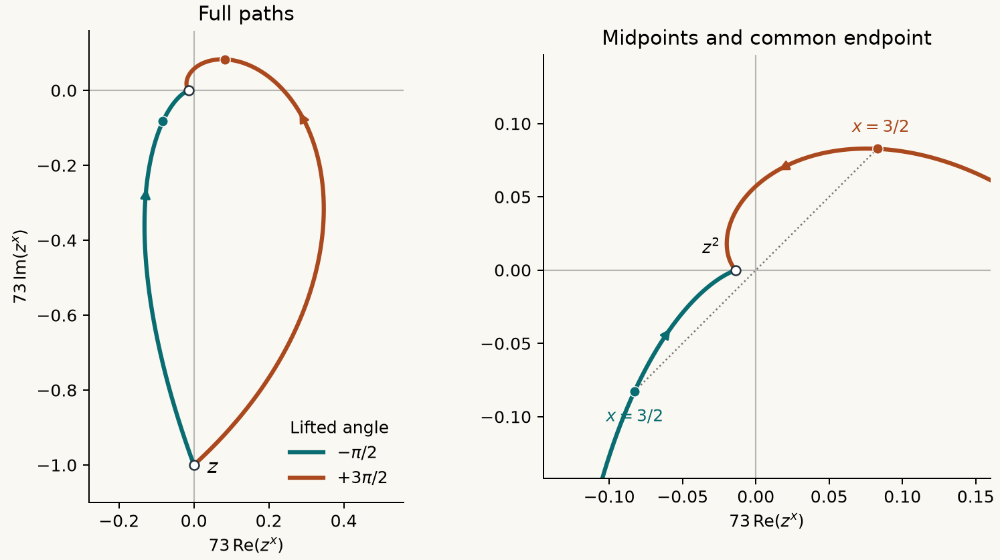

# Fractional powers at norm 73 recover the parity of the turn

The two angles in Fig. 1 are $-\pi/2$ and $3\pi/2$. Both point down. I use each angle as the imaginary part of a logarithm of $z=-i/73$ and let the exponent run from $1$ to $2$. The endpoints agree. Halfway through the exponent interval, the two points are opposite each other.

**Fig. 1. Two logarithms of the same prime-power value.** Both panels show the same paths, with coordinates multiplied by 73. The right panel enlarges the two filled points at exponent $3/2$ and their common endpoint $z^2$. The arrows show increasing exponent on both paths. For the closed loop, follow orange along its arrow and teal against its arrow.

## Which turns give the same fractional power?

Fix a reference logarithm $L$ of a nonzero complex number $z$. All its logarithms have the form $L+2\pi i k$ with $k\in\mathbb Z$. Write $U_k(x)=\exp(x(L+2\pi i k))$ for the reading at real exponent $x$. This is the usual complex power with its logarithm specified. [NIST DLMF, Eq. 4.2.26](https://dlmf.nist.gov/4.2.E26)

**Theorem.** If $p/q$ is in lowest terms with $q>0$, then $U_j(p/q)=U_k(p/q)$ exactly when $j\equiv k\pmod q$.

**Proof.** Dividing the two values gives $U_k(x)/U_j(x)=e^{2\pi i(k-j)x}$. This equals one precisely when $(k-j)x$ is an integer. At $x=p/q$, coprimality makes this equivalent to $q$ dividing $k-j$. In particular the ratio for one extra turn at exponents $1,\ 3/2,\ 2$ is respectively $1,\ -1,\ 1$. [Lean proof of the ratio](../../lean/SuperZeta/FractionalTurnPower.lean) · [Lean proof for reduced fractions](../../lean/SuperZeta/FractionalTurn.lean)

## The square root selected by the height

Take $s_*=\tfrac12+i\pi/(4\log73)$ and $X=73^{-s_*}$. Then $X=73^{-1/2}e^{-i\pi/4}$, $z=X^2=-i/73$, and the height supplies the reference logarithm $L=-2s_*\log73$. At $x=3/2$ the two raw readings are $X^3$ and $-X^3$. Dividing by their common starting value recovers the selected square root,

$$
\frac{U_k(3/2)}{z}=(-1)^k X.
$$

The modulus also recovers the exponent. On either path $|U_k(x)|=73^{-x}$, so a point of radius $y$ has exponent $x=-\log y/\log73$. An intersection would therefore have to occur at the same exponent on both paths. For adjacent logarithms that requires an integer exponent, so the two arcs meet only at $z$ and $z^2$ on this interval. [Lean proof at the quarter-turn](../../lean/SuperZeta/FractionalTurn.lean)

## Winding of the two arcs

Follow $U_m$ from exponent 1 to 2 and $U_0$ from 2 back to 1. Both arcs avoid zero. On the first arc the continuous change in angle is $\Im L+2\pi m$. On the return arc it is $-\Im L$. The total is $2\pi m$, so the winding number about zero is $m$. In Fig. 1 the orange path contributes $3\pi/2$ and the reversed teal path contributes $\pi/2$. Lean constructs a continuous logarithm across their meeting point and proves that every continuous logarithm of this closed path gives the same winding. [Lean proof for the parameterized loop](../../lean/SuperZeta/FractionalTurnWinding.lean)

The period-640 construction uses the same law. Its principal multiplier angle is $+\pi/4$. Adding the logarithms of the 640 stage derivatives gives the ordered angle $-7\pi/4$, one full clockwise turn away. Their interpolated half-lap multipliers therefore differ by a factor of $-1$. This half-lap reading is defined by exponentiating half the chosen logarithm. Multiplying the first 320 stage derivatives is a separate orbit measurement. [Period-640 construction and stage sum](reciprocal-constructions.md#two-destinations-at-fixed-hurwitz-shift)

## What cancels in the quartic’s Euler factor?

The marked Gaussian primes $3+8i$ and $3-8i$ both have norm 73. Their quadratic residue signs are $-1$ and $+1$, respectively. With $T$ a formal variable, multiplying the two geometric series gives

$$
H_{73}(T)=\frac{1}{(1+T)(1-T)}=\frac{1}{1-T^2}
          =1+T^2+T^4+\cdots .
$$

In degree three the coefficient is $1-1+1-1=0$. At the selected height the individual complex reading $X^3$ is nonzero. The coefficient calculation combines both primes and is unchanged if their signs are exchanged. To decode a turn I keep the complex midpoint together with the reference $X$ supplied by the height. The prime labels themselves come from the quartic’s residue calculation. [Marked branches and signs](marked-gaussian-direction.md) · [Lean proof from the two residue counts](../../lean/SuperZeta/FractionalTurnAt73.lean)
