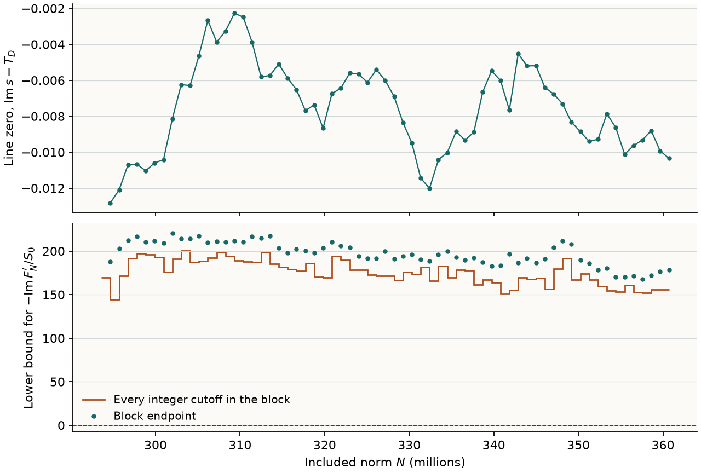

# How far the intervening Gaussian coefficients move the zero

I started at the previous cutoff $N_0=293{,}601{,}280$ and added the next 64 consecutive blocks of $2^{20}$ norms. For **every one of the 67,108,864 new integer cutoffs**, the completed prefix has exactly one simple zero in the measuring rectangle. It stays on the critical line. The calculation includes the 4,430,705 norms in that range whose coefficients are nonzero. [Signed coefficients, slope and endpoint enclosures](../../archive/2026-11-21-gaussian-rectangle-v001/gaussian-intervening-slope.json) · [Rebuild the calculation](../../tools/gaussian_intervening_slope.py)

**Fig. 1.** Along the horizontal axis I add norms in order. Each dot in the upper panel marks the height of the zero of a sharp prefix at the end of a block. Its certified bracket is narrower than the dot. The orange steps in the lower panel bound the negative of the normalized horizontal derivative for the whole block and the whole rectangle. A positive lower bound means the imaginary part decreases as I move to the right. The dashed line marks zero slope. [Figure source](../../tools/plot_gaussian_intervening_slope.py)

### What the signs control

Write $s=1/2+x+i(T_D+y)$, with $|x|\le63/2048$ and $-35/2048\le y\le27/2048$. The positive scale $S_0$ is the absolute value of the completed sharp prefix through norm $276{,}824{,}064$ at $x=0$, $y=-1/512$. For every new sharp prefix $F_N$ the three inequalities are

$$
\begin{gathered}
-\operatorname{Im}F_N'(s)/S_0>144.3147,\\
F_N(1/2+i(T_D-35/2048))/S_0<-0.77914,\\
F_N(1/2+i(T_D+27/2048))/S_0>4.02807 .
\end{gathered}
$$

The functional symmetry makes $F_N$ real on $x=0$. The first inequality forces its imaginary part to be positive to the left and negative to the right. On the line, the same inequality says the real value increases with height. The two endpoint signs give a crossing, and the derivative makes it simple. For the final sharp prefix the zero height relative to $T_D$ is in $[-0.010341284760216,-0.010341284753167]$. These claims apply to each fixed cutoff and allow its zero to move as the cutoff changes.

The smooth equation for the full Gaussian factor gives a specific weight to each norm. Replacing the sharp weights on any fixed subset through $360{,}710{,}144$ with those smooth weights changes the normalized derivative by less than $4.0\times10^{-47}$ and the normalized values by less than $4.9\times10^{-51}$. Both endpoint signs and the negative derivative persist. I can also retain the six previously measured distant bands and the infinite far tail, whose combined normalized derivative has magnitude below $0.007893$. Even then the negative slope has a lower bound of $144.3068$ and the two endpoint signs persist. This brings the earlier one-zero result through the full run of new cutoffs. [Weight replacement](gaussian-prefix-smoothing.md) · [Six-band and infinite-tail certificate](../../archive/2026-11-21-gaussian-rectangle-v001/README.md)

With those same six bands and the infinite far tail retained at both cutoffs, I enclosed the zero of the smooth model directly at the beginning and end of the run.

| Smooth prefix through norm | Height of the unique zero, relative to $T_D$ |
| ---: | --- |
| $293{,}601{,}280$ | $[-0.011443479006396,-0.011443479006175]$ |
| $360{,}710{,}144$ | $[-0.010341287620179,-0.010341287619738]$ |

Using the unrounded bracket endpoints, the net motion is upward by between $0.001102191385996$ and $0.001102191386658$ in height. For each endpoint sign I included the error from smoothing the prefix and from enclosing the infinite tail. [Signed readings at both ends of both brackets](../../archive/2026-11-21-gaussian-rectangle-v001/gaussian-intervening-slope.json)

If I turn on a block gradually, the same count holds between cutoffs. For a fixed fraction $0\le t\le1$, both the derivative and the two real endpoint readings of $(1-t)F_N+tF_M$ are the same weighted averages of the corresponding readings for $F_N$ and $F_M$. All three strict inequalities survive. This is an interpolation of the specified functions at a common input.

### How I checked every cutoff inside a block

At the last norm of each block I reconstruct the signed Taylor moments and enclose the derivative on all four edges of the right half-rectangle. Harmonicity gives the same bound in its interior, and reflection gives the left half. To cover each intermediate integer cutoff I keep the order of the signed coefficients. With $s_0=1/2+iT_D$ and block start $h$, put

$$
c_n=a_n n^{-s_0},\qquad C_k=\sum_{h<n\le k}c_n,\qquad
A=\max_{h\le k\le h+2^{20}}|C_k| .
$$

I measure $A$ using every nonzero coefficient of that block. For $z=s-s_0$, write $u_n=\log(n/h)$ and $L=\log(1+2^{20}/h)$. Partial summation and $0\le u_n\le L$ give

$$
\begin{aligned}
\left|\sum_{h<n\le k}c_n(e^{-zu_n}-1)\right|
  &\le 2A|z|L e^{|z|L},\\
\left|\sum_{h<n\le k}c_n u_n e^{-zu_n}\right|
  &\le A L(2+|z|L)e^{|z|L}.
\end{aligned}
$$

Each bound is the endpoint term plus the integral of the absolute derivative of its weight times $A$. I use the product rule on the completed factor $B^s\Gamma(s)h^{-z}/S$ and include its reflected term. The resulting upper bound on the change of derivative is valid at every point in the rectangle and for all $k$ together. At each height endpoint I also enclose the **real projection** of each $C_k$ with its completed prefactor. This preserves the sign information needed to certify the crossing.

### Three inputs through norm $2^{30}$

After the rectangle calculation I fixed three inputs and followed their derivatives at the next 680 block endpoints, through norm $1{,}073{,}741{,}824$. All 2,040 readings had negative horizontal derivative. The closest measured approach to zero, in units of $S_0$, was $-123.7444862057$ with interval radius $3.21\times10^{-11}$, at the bottom of the critical line segment and norm $824{,}180{,}736$. This test covers just the three specified inputs at those larger cutoffs. [Three-point data](../../archive/2026-11-21-gaussian-rectangle-v001/gaussian-slope-screen.json) · [Replay](../../tools/gaussian_slope_screen.py)

### What could reverse the slope of the full field factor?

Take the final measured model $H_N$ with smooth weights on the prefix, the six retained bands and the full far tail, and write the exact completed Hecke factor as $F=H_N+E$. If an off-line zero exists in the rectangle, the imaginary part of $F$ vanishes twice on the same horizontal segment. Somewhere between those two points,

$$
\operatorname{Im} E'(s)/S_0=-\operatorname{Im}H_N'(s)/S_0 .
$$

For a local exclusion I need an upper bound on the **signed** derivative of the remaining coefficients over that rectangle. The absolute estimate still allows a reversal. A line zero for the full $F$ would also require endpoint signs for $F$ itself. The transfer to the whole quartic field has explicit hypotheses and ranges over every height. [Full derivative estimate](gaussian-prefix-smoothing.md) · [Field statement and Lean proof](gaussian-field-target.md)

To reproduce the 64-block calculation, install the versions listed in the [moment replay](gaussian-moment-regeneration.md) and run these commands from the repository root.

~~~sh
python -B tools/gaussian_prefix_smoothing.py
python -B tools/gaussian_intervening_slope.py
python -B tools/gaussian_slope_screen.py
~~~
