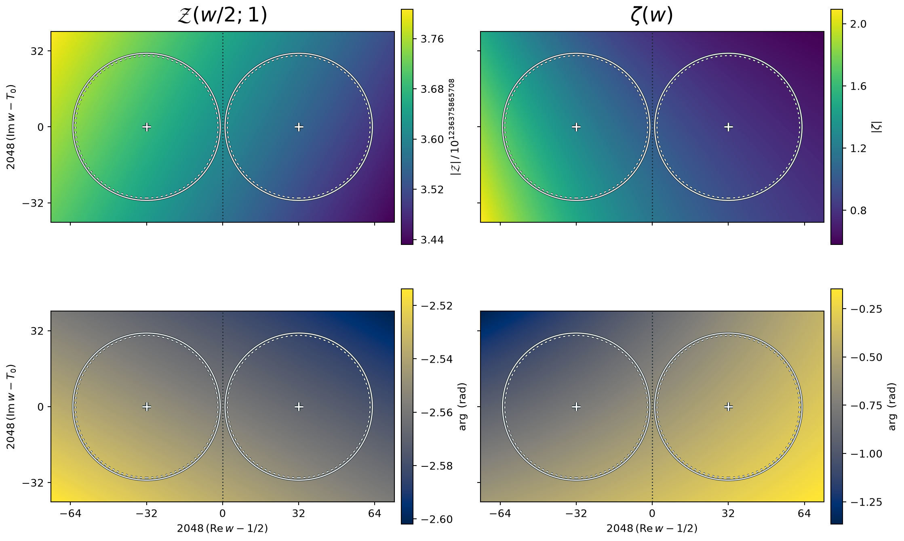
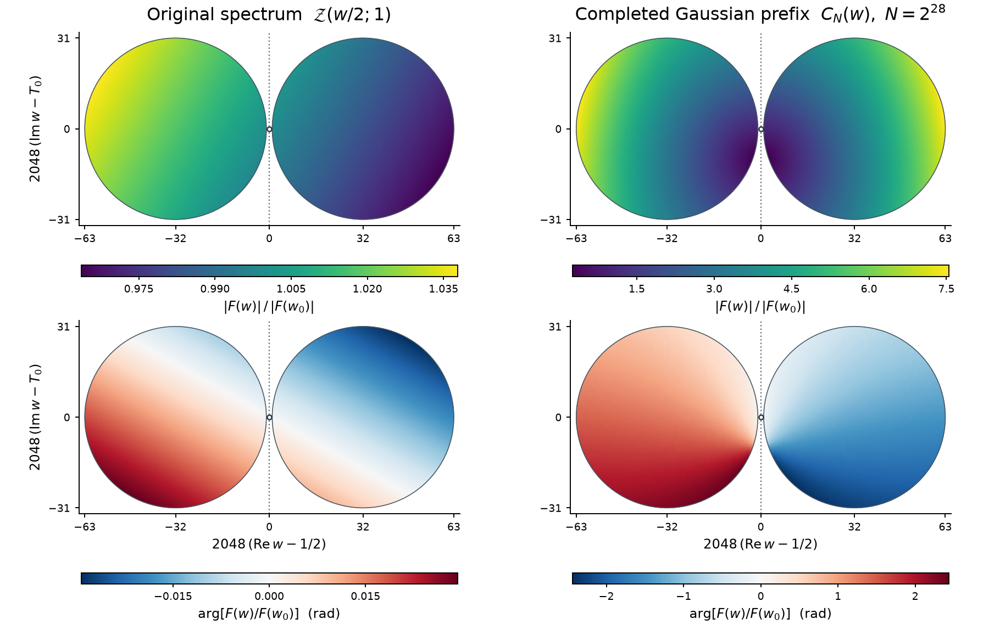
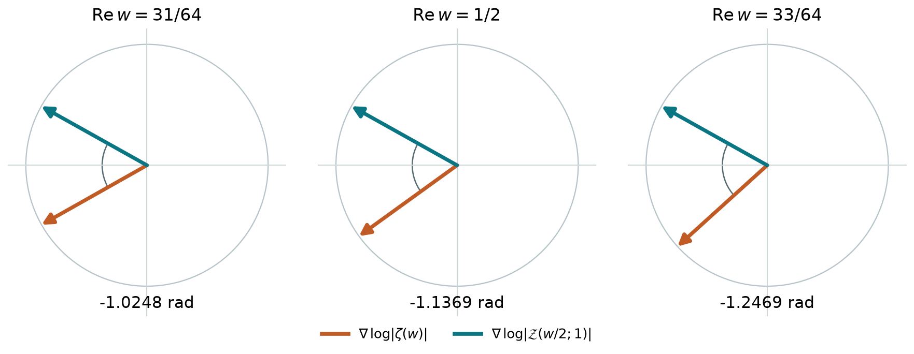

# The original super zeta at reflected inputs near the Dottie height

I use the same arithmetic input $w$ in both columns of Fig. 1. The original super zeta is evaluated at $s=w/2$ because the Mellin identity contains $\zeta(2s)$. Write $T_0=T_D-1/512$. The disks have centers $31/64+iT_0$ and $33/64+iT_0$ and outer radius $31/2048$. Reflection sends $w$ to $w^*=1-\overline w$ and preserves the height.

**Fig. 1.** The left column shows the magnitude and phase of $\mathcal Z(w/2;1)$, and the right column shows the same two quantities for $\zeta(w)$. The contours outlined in both columns are the two Gaussian measuring circles. The multiplier printed on the original spectrum's magnitude scale applies throughout its panel. [Values, bounds and reproduction](../../archive/2026-11-21-quarter-line-v001/README.md)

## Why the spectrum distinguishes two reflected inputs

The order of the two exponentials fixes the sign before the spectrum is formed. At a fixed pair I write

$$
P=e^{LQ},\qquad Q=e^{-LP},\qquad U=LQ,\qquad V=-LP.
$$

At multiplier one, $UV=1$ and the signed cosine coordinate is $u=(U-V)/(2i)$. Replacing $(L,P,Q)$ by $(-L,Q,P)$ exchanges $U$ and $V$. The output ratio $Q/P=e^{V-U}$ becomes its reciprocal, while $u$ becomes $-u$. The spectral entry is $v=u^2$, so the two ordered descriptions give exactly the same $v^{-s}$. The original pair records which stage came first. Squaring identifies that particular pair of labels. [Ordered-stage proof](../../lean/SuperZeta/QuarterLine/QuarterLiftOrientation.lean) · [Numerical reconstruction from the first upper root](../../archive/2026-11-21-quarter-line-v001/ordered-lift-audit.json)

Let $d=\cos d$ be the positive real root, and let $u_n$ denote the upper root of the $n$th quartet. Subtracting two copies of $(\pi n)^{-2s}$ at each level gives an absolutely convergent difference series on the quarter-line. The continued spectrum there is

$$
\mathcal Z(s;1)=d^{-2s}+2\pi^{-2s}\zeta(2s)
+\sum_{n\ge1}\left(u_n^{-2s}+\overline{u_n}^{\,-2s}-2(\pi n)^{-2s}\right).
$$

At $s=1/4+it$ with $t>0$, the magnitude of the first upper term $L(s)=u_1^{-2s}$ includes $\exp(2t\arg u_1)$. The first root satisfies $2\arg u_1>5/4$. From the second level onward the exponent is at most $1.1t$. Estimating the differences on the segments from $\pi n$ to each root bounds their entire sum by $48|s|e^{1.1|t|}$. Including the real reference, the real root and the opposite first root gives a bound smaller than $|L(s)|$ for $t\ge100$. The conjugate first root gives the corresponding result at negative heights. Hence the original spectrum is nonzero on $\Re s=1/4$ for every $|\Im s|\ge100$. [Quarter-line proof](../../lean/SuperZeta/QuarterLine/QuartetDominance.lean)

The estimate extends to $7/32\le\Re s\le9/32$, $\Im s\ge100$, where $|\mathcal Z/L-1|<1/128$. In the inner band $|\Re s-1/4|\le1/64$, $\Im s\ge101$, Cauchy's estimate controls the derivative of this same error. Across each horizontal segment,

$$
\frac{\partial}{\partial \sigma}\log|\mathcal Z(\sigma+it;1)|
=\Re\!\left(\frac{\mathcal Z'}{\mathcal Z}\right)<-\frac{62}{381}.
$$

Thus moving to the right at fixed height strictly decreases the modulus. At fixed real part the unwrapped angle decreases, and the logarithm of the radius increases. The first term alone makes an exact clockwise turn over a height increment $\pi/\log|u_1|\approx2.796377$ and multiplies its radius by about $33.70876$. The full spectrum obeys the derivative inequalities throughout the band. [Band estimate](../../lean/SuperZeta/QuarterLine/QuartetBandDominance.lean) · [Unwrapped phase and radial growth](../../lean/SuperZeta/QuarterLine/QuartetActualSpiral.lean) · [Horizontal order across the two disks](../../lean/SuperZeta/QuarterLine/QuarterReflectedReadings.lean)

In fact the original super zeta is one-to-one on the entire closed band $15/64\le\Re s\le17/64$, $\Im s\ge101$. To prove this I first keep the continuous argument in the logarithm of the original spectrum. Its derivative has strictly negative real part throughout this convex region, which distinguishes every pair of inputs in the lifted logarithm. Equal original outputs would require two lifted readings to differ by $2\pi i k$. Their equal radii force their heights less than $1/4$ apart. Across that height change and the full width of the band the unwrapped angle difference has magnitude less than $2$ radians, forcing $k=0$. Thus the original complex value also identifies at most one input in this band. [Proof for the original spectrum](../../lean/SuperZeta/QuarterLine/QuarterOriginalUnivalent.lean)

At the two crosses in Fig. 1, reading from left to right, the spectral phase decreases from $-2.548076$ to $-2.567732$ radians. The ordinary zeta phase increases from $-0.778852$ to $-0.474020$ radians. The magnitude decreases in both columns. Across all 2,880 closed cells in the figure the interval calculation gives $\Re\zeta(w)>0$ and $|\zeta(w)|>1/4$. Thus an ordinary zero is excluded throughout the displayed rectangle. [Cell enclosures and independent point checks](../../archive/2026-11-21-quarter-line-v001/side-by-side.json)

## What an additional ordinary zero would require

Over the rectangle of Fig. 1, the cell enclosures give $|\mathcal Z(w/2;1)-J(w/2;1)|>1.171$ from the exact factorization below. This bounds how close the two complex values can come throughout the two measuring disks. [Interval calculation](../../archive/2026-11-21-quarter-line-v001/side-by-side.json)

At $w$ in the open critical strip the reconstruction reads

$$
D(w)=\mathcal Z(w/2;1)-J(w/2;1)
=2\pi^{-w}(2^w-1)\,\zeta(w).
$$

The prefactor is nonzero throughout the strip. If $w$ is an ordinary off-line zero, its reflection $w^*$ is also a zero and both differences vanish. If $w$ lies in the right disk, the two original readings have strictly ordered positive magnitudes. The correction must therefore equal **two distinct complex values** at the corresponding inputs and reproduce their ordered magnitudes. Each contact has the multiplicity of the corresponding ordinary zero. In particular an independently bounded mismatch between the two complex increments would exclude that pair. Obtaining the increments from this same identity provides a check of it. [Multiplicity](../../lean/SuperZeta/UnitSpectrum.lean) · [Two-input test](../../lean/SuperZeta/QuarterLine/DominanceCriterion.lean) · [Riemann reflection formula](https://dlmf.nist.gov/25.4.E3)

For a separate slice at exactly $T_D$, I measured $D$ at $31/64+iT_D$ and $33/64+iT_D$. The right reading minus the left was $-0.5000619436+1.0910140023i$. These values came from the factored expression for $D$, which avoids subtracting two numbers with more than a trillion digits before the decimal point. [Enclosures for both readings and the midpoint](../../archive/2026-11-21-quarter-line-v001/reflected-readings.json)

## What the same measurement gives for the Gaussian rings

**Fig. 2.** The Gaussian column uses the completed sum through norm $2^{28}$. Its reflection fixes the magnitude of each pair of inputs. The full Gaussian value also includes the remaining signed ideal coefficients. The numerical replay records the finite measurement and the bound on those omitted terms. [Reproduction and conventions](../../archive/2026-11-21-quarter-line-v001/README.md)

Write $Z_R=\mathcal Z(w/2;1)$ and $Z_L=\mathcal Z(w^*/2;1)$ on the right disk. Then $0<|Z_R|<|Z_L|$ everywhere, including the boundary. At the west rim, center and east rim, respectively, $|Z_R|$ is about $0.109652\%$, $3.449871\%$ and $6.678398\%$ smaller than $|Z_L|$. These are measurements of the original spectrum. [Interval bounds](../../archive/2026-11-21-quarter-line-v001/reflected-modulus-contrast.json)

For the completed Gaussian factor $G$, reflection gives $|G(w^*)|=|G(w)|$. The difference of the normalized Gaussian magnitudes is exactly

$$
\left|\frac{G(w)}{Z_R}\right|-\left|\frac{G(w^*)}{Z_L}\right|
=|G(w)|\left(\frac1{|Z_R|}-\frac1{|Z_L|}\right).
$$

The parenthesis is strictly positive, so equality of the normalized magnitudes detects a Gaussian zero exactly. Suppose the completed finite sum $P$ satisfies the same reflection, and $|G(w)-P(w)|\le\delta$. The parenthesis multiplies both $|P(w)|$ and the propagated error allowance $\delta$. The measured contrast exceeds that allowance exactly when $|P(w)|>\delta$. Excluding zeros with the measured quartic coefficients therefore still requires a bound on their signed remainder. The existing rectangle calculation gives a separate route by bounding its horizontal derivative. [Exact comparison and error equivalence](../../lean/SuperZeta/QuarterLine/QuarterGaussianContrast.lean) · [Gaussian horizontal slope](gaussian-intervening-slope.md)

## The clockwise tilt at the two disk centers

**Fig. 3.** Each pair of arrows starts at the same input. Orange points in the direction that increases ordinary zeta's modulus fastest, and teal gives that direction for the original super zeta. Reading from orange to teal gives clockwise angles of $1.024805$, $1.136940$ and $1.246931$ radians at the left disk center, the critical line and the right disk center. All three are at height $T_0$. The arrows have been drawn at equal length to show the angles. [Directions, gradient lengths and numerical enclosures](../../archive/2026-11-21-quarter-line-v001/rotation-audit.md)

The input substitution matters in taking this derivative. For the first upper root, $\operatorname{Log}(u_1^2)=2\operatorname{Log}u_1$, and its contribution at $s=w/2$ is $u_1^{-w}$. Increasing $\Im w$ increases its unwrapped clockwise angle by $\log|u_1|$ radians per unit height. For a nonvanishing holomorphic $f$, the uphill direction in the input plane is given by $(\Re(f'/f),-\Im(f'/f))$. The full spectral logarithmic derivative in $w$ differs from $-\operatorname{Log}u_1$ by less than $10^{-54}$ at these three inputs.
